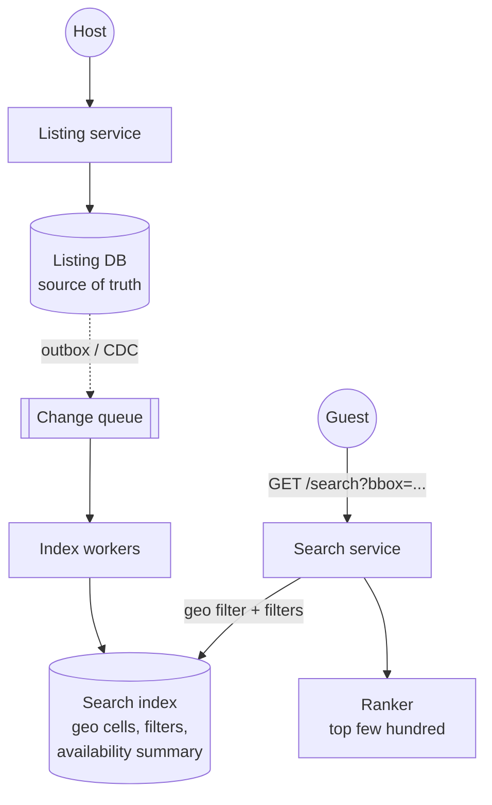
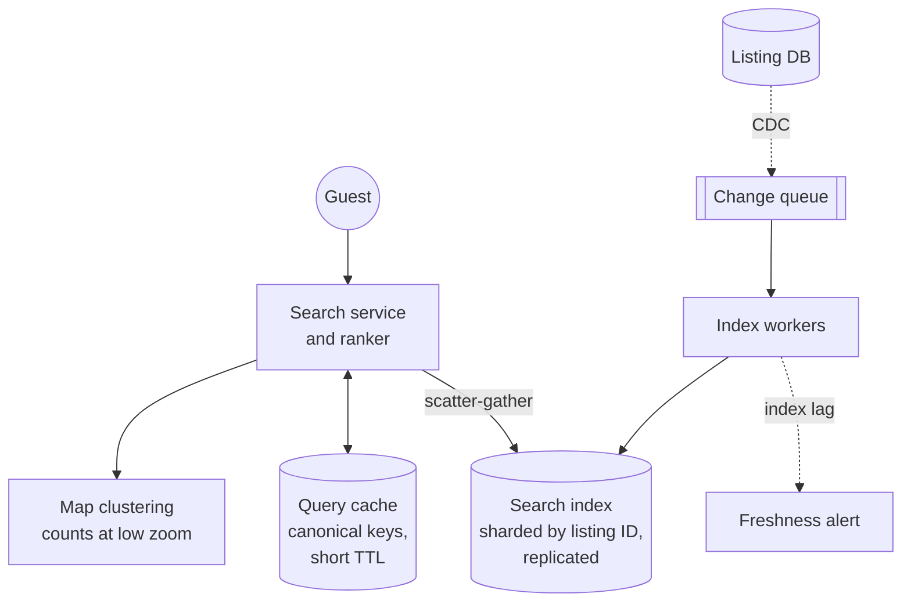
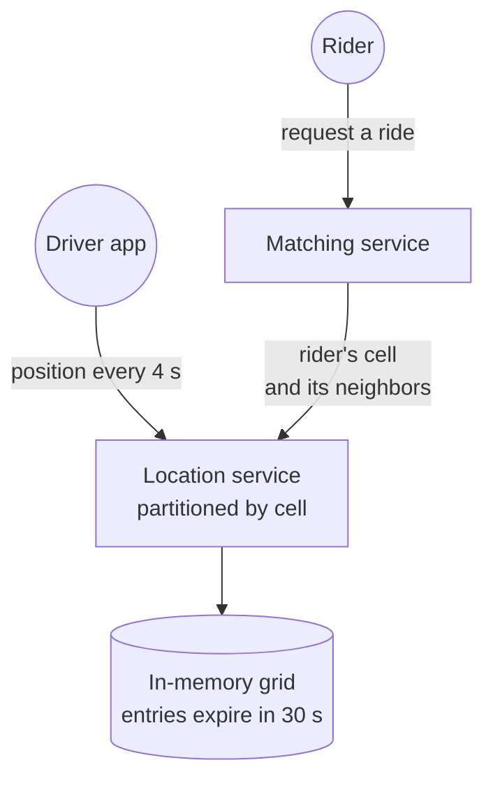

Two flavors share a core: **static places** (listings, restaurants: search by map area plus filters) and **moving objects** (drivers: find the nearest). I'll design the listing search, then show what changes for drivers.

**Requirements.** Functional: search listings by location (a city or map viewport), dates, guests, price and amenities; ranked results with pagination; listings added and edited by hosts. Non-functional: results under 300 ms; search may lag the source of truth by seconds; handles dense cities and sparse regions; high availability.

**Estimates.** 10M listings × ~2 KB of searchable fields = 20 GB of core search data, [small enough to hold in memory on every search node](#/design/learn/building-blocks/estimation-and-benchmarks), so it can be replicated; the load is the issue. 100M searches/day ≈ 1,200/s average, 5,000/s peak, which at hundreds to a few thousand queries/s per search node means several replicas. Index updates: price/availability changes and edits maybe 100/s. So: read-heavy, small data, many filters.

**API.** `GET /search?bbox=...&check_in&check_out&guests&price_max&amenities&sort&cursor` → `{listings[], next_cursor}`. Use [cursor pagination](#/design/learn/networking/pagination-offset-vs-cursor); keep a search session token so results stay stable while paging.

**Design.**

1. **Source of truth:** the listing database (relational). Changes flow out through the [outbox/CDC](#/design/learn/reliability/the-outbox-pattern) to a queue.
2. **Search index:** Elasticsearch/OpenSearch (or a similar engine) holds [a denormalized document per listing](#/design/learn/reliability/read-models-and-search-indexes): location (as a geo point and as [geohash/S2 cell IDs](#/design/learn/building-blocks/geohash)), price, amenities, ratings, capacity, and a compact availability summary. Updated asynchronously by index workers; eventually consistent.
3. **Query path:** the search service turns the viewport into a geo filter (cells overlapping the bounding box, or the engine's geo-bounding-box), applies filters (price, guests, amenities) as structured filters, then ranks the candidates and returns a page.
4. **Availability:** the hard part. Dates change the result set per query. Options: (a) store a bitmap or interval list of free nights in each document and filter on it; (b) run the search ignoring dates, then check availability for the top few hundred candidates in a calendar service; (c) precompute availability per listing for the next N months. Mention (a)/(c) for speed and (b) as the simple start. Treat the result as optimistic; the booking transaction is final (see the booking question).
5. **Ranking:** a score from relevance, quality (ratings, response rate), price competitiveness, distance from the viewport center, and personalization, tuned by experiments. Start with a rule-based scorer; add a learned ranker over the top few hundred candidates later.

**Deep dives.**

1. **[Geo indexing choices](#/design/learn/building-blocks/geospatial-indexes-compared).** Geohash or S2 cells in [an inverted index](#/design/learn/building-blocks/inverted-indexes) make "which cells overlap this box" a set of term lookups; [a quadtree](#/design/learn/building-blocks/quadtrees) adapts to density; the engine's built-in BKD-tree geo index is usually enough and avoids building your own. Pick the precision from the viewport size, [query the covering cells](#/design/learn/building-blocks/nearby-search), and filter by exact bounds. Handle viewport crossing the antimeridian and poles by splitting the box.
2. **Density skew.** Manhattan has 50,000 listings in a viewport, a rural area has 5. Don't return everything: rank and return the top N, and for map view cluster results server-side (grid or geohash prefix aggregation) into counts at low zoom levels.
3. **Sharding the index.** Shard by listing ID (even load; every query [scatter-gathers across shards](#/design/learn/data/secondary-indexes-on-sharded-data) and merges) or [by geography](#/design/learn/building-blocks/sharding-by-location) (queries touch few shards but dense cities become hot shards). Most systems shard by ID with replicas, and cache popular queries (city + default filters) for a short TTL.
4. **Freshness.** Price or availability changes should reach the index within seconds; a lag metric on the pipeline is essential. A stale "available" result costs one disappointed click, not a double booking.
5. **Caching.** Cache common queries and viewport tiles (a popular city's first page) with short TTLs; [keep keys canonical](#/design/learn/building-blocks/cache-control-headers-and-cache-keys) (rounded viewport, sorted filters) so hit rates are high.

**The design after the deep dives.** Green marks what they added or changed.

**Variant: nearest drivers (ride-hailing).** Locations change every few seconds, so a disk-backed index is the wrong tool. [Keep driver positions in memory](#/design/learn/building-blocks/moving-objects) (Redis geo, or a service holding an in-memory grid) partitioned by cell. Each driver app sends a location update every 4–5 seconds (about 1M drivers → 200,000–250,000 writes/s, a few in-memory shards at ~100K writes/s each), which overwrites the previous entry and expires with a TTL. A ride request queries the rider's cell and neighbors, filters by distance and availability, and hands candidates to a matching service. Use the same cell grid to shard the service so most queries touch one or two partitions.

**Wrap-up.** Metrics: search latency p99, zero-result rate, index lag, conversion. Failure: if the search cluster degrades, [serve cached popular results](#/design/learn/reliability/graceful-degradation) and a simplified query path.
