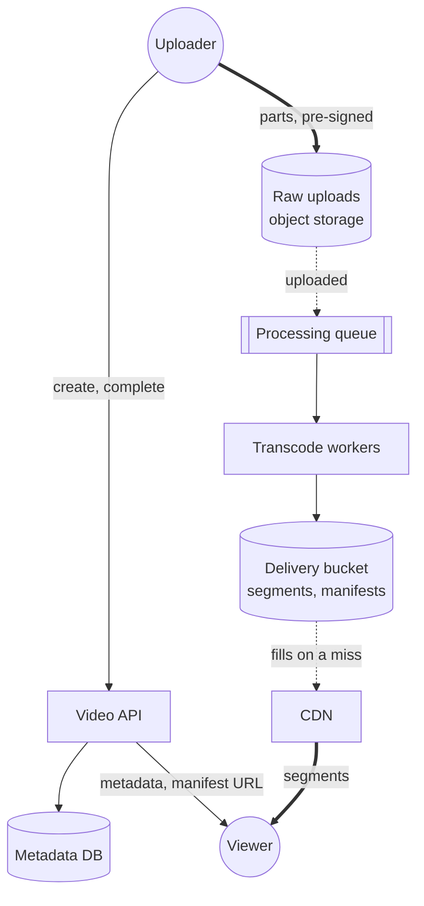
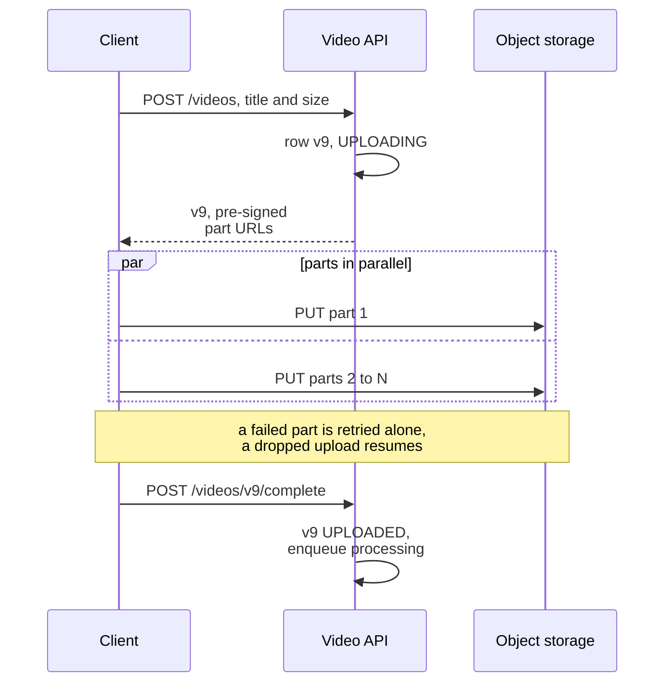
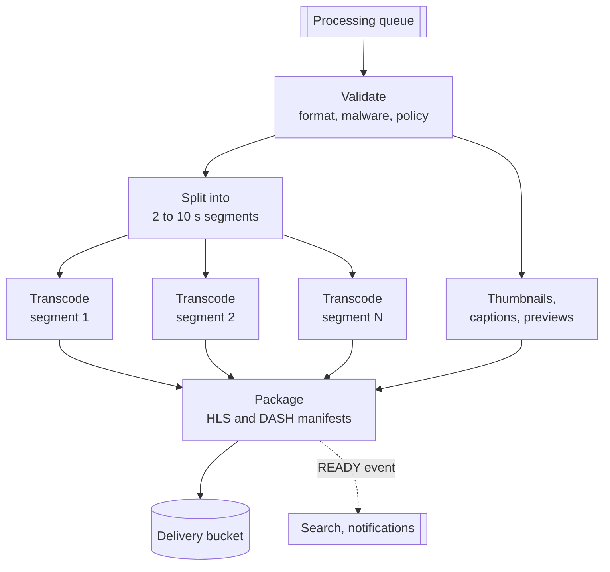
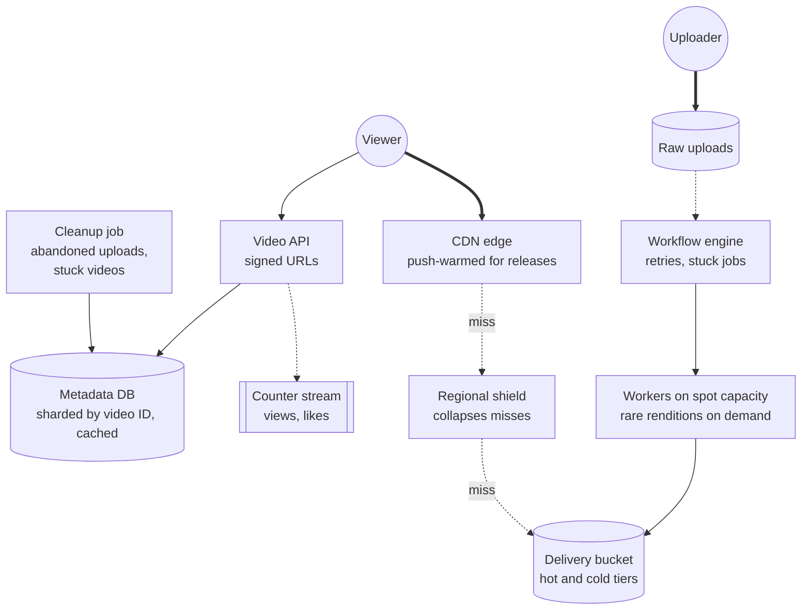
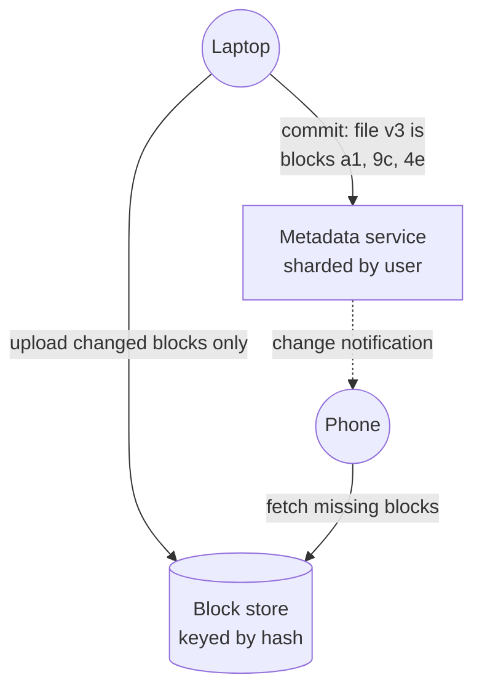

Two related questions: **video platform** (upload, process, stream globally) and **file sync**. I'll design the video platform, then note the sync differences.

**Requirements.** Functional: upload videos (up to several GB); process into streamable formats; watch with adaptive quality on any device; metadata, search and recommendations are out of scope except a metadata API. Non-functional: uploads survive flaky networks; playback starts in under 2 seconds with little rebuffering; global; very high availability for playback; processing can take minutes.

**Estimates.** 5M uploads/day (≈ 60/s), average 300 MB raw = 1.5 PB/day raw. Keeping the original plus ~6 renditions (the full ladder is about twice the top rendition) brings that to roughly 3x, about 4.5 PB/day. Playback: 1B views/day ≈ 12,000 starts/s; at ~10 minutes watched per view that is about 7M streams at once, × 5 Mbps average ≈ 35 Tbps, more at peak: [thousands of servers' worth of 10–25 Gbps network cards](#/design/learn/building-blocks/estimation-and-benchmarks). Conclusion: bandwidth and storage dominate cost, so the CDN carries nearly all playback and [uploads must bypass application servers](#/design/learn/building-blocks/presigned-url-uploads).

**API.**

- `POST /videos {title, size, content_type}` → `{video_id, upload_session_url}` (pre-signed, [multipart/resumable](#/design/learn/building-blocks/multipart-and-resumable-uploads))
- Client uploads parts directly to object storage; `POST /videos/{id}/complete`.
- `GET /videos/{id}` → metadata and the manifest URL; the player fetches the manifest (HLS `.m3u8` / DASH `.mpd`) and then segments from the CDN.

**High-level design.** Three paths share the metadata database: uploads go straight to object storage, a queue drives processing, and the CDN serves playback.

**Upload path.**

1. Client requests an upload session; the server [creates a metadata row](#/design/learn/building-blocks/upload-states-and-cleanup) (`UPLOADING`) and returns a pre-signed multipart or resumable URL.
2. The client splits the file into chunks (say 8–50 MB), uploads in parallel, retries only failed chunks, and resumes after a dropped connection. Checksums verify each chunk.
3. When complete, object storage emits an event (or the client calls `complete`), and the row becomes `UPLOADED`; a message goes onto a processing queue.

**Processing pipeline ([an async DAG on queues](#/design/learn/building-blocks/when-to-use-a-queue)).**

1. **Validate** (format, size, malware scan, policy checks).
2. **Split** the video into segments (about 2–10 s each) so transcoding parallelizes across many workers.
3. **Transcode** each segment into multiple resolutions and bitrates (240p to 4K) and codecs (H.264 for compatibility, VP9/AV1 where it saves bandwidth), plus audio tracks.
4. **Generate** thumbnails, captions (speech-to-text) and previews.
5. **Package** segments plus manifests (HLS/DASH) into the delivery bucket, then mark `READY` and publish an event for search indexing and notifications.

[Workers are stateless and idempotent](#/design/learn/reliability/naturally-idempotent-operations) (same input segment produces the same output key, so retries are safe); [a workflow engine](#/design/learn/reliability/orchestration-vs-choreography) tracks the DAG, retries failed tasks and surfaces stuck jobs. Use autoscaled workers (cheap spot capacity is fine since tasks are retryable) and a priority queue (short videos or partners first).

**Playback.**

[Adaptive bitrate streaming](#/design/learn/building-blocks/video-processing-and-adaptive-bitrate): the player downloads the manifest listing renditions, measures throughput, and requests segments at the best quality it can sustain, switching mid-stream. Because it's just HTTP file fetches, [the CDN caches every segment](#/design/learn/building-blocks/what-to-put-on-a-cdn) like any static asset.

**Deep dives.**

1. **[CDN strategy](#/design/learn/building-blocks/cdns-and-edge-caching).** Popular videos (the head) are cached at the edge nearly always; the long tail misses to a regional shield and then to origin storage. [Push-warm the edge](#/design/learn/building-blocks/pull-vs-push-cdns) for known releases. Tiered storage moves old, rarely watched videos to cheaper storage classes and may keep fewer renditions.
2. **Hot content.** A viral video makes one object extremely hot; CDNs replicate it automatically, and the shield tier [collapses simultaneous misses](#/design/learn/building-blocks/cache-failure-modes) so origin sees one request per segment.
3. **Metadata store.** A relational or key-value [store for video metadata](#/design/learn/data/metadata-and-blobs), sharded by video ID with cache in front; counters (views, likes) written to a stream and aggregated asynchronously, since exact real-time counts aren't needed.
4. **Reliability of uploads.** The metadata row's status is the source of truth. A cleanup job aborts abandoned multipart uploads and detects `UPLOADED` videos with no processing result after a timeout to re-enqueue them.
5. **Cost control.** Transcode lazily (generate rarely used renditions only when first requested), choose codecs by popularity, and dedupe identical uploads by content hash.
6. **Content safety and DRM.** Moderation in the pipeline; [signed URLs or tokens](#/design/learn/building-blocks/serving-downloads) for private or paid content; encrypted segments for DRM.

**The design after the deep dives.** Green marks what they added or changed.

**Variant: file sync.** Split files into content-addressed blocks (about 4 MB, keyed by hash), so only changed blocks upload and identical blocks dedupe across users. A metadata service stores each file as an ordered list of block hashes with a version number; clients keep a local database and poll or hold a long connection for change notifications, then fetch the delta. Conflicts (two devices edit offline) are resolved by [keeping both versions as conflicted copies](#/design/learn/data/version-vectors-and-siblings) rather than silently overwriting. The block store is object storage; metadata is a strongly consistent database sharded by user.

**Wrap-up.** Metrics: upload success rate, time from upload to ready, time to first frame, rebuffer ratio, CDN hit ratio, cost per hour of video.
