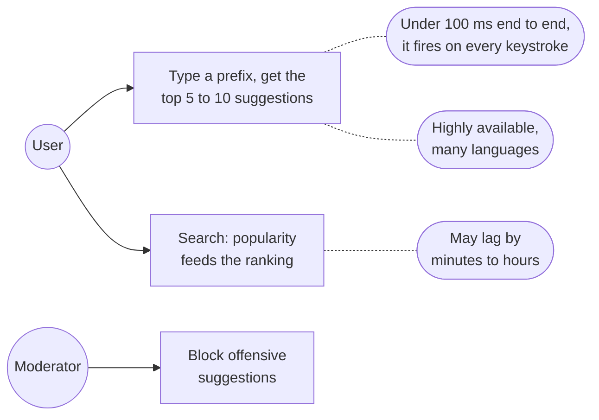
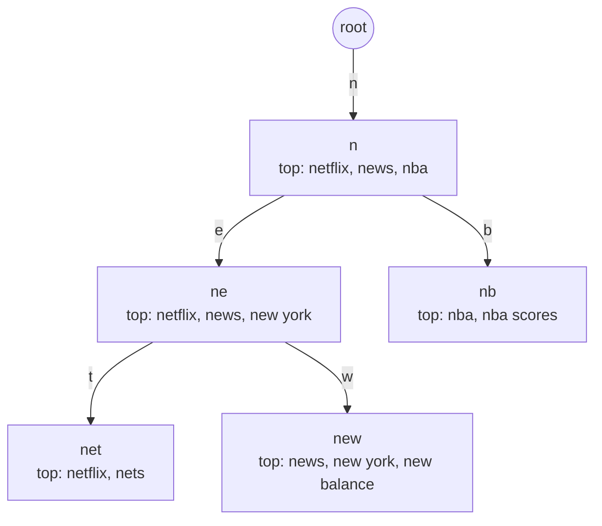
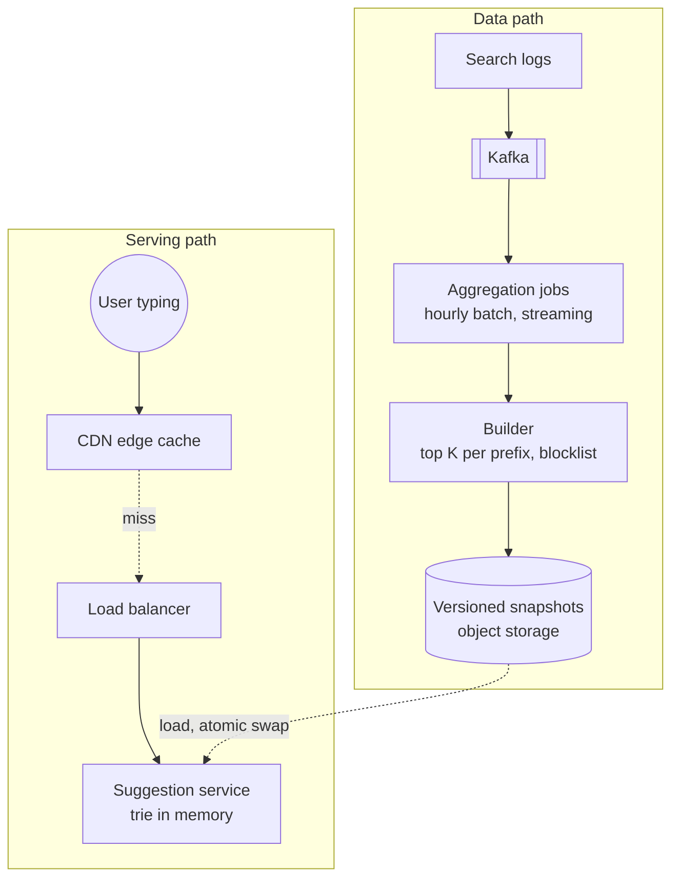
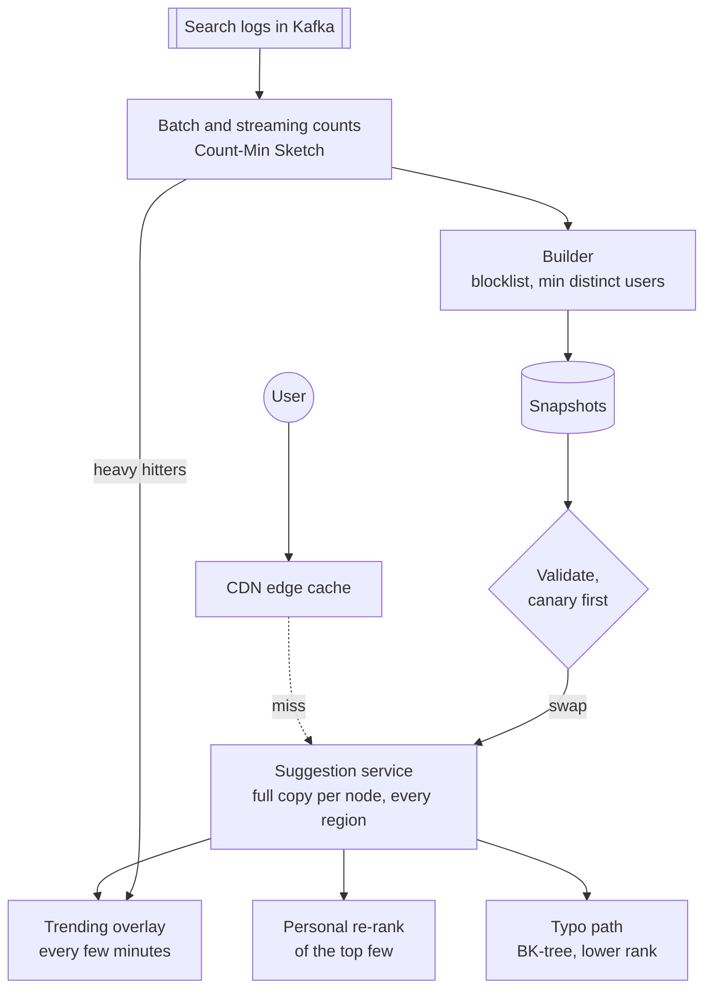

**Requirements.** Functional: as the user types a prefix, return the top 5–10 suggested queries, ranked by popularity (and optionally personalization and freshness); support multiple languages; filter offensive or blocked suggestions. Non-functional: very low latency ([under 100 ms end to end](#/design/learn/networking/round-trips-and-latency-budgets), ideally under 50 ms server-side, since it fires on each keystroke); high availability; suggestions may lag real search activity by minutes to hours (eventual consistency is fine).

Amber marks the non-functional requirements, each beside the operation it constrains.



**Estimates.** 500M DAU × 5 searches/day × ~4 requests per search (keystroke bursts, debounced) ≈ 10B requests/day ≈ 115,000/s average, 300,000/s peak. Query log: 2.5B searches/day, but only a few hundred million distinct queries matter. The suggestion corpus (top queries worth suggesting) is perhaps 100M strings × ~30 bytes ≈ 3 GB, which [fits in memory on every serving node](#/design/learn/building-blocks/estimation-and-benchmarks). Throughput, not size, sets the node count: at up to 10,000 requests/s per node, 300,000/s peak needs about 30 nodes, fewer once the edge caches short prefixes. So: a read-only, memory-resident lookup, refreshed periodically.

**API.** One tiny read, called on nearly every keystroke, so it is designed to be cached:

```text
GET /v1/suggest?q=new%20yo&limit=8&locale=en-US
  -> 200 {q: "new yo",
          suggestions: ["new york",
                        "new york times",
                        "new york weather"]}
```

- **Everything that changes the answer is in the URL** (prefix, locale, limit), not in headers or cookies, so browsers and the CDN can use the URL as the [cache key](#/design/learn/building-blocks/cache-control-headers-and-cache-keys). The global list is sent with `Cache-Control: public, max-age=300`.
- **Normalize `q`** on the client and again on the server: lower case, trimmed, repeated spaces collapsed, Unicode normalized. Then "New  York" and "new york" share one cache entry and one trie lookup.
- **The response echoes `q`.** Responses can arrive out of order (the one for "ne" after the one for "new"), so the client shows a response only if its `q` still matches the text box.
- **Clients** wait about 100 ms after the last keystroke, cancel the request in flight when a new one starts, and [cache responses locally by prefix](#/design/learn/networking/http-caching).
- **Personal suggestions** (the user's own recent searches, deep dive 1) make a response `private`, so it skips the CDN. Keep that path cheap: the app can merge the user's recent searches on the device and leave the server's list global and cacheable.
- **Limits.** `limit` is capped at 10 and `q` at about 100 characters. An empty `q` returns trending searches or nothing, a product choice.
- **Failure is silent.** An error, a timeout or a `429` just hides the dropdown; the search box never waits for suggestions ([graceful degradation](#/design/learn/reliability/graceful-degradation)).
- **No feedback endpoint.** The search request records how it started (`?source=suggest&pos=2`), which gives the acceptance-rate metric without an extra call.

**Core data structure.** A **[trie](#/design/learn/building-blocks/autocomplete-and-typeahead)** (prefix tree) where each node represents a prefix. To answer quickly, each node stores its **top-K completions** (K around 10) precomputed, so a lookup is O(length of prefix) with no subtree traversal. Memory trick: store only popular completions per node, compress chains of single-child nodes (a radix tree), and cut the trie at a depth limit and a minimum frequency.



Alternative: [an inverted-index style table](#/design/learn/building-blocks/inverted-indexes) `prefix → top-K list` generated offline for every prefix of every popular query (a key-value store keyed by prefix). Simpler to serve (one key lookup, trivially cacheable and shardable) at the cost of more storage; most production systems end up here.

**High-level design: two paths.**

- **Serving path (online):** client → CDN/edge cache → load balancer → suggestion service → in-memory trie or prefix-key store (and optionally a personalization layer). The popular prefixes (the first one to three characters cover a huge share of traffic) are served from cache with short TTLs, [even at the CDN](#/design/learn/building-blocks/cdns-and-edge-caching).
- **Data path (offline/near-line):** search logs stream into Kafka → [aggregation jobs](#/design/learn/building-blocks/batch-vs-stream-processing) (batch hourly/daily, plus a streaming job for trending terms) count query frequencies [over time windows](#/design/learn/building-blocks/event-time-windows-and-watermarks) → a builder produces the top-K per prefix, filters blocked content → publishes a new versioned snapshot to object storage → serving nodes load it and [atomically swap](#/design/learn/reliability/atomic-snapshot-swaps).



**Deep dives.**

1. **Ranking.** Score by frequency with recency decay (so last week's trending topic outranks last year's), optionally boosted by location, language and the user's own history. Keep the global candidate list from the trie and re-rank a handful with personal signals at request time. [Count-Min Sketch](#/design/learn/building-blocks/count-min-sketch) with a heap handles [heavy-hitter detection](#/design/learn/building-blocks/top-k-heavy-hitters) in the streaming path without storing every query.
2. **Freshness.** Rebuilding the whole structure hourly is fine for most queries. For breaking news, a small "trending" overlay updated every few minutes is merged at query time. Don't update the main trie in place; rebuild and swap, so reads are lock-free.
3. **Sharding.** The corpus fits one machine, so shard for throughput, not capacity: replicate the full structure on many nodes behind a load balancer. If it ever outgrew memory, [shard by first characters of the prefix](#/design/learn/data/partitioning-strategies), with attention to skew (many more queries start with "s" than "x"), using a prefix-range map with rebalancing.
4. **Latency.** Memory-resident lookups take microseconds; the budget is mostly network. Put suggestion servers near users (regional deployments), [reuse connections (HTTP/2)](#/design/learn/networking/http-versions), keep payloads tiny, and let the browser cache each prefix's answer for a short period.
5. **Typos and fuzzy matching.** Prefix match handles only exact beginnings. For misspellings, [add edit-distance candidates](#/design/learn/building-blocks/typos-filters-and-pagination) (BK-tree, or n-gram index) as a secondary path with lower rank.
6. **Safety.** Blocklists applied in the offline build and again at serve time; never suggest private queries (aggregate across many users, require a minimum number of distinct users per suggestion to protect privacy).
7. **Failure.** If the service is down, the search box still works; [degrade by returning no suggestions](#/design/learn/reliability/graceful-degradation) (fail silently) or a cached top list. Serving nodes keep the last good snapshot if a new build is corrupt, and snapshots are validated (size, sample queries) before rollout, with [canary nodes first](#/design/learn/reliability/rollout-strategies).

**The design after the deep dives.** Green marks what they added or changed.



**Wrap-up.** Metrics: suggestion latency p99, cache hit rate, suggestion acceptance rate (the product metric: how often users pick a suggestion), snapshot age. Scaling 10x: more replicas and cache layers; the data size barely changes.
