# Networking and APIs

How a request travels from a user's device to your servers and back, which protocol to draw on each arrow, and how to design APIs that are safe to retry, page through and change. Every section gives the costs and the trade-off to say out loud, with reference material on TCP, HTTP and TLS at the end for when an interviewer pushes further.

## Life of a request

"What happens when you type a URL and press Enter?" is still a common warm-up, and the answer is
also the top half of every design diagram. Know the steps, and roughly what each one costs.

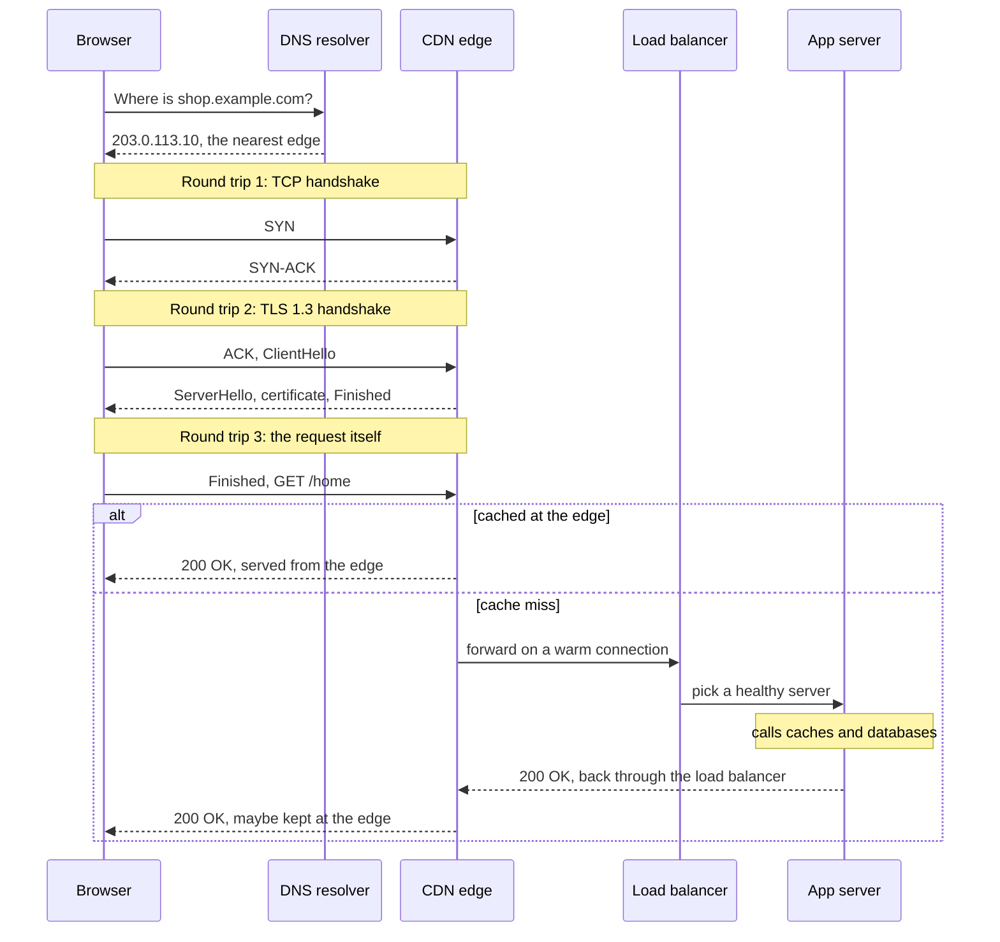

Notice that the browser can't even send its request until two round trips have passed: on a new
connection, the handshakes cost more than the request itself.

| Step | What happens | Typical cost |
|---|---|---|
| DNS lookup | The name becomes an IP address. DNS can also pick the user's nearest region. | Nearly free when cached by the browser or OS; 20–100 ms when not |
| TCP handshake | SYN, SYN-ACK, ACK opens a reliable connection. | 1 round trip |
| TLS handshake | Client and server agree on keys; the server proves who it is with a certificate. | 1 round trip with TLS 1.3, 2 with TLS 1.2 |
| CDN or edge | A server near the user returns static files and cached responses. | A cache hit ends the trip here |
| Load balancer | Picks a healthy server, and often terminates TLS so the servers don't have to. | Under 1 ms |
| App server | Runs your code, which calls caches, databases and other services. | About 1 ms per cache call, 1–10 ms per indexed query, more per extra service |
| Response | Travels back the same way; the CDN may keep a copy. | Part of the request's round trip |

Reused connections skip the TCP and TLS steps entirely. That is why **keep-alive** (holding a
connection open between requests) and **connection pooling** (a server sharing a set of open
connections across its requests) matter so much.

### Round trips and latency budgets

A **round trip** is the time for a message to reach the other side and for the reply to come back.
Light in fiber covers about 200,000 km per second, so every 100 km between client and server adds
about 1 ms of round trip, and real cable routes are longer than a straight line.

| Path | Typical round trip |
|---|---|
| Within one data center | ~0.5 ms |
| Between zones of one cloud region | 1–2 ms |
| User to a nearby CDN edge | 5–30 ms, plus tens of ms on a mobile network |
| Across a continent | 40–80 ms |
| Across the Atlantic | 70–90 ms |
| Across the Pacific, or Europe to Asia | 100–250 ms |

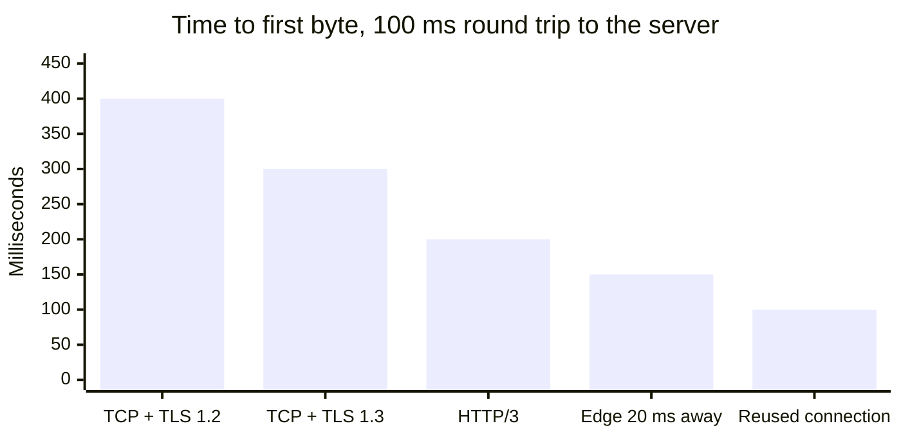

Notice that reusing a connection saves more than any protocol upgrade, and that a nearby edge helps
even when nothing is cached: the handshakes happen over the short hop to the edge, which already
holds a warm connection to your servers.

A **latency budget** splits a target, such as "suggestions within 100 ms of a keystroke", across
the hops a request makes. Writing one down shows where the time really goes:

| Hop | Budget |
|---|---|
| User to the nearest region and back | 40–50 ms |
| Load balancer and gateway | 1–2 ms |
| Service logic | 5–10 ms |
| Cache or index lookup | 1–5 ms |
| Headroom for the slow tail (p99) | The rest |

Each internal service hop adds about 1 ms plus the callee's own work, so five calls made one after
another eat a tight budget fast: make independent calls in parallel.

The cheapest request is the one the client never sends. For type-ahead features, **debounce** (send
only after about 100 ms without a keystroke), cancel in-flight requests the user has already typed
past, and cache each answer on the device by its query.

> **Key idea.** Half of a typical budget is distance, and no code optimization wins it back. The
> standard fixes are geographic: CDNs and edge locations, regional deployments, and reused
> connections, so each request pays one round trip instead of three.

## Transport and HTTP versions

Two choices sit under every arrow you draw: the transport (TCP or UDP) and the HTTP version on top
of it. One sentence usually covers both: "Clients talk to us over HTTP/2 or HTTP/3 through the CDN
and load balancer; internal services use gRPC, which runs on HTTP/2." Go deeper only when the
problem is latency-sensitive or mobile-heavy.

### TCP or UDP

**TCP** delivers every byte, in order, or tells you the connection failed. **UDP** just sends
packets: no handshake, no retransmission, no ordering. Default to TCP; almost everything in a design
runs on it. Choose UDP only when a late packet is worse than a lost one, and let the application
handle loss itself, for example by skipping a dropped audio frame.

| Traffic | Transport | Why |
|---|---|---|
| Web pages, APIs, gRPC, database connections | TCP, or QUIC for HTTP/3 | Every byte must arrive, in order |
| Video on demand and live broadcasts | HTTP over TCP or QUIC, in short segments (HLS, DASH) | A few seconds of buffer hides retransmissions, and segments cache well on CDNs |
| Video and voice calls | UDP, through WebRTC | A late audio packet is useless; play the next one instead |
| Fast-paced multiplayer games | UDP | Only the newest position matters |
| DNS lookups | UDP, with TCP for large answers | One small question and answer; a handshake would double the cost |

> **Pitfall.** "It's live video, so UDP" is a common slip. A live stream watched by thousands is cut
> into HTTP segments a few seconds long and served from a CDN, and the player picks a quality for
> each segment from the bandwidth it measures (adaptive bitrate). Only interactive calls need UDP.

### HTTP versions

| Version | Runs on | Requests on one connection | When a packet is lost | New connection |
|---|---|---|---|---|
| HTTP/1.1 | TCP | One at a time, so browsers open about 6 connections per host | That connection waits | TCP + TLS 1.3: 2 round trips before the request |
| HTTP/2 | TCP | Many at once, interleaved as streams | Every stream waits for the retransmission | Same as HTTP/1.1 |
| HTTP/3 | QUIC, over UDP | Many at once, as independent streams | Only the stream that lost data waits | 1 round trip (0 when resuming), and it survives a switch from Wi-Fi to mobile |

```intervals
HTTP/1.1: [0,1] [1,2] [2,3]
HTTP/2: [0,1] [0,1] [0,1]
HTTP/2, packet lost: [0,2] [0,2] [0,2]
HTTP/3, packet lost: [0,2] [0,1] [0,1]
caption: three requests on one connection, time in round trips
```

Notice that HTTP/2 fixes the queueing of HTTP/1.1 but not the loss problem: TCP hands bytes to the
application strictly in order, so one lost packet holds up every stream behind it. QUIC tracks loss
per stream, which is why HTTP/3 helps most on lossy mobile networks. Some networks block UDP, so
HTTP/3 clients fall back to HTTP/2.

## The edge and gateway layer

Between the user and your services sit several layers that often get drawn as one box. Know what
each does, so you can say which one you mean.

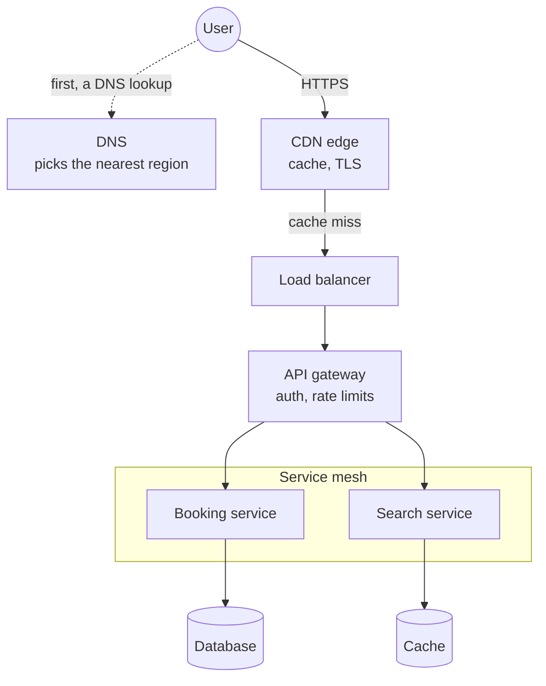

Notice that the CDN, the load balancer and the gateway are three boxes with three jobs: serving
from near the user, spreading load across healthy servers, and enforcing API policy. "The load
balancer checks the token" usually means the gateway.

### DNS as a routing tool

DNS does more than turn names into IP addresses. Because the answer can depend on who is asking, it
is the first and cheapest routing layer you have.

- **Routing policies.** Answer with the nearest region (by geography or measured latency), split
  traffic by weight (send 5% to a new region during a migration), or fail over to a healthy region
  when health checks fail.
- **TTL trade-off.** The TTL (time to live) says how long resolvers may cache an answer. A short TTL
  (30–60 s) lets you move traffic within minutes during an outage, at the cost of more lookups; a
  long one (hours) is cheaper but slow to change. Some resolvers and clients ignore TTLs, so DNS
  failover is never instant: expect a tail of traffic on the old address.
- **Anycast.** Many locations announce the same IP address, and internet routing delivers each
  user's packets to the nearest one. CDNs and public DNS resolvers rely on it: one address, hundreds
  of locations, and when a location fails its route is withdrawn and traffic flows to the next one.

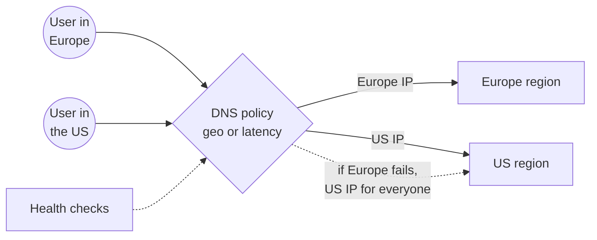

Notice that DNS only hands out an address and never sees the request itself. It can steer users to
a region, but spreading load across the servers in that region is the load balancer's job.

### Proxies

A proxy relays traffic on someone else's behalf. Which side it acts for is the whole difference:

| | Forward proxy | Reverse proxy |
|---|---|---|
| Acts for | Clients | Servers |
| Sits | In the client's network, in front of the internet | In front of your servers |
| Typical jobs | Filter and log outbound traffic, cache | Terminate TLS, compress, cache, route, load balance |
| Example | A corporate outbound proxy | Nginx, Envoy, HAProxy |

A layer 7 load balancer (one that reads HTTP) is a kind of reverse proxy. Load balancing itself is
covered in [Building blocks](#/design/learn/building-blocks).

### API gateway

The single entry point for external API traffic. Its typical jobs: authenticate (validate tokens and
API keys), rate limit, route each request to the right service, validate requests, and log and
trace. Sometimes it also aggregates several backend responses into one.

> **Pitfall.** Keep business logic out of the gateway. Every team would then have to change and
> deploy it, and it becomes everyone's bottleneck. Cross-cutting checks only.

### Backend for frontend (BFF)

A BFF is a small service per client type (web, mobile) that calls the backend services and returns
exactly what that client's screens need, in one response. It is the main alternative to
[GraphQL](#/design/learn/networking/when-to-choose-graphql): simpler to run, at the cost of some
duplicated code across BFFs.

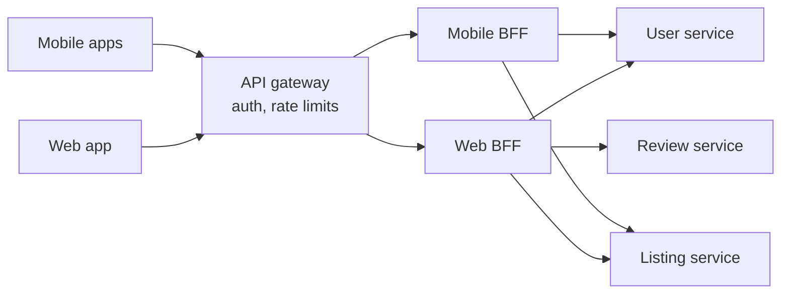

Notice the split: the gateway applies the same checks to every client, while each BFF shapes one
client's screens out of several services.

### Service mesh

For internal traffic, a service mesh puts a **sidecar proxy** next to every service instance. The
proxies handle mTLS (mutual TLS, where both sides prove their identity with certificates), retries,
timeouts, load balancing and tracing, so application code doesn't have to. A control plane such as
Istio or Linkerd pushes configuration and certificates to them.

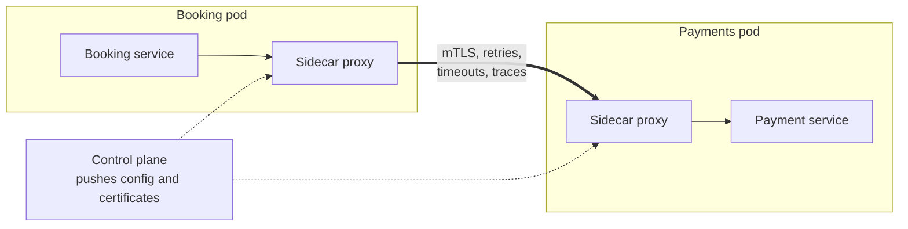

Notice that each service talks only to its own sidecar, on the same machine; encryption, retries
and tracing happen between the proxies, so no application code changes.

Worth mentioning when there are dozens of services; overkill for a handful, since every call gains a
proxy hop and the mesh itself has to be operated.

## Real-time communication

Chat, notifications, live location, collaborative editing and streamed AI responses all need the
server to send data the client didn't just ask for. Plain HTTP can't: the server only speaks when
spoken to. Pick the simplest option that meets the latency need.

| Option | How it works | Direction | Use it for |
|---|---|---|---|
| Short polling | Client asks every N seconds | Client pulls | Rare updates where seconds of delay are fine (order status) |
| Long polling | Server holds each request until there's news, then the client asks again | Server to client | A fallback when nothing better gets through |
| Server-Sent Events (SSE) | One long-lived HTTP response streams events | Server to client only | Notifications, live scores, streamed LLM tokens |
| WebSockets | An HTTP connection upgraded to a persistent two-way channel | Both ways | Chat, multiplayer, collaborative editing, live driver location |
| WebRTC | Peer-to-peer media over UDP; servers only for setup and relay | Both ways, peer to peer | Video and voice calls |

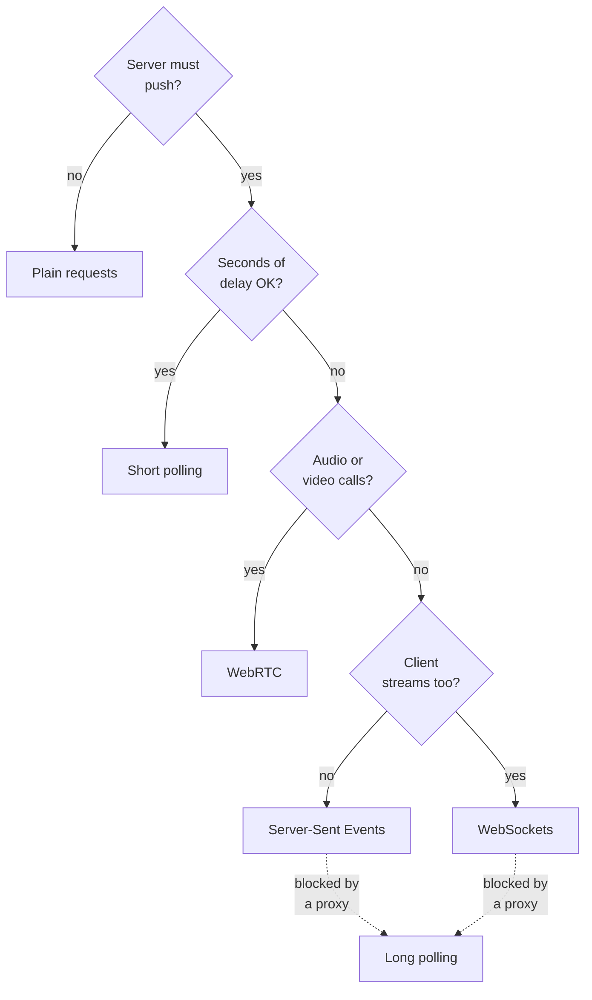

Notice that WebSockets are only needed when the client streams too. One-way updates are simpler
with SSE, which is plain HTTP and works with the infrastructure you already have.

### Short polling

The client asks "anything new?" on a timer. It is simple, stateless and works everywhere, but most
answers are "no", and news waits up to a full interval. The cost grows with clients, not with
events: 1 million clients polling every 5 seconds is 200,000 requests per second, nearly all of them
empty. Use it when updates are rare and a few seconds of delay is fine.

### Long polling

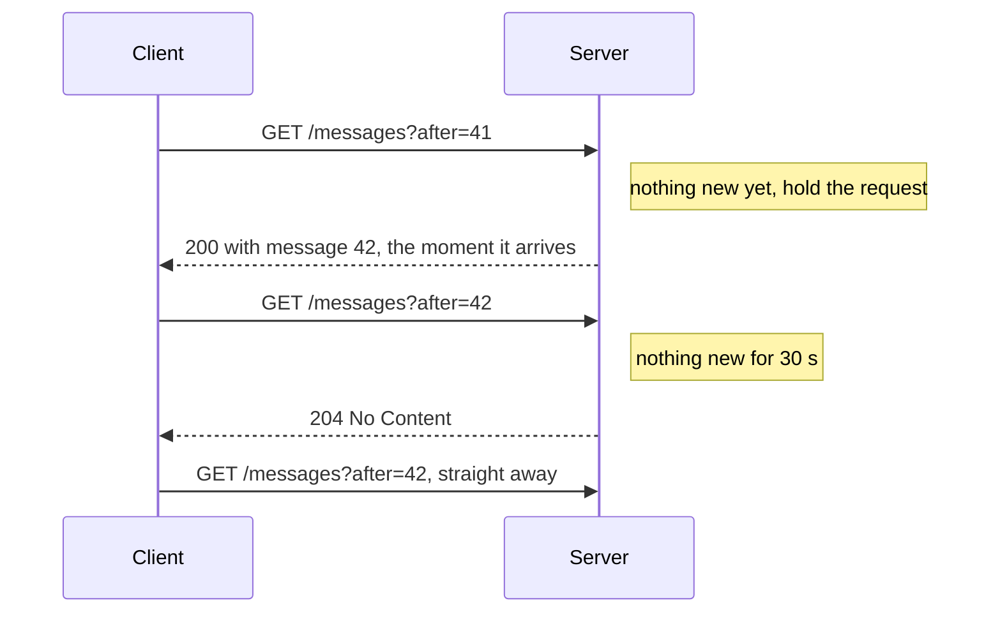

Notice the `after=` parameter: a message that arrives between two polls isn't lost, because each
request asks for everything after the last message seen.

The server holds the request open (typically 20–30 s, under the load balancer's idle timeout) until
there is news or the time runs out, and the client asks again at once. It works through any proxy,
because it is ordinary HTTP. But every message costs a full request with headers, and each waiting
client holds a connection. Today it is mainly a fallback for when SSE or WebSockets are blocked.

### Server-Sent Events (SSE)

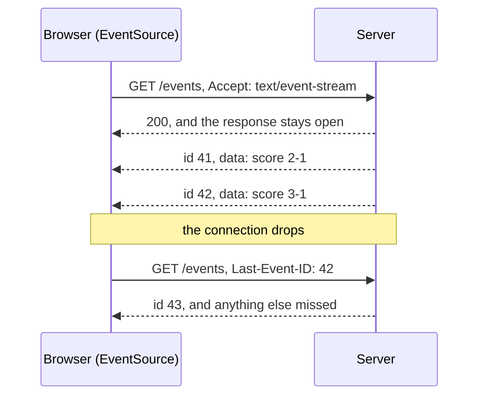

Notice that reconnecting and catching up are built in: the browser's `EventSource` reconnects on its
own and sends `Last-Event-ID`, so the server can replay what was missed.

SSE is a normal HTTP response with `Content-Type: text/event-stream` that never ends; the server
writes events into it as they happen. It is one-way (the client sends anything back as ordinary
requests), text only, and passes through most proxies as long as they don't buffer the response. One
catch: over HTTP/1.1 a browser allows only about 6 connections per domain, shared by all its tabs,
so serve SSE over HTTP/2. It is the natural fit for notifications, live scores and streaming LLM
tokens.

### WebSockets

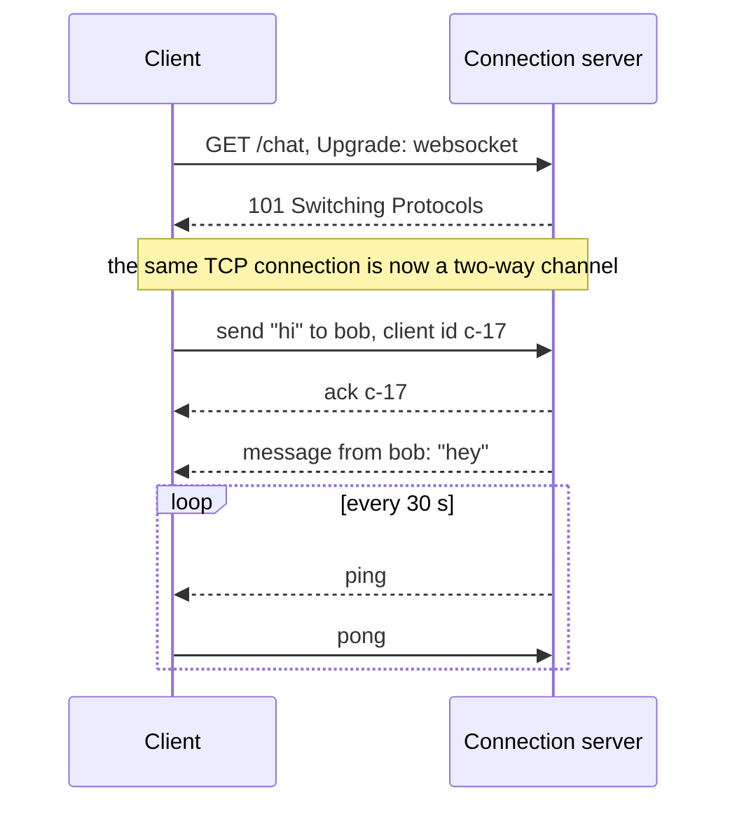

Notice that it starts as an ordinary HTTP request, which is how it gets through load balancers and
firewalls; after the `101`, either side can send at any time.

Each message costs a 2–14 byte frame header instead of hundreds of bytes of HTTP headers. The price
is state: every connection is pinned to one server, load balancers need long idle timeouts, and the
protocol gives you no acknowledgements, no resume and no ordering across reconnects. You build those
yourself with message IDs, acks and "send me everything since X", as in
[scaling WebSockets](#/design/learn/networking/scaling-websockets).

### WebRTC

WebRTC sends audio, video and data directly between browsers or apps over UDP. Your servers do three
supporting jobs: a **signaling** server (often a WebSocket) lets the peers exchange connection
details, a **STUN** server tells each peer its public address behind NAT, and a **TURN** server
relays the media when no direct path works.

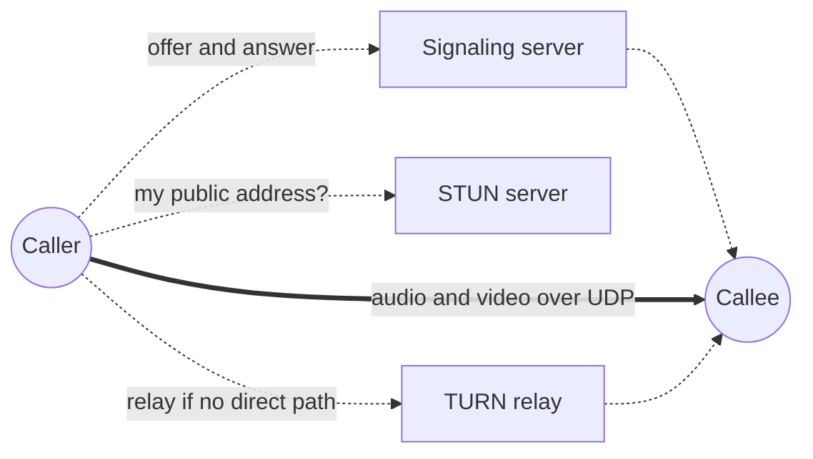

Notice that your servers carry only the setup messages; the media flows peer to peer unless a
firewall forces it through the relay.

A direct mesh breaks down beyond a handful of people, because each one uploads a copy of their
stream to every other. Group calls send one stream to a media server (an SFU, selective forwarding
unit) that forwards it to everyone else.

### Scaling WebSockets

This is the usual follow-up. Each connection is pinned to one server, so a message for user B has
to find the server holding B's connection. The standard design:

- **Connection servers** (gateways) that only hold sockets: they authenticate on connect, then pass
  messages in and out. Keeping logic out of them makes them cheap to restart.
- **A registry** (for example Redis) mapping each user to their connection server, or **pub/sub**:
  each connection server subscribes to a channel per user or room it holds, and senders publish to
  the channel without knowing where anyone is.
- **Heartbeats** to detect dead connections, and clients that **reconnect with backoff** and ask
  for everything since their last message, so nothing is lost.
- **Load balancers that allow long-lived connections**, and graceful **draining** during deploys:
  stop sending new connections to a server, then ask its clients to reconnect elsewhere a few at a
  time.

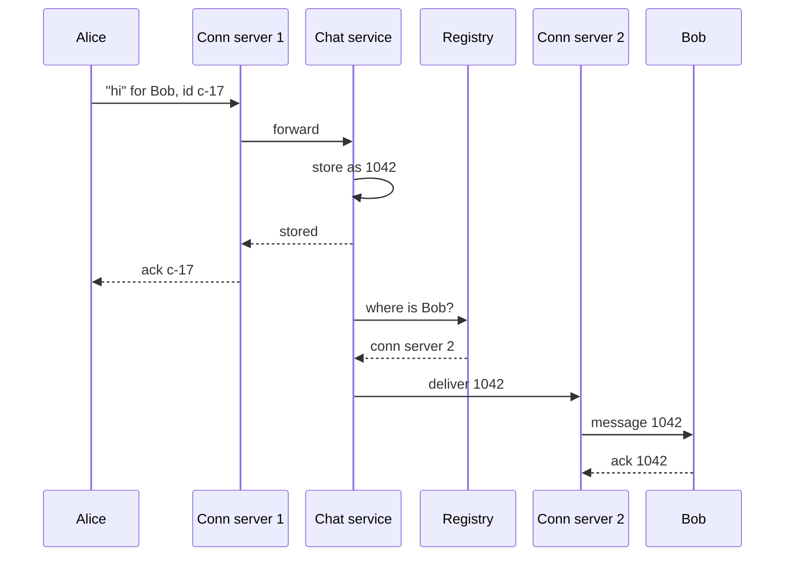

Notice that the message is stored before it is delivered, and acknowledged by the client's own ID,
so a send retried after a dropped connection can be recognised as a duplicate.

| Routing | How | Good | Watch out |
|---|---|---|---|
| Registry lookup | Look up B's server, then send there directly | One hop, easy to reason about | The registry must stay current as users reconnect |
| Pub/sub | Publish to B's channel; B's server is subscribed | Senders need no lookup; a group is one channel | A big room's messages go to every server holding a member |

> **Rule of thumb.** A tuned server holds tens of thousands to hundreds of thousands of idle
> connections; the limit is usually memory and messages per second, not the count. 10 million
> online users at 100,000 per server is about 100 connection servers, plus headroom for the
> survivors to absorb a failed server's users.

### Heartbeats, presence and reconnects

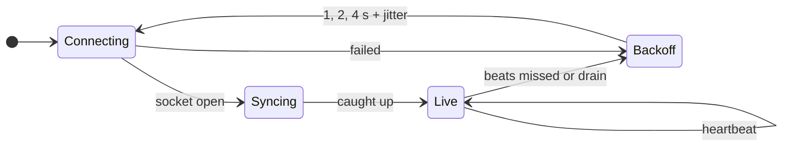

Notice that every reconnect passes through Syncing: the client asks for everything after the last
message it saw, so a dropped connection costs a delay, never a message.

- **Heartbeats.** A ping every 15–30 s keeps idle connections alive through NAT devices and load
  balancers, and detects dead peers: after two or three missed beats, close the connection.
- **Presence.** The registry entry doubles as presence. Store it with a TTL a little longer than the
  heartbeat interval and let each heartbeat refresh it; when heartbeats stop, the entry expires and
  the user shows as offline. Treat presence as best effort ("last seen 2 min ago"), and send changes
  only to people who are looking at that user, or it becomes a broadcast storm.
- **Reconnect storms.** When a server holding 100,000 connections dies, all its clients reconnect at
  the same moment. Exponential backoff with random jitter spreads them over a minute instead of one
  second.

## Long-running work and webhooks

Not every request can finish in a few hundred milliseconds. Video processing, report generation,
payment settlement and batch jobs need an asynchronous API, and events your customers care about
need a reliable way to reach their systems.

### Async request-reply

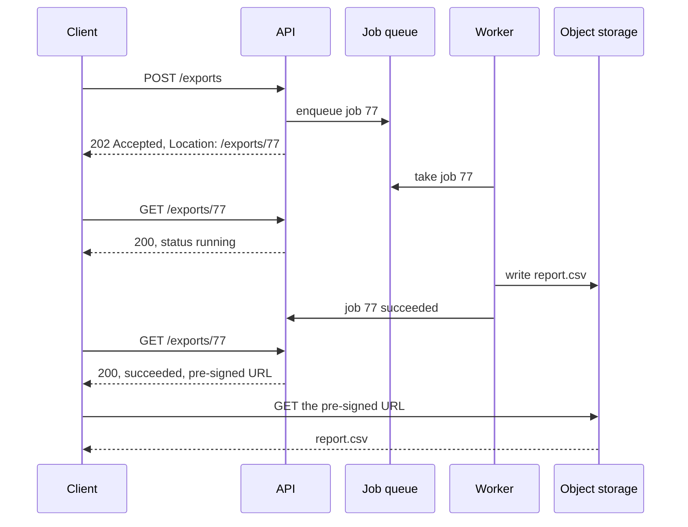

Notice that the API never waits for the work: it answers in milliseconds, and the finished file
comes straight from object storage, not through your servers.

1. The client sends `POST /exports`. The server queues the job and returns `202 Accepted` with a job
   ID and a status URL.
2. The client polls `GET /exports/{id}` (a `Retry-After` header says how often), or subscribes over
   [SSE](#/design/learn/networking/server-sent-events-sse), until the status is `succeeded` or
   `failed`.
3. The result is usually a **pre-signed URL**: a link to one object in storage, signed by your server
   and expiring in minutes, so the client downloads it directly. Object storage is covered in
   [Building blocks](#/design/learn/building-blocks).

The job's status is a small state machine: `queued`, `running`, then `succeeded` or `failed`. A
worker holds a **lease** on the job (a lock that expires); if the worker dies mid-job, the lease runs
out and the job goes back to `queued`, so the work must be safe to run twice.

Large uploads use the same trick in reverse. The API returns a pre-signed upload URL, the client
sends the file straight to object storage (in parts, so a dropped connection resumes instead of
starting over), and storage notifies the API when the file has landed, which starts the processing
job. Your servers never carry the bytes.

### Webhooks

Webhooks reverse the direction: your system calls a URL the customer registered when something
happens (payment succeeded, booking cancelled). Payment providers and most SaaS APIs work this way,
so expect follow-up questions on making them reliable.

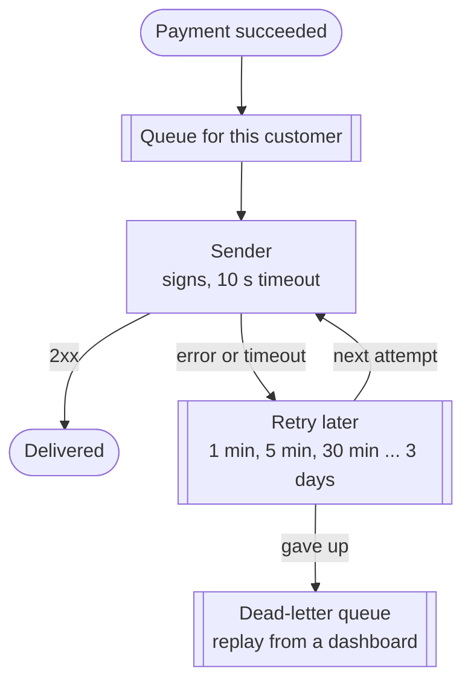

Notice the queue per customer: one customer's slow or broken endpoint backs up only its own queue,
while everyone else's events keep flowing.

- **Delivery is at least once.** Retry failures with exponential backoff for hours or days, then move
  the event to a dead-letter queue the customer can replay.
- **Receivers must be idempotent.** Each event has a unique ID; the receiver records the IDs it has
  processed and ignores repeats.
- **Order isn't guaranteed.** Include a timestamp or version in each event, or send only the event ID
  and let the receiver fetch the current state.
- **Sign every payload.** An HMAC (a hash keyed with a secret shared with the customer) of the
  timestamp and body lets receivers check the event came from you; rejecting old timestamps (over 5
  minutes, say) stops replays.
- **Respond fast.** Receivers should acknowledge with a 2xx immediately and process the event from
  their own queue, or the sender's timeout triggers duplicate deliveries.

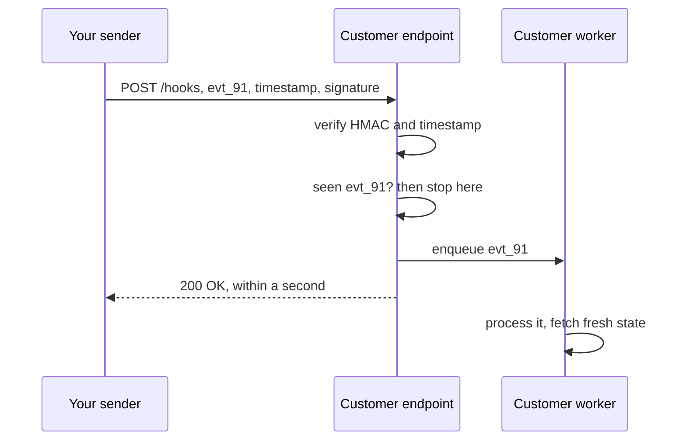

Notice that the receiver acknowledges before doing the work, and still dedupes: any timeout on the
sender's side means the same event will come again.

> **Pitfall.** Customers choose the URL, so the sender must refuse private and internal addresses
> (10.0.0.0/8, 169.254.169.254, localhost). Otherwise anyone can aim a webhook at your own network.

## Choosing an API style

The default that rarely gets challenged: **REST for public and client-facing APIs, gRPC between
internal services, GraphQL when many clients need different shapes of the same data.** Say that,
then adjust for the problem.

| Style | Best for | Main weakness | Say this in an interview |
|---|---|---|---|
| REST (JSON over HTTP) | Public APIs, CRUD on resources, anything that benefits from HTTP caching | Over- or under-fetching; awkward for actions that aren't CRUD | "Resource-oriented, cacheable, and every client can call it." |
| GraphQL | Many screens or clients needing different fields; aggregating several backends | Harder HTTP caching; expensive queries need depth and cost limits | "One request per screen, and clients pick their fields." |
| gRPC | Internal service-to-service calls, high throughput, streaming | Not browser-native; binary payloads are harder to debug | "Typed contracts with Protocol Buffers and low overhead on HTTP/2." |
| Message queue | Work that doesn't need an immediate answer | The caller gets no direct response | "Decouples the services and absorbs spikes." |

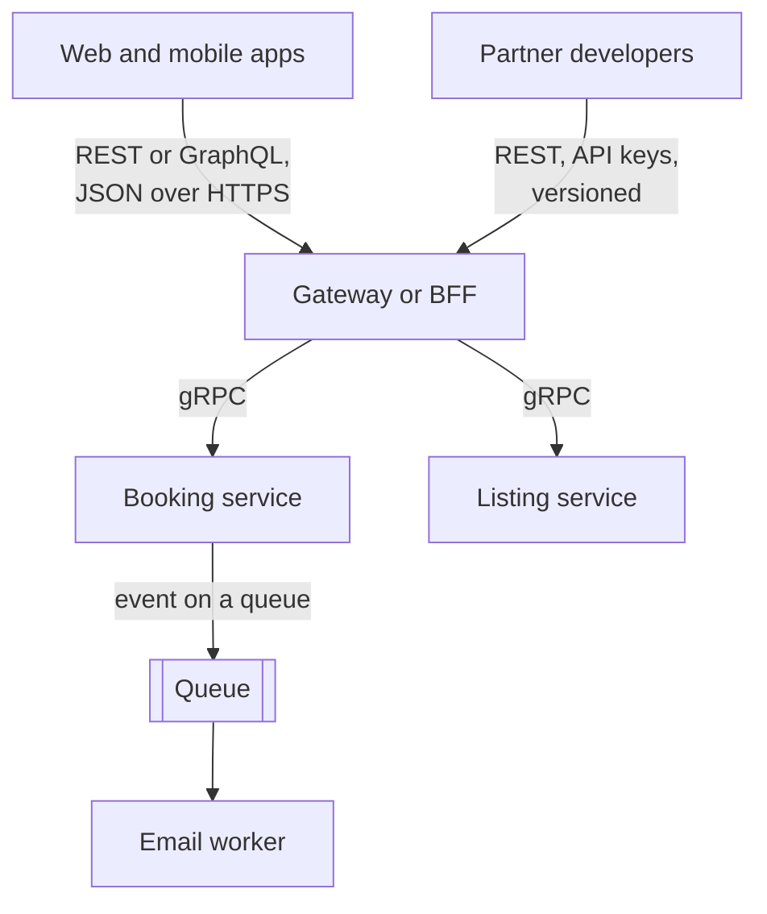

Notice that the style changes at the boundaries: flexible JSON outside, typed binary calls inside,
and a queue wherever nobody is waiting for the answer.

SOAP, an older XML-based protocol, still turns up in legacy enterprise integrations but rarely
belongs in a new design. Queues are covered in [Building blocks](#/design/learn/building-blocks).

### REST

REST (Representational State Transfer) is a set of design principles on top of HTTP:

1. **Client and server are decoupled.** Either can change as long as the interface holds.
2. **Requests are stateless.** Each one carries everything needed to handle it, including
   credentials, so any server can answer any request. Scaling out is easy; the cost is resending
   tokens and context every time.
3. **A uniform interface.** Everything is a resource with a predictable URL
   (`/users/{id}/orders`), and standard HTTP methods say what to do with it.
4. **Responses say whether they're cacheable**, through HTTP headers, so browsers, CDNs and proxies
   can reuse them.

It is mature, easy to debug with any tool, and every language can call it. Its weaknesses:

- **Over- and under-fetching.** The home page needs a user's name, but `GET /users/7` returns 40
  fields; the profile page needs the user, their posts and their friends, which is three round
  trips. You either over-fetch or build an endpoint per screen.
- **Endpoint sprawl.** Per-screen endpoints and multi-step workflows (checkout) pile up, and real
  systems need verbs (cancel, change password) that aren't resources.
- **Versioning.** Changing a response's shape can break clients that aren't ready.
- **Overhead inside the system.** Parsing text payloads on every internal call adds latency; gRPC or
  queues fit better there.
- **Real time.** Request-response can't push; see
  [real-time communication](#/design/learn/networking/real-time-communication).

### RPC and gRPC

RPC (remote procedure call) makes calling a function on another server look like calling a local
one. REST exposes resources (`POST /users`); RPC exposes functions (`CreateUser`). The illusion has
limits: a remote call is slower and can fail halfway, so every call needs a timeout, an
authorization check, and protection against duplicate work when it is retried.

**gRPC** is the most common RPC framework, and it runs on top of HTTP/2 rather than replacing it.

```proto
service Bookings {
  rpc CreateBooking (CreateBookingRequest) returns (Booking);           // unary
  rpc WatchAvailability (ListingRequest) returns (stream Availability); // server streaming
}
```

- **Protocol Buffers** define typed messages and services in `.proto` files, and client and server
  code is generated for many languages.
- **Binary encoding** is smaller and faster to parse than JSON.
- **Four call shapes:** unary (one request, one response), server streaming, client streaming and
  bidirectional streaming.
- **Deadlines** travel with each call, so every service downstream knows how long it has left.
- **Limits:** browsers can't call it directly (you need gRPC-Web or a gateway in between), and binary
  payloads are harder to inspect while debugging.

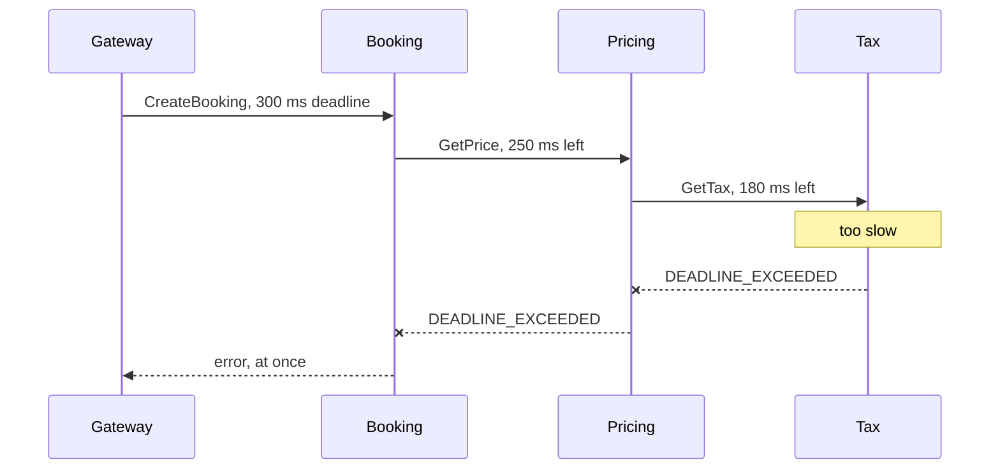

Notice that each hop passes on the time that is left rather than starting a fresh timeout, so the
whole chain gives up together instead of finishing work nobody is waiting for.

> **Pitfall.** gRPC sends every call over one long-lived HTTP/2 connection, so a layer 4 load
> balancer, which balances connections, pins all of a client's calls to one server. Balance per call
> instead: a layer 7 proxy (Envoy, a service mesh) or client-side load balancing.

### GraphQL basics

GraphQL lets the client ask for exactly the fields it needs. One endpoint receives every request, and
the server walks the query, running a **resolver** (a function that fetches or computes one field's
value) for each field. The schema defines the types and the operations the API supports:

```graphql
type Listing {
  id: ID!
  title: String!
  host: User!        # resolved by calling the user service
}
type Query {
  listing(id: ID!): Listing
}

query ListingPage {  # the client picks the fields it wants
  listing(id: "42") { title host { name } }
}
```

The response is JSON in the same shape: `{"data": {"listing": {"title": "...", "host": {"name": "Ana"}}}}`.

| Operation | Does | Runs |
|---|---|---|
| Query | Reads | Fields can resolve in parallel |
| Mutation | Writes | Top-level fields one after another, with no automatic rollback if one fails |
| Subscription | Pushes updates | Usually over WebSockets, backed by pub/sub |

The API evolves by deprecating fields rather than shipping versions, and federation lets each team
own part of the schema. The costs are more moving parts than REST, harder HTTP caching (one URL for
everything), clients that can write expensive queries, and the N+1 problem. The next section takes
each in turn.

## GraphQL at scale

Saying "use GraphQL" is easy. Senior interviews test whether you know what it costs to run one at
scale. These are the topics that come up, roughly in order of how often.

### When to choose GraphQL

| Situation | Pick |
|---|---|
| Many clients (web, iOS, Android, partners) need different shapes of the same data | GraphQL |
| One screen needs data from several backend services | GraphQL, or a BFF |
| Two or three clients and one team | A [BFF](#/design/learn/networking/backend-for-frontend-bff) per client: simpler to operate |
| Many teams contributing to one API | [Federated](#/design/learn/networking/federation) GraphQL |
| Simple CRUD, public APIs that rely on HTTP caching, file transfer, service-to-service calls | REST or gRPC |

### The N+1 problem and DataLoader

Resolvers run per field, so a naive list query is slow. Fetching 50 listings and then each listing's
host runs 1 query for the list plus 50 for the hosts.

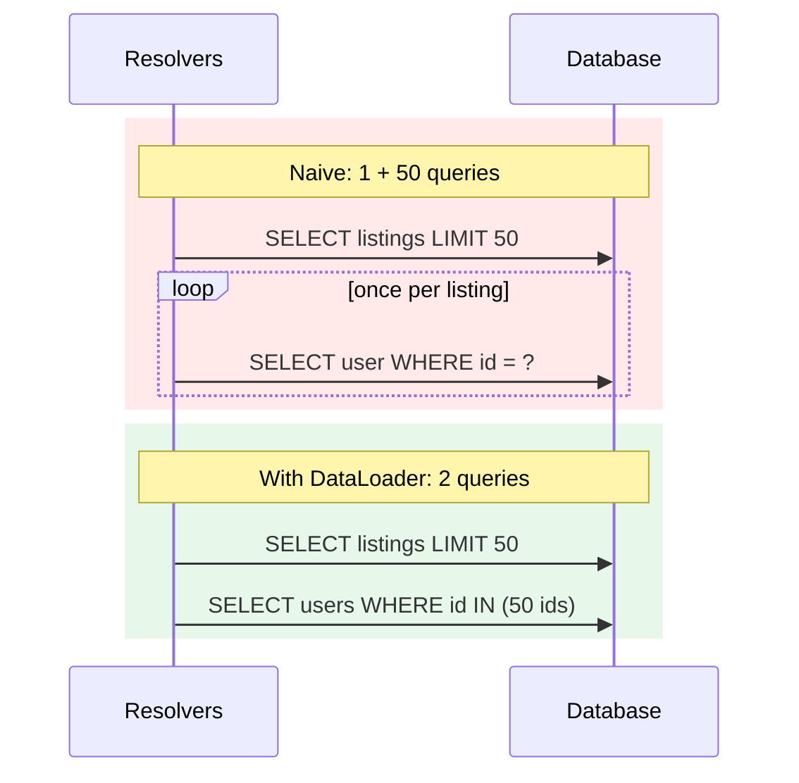

Notice that the batched version makes 2 queries whether the page holds 5 listings or 500.

**DataLoader** is the fix. Within one request it collects every host ID asked for in the same tick
of the event loop, issues one batched query (`WHERE id IN (...)`), and caches the results for the
rest of that request. Expect to explain it in any GraphQL design: "a list query got 20 times slower
after someone added a field" almost always means a new resolver running once per item.

### Limiting expensive queries

The client controls the shape of the query, so one request can ask for an enormous amount of work:

```graphql
query {
  listings(first: 50) {               # 50 listings
    host {
      listings(first: 50) {           # 50 x 50 = 2,500 listings
        reviews(first: 20) { text }   # 2,500 x 20 = 50,000 reviews
      }
    }
  }
}
```

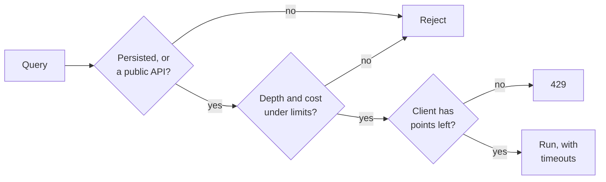

Notice that every check runs before a single resolver does: the expensive query is refused when it
is parsed, not discovered halfway through.

- **Required pagination** on every list field, usually as cursor-based connections (`edges`, `node`,
  `pageInfo`, `first` and `after`). No unbounded lists.
- **Depth limits** block deeply nested queries (user, friends, their friends, their friends...).
- **Cost analysis.** Give each field a cost, multiply by the requested page sizes, and reject
  queries over a budget before running them.
- **Rate limit by cost, not request count.** One GraphQL request can do the work of hundreds of REST
  calls, so public GraphQL APIs typically charge points per query.
- **Timeouts** per request and per resolver.
- **Alias and batching limits.** Aliases let one request call the same field hundreds of times, for
  example to brute-force a login mutation.

### Persisted queries and caching

With **persisted queries**, the client sends a hash of a query registered at build time instead of
the full query text. That lets queries go over GET again, so CDNs and HTTP caches work; it shrinks
requests on mobile; and with a strict allowlist ("trusted documents") the server runs only queries
it already knows, which removes most of the abuse risk for first-party apps.

HTTP caching doesn't work by default, because every request is a POST to one URL. Cache at several
layers instead:

- **Client.** Most GraphQL client libraries keep a normalized cache keyed by type and ID, so an
  object updated once updates everywhere on screen.
- **CDN.** Persisted GET queries for public, non-personalized data.
- **Server.** Per-field cache hints (max age, public or private) combine into a cache policy for the
  whole response, plus entity caching at the router.
- **Data layer.** DataLoader within each request, and your usual caches (Redis) behind resolvers.

### Errors and partial results

GraphQL usually returns HTTP 200 even when part of the query fails. The body holds `data` with
whatever succeeded and an `errors` array for what didn't:

```json
{
  "data": { "booking": { "id": "b77", "listing": null } },
  "errors": [{ "message": "listing service timed out", "path": ["booking", "listing"] }]
}
```

- **Monitoring can't rely on status codes.** Parse the `errors` array and track error rates per
  operation and per field.
- **Nullability is a design decision.** A non-null field (`Listing!`) that fails can't be null, so
  the null moves up to its parent, and on up to the nearest nullable field. One failed field can
  wipe out a whole screen; make fields nullable where partial data is acceptable.
- **Expected business errors** ("dates unavailable") belong in the mutation's result type, not in
  `errors`, so clients handle them like any other data:
  `union CreateBookingResult = Booking | DatesUnavailable`.

### Authorization in a graph

Authorize in the business layer behind the resolvers, per object or field, not only at the gateway.
The same object can be reached by many paths through the graph, and every path must enforce the
same rule.

```mermaid
flowchart LR
  P1["booking.guest.email"] --> R["User.email resolver<br/>asks the business layer"]
  P2["listing.host.email"] --> R
  P3["review.author.email"] --> R
  R --> AZ{"May this viewer<br/>see this email?"}:::purple
  AZ -- yes --> V[The email]:::good
  AZ -- no --> N["null, plus an error"]:::bad
```

Notice that the check sits where every path meets; a check on one path, or only at the gateway,
leaves the other paths open.

### Federation

With many teams, each service owns a **subgraph** of the schema, and a **router** composes them
into one supergraph that clients see as a single API.

```mermaid
flowchart TD
  C[Clients] --> R["Router<br/>plans each query"]:::purple
  R --> L["Listings subgraph<br/>owns Listing, keyed by id"]:::accent
  R --> RV["Reviews subgraph<br/>adds Listing.reviews"]:::accent
  R --> U["Users subgraph<br/>owns User"]:::accent
  REG[("Schema registry<br/>checks changes in CI")]:::warn -. "composed schema" .-> R
```

Notice that the reviews team adds a field to a type the listings team owns, joined by its key,
without either team touching the other's code; the router stitches the results together on every
request.

- **Entities** are types shared across subgraphs and identified by a key (`@key(fields: "id")`), so
  the reviews subgraph can add `reviews` to the listings subgraph's `Listing` type.
- The router builds a **query plan** for each request: which subgraphs to call, in what order, and
  what to fetch in parallel.
- A **schema registry** checks every subgraph change in CI, for composition errors and for breaking
  changes against real client usage, before it ships.
- **Costs:** an extra network hop, query-planning overhead, and a router that becomes critical
  infrastructure with its own scaling and monitoring.

### Evolving and operating a graph

- **No versions.** Add fields freely. To remove one, mark it `@deprecated`, track which client
  operations still use it, and remove it only when usage reaches zero. Usage tracking depends on
  **named operations** (`query ListingPage`), which is why production APIs require them.
- **Subscriptions** push updates over WebSockets and scale like any
  [WebSocket system](#/design/learn/networking/scaling-websockets). Many teams poll or use SSE
  instead unless updates are frequent.
- **Incremental delivery.** `@defer` and `@stream` let the server send the fast parts of a response
  first and slow fields later.
- **Observability.** Trace each operation and each resolver, so you can see which field made a query
  slow, and track latency and errors per named operation. There is only one endpoint, so
  per-endpoint metrics tell you nothing.

## API design essentials

These come up in almost every design, and they are the core of a product architecture interview.

### Resources and verbs

```text
GET    /listings?city=lisbon&cursor=c1&limit=20   -> {items, next_cursor}
GET    /listings/{id}                             -> Listing
GET    /listings/{id}/reviews?cursor=c9           -> {items, next_cursor}
POST   /bookings          (Idempotency-Key: k81)  -> 201 Booking
POST   /bookings/{id}/cancel                      -> 200 Booking
PATCH  /users/{id}        {"email": "..."}        -> 200 User
GET    /users?ids=1,2,3&fields=id,name            -> [User]
```

- Name resources as plural nouns, nested where one belongs to another (`/listings/{id}/reviews`).
- For actions that aren't CRUD, use a verb sub-resource and don't apologize for it:
  `POST /bookings/{id}/cancel`.
- Offer **batch endpoints** when clients would otherwise call in a loop, and let them pick fields
  (`?fields=id,name`) to cut payload size.

### Pagination: offset vs cursor

Never return an unbounded list.

| Approach | How | Good | Bad |
|---|---|---|---|
| Offset | `?offset=40&limit=20` | Simple; can jump to page N | Slow on deep pages; items shift when data changes, so users see duplicates or miss items |
| Cursor | `?cursor=abc&limit=20`, where the cursor encodes the last item's sort key | Fast at any depth; stable while data changes | Can't jump to page N |

```array
label: page 1
values: p50 p49 p48 p47 p46 p45 p44
highlight: 0..2
indices: false
caption: offset=0, limit=3 returns p50 p49 p48
---
label: page 2
values: p51 p50 p49 p48 p47 p46 p45
highlight: 3..5
pointers: offset=3
indices: false
caption: p51 was posted in between, so offset=3 returns p48 again
---
label: cursor
values: p51 p50 p49 p48 p47 p46 p45
highlight: 4..6
pointers: after=3
indices: false
caption: cursor "after p48" returns p47 p46 p45, whatever lands on top
```

Notice the second frame: one new post shifts every offset by one, so the user sees p48 twice. A
cursor names a position in the data rather than a count, so inserts above it don't matter.

```sql
-- Offset: the database reads and throws away 10,000 rows to return 20
SELECT * FROM posts ORDER BY created_at DESC, id DESC LIMIT 20 OFFSET 10000;

-- Cursor: seek straight past the last item seen, using the index
SELECT * FROM posts
WHERE (created_at, id) < (:last_created_at, :last_id)
ORDER BY created_at DESC, id DESC
LIMIT 20;
```

Sort by something unique (add the ID as a tie-breaker), back it with an
[index](#/design/learn/data), and make the cursor opaque (for example, base64 of the last item's
sort key) so you can change what's inside later. Default to cursor pagination for feeds and anything
that changes often; offset is fine for small, stable lists such as an admin table.

### Idempotency keys

Any request that creates something or moves money must be safe to retry, because the client can't
tell "my request was lost" from "the response was lost". The client sends an `Idempotency-Key`
header; the server stores the key with the result and returns the stored result if the same key
arrives again.

```mermaid
sequenceDiagram
  participant C as Client
  participant API as Payments API
  participant K as Key store
  C->>API: POST /payments, Idempotency-Key: 9f1c
  API->>K: insert 9f1c, unique
  API->>API: charge the card
  API->>K: save 9f1c = 201 and the payment
  API--xC: 201 Created, lost on the way
  Note over C: times out, retries with the same key
  C->>API: POST /payments, Idempotency-Key: 9f1c
  API->>K: insert 9f1c
  K-->>API: already there, stored result 201
  API-->>C: 201 Created, the same payment
```

Notice that the retry is answered from the key store: the client sent the request twice, and the
card was charged once.

- The client generates one key (a UUID) per logical operation and reuses it on every retry of that
  operation.
- Insert the key under a unique constraint, ideally in the same transaction as the business write,
  so two concurrent copies can't both proceed. Keep keys for a day or so.
- The same key with a different body is a client bug: reject it with `422`. The same key while the
  first request is still running gets `409 Conflict`, and the client retries later.
- GET, PUT and DELETE are idempotent by design; POST is not unless you add a key; PATCH depends on
  the change ("set the email" is idempotent, "add 1 to the count" is not).

Keys stop duplicates at the API. Making a multi-step flow take effect exactly once (outbox, sagas)
is covered in [Reliability](#/design/learn/reliability).

### Timeouts and retries

Every network call needs a timeout; without one, a hung dependency holds your threads until you run
out of them. Then retry carefully:

- **Retry only idempotent calls**, or calls made safe with an idempotency key.
- **Back off exponentially, with jitter.** Wait about 100 ms, then 200, 400 and so on up to a cap,
  picking a random point below each step, so clients that failed together don't retry together.
- **Cap the attempts** (3 is common) and set a **retry budget**, for example retries may add at
  most 10% extra load, so retries can't multiply an outage.
- **Retry at one layer.** If three layers each make up to 3 attempts, one user request can become
  3 × 3 × 3 = 27 calls to the bottom service.
- A **circuit breaker** stops calling a dependency that keeps failing and fails fast instead, then
  lets a trial request through after a pause. More in [Reliability](#/design/learn/reliability).

```mermaid
---
config:
  xyChart:
    height: 340
---
xychart-beta
  title "Backoff with full jitter: base 100 ms, cap 3.2 s"
  x-axis "Retry attempt" [1, 2, 3, 4, 5, 6]
  y-axis "Wait before retrying (ms)" 0 --> 3400
  bar [70, 130, 330, 520, 1250, 2100]
  line [100, 200, 400, 800, 1600, 3200]
```

Notice that the line is the ceiling, doubling each attempt, while the bars are what one client
actually waits: a random point under the ceiling, so a thousand clients that failed at the same
moment spread their retries out.

```python
import random


def backoff(attempt: int, base: float = 0.1, cap: float = 3.2) -> float:
    """Seconds to wait before retry number `attempt` (1, 2, 3...), with full jitter."""
    return random.uniform(0, min(cap, base * 2 ** (attempt - 1)))
```

### Errors and status codes

Use the right status code family and a consistent error body: a machine-readable code, a human
message and a request ID for support. (RFC 9457 "problem details" is a standard shape for it.)

```json
{"error": {"code": "dates_unavailable", "message": "Those nights are already booked.", "request_id": "req_8f2c"}}
```

```mermaid
flowchart LR
  S{"Whose problem<br/>is it?"} -- "the request's: 4xx" --> C4{"What's wrong?"}
  S -- "the server's: 5xx" --> C5{"What happened?"}
  C4 -- "malformed or invalid" --> E400[400 Bad Request]:::warn
  C4 -- "no valid credentials" --> E401[401 Unauthorized]:::warn
  C4 -- "not allowed" --> E403[403 Forbidden]:::warn
  C4 -- "no such resource" --> E404[404 Not Found]:::warn
  C4 -- "clashes with current state" --> E409[409 Conflict]:::warn
  C4 -- "too many requests" --> E429[429 Too Many Requests]:::warn
  C5 -- "a bug" --> E500[500 Internal Server Error]:::bad
  C5 -- "upstream sent garbage" --> E502[502 Bad Gateway]:::bad
  C5 -- "overloaded or down" --> E503[503 Service Unavailable]:::bad
  C5 -- "upstream too slow" --> E504[504 Gateway Timeout]:::bad
```

Notice the first split, because it's the one clients act on: a 4xx means change the request, a 5xx
means the same request may work later.

| Code | Meaning | When you'd use it |
|---|---|---|
| 200 OK | Success | Standard success with a body |
| 201 Created | New resource created | After a successful POST |
| 202 Accepted | Accepted, not done yet | [Async jobs](#/design/learn/networking/async-request-reply) |
| 204 No Content | Success, empty body | After a DELETE |
| 304 Not Modified | The client's cached copy is still valid | [Conditional GET](#/design/learn/networking/http-caching) with an ETag |
| 400 Bad Request | Malformed or invalid input | Validation failures |
| 401 Unauthorized | Not authenticated, despite the name | Missing or expired token |
| 403 Forbidden | Authenticated but not allowed | Someone else's booking |
| 404 Not Found | No such resource | Unknown ID |
| 409 Conflict | Clashes with the current state | Dates already booked |
| 429 Too Many Requests | Rate limited | Send with [Retry-After](#/design/learn/networking/rate-limiting-429-and-retry-after) |
| 500 Internal Server Error | Unexpected failure | Bugs, unhandled exceptions |
| 502 Bad Gateway | Upstream sent an invalid response | The load balancer got garbage or a reset |
| 503 Service Unavailable | Overloaded or in maintenance | Shedding load, with Retry-After |
| 504 Gateway Timeout | Upstream didn't answer in time | A slow dependency |

Don't retry a 4xx unchanged, except a 429 after its `Retry-After`. Retry 5xx responses and timeouts
with backoff, and only for idempotent requests.

### Redirects: 301 vs 302

A redirect is a response with a 3xx status and a `Location` header; the browser follows it to the
new address. The codes differ in whether the browser may remember the answer:

| Code | Meaning | Browser caches it | Keeps POST as POST |
|---|---|---|---|
| 301 Moved Permanently | Gone for good | Yes, often indefinitely | No, may switch to GET |
| 302 Found | Temporarily elsewhere | Only if headers allow | No, may switch to GET |
| 307 Temporary Redirect | Like 302 | Only if headers allow | Yes |
| 308 Permanent Redirect | Like 301 | Yes | Yes |

```mermaid
sequenceDiagram
  participant B as Browser
  participant S as Short-link service
  participant T as Target site
  alt 301 Moved Permanently
    B->>S: GET /x7Kp2
    S-->>B: 301, Location: target
    B->>T: GET target
    Note over B: remembers the redirect
    B->>T: next click goes straight to the target
  else 302 Found
    B->>S: GET /x7Kp2
    S-->>B: 302, Location: target
    B->>T: GET target
    B->>S: next click comes back to us and is counted
  end
```

Notice that after a 301 the browser goes straight to the target, so your service never sees the
next click: less load, but no click count, and no way to change or expire the link for that browser.

> **Interview tip.** For a URL shortener, say the trade-off out loud: 301 cuts load because browsers
> remember it; 302 keeps every click on your servers, so you can count clicks, expire links and take
> down abusive ones. Pick 302 if analytics or expiry matter.

### HTTP caching

Every HTTP response can say who may cache it and for how long, so browsers, CDNs and proxies can
answer repeat requests without reaching your servers.

| Header | Effect |
|---|---|
| `Cache-Control: public, max-age=300` | Any cache, including the CDN, may reuse it for 5 minutes |
| `Cache-Control: private, max-age=60` | Only the user's own browser may keep it (personalized data) |
| `Cache-Control: s-maxage=3600` | How long shared caches such as the CDN keep it |
| `Cache-Control: no-store` | Never store it (account balances, one-time tokens) |
| `ETag: "v7"` | A version tag; the client revalidates with `If-None-Match` and gets `304 Not Modified` if nothing changed |

```mermaid
sequenceDiagram
  participant B as Browser
  participant E as CDN edge
  participant O as Origin
  B->>E: GET /listings/42
  E->>O: miss, fetch it
  O-->>E: 200<br/>Cache-Control: public, max-age=60<br/>ETag: "v7"
  E-->>B: 200, and the edge keeps a copy
  B->>E: GET /listings/42, another user 20 s later
  E-->>B: 200 from the edge, origin untouched
  Note over E: 60 s pass and the copy goes stale
  E->>O: GET /listings/42, If-None-Match: "v7"
  O-->>E: 304 Not Modified, no body
```

Notice the difference between the two kinds of hit: a fresh copy costs the origin nothing, while a
revalidation still costs a round trip to the origin but skips the body.

For static files, put a content hash in the file name (`app.3f9a1c.js`) and cache it for a year: a
new release changes the name, so users never get a stale file and you never need to purge. Use short
TTLs, or purge through the CDN, for content that changes in place. CDNs themselves are covered in
[Building blocks](#/design/learn/building-blocks).

### Rate limiting: 429 and Retry-After

When a client goes over its limit, reject the request early, usually at the gateway, with
`429 Too Many Requests`, and tell the client when to come back:

```http
HTTP/1.1 429 Too Many Requests
Retry-After: 30
X-RateLimit-Limit: 100
X-RateLimit-Remaining: 0
X-RateLimit-Reset: 1763402430
Content-Type: application/json

{"error": {"code": "rate_limited", "message": "The limit is 100 requests per minute."}}
```

- `Retry-After` gives the seconds (or a date) to wait; well-behaved clients wait at least that long,
  plus jitter.
- The `X-RateLimit-*` headers let clients pace themselves before they hit the limit.
- Limit per API key or user for authenticated calls and per IP address for anonymous ones; limit
  GraphQL by [query cost](#/design/learn/networking/limiting-expensive-queries) instead of request
  count.
- `503 Service Unavailable` with `Retry-After` is the server-side cousin: "I'm overloaded" rather
  than "you sent too much".

The algorithms (token bucket, sliding window) and the shared counters behind them are in
[Building blocks](#/design/learn/building-blocks).

### Versioning

- **Add freely.** New optional fields and new endpoints break no one, since old clients ignore
  fields they don't know.
- **Never remove a field or change its meaning in place.** That breaks clients you can't see,
  including old mobile app versions that stay installed for years.
- **For breaking changes,** put a version in the path (`/v2/`) or a header, run both versions side
  by side, watch traffic to the old one, and retire it after a published end date (a `Sunset`
  header announces it).
- GraphQL avoids versions by [deprecating fields](#/design/learn/networking/evolving-and-operating-a-graph)
  instead.

## Data formats and schema evolution

Every API, queue and log needs a data format, and every format has to change over time without
breaking whoever reads it.

| Format | Strengths | Weaknesses | Typical use |
|---|---|---|---|
| JSON | Human-readable, universal, no schema needed | Larger and slower to parse; no enforced types | Public APIs, web clients |
| Protocol Buffers | Compact, fast, typed schema, generated code | Not human-readable; you need the schema to decode it | gRPC, internal services, mobile |
| Avro | Compact; the schema travels with the data or sits in a registry | Rare outside data pipelines | Kafka topics, data lakes |

### Backward and forward compatibility

During a deploy, old and new versions of code run side by side, and old messages can sit in a queue
for days. So every change must be:

- **Backward compatible:** new code can read data written by old code.
- **Forward compatible:** old code can read data written by new code, ignoring fields it doesn't
  know.

```mermaid
flowchart LR
  P1[Producer v1] -- "id, amount" --> Q[["Queue holding old<br/>and new messages"]]:::accent
  P2[Producer v2] -- "id, amount, currency" --> Q
  Q --> C1["Consumer v1 skips currency<br/>forward compatible"]:::good
  Q --> C2["Consumer v2 defaults currency<br/>backward compatible"]:::good
```

Notice that during a rolling deploy both producers and both consumers run at once, so every message
on the queue has to make sense to every version.

In practice: add fields as optional, with defaults; never reuse or renumber a field; never change a
field's type or meaning in place; and remove a field only after nothing reads it. A schema registry
can enforce these rules automatically for queue topics.

```proto
message Payment {
  string id = 1;
  int64 amount_cents = 2;
  reserved 3;            // was card_last4: retired, and the number is never reused
  string currency = 4;   // added later: old readers skip it, new readers default it
}
```

## Authentication and authorization

Any design with users needs a sentence or two on this, and some interviewers push further.

### Authentication vs authorization

**Authentication** answers "who are you?" (password, single sign-on, passkey). **Authorization**
answers "what are you allowed to do?" (roles, ownership checks). A `401` means not authenticated; a
`403` means authenticated but not allowed.

```mermaid
sequenceDiagram
  participant C as Client
  participant G as API gateway
  participant B as Booking service
  C->>G: GET /bookings/77, Bearer token
  alt token missing, expired or forged
    G-->>C: 401 Unauthorized
  else token valid for user 5
    G->>B: get booking 77, as user 5
    B->>B: booking 77 belongs to user 9
    B-->>C: 403 Forbidden
  end
```

Notice that the gateway can answer "who is this?", but only the booking service knows who owns
booking 77, so the 403 has to come from there. Authorization lives in the service that owns the data.

### Sessions vs tokens

Two ways to keep a user logged in:

| | Server-side session | Signed token (JWT) |
|---|---|---|
| How | A random session ID in a cookie; the session data in a shared store like Redis | A signed token carries the user ID and claims; any server can verify it |
| Revocation | Instant: delete the session | Hard: the token is valid until it expires |
| Cost | A store lookup per request | No lookup; bigger requests |
| Use for | Web apps where instant logout matters | Mobile apps, APIs, service-to-service calls |

The common compromise is a **short-lived access token** (minutes) plus a **long-lived refresh
token** that the server can revoke: cheap verification on every request, and logout within minutes.

```mermaid
sequenceDiagram
  participant C as App
  participant A as Auth service
  participant API as API
  C->>A: log in
  A-->>C: access token (15 min) and refresh token (30 days)
  C->>API: request with the access token
  API->>API: check the signature, no lookup
  API-->>C: 200 OK
  Note over C,API: 15 minutes later the access token expires
  C->>A: refresh token
  A->>A: valid and not revoked?
  A-->>C: new access token and new refresh token
```

Notice that only the refresh step touches a store, so revoking a user's refresh tokens logs them out
everywhere within one access-token lifetime.

> **Pitfall.** A JWT is signed, not encrypted: anyone holding one can read its claims, so keep
> secrets out of it. For an instant ban, keep a small denylist of revoked token IDs at the gateway
> until those tokens expire.

### OAuth, API keys and mTLS

- **OAuth 2.0** lets a user grant one app limited access to their data in another (a printing
  service reading your photos) without handing over their password. The user logs in at the
  identity provider and approves a scope, and the app receives a token limited to that scope.
  **OpenID Connect** is the login layer on top of it: the "Sign in with..." buttons.
- **API keys** identify a calling application, not a user. Fine for server-to-server calls; never
  ship one in client code, where anyone can extract it.
- **mTLS** (mutual TLS) lets internal services prove their identity to each other with certificates;
  a [service mesh](#/design/learn/networking/service-mesh) automates it.

Security basics worth a sentence each in a design: HTTPS everywhere, secrets in a secret manager,
least-privilege access between services, and rate limits on login endpoints.

## Interview cheat sheet

| If the problem says... | Reach for |
|---|---|
| Public API, third-party developers | [REST](#/design/learn/networking/rest), API keys or [OAuth](#/design/learn/networking/oauth-api-keys-and-mtls), [versioning](#/design/learn/networking/versioning), [rate limits](#/design/learn/networking/rate-limiting-429-and-retry-after) |
| Many client screens, different data needs | GraphQL with [DataLoader](#/design/learn/networking/the-n1-problem-and-dataloader), [cost limits](#/design/learn/networking/limiting-expensive-queries) and [persisted queries](#/design/learn/networking/persisted-queries-and-caching), or a [BFF](#/design/learn/networking/backend-for-frontend-bff) |
| Many teams contributing to one API | [Federated GraphQL](#/design/learn/networking/federation) with a schema registry |
| Internal high-throughput calls | [gRPC](#/design/learn/networking/rpc-and-grpc) with deadlines, [retries](#/design/learn/networking/timeouts-and-retries) and circuit breakers |
| Chat, collaboration, live location | [WebSockets](#/design/learn/networking/websockets) plus [connection servers and pub/sub](#/design/learn/networking/scaling-websockets) |
| Notifications, streaming AI responses | [Server-Sent Events](#/design/learn/networking/server-sent-events-sse) |
| Video or voice calls | [WebRTC](#/design/learn/networking/webrtc) over UDP, with media servers for groups |
| Work that takes minutes | [202 Accepted, a job ID and a status endpoint](#/design/learn/networking/async-request-reply) |
| Notify customers' systems of events | [Signed, retried, idempotent webhooks](#/design/learn/networking/webhooks) |
| Payments, bookings, anything retried | [Idempotency keys](#/design/learn/networking/idempotency-keys) |
| Infinite feeds, large result sets | [Cursor pagination](#/design/learn/networking/pagination-offset-vs-cursor) |
| Short links, moved pages | [A 301 or 302 redirect](#/design/learn/networking/redirects-301-vs-302) |
| Read-heavy responses that rarely change | [Cache-Control headers and a CDN](#/design/learn/networking/http-caching) |
| Global users, latency matters | CDN, [geo-DNS or anycast](#/design/learn/networking/dns-as-a-routing-tool), regional deployments, [connection reuse](#/design/learn/networking/round-trips-and-latency-budgets) |
| Messages on a queue that outlive a deploy | [Protobuf or Avro with a schema registry](#/design/learn/networking/backward-and-forward-compatibility) |
| Instant logout or account bans | [Server-side sessions, or short-lived tokens with revocable refresh tokens](#/design/learn/networking/sessions-vs-tokens) |

**Questions to practice answering out loud:**

- What happens when you type a URL and press Enter?
  ([Life of a request](#/design/learn/networking/life-of-a-request))
- How would you push a message to one specific user among 10 million connected users?
  ([Scaling WebSockets](#/design/learn/networking/scaling-websockets))
- Why would you pick gRPC over REST for internal calls, and when wouldn't you?
  ([RPC and gRPC](#/design/learn/networking/rpc-and-grpc))
- How do you make a payment API safe to retry?
  ([Idempotency keys](#/design/learn/networking/idempotency-keys))
- Offset or cursor pagination for a news feed, and why?
  ([Pagination](#/design/learn/networking/pagination-offset-vs-cursor))
- How do you log a user out everywhere if you use JWTs?
  ([Sessions vs tokens](#/design/learn/networking/sessions-vs-tokens))
- A GraphQL list query got 20 times slower after a new field was added. What's likely happening,
  and how do you fix it? ([N+1](#/design/learn/networking/the-n1-problem-and-dataloader))
- How do you stop a client from sending a GraphQL query that takes down your servers?
  ([Limiting expensive queries](#/design/learn/networking/limiting-expensive-queries))
- How do you cache GraphQL responses?
  ([Persisted queries and caching](#/design/learn/networking/persisted-queries-and-caching))
- Design webhook delivery for a payments platform. What happens when a customer's endpoint is down
  for a day? ([Webhooks](#/design/learn/networking/webhooks))
- How do you roll out a change to a message format while old and new consumers run at the same
  time? ([Compatibility](#/design/learn/networking/backward-and-forward-compatibility))

## Reference

The material below goes beyond what most design interviews test. Use it when an interviewer pushes
on a specific protocol, or when the problem is networking-heavy (video calls, multiplayer games, a
CDN).

### The TCP/IP model

The internet protocol suite organizes networking into four layers, each built on the one below. (The
OSI model splits the same work into seven layers and lives mostly in textbooks.) Each layer wraps
the one above in its own header: an HTTP request travels inside a TCP segment, inside an IP packet,
inside an Ethernet frame.

| Layer | Job | Examples |
|---|---|---|
| Application | The protocols applications speak | HTTP, DNS, TLS, gRPC |
| Transport | Delivery between applications, identified by port number; splits data into segments and reassembles them | TCP, UDP, QUIC |
| Internet | Routes packets across networks from source IP to destination IP | IPv4, IPv6, ICMP |
| Link | Moves frames between devices on the same local network | Ethernet, Wi-Fi |

- **MAC address:** a 48-bit hardware ID for a network interface. It matters only on the local
  network; routers forward by IP address.
- **IP address:** a global address for routing packets between networks. IPv4's 32-bit space ran out
  and is stretched with NAT (many devices sharing one public address); IPv6 uses 128 bits and is
  still rolling out.
- **Packet:** data is split into packets, each with routing headers and a payload. Packets travel
  independently and are reassembled at the destination.

### TCP and UDP in detail

**TCP** is connection-oriented and reliable. It carries the web, email, SSH and most
service-to-service traffic.

- **Handshake:** SYN, SYN-ACK, ACK, which costs one round trip before data flows.
- **Reliability and ordering:** the receiver acknowledges data, and the sender retransmits anything
  not acknowledged in time. Checksums catch corrupted segments; sequence numbers put data back in
  order.
- **Flow control:** the receiver advertises how much it can accept, so a fast sender can't overwhelm
  a slow receiver.
- **Congestion control:** a new connection starts small (about 10 packets, roughly 14 KB, in its
  first round trip), doubles each round trip while things go well ("slow start"), and backs off
  when it sees loss.
- **The cost:** handshake latency, and head-of-line blocking: one lost packet stalls everything
  behind it on that connection.

```mermaid
---
config:
  xyChart:
    height: 300
---
xychart-beta
  title "Congestion window of a new TCP connection"
  x-axis "Round trip" [1, 2, 3, 4, 5, 6, 7, 8, 9, 10]
  y-axis "Packets in flight" 0 --> 340
  line [10, 20, 40, 80, 160, 320, 160, 161, 162, 163]
```

Notice how slowly a new connection starts: it needs about 7 round trips to deliver its first
megabyte, however fast the link, and a single loss cuts the window (classically by half). That is
why reusing warm connections matters for latency.

**UDP** is connectionless: no handshake, no delivery or ordering guarantee, and an 8-byte header. DNS
lookups, voice and video calls, online games and QUIC (the basis of HTTP/3) all use it, and handle
loss themselves where they need to.

### HTTP messages and methods

HTTP is the request-response protocol of the web. It is **stateless**: the server keeps no memory of
earlier requests, so anything like a login travels with each request in a cookie or header.
Statelessness is what lets any server behind a load balancer handle any request. HTTP was also
designed so intermediaries (caches, proxies, CDNs) can sit between client and server.

```http
POST /users HTTP/1.1
Host: api.example.com
Content-Type: application/json
Authorization: Bearer eyJhbGciOi...

{"name": "Ana", "email": "ana@example.com"}

HTTP/1.1 201 Created
Location: /users/42
Content-Type: application/json

{"id": 42, "name": "Ana"}
```

A request is a request line (method, target, version), headers (metadata such as `Content-Type`,
`Authorization` and `Cache-Control`) and an optional body. A response mirrors it, starting with a
status line. Two properties of methods matter in design: **safe** (it changes nothing) and
**idempotent** (repeating it has the same effect as doing it once, so it can be retried).

| Method | Meaning | Example | Safe | Idempotent |
|---|---|---|---|---|
| GET | Read | Get a user | Yes | Yes |
| POST | Create, or run an action | Create a user | No | No (add an [idempotency key](#/design/learn/networking/idempotency-keys)) |
| PUT | Replace entirely | Replace a user's profile | No | Yes |
| PATCH | Modify part | Change a user's email | No | Not guaranteed |
| DELETE | Remove | Delete a user | No | Yes |

### HTTPS and TLS

HTTPS is HTTP inside TLS encryption. Only the client and server can read the traffic, which stops
eavesdropping and tampering along the way, and the server proves its identity with a certificate
signed by an authority the client trusts.

- **Cost:** TLS 1.3 adds one round trip to a new connection (TLS 1.2 added two). A resumed TLS 1.3
  session can send the request in its very first message ("0-RTT"), but an attacker can replay that
  early data, so allow it only for idempotent requests.
- **Where to terminate it:** usually at the CDN or load balancer, which holds the certificates and
  does the crypto so services don't have to. Traffic behind that point is unencrypted unless you
  re-encrypt it; use mTLS, often through a [service mesh](#/design/learn/networking/service-mesh),
  if internal traffic must be encrypted too.
