# Data

Most designs are decided by their data: where the source of truth lives, how it stays correct when many requests write at once, and how it grows past one machine. This page covers choosing a store, indexes, transactions and locking, sharding, replication, consistency, consensus, data modelling and caching, with the trade-off to say out loud for each.

## Choosing a store

Pick the store from the access pattern, not from habit. In the interview, say the access pattern first ("look up a booking by ID, list a guest's bookings by date, 50 writes a second"), then name the store that serves it.

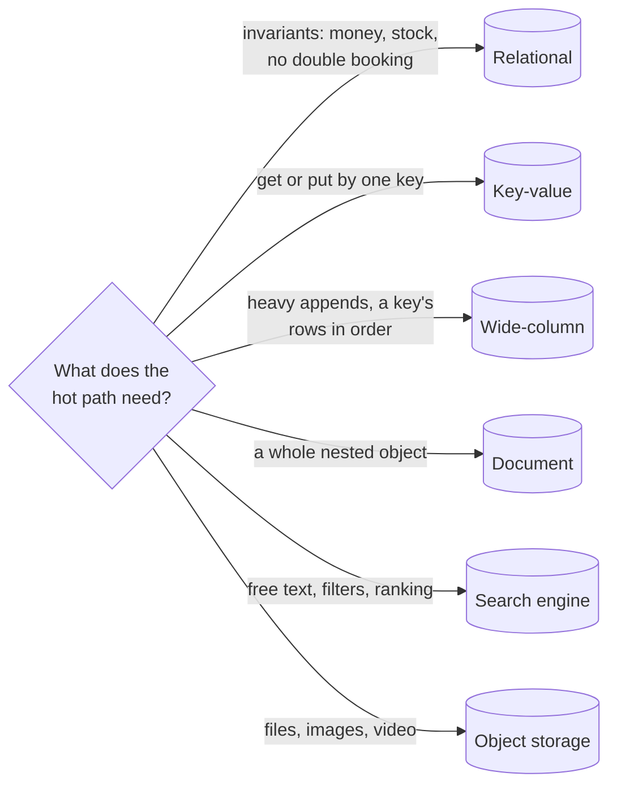

Blue is the usual source of truth. The green stores serve one access pattern very well and can be the primary store for it. The amber search engine holds a copy, and object storage holds bytes that a database row points to.

| Store | Good at | Weak at | Examples | Use for |
|---|---|---|---|---|
| Relational (SQL) | Transactions, joins, constraints, ad hoc queries | Spreading writes over many machines takes sharding work | PostgreSQL, MySQL, Spanner | Bookings, payments, orders: anything with invariants |
| Key-value | Very fast reads and writes by key | Any query that isn't by key | Redis, DynamoDB | Sessions, carts, rate-limit counters, caches |
| Document | Nested objects read and written together | Joins and transactions across documents | MongoDB | Product catalogs, profiles with varied fields |
| Wide-column | Huge write volume, rows kept sorted within a key | Ad hoc queries: you design one table per query | Cassandra, HBase, Bigtable | Messages, activity feeds, metrics |
| Search engine | Full-text search, filters, facets, relevance | Not a source of truth; eventually consistent | Elasticsearch, OpenSearch | Search boxes, log search |
| Graph | Queries that hop across many relationships | Hard to spread across machines | Neo4j | Social graph queries, fraud rings |
| Time-series | Append-heavy metrics, downsampling, retention | General records | Prometheus, InfluxDB | Monitoring, sensor data |
| Object storage | Large files: cheap and very durable | No queries; tens of ms to the first byte | S3-style object stores | Images, video, exports, backups |

Rough numbers for one node, to anchor your estimates: Redis does about 100,000 simple operations a second at under a millisecond each. A PostgreSQL or MySQL primary does a few thousand writes and tens of thousands of indexed reads a second over a few terabytes. A Cassandra node takes tens of thousands of writes a second.

> **Interview tip.** The safe default is a relational database as the source of truth, plus a specialized store for each access pattern it serves badly: a cache, a search index, a warehouse for analytics. Present every extra store as a copy that must be kept in sync, and say how.

### Relational or NoSQL

"SQL vs NoSQL" is less a contest than a list of what you give up. NoSQL stores (key-value, document, wide-column) partition data by key from day one, and pay for it with narrower transactions and fewer query shapes.

| | Relational | NoSQL |
|---|---|---|
| Schema | Declared tables, enforced by the database | Flexible per item; the application enforces it |
| Transactions | Across any rows and tables | Usually within one item or one partition |
| Queries | Joins and ad hoc SQL | By key, or by a table designed for that one query |
| Scaling writes | Shard it yourself, or use distributed SQL (Spanner, CockroachDB) | Built in: add nodes and the data rebalances |
| Consistency | Strong on the primary | Often tunable per request; eventual on replicas |

> **Pitfall.** "NoSQL scales and SQL doesn't" is wrong. A single relational primary handles thousands of writes a second and terabytes of data, read replicas multiply its read capacity, and sharding takes it further. Choose NoSQL for a specific access pattern (huge append volume, pure key lookups, flexible documents), not for "scale" in general.

### Polyglot persistence

Using several stores in one system is called polyglot persistence. Each extra store is another copy of the data with its own lag and failure modes, so justify every one and name its sync path.

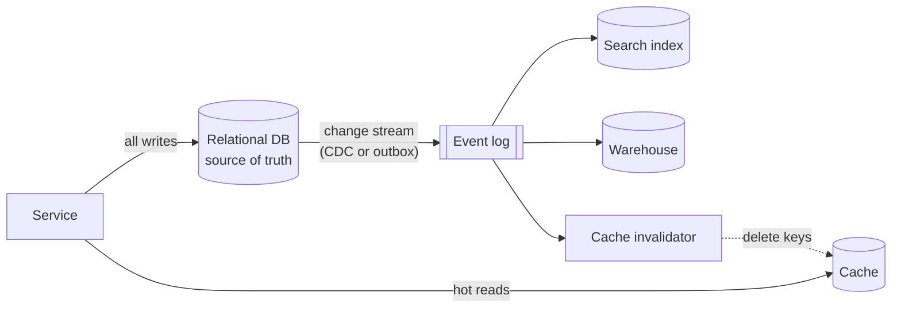

Writes go to one place, and every copy is fed from that database's change stream, so a copy can lag behind but never holds data the source of truth doesn't.

> **Pitfall.** Writing to the database and then to the search index from application code (a dual write) leaves the two inconsistent whenever the second write fails. Publish changes from the database's log with change data capture (CDC), or through a transactional outbox, covered on the [Reliability and correctness page](#/design/learn/reliability).

## Indexes and storage engines

An index is a sorted copy of some columns that points back to the rows, so a lookup reads a few pages instead of the whole table. Every index speeds up the queries that use it and slows every write, which must update it too. Two engine designs cover most databases: B-trees (relational databases) and LSM trees (most wide-column and many key-value stores).

### B-tree indexes

A B-tree keeps keys sorted in fixed-size pages (8 KB in PostgreSQL, 16 KB in MySQL's InnoDB). Each inner page holds hundreds of keys that split the key space, so three or four levels reach billions of rows, and a lookup reads one page per level, most of them already in memory.

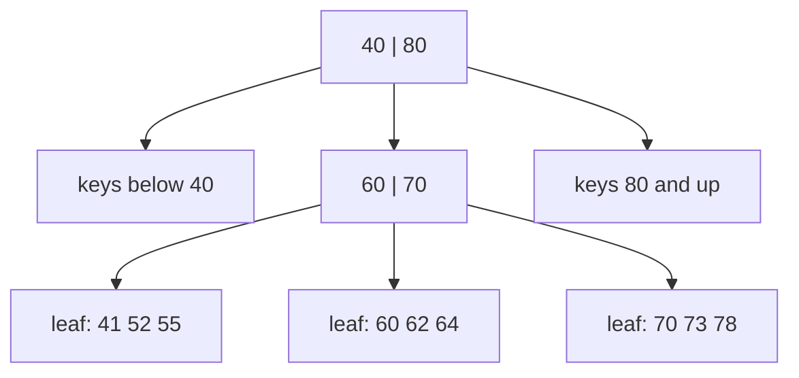

To find 62, compare at each level: 62 is between 40 and 80, then between 60 and 70, so a single leaf page holds it. The leaves are also chained in key order, so a range query (`WHERE created_at BETWEEN ...`) finds its first key this way and then reads sideways.

### LSM trees

A log-structured merge tree (LSM tree) turns random writes into sequential ones. A write is appended to a log on disk (for crash recovery) and inserted into a sorted table in memory, the memtable. When the memtable reaches tens of megabytes it is written out as an immutable sorted file, an SSTable. Background compaction merges SSTables, keeping only the newest version of each key and dropping deleted keys (a delete is written as a marker called a tombstone).

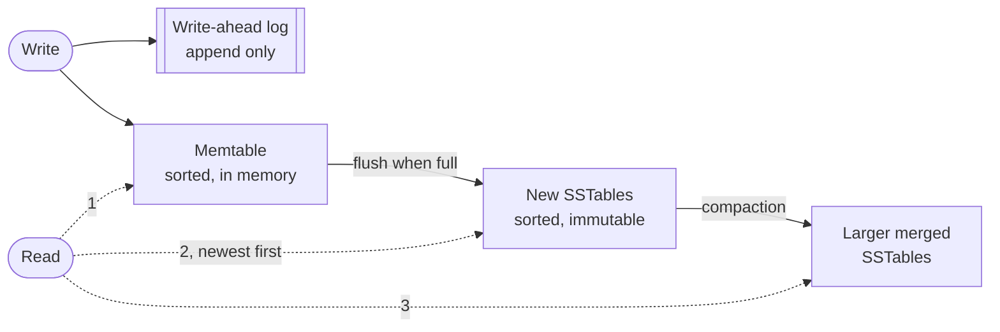

Writes only ever append, which is why LSM stores absorb huge write volumes. A read may have to check several files, newest first; a Bloom filter per file skips the files that can't contain the key.

```array
label: file 1
values: a=1 c=4 f=2 k=9
indices: false
caption: older SSTable
---
label: file 2
values: c=7 d=3 k=del
indices: false
caption: newer SSTable: c changed, d added, k deleted
---
label: merged
values: a=1 c=7 d=3 f=2
highlight: 1 2
indices: false
caption: compaction keeps the newest c, adds d and drops k, in one sorted pass
```

Both inputs are already sorted, so compaction is a single merge pass, like the merge step of merge sort.

| | B-tree | LSM tree |
|---|---|---|
| Writes | Update pages in place: random I/O | Append, then flush whole files: sequential I/O, very high throughput |
| Reads | One path from root to leaf: predictable | May check several files; Bloom filters and compaction keep it fast |
| Background cost | Little | Compaction competes for disk I/O |
| Used by | PostgreSQL, MySQL InnoDB | Cassandra, HBase, RocksDB, Bigtable |

> **Rule of thumb.** Write-heavy, append-mostly data (messages, events, metrics) suits an LSM store. Read-heavy data with transactions and several secondary indexes suits a B-tree database.

### Composite indexes

A composite index sorts by several columns in order. An index on `(user_id, created_at)` stores each user's rows next to each other, already sorted by time, so "this user's latest 20 posts" is one short read with no sort step.

```grid
collabels: user time post
17 09:12 p81
42 08:01 p11
42 09:30 p57
42 10:05 p92
42 11:47 p103
57 07:15 p12
highlight: 2,0 2,1 2,2 3,0 3,1 3,2 4,0 4,1 4,2
caption: user 42's newest three posts sit together: read them from the end, newest first
```

Column order matters. This index serves `WHERE user_id = ?` and `WHERE user_id = ? AND created_at > ?`, but not `WHERE created_at > ?` on its own, because times are only sorted within each user (the leftmost-prefix rule). An index that also holds every column a query needs (a covering index) answers it without touching the table at all.

> **Pitfall.** Each index is one more write on every insert. Index what the hot queries need and no more, especially on a write-heavy table.

### Cursor pagination

`LIMIT 20 OFFSET 10000` makes the database walk past 10,000 rows and throw them away, and rows inserted between page loads shift the window, so users see duplicates or miss items. Cursor pagination (also called keyset pagination) remembers where the last page ended and asks for the rows after it, which an index finds directly.

```array
label: page 1
values: p9 p8 p7 p6 p5 p4
highlight: 0..2
caption: newest first, 3 per page: page 1 is p9 p8 p7
---
label: offset
values: p10 p9 p8 p7 p6 p5 p4
dim: 0..2
highlight: 3..5
caption: p10 arrives, so OFFSET 3 skips p10 p9 p8 and shows p7 a second time
---
label: cursor
values: p10 p9 p8 p7 p6 p5 p4
pointers: after=3
highlight: 4..6
caption: the cursor "after p7" returns p6 p5 p4, whatever arrived meanwhile
```

The cursor is the last row's sort key, sent to the client as an opaque token. Include the ID as a tie-breaker so two posts with the same timestamp can't be skipped:

```sql
SELECT id, created_at, body
FROM posts
WHERE user_id = 42
  AND (created_at, id) < (:last_created_at, :last_id)
ORDER BY created_at DESC, id DESC
LIMIT 20;
```

## Transactions

A transaction groups several reads and writes so they succeed or fail together. Its guarantees are called ACID:

- **Atomicity:** all of it happens or none of it does; a crash halfway through rolls it back.
- **Consistency:** the data obeys its declared rules (constraints, foreign keys) before and after.
- **Isolation:** concurrent transactions don't see each other's half-done work, to the degree the isolation level promises.
- **Durability:** once committed, it survives a crash, because the commit waits for the write-ahead log to reach disk (and, ideally, a replica).

### Isolation levels

Isolation is where interviews go deep. Weaker levels are faster but allow anomalies, the bugs described in the next two sections.

| Level | Prevents | Still allows | Default in |
|---|---|---|---|
| Read uncommitted | Almost nothing | Dirty reads: seeing another transaction's uncommitted data | Rarely used |
| Read committed | Dirty reads and dirty writes | Non-repeatable reads, lost updates, write skew, phantoms | PostgreSQL and most others |
| Repeatable read | Non-repeatable reads | Write skew; phantoms and lost updates in some databases | MySQL (InnoDB) |
| Snapshot isolation | Dirty and non-repeatable reads, phantoms in reads; usually lost updates | Write skew | PostgreSQL's REPEATABLE READ |
| Serializable | Every anomaly: the result matches some one-at-a-time order | Nothing, but it blocks or aborts transactions and costs throughput | Opt-in, for critical paths |

A non-repeatable read is reading the same row twice in one transaction and getting two different values. Snapshot isolation gives each transaction a consistent view of the database as of its start, so reads never block writes.

> **Pitfall.** The level names mean different things in different databases. PostgreSQL's REPEATABLE READ is snapshot isolation and aborts one of two transactions that update the same row; MySQL's REPEATABLE READ lets that lost update through. Name the anomaly you must prevent, not just the level.

### Lost updates

Two transactions read the same value, both change it in application code, and both write it back: the second write silently overwrites the first.

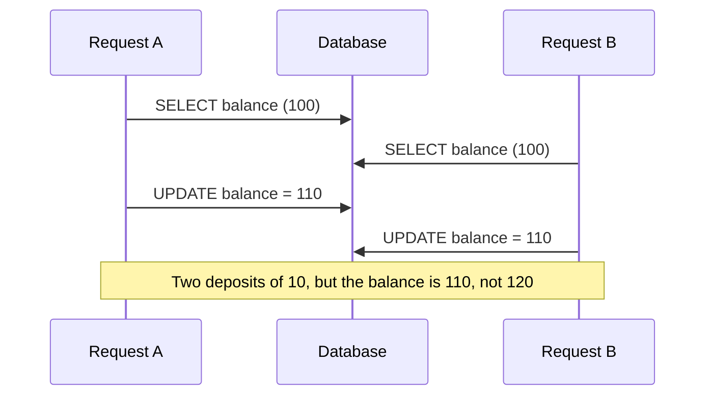

Both requests did the right arithmetic on a value that was already stale. Fixes, cheapest first: do the arithmetic in the database (`SET balance = balance + 10`), check a version ([optimistic locking](#/design/learn/data/optimistic-locking)), lock the row first ([pessimistic locking](#/design/learn/data/pessimistic-locking-and-deadlocks)), or use an isolation level that detects it.

### Write skew and phantoms

Write skew is subtler. Two transactions read the same rows, each makes a decision from what it read, and each writes a different row. No row is written twice, so row locks and snapshot isolation don't notice.

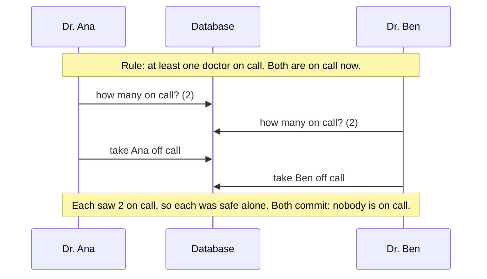

Each transaction was correct on its own snapshot; together they broke a rule that spans two rows. A phantom is the same problem with rows that don't exist yet: one transaction checks "no booking overlaps these dates", another inserts an overlapping booking, and there was no row to lock. Prevent both with serializable isolation, with `SELECT ... FOR UPDATE` on the rows the decision read, or by turning the rule into rows the database can guard: one row per listing-night under a [unique constraint](#/design/learn/data/unique-constraints).

> **Interview tip.** For a booking or a payment, enforce the invariant with a unique constraint (cheap, and it works under any isolation level) or run the critical transaction as serializable. Say out loud that read committed is the default almost everywhere and is not enough for these invariants.

### Transactions across partitions and services

A transaction is cheap when all its rows live in one database on one machine. Once they span shards or services, you need a protocol, and each one costs latency or isolation.

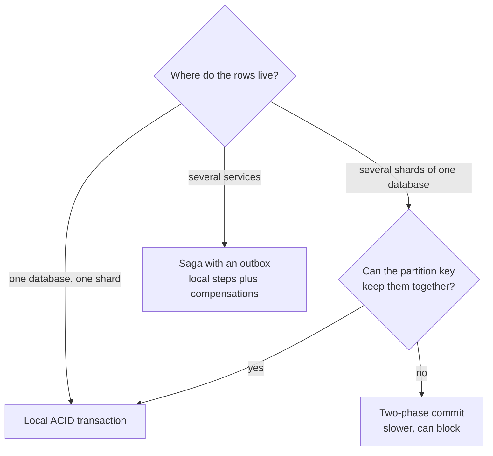

Start by choosing the partition key so the common transaction stays on one shard. Two-phase commit (2PC) has a coordinator ask every participant to prepare and then to commit. It is atomic, but participants hold their locks until the coordinator decides, so a coordinator crash leaves them blocked; distributed SQL databases (Spanner, CockroachDB) run it internally over consensus-replicated shards. Across services, use a saga: a chain of local transactions, each with a compensating action, with events published through a transactional outbox. Both are covered on the [Reliability and correctness page](#/design/learn/reliability).

## Preventing conflicting writes

When two requests can change the same data at once, pick the cheapest tool that protects the invariant.

| Technique | How it works | Best for | Cost |
|---|---|---|---|
| Unique constraint | The database rejects a second row with the same key | One booking per listing per night, unique usernames, idempotency keys | Almost free; works under any isolation level |
| Atomic conditional update | Check and change in one statement (`... WHERE remaining > 0`) | Counters, stock, status changes | Almost free, for one row |
| Optimistic locking | A version column: the update succeeds only if the version is unchanged, otherwise retry | Rare conflicts: profile edits, document edits | A retry when a conflict happens |
| Pessimistic locking | `SELECT ... FOR UPDATE` locks the rows until commit | Hot rows with frequent conflicts | Waiting, and deadlock risk |
| Serializable transaction | The database aborts or blocks one of two conflicting transactions | Invariants that span several rows (write skew) | Retries and lower throughput |

### Check-then-act races

Most concurrency bugs are a check followed by an act: "is the night free? then book it". Between the check and the act, another request can make the same check and get the same answer.

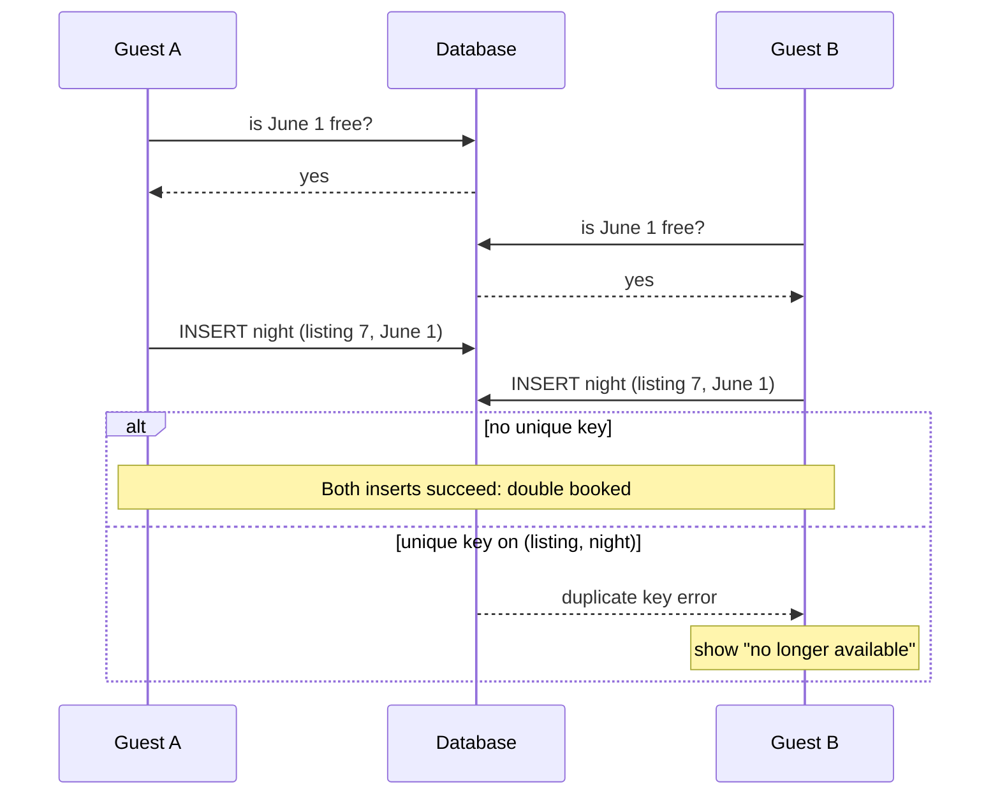

The check was never the protection; the unique key is. The check is still worth doing, because it gives a fast, friendly answer in the common case.

### Unique constraints

Model the thing that must not be duplicated as a key. For bookings, that is one row per listing per night:

```grid
collabels: listing night booking
L7 "Jun 1" b31
L7 "Jun 2" b31
L7 "Jun 3" b40
L9 "Jun 1" b35
highlight: 1,0 1,1
caption: booking b44 also claims (L7, Jun 2): the key exists, so b44's insert fails
```

```sql
CREATE TABLE booking_night (
  listing_id bigint NOT NULL,
  night      date   NOT NULL,
  booking_id bigint NOT NULL,
  PRIMARY KEY (listing_id, night)
);
```

In one transaction, insert the booking and one `booking_night` row per night. If any night is taken, the duplicate-key error rolls back the whole booking and the service returns "no longer available". There are no application locks, and the database enforces the rule for every writer, including code written next year. The same idea makes retries safe (store each request's idempotency key under a unique constraint, so a retry finds the first result) and makes random IDs safe (insert a random short code, and retry on the rare collision).

### Atomic updates and counters

Never read a counter, change it in code, and write it back. Put the check and the change in one statement, and look at how many rows it changed:

```sql
UPDATE inventory
SET remaining = remaining - 1
WHERE listing_id = 7 AND remaining > 0;
-- 1 row changed: you got one. 0 rows changed: sold out.
```

The same pattern guards state changes: `UPDATE payment SET status = 'SUCCEEDED' WHERE id = ? AND status = 'PENDING'` succeeds once, however many workers try.

Counters shared by many servers usually live in Redis. Single commands such as `INCR` are atomic because Redis runs one command at a time. For check-and-change logic (allow the request only if the count is under the limit), run a short Lua script, which Redis also runs as one step.

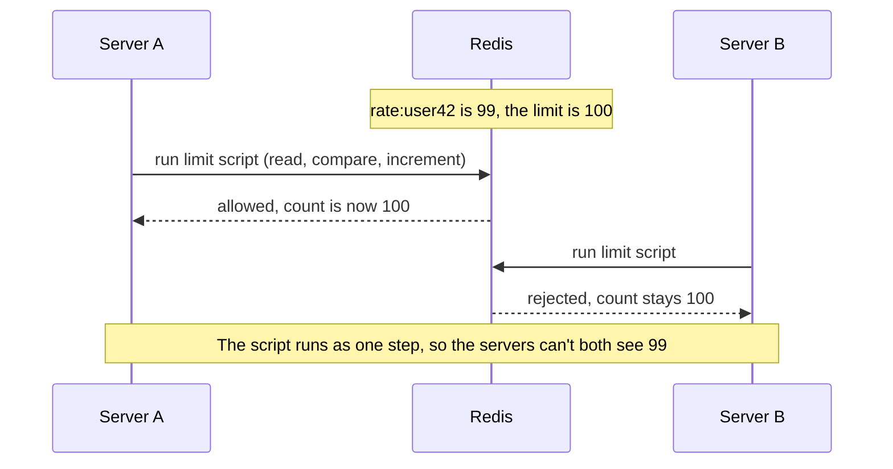

The two servers race, but the comparison and the increment happen inside Redis as one step, so exactly one of them gets the last slot. A Redis node handles on the order of 100,000 such checks a second, so a few shards cover most rate limiters; the limiting algorithms themselves are on the [Building blocks page](#/design/learn/building-blocks).

### Optimistic locking

Give each row a version number. Read the version with the row, and make the write conditional on it:

```sql
UPDATE listing
SET price = 180, version = version + 1
WHERE id = 7 AND version = 3;
-- 0 rows changed: someone else wrote first. Re-read, then retry or show the conflict.
```

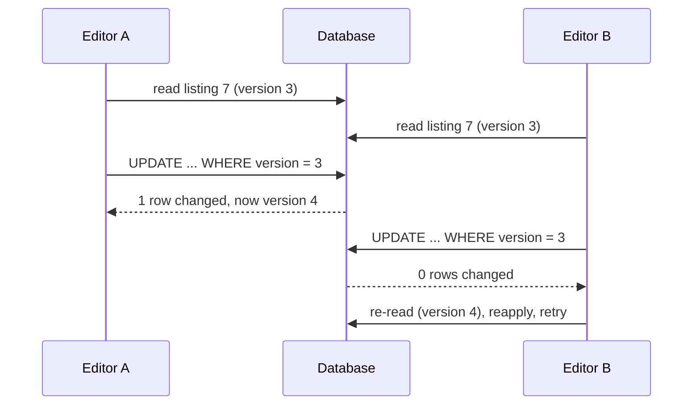

Nobody holds a lock while a user edits, and the loser finds out instead of silently overwriting. It suits rare conflicts; under heavy contention most attempts fail and retry, so use a lock or a queue there. Over HTTP the same idea is an `ETag` sent back in an `If-Match` header.

> **Pitfall.** A version check works only when every write is checked in one place. If two regions each accept writes (multi-leader replication), both can pass the check locally; see [concurrent writes](#/design/learn/data/concurrent-writes).

### Pessimistic locking and deadlocks

`SELECT ... FOR UPDATE` locks the selected rows until the transaction ends, and anyone else who wants them waits. Use it for hot rows where conflicts are frequent and retries would waste work, and keep the transaction short, because every waiter's latency includes it.

Locks bring deadlocks: two transactions each hold a lock the other needs.

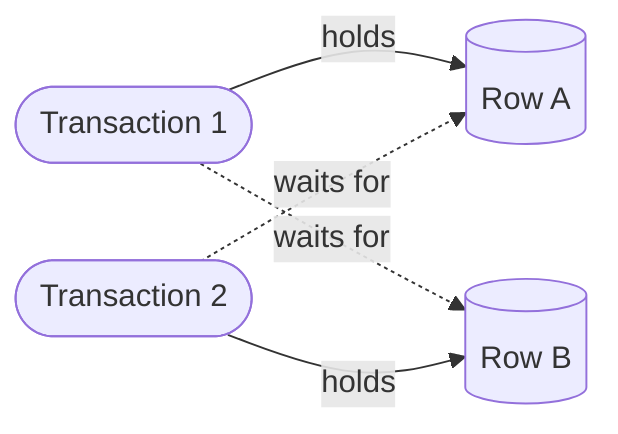

The waits form a cycle, so neither transaction can finish. Databases detect the cycle and abort one, which the application retries. Prevent it by always locking rows in the same order (by ID, or by night for a date range) and by keeping transactions short.

### Holds that expire

Checkout takes time (payment can take seconds to minutes), so claim the inventory first as a hold with an expiry, then confirm. The hold is a row with a status and an `expires_at`, enforced on the server, never by the client's timer.

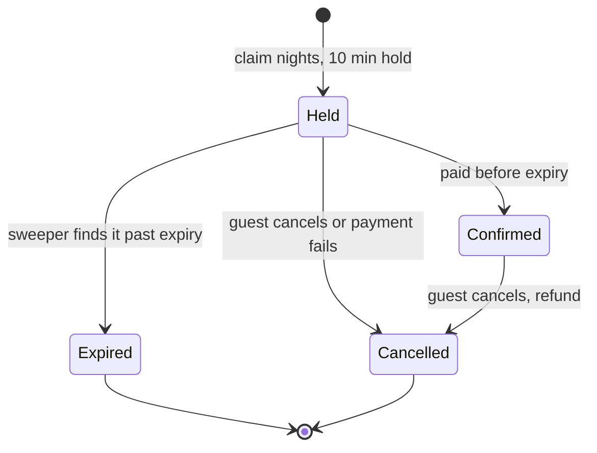

While a booking is held, its `booking_night` rows block everyone else; moving to Expired or Cancelled deletes them, which frees the nights. Confirm with a conditional update (`WHERE status = 'HELD' AND expires_at > now()`) so a payment that lands after expiry can't confirm a released hold, and run a sweeper every minute to expire the rest. For a flash sale, a Redis `SET seat:12A user42 NX EX 600` (set only if absent, expire after 600 s) makes a cheap first gate, but the database stays the final check.

## Sharding

Sharding, also called partitioning, splits one dataset across machines so that no machine has to store or serve all of it. Replication copies data for availability and read capacity; sharding divides it for write capacity and size. Large systems do both: every shard is replicated.

```grid
collabels: P0 P1 P2 P3 P4 P5
rowlabels: "node 1" "node 2" "node 3" "node 4"
L _ F F L _
F L _ F F L
F F L _ F F
_ F F L _ F
highlight: 0,0 0,4 1,1 1,5 2,2 3,3
caption: 6 shards x 3 copies on 4 nodes. L = leader, F = follower
```

Every shard has a copy on three different nodes, so any one node can fail without losing data, and the leaders are spread out, so the writes are too. Shard when one machine can't hold the data (several terabytes) or take the writes (thousands to tens of thousands a second). Before that, a bigger machine plus read replicas is simpler, and saying so is a senior signal.

### Choosing a partition key

The partition key decides which shard holds each row, and it is the decision that matters most. A good key spreads load evenly and keeps the most common query, and the most common transaction, on one shard.

| System | Partition key | Why |
|---|---|---|
| URL shortener | Short code | Every redirect is a lookup by code |
| Chat | Conversation ID, plus a time bucket for busy chats | A conversation's history is read together, in order |
| News feed | The feed owner's user ID | Building one user's feed reads one shard |
| Booking | Listing ID | A listing's nights live together, so the unique-key check stays local |
| Payments ledger | Account ID | A balance check is a local transaction |
| Rate limiter | Client key (user, API key or IP) | Each check touches one counter |

A query that doesn't include the partition key has to ask every shard and merge the answers (scatter-gather). Its latency is the slowest shard's, so keep such queries off the hot path.

### Partitioning strategies

| Strategy | How it works | Good | Bad |
|---|---|---|---|
| Range | Contiguous key ranges per shard (A–F, G–M) | Range scans are cheap; easy to reason about | Hot spots when keys are sequential (timestamps, auto-increment IDs) |
| Hash | Shard by a hash of the key, placed on a ring or into fixed slots | Even spread | A range query must ask every shard |
| Directory | A lookup table maps each key (or key range) to a shard | Total flexibility: move one tenant at a time | The directory is one more service to cache and keep available |
| Geographic | Shard by region | Data near its users; data-residency rules | Uneven sizes; cross-region queries are slow |

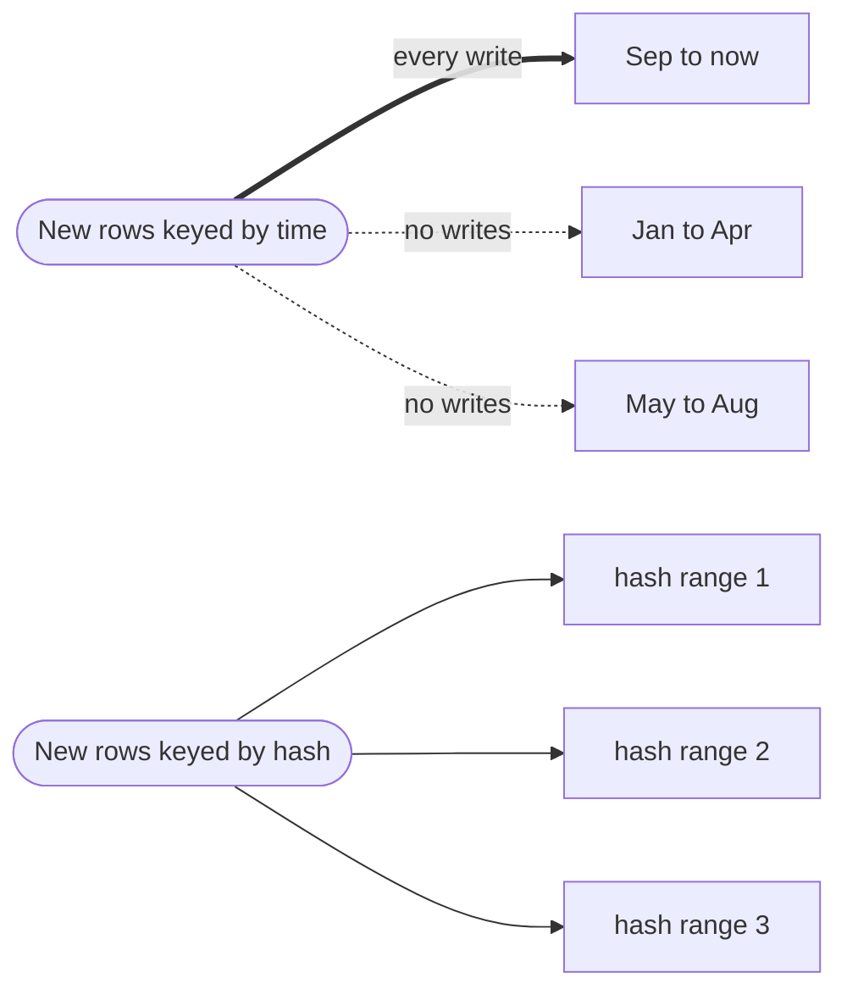

With range partitioning on a timestamp, the newest range takes every write while the others sit idle. Hashing spreads the writes evenly, at the cost of cheap range scans.

### Consistent hashing

Plain `hash(key) mod N` is a trap for a system that grows: going from 4 to 5 shards changes the shard of about 80% of the keys, which means moving almost all the data. Consistent hashing places both shards and keys on a ring of hash values, and each key belongs to the next shard clockwise.

```ring
nodes: A@40 B@160 C@280
keys: k1@10 k2@100 k3@200 k4@250 k5@330
caption: each key belongs to the next node clockwise
---
nodes: A@40 B@160 D@220 C@280
keys: k1@10 k2@100 k3@200 k4@250 k5@330
highlight: D
caption: adding D takes only k3 (on the arc from B to D) from C
```

Adding a shard takes keys from one neighbour only, about 1/N of the data, instead of reshuffling everything. In practice each machine sits on the ring at many points (virtual nodes, dozens to hundreds each), which evens out the arc sizes and spreads a failed machine's load over all the others. A simpler alternative is a fixed number of slots chosen up front (Redis Cluster uses 16,384 hash slots; you might pick 1,024 partitions), moved between machines whole. The same ring also routes requests to cache servers; see the [Building blocks page](#/design/learn/building-blocks).

### Hot keys

Sometimes one key gets far more traffic than any shard can serve: a celebrity's profile, a viral post, a flash sale. A better partition key doesn't help when a single key is the problem.

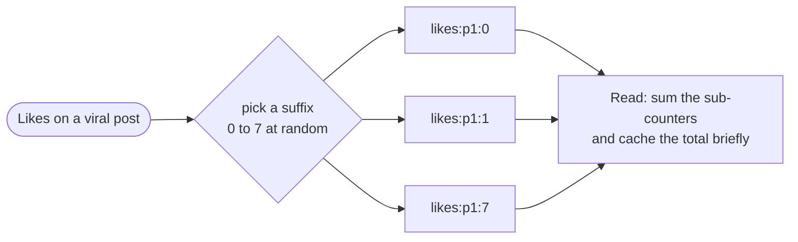

Splitting the key spreads its writes over eight shards; the price is that every read gathers and merges the pieces. The options:

- **Split the key** for write-hot keys, as above, and merge on read.
- **Cache it** for read-hot keys, ideally in each server's memory for a second or two, so the shared cache doesn't become the hot spot instead.
- **Give it its own shard** when it stays hot (a huge tenant).
- **Batch it:** count locally for a second, then write one increment.
- **Change the algorithm:** a celebrity's posts aren't pushed to millions of feeds; followers pull them at read time ([fan-out](#/design/learn/data/fan-out-on-write-vs-fan-out-on-read)).

### Secondary indexes on sharded data

Data sharded by one key often needs lookups by another, such as "listings in Lisbon" when listings are sharded by ID. There are two ways to index it.

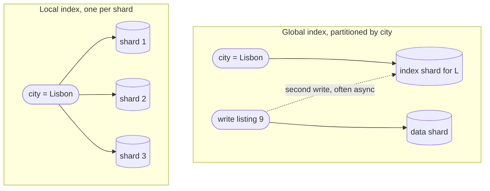

A local index makes writes cheap (one shard) and reads expensive (every shard). A global index makes reads cheap (one shard) and writes expensive: each write touches two shards, which needs a distributed transaction or, more commonly, an asynchronous index update with a short lag. Many NoSQL stores update global indexes asynchronously, so a read through one can be slightly stale.

## Replication

Replication keeps copies of the same data on several machines, for availability (survive losing a machine) and read capacity (spread reads over the copies). The hard question is how writes reach the copies.

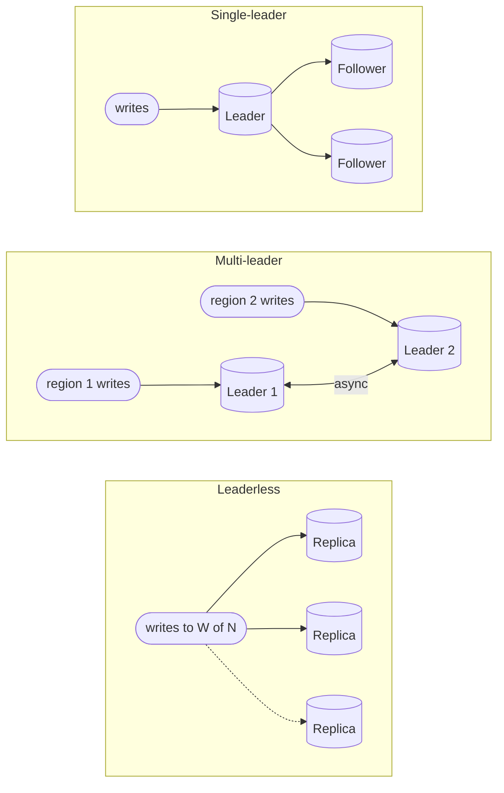

The three topologies trade simplicity against write availability: only single-leader has no write conflicts, and only the other two keep accepting writes when a leader or a whole region is cut off.

| | Single-leader | Multi-leader | Leaderless |
|---|---|---|---|
| Writes go to | One leader per shard | A leader in each region | Any W of the N replicas |
| Write conflicts | None | Yes: needs a resolution rule | Yes: needs versions and repair |
| Survives | Lost followers; a lost leader after failover | A whole region | Several replicas down |
| Seen in | PostgreSQL, MySQL, most systems | Multi-region writes, offline-first apps | Cassandra and other Dynamo-style stores |

> **Interview tip.** The default is single-leader per shard, with one synchronous follower for durability and consensus-based failover. Reach for multi-leader or leaderless only when writes must stay available across regions or during a network partition, and name your conflict policy when you do.

### Single-leader replication

All writes go to the leader, which streams its log of changes to followers; followers serve reads. It is simple and has no write conflicts. The costs: the leader caps write throughput, and a leader crash needs a failover. How long the leader waits before confirming a write is the main setting:

| Mode | The leader confirms a write | Write latency | If the leader dies |
|---|---|---|---|
| Synchronous | After every follower has it | Highest: one slow follower stalls every write | Nothing confirmed is lost |
| Asynchronous | Immediately | Lowest | The last moments of confirmed writes can be lost |
| Semi-synchronous | After one follower has it | One extra round trip, about a millisecond within a region | Promote that follower and nothing confirmed is lost |

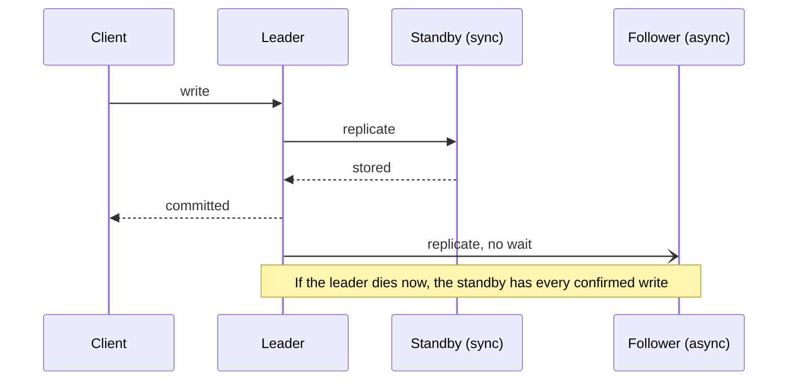

The client waits for one copy, not all of them, so durability doesn't depend on the slowest follower. PostgreSQL and MySQL replicate asynchronously by default; adding a synchronous standby, ideally in another availability zone, is the usual answer when a failover must not lose confirmed writes.

### Leader failover

When the leader dies, a follower takes over. Each step has a known way to go wrong.

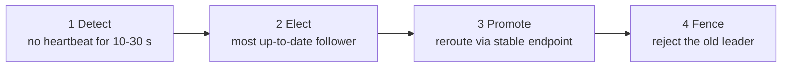

Detection trades speed for false alarms: a short timeout fails over on a long garbage-collection pause, a long one leaves writes down for longer. The election must go through consensus (Raft, or a coordinator such as etcd or ZooKeeper), never each node deciding alone. Clients find the new leader through service discovery, a virtual IP or a proxy, never a hard-coded host.

| Risk | What happens | Defence |
|---|---|---|
| Lost writes | With async replication, writes the old leader confirmed but never shipped are discarded | Promote the synchronous standby; state the data loss you accept (the RPO) |
| Split brain | Two nodes both accept writes and the data diverges | Majority-based election, and fencing: writes carry the leader's term number and old terms are rejected |
| Broken references | A discarded write's ID was already seen by a cache or another service, then reused | Never reuse IDs; reconcile after a failover |
| Flapping | A too-eager timeout fails over again and again under load, making an overload worse | Conservative timeouts, and alerts to a human |

Managed databases with a high-availability option do the detection, promotion and DNS repointing for you, typically in 30 to 120 seconds. In an interview it's enough to say so and name the RPO.

> **Interview tip.** "Single leader with a synchronous standby in another zone, so a failover loses no confirmed writes. Election goes through consensus, the old leader is fenced by term number, and clients reconnect through a stable endpoint. Expect under a minute of write unavailability." Region-level disaster recovery is on the [Reliability and correctness page](#/design/learn/reliability).

### Read replicas and replication lag

Followers that serve reads are called read replicas. Each adds roughly a primary's worth of read capacity, and two to five is common for a read-heavy service. Their lag is usually under a second but can grow to minutes under heavy write load, and it causes visible bugs even when nothing has failed.

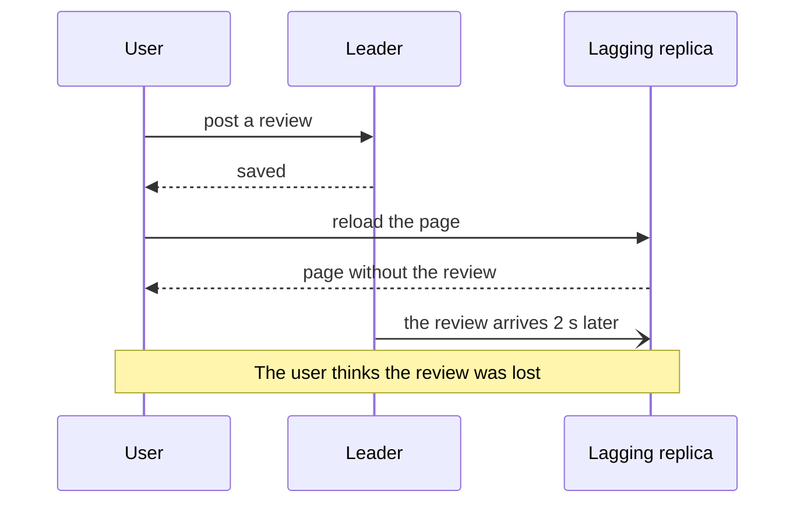

The write succeeded; the read simply went to a copy that hadn't caught up yet. Each fix gives one guarantee:

| Guarantee | Bug it prevents | How |
|---|---|---|
| Read-your-writes | Your own post vanishes after a refresh | Read from the leader for a few seconds after the user writes, or from a replica that has applied the write's log position |
| Monotonic reads | A refresh shows older data than the last one | Pin each user to one replica (hash the user ID) |
| Consistent prefix | A reply appears before the message it answers | Keep causally related writes in one partition, applied in order |

### Multi-leader replication

Each region has a leader that accepts local writes and replicates them to the other leaders asynchronously. Users get fast local writes, and a region outage doesn't stop writes elsewhere. The cost is conflicts: the same record edited in two regions at once ends up with two versions that must be reconciled, by last-write-wins (simple, but silently drops data), application merge rules or CRDTs (see [concurrent writes](#/design/learn/data/concurrent-writes)). Avoid it unless you truly need writes in several regions, and never rely on a unique constraint across regions: both can accept the same username before they hear from each other. Offline-first apps are multi-leader too, since each device acts as a leader while it is offline.

### Leaderless replication and quorums

In a leaderless (Dynamo-style) store, the client, or a coordinator node acting for it, sends each write to all N replicas and waits for W of them to confirm. It reads from R replicas and takes the newest version. If W + R > N, every read overlaps at least one replica that holds the latest write.

```array
label: W=2
values: "r1 v2" "r2 v2" "r3 v1"
highlight: 0 1
indices: false
caption: writing v2 with W = 2: r1 and r2 confirm, r3 missed it
---
label: R=2
values: "r1 v2" "r2 v2" "r3 v1"
highlight: 1 2
indices: false
caption: reading with R = 2: any two replicas include r1 or r2, so v2 wins
---
label: R=1
values: "r1 v2" "r2 v2" "r3 v1"
highlight: 2
indices: false
caption: with R = 1, W + R = N: a read that lands on r3 returns stale v1
```

N = 3, W = 2, R = 2 is the common setting: reads and writes both survive one replica being down. Smaller W or R is faster and more available, but reads may be stale. Stale replicas are repaired by reads (a read that finds an old version writes the new one back) and by a background anti-entropy process that compares replicas. During a partition, a sloppy quorum lets writes land on healthy nodes outside the key's usual replicas, and hinted handoff moves them home later: writes stay available, but the overlap guarantee is gone until then.

> **Pitfall.** W + R > N does not make reads linearizable. Concurrent writes still conflict and need versions or last-write-wins, a write that failed on some replicas may survive on others, and two reads during a write can see the new value and then the old one. Quorums guarantee overlap, not order.

## Consistency models

"Consistency" means different things in different contexts. In an interview, name the guarantee you need, not the word.

| Model | Guarantee | Where it matters |
|---|---|---|
| Linearizable | Every read sees the latest completed write, as if there were one copy | Seat locks, leader election, unique usernames, balances |
| Sequential | Every replica applies writes in the same order, but a reader may be behind | Reading a replicated log from a follower |
| Causal | If B depends on A, everyone sees A before B | A reply never shows before the comment it answers |
| Read-your-writes | Users always see their own writes | Profile edits, a post just made |
| Monotonic reads | A user never sees data go backwards | A feed that doesn't jump back to older posts |
| Eventual | Replicas converge once writes stop | View counts, like counts, search indexes |

The stronger the guarantee, the more coordination it needs. Linearizable reads and writes go through one leader or a quorum, which costs a round trip and, during a partition, availability. Eventual consistency lets any nearby copy answer.

### CAP and PACELC

CAP says that during a network partition, a replicated system must choose between consistency (refuse or delay some requests, so nobody reads stale data) and availability (answer every request, possibly with stale data). The C in CAP means linearizable, and CAP only describes behaviour during a partition. Partitions do happen, so "CA" is not a real option for a distributed system.

PACELC adds the everyday case: if there is a **P**artition, choose **A**vailability or **C**onsistency; **E**lse, in normal running, choose **L**atency or **C**onsistency.

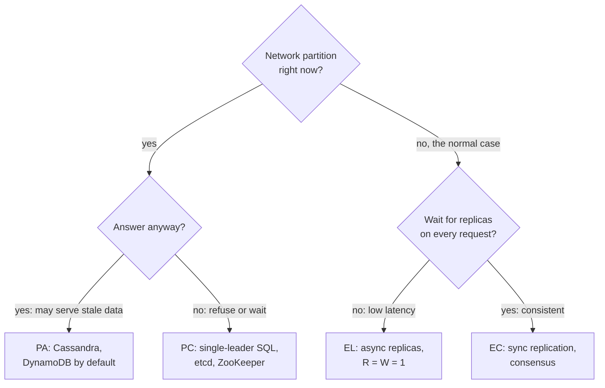

Partitions are rare, while the latency-versus-consistency choice on the right is made on every single request; that is why interviewers like PACELC.

### Picking a guarantee per operation

Don't say "we'll use CAP, so we pick CP." Different operations in one system need different guarantees: say which, and where each is enforced.

| Operation | Guarantee | Served from |
|---|---|---|
| Book a night, charge a card | Linearizable | The leader in the listing's or account's home region |
| Claim a username, lock a seat, elect a leader | Linearizable | A leader, or a consensus store such as etcd |
| See your own edit | Read-your-writes | The leader for a short window, or a caught-up replica |
| Comments, a feed | Causal, monotonic reads | Replicas, with each user pinned to one |
| Search results, like and view counts | Eventual | Replicas and caches everywhere |

> **Example.** "Bookings need linearizable writes, so they go to a single leader in one region, and we accept up to a few hundred milliseconds of extra latency for users far away. Search can be eventually consistent, so it's served from replicas everywhere."

### Ordering per key

A total order over every write in a system needs a single sequencer or consensus on every write, which is slow and a bottleneck. Most products only need order within one key: the messages of one conversation, the events of one account. Get it cheaply by routing all writes for a key to one owner (the leader of its partition), which hands out increasing sequence numbers.

```mermaid
sequenceDiagram
  participant A as Ana's phone
  participant O as Owner of chat 7
  participant B as Ben's phone
  A->>O: send "on my way" (client ID a-19)
  B->>O: send "ok" (client ID b-52)
  O->>O: assign seq 41, then seq 42
  O-->>A: stored as 41
  O-->>B: stored as 42
  Note over A,B: Every device shows 41 before 42, whatever its clock says
```

Clients sort by the sequence number, not by timestamps, because clocks on different devices disagree. The client-generated ID is still useful: it lets the owner drop a retried duplicate.

## Concurrent writes

Two writes to the same key on different replicas, where neither saw the other, are concurrent. Every multi-leader or leaderless system must decide what happens next, and "the later one wins" is harder than it sounds.

### Last-write-wins

Last-write-wins (LWW) keeps the write with the highest timestamp. It is simple and common, but clocks on different machines disagree by milliseconds or more, and the losing write disappears without an error.

```mermaid
sequenceDiagram
  participant A as Ana
  participant R1 as Region 1
  participant R2 as Region 2
  participant B as Ben
  A->>R1: cart = [book] at .200
  B->>R2: cart = [lamp] at .150
  Note over R2,B: 50 ms after Ana, clock 100 ms slow
  R1-)R2: [book] .200
  R2-)R1: [lamp] .150
  Note over R1,R2: Both keep [book]: Ben's write is lost
```

The stamps are fractions of the same second. Ben wrote second in real time, but his clock was behind, so his write lost. Use LWW only where losing an update is acceptable: a cache, a "last seen" time, a sensor reading.

### Version vectors and siblings

To detect concurrent writes instead of guessing with clocks, each version carries a version vector: one counter per replica, counting the updates from that replica the version includes. If every counter in one vector is at least the other's, that version is newer and replaces the other. If neither vector dominates, the writes were concurrent: the store keeps both as siblings, and the application merges them.

```mermaid
flowchart LR
  V0["cart: book<br/>A:1 B:0"] --> V1["cart: book, lamp<br/>A:2 B:0"]
  V0 --> V2["cart: book, pen<br/>A:1 B:1"]
  V1 --> X{"neither vector<br/>dominates"}:::warn
  V2 --> X
  X --> M["siblings merged:<br/>cart: book, lamp, pen<br/>A:2 B:1"]:::good
```

Replica A added a lamp and replica B added a pen to the same starting cart. Neither saw the other's change, so a union keeps both. Deletes need a marker (a tombstone), or the merge would bring a deleted item back.

### CRDTs

Conflict-free replicated data types (CRDTs) are data structures designed so that concurrent updates merge automatically, to the same result on every replica. The simplest is a grow-only counter: each replica increments only its own slot, and merging takes the maximum of each slot.

```grid
collabels: A B C sum
rowlabels: "at A" "at B" merged
3 0 1 4
2 4 1 7
3 4 1 8
highlight: 2,0 2,1 2,2 2,3
caption: merge takes each slot's maximum: 3 + 4 + 1 = 8
```

No increment is lost or counted twice, whatever order the merges happen in. Other CRDTs cover sets (an observed-remove set, where an add beats a concurrent remove) and text (the sequence types behind collaborative editors). The cost is extra metadata and a narrow set of operations: a CRDT can't enforce "the balance never goes below zero".

> **Interview tip.** "For a collaborative document I'd use a CRDT or operational transformation, so concurrent edits merge without losing anyone's typing. For a listing's price I wouldn't allow concurrent writes at all: it goes through a single leader, where a version column catches conflicts."

## Consensus and leader election

Some decisions must be made exactly once and agreed by everyone: who the leader is, which write came first, what the current configuration is. Consensus algorithms (Raft, Paxos) make them correctly even when machines crash or the network splits, as long as a majority of the nodes is up and can talk.

### How Raft works

Raft is the one to know. Time is divided into numbered terms, and each term has at most one leader.

```mermaid
stateDiagram-v2
  [*] --> Follower
  Follower --> Candidate: no heartbeat before the timeout
  Candidate --> Leader: votes from a majority
  Candidate --> Follower: another node won this term
  Leader --> Follower: sees a higher term
```

A follower that hears no heartbeat for a randomized timeout (hundreds of milliseconds to a few seconds) becomes a candidate, starts a new term and asks for votes. Each node votes once per term, so at most one candidate wins; if the vote splits, the random timeouts make one candidate try again first. The leader then appends each command to its log and replicates it:

```mermaid
sequenceDiagram
  participant C as Client
  participant L as Leader, term 5
  participant F1 as Follower 1
  participant F2 as Follower 2
  C->>L: set max_conn = 50
  L->>L: append as log entry 42
  par replicate
    L->>F1: append entry 42
  and
    L->>F2: append entry 42
  end
  F1-->>L: stored
  Note over L,F1: 2 of 3 nodes have entry 42, so it is committed
  L-->>C: ok
  F2-->>L: stored (late, and that's fine)
```

An entry counts as committed once a majority has stored it, and only committed entries are applied. Any two majorities of the same group overlap, so two leaders can't both win the same term and a committed entry can't be lost. That overlap is what prevents split brain.

| Cluster size | Majority | Failures tolerated |
|---|---|---|
| 3 | 2 | 1 |
| 4 | 3 | 1 |
| 5 | 3 | 2 |

An even size adds cost without adding tolerance, and clusters beyond five usually add more latency than safety. Every committed write costs a round trip to a majority (about a millisecond within a region, 50 to 150 ms across regions), so use consensus for small, critical decisions rather than for every row:

- **Leader election** for each shard of a database: a failover promotes a new leader only when a majority agrees.
- **Coordination services** such as etcd, ZooKeeper and Consul, used for locks, service discovery and configuration.
- **Distributed locks**, which also need fencing tokens (next section).

> **Interview tip.** "Leader election uses Raft across three nodes in separate zones, so one zone can fail without losing writes or allowing two leaders."

### Fencing tokens

A lock or a leadership lease can expire while its holder is paused (a long garbage-collection pause, a stalled network), and the holder still believes it has it. A fencing token closes that gap: the lock service hands out an increasing number with every grant, and the storage rejects any write carrying a smaller number than one it has already seen.

```mermaid
sequenceDiagram
  participant A as Worker A
  participant K as Lock service
  participant S as Storage
  participant B as Worker B
  A->>K: acquire lock
  K-->>A: granted, token 33
  Note over A: long GC pause, the lease expires
  B->>K: acquire lock
  K-->>B: granted, token 34
  B->>S: write, token 34
  S-->>B: ok
  A->>S: write, token 33
  S-->>A: rejected, a newer token was seen
```

Without the token, worker A's late write would silently overwrite B's. The same idea fences an old database leader after a failover: every write carries the leader's term, and writes from an old term are refused. The storage itself must check the token; a lock without fencing is only an optimization.

## Data modelling

How you shape the records decides which reads are cheap and which writes are expensive.

### Normalize or denormalize

Normalized data stores each fact once and joins tables at read time. Denormalized data copies facts to where they're read, so reads need no joins. Choose by which side is hotter.

| Choose | When | Cost |
|---|---|---|
| Normalize | Data changes often, must stay consistent, and reads aren't the bottleneck | Joins on read; more queries per page |
| Denormalize | One read path dominates and must be fast (a listing card shows the host's name, photo and rating) | Every copy must be updated when the source changes, by events or a backfill job |

```mermaid
erDiagram
  HOST ||--o{ LISTING : owns
  LISTING ||--o{ BOOKING_NIGHT : "is booked as"
  BOOKING ||--|{ BOOKING_NIGHT : claims
  GUEST ||--o{ BOOKING : makes
  LISTING {
    bigint id PK
    bigint host_id FK
    string title
    string host_name "copy for listing cards"
  }
  BOOKING {
    bigint id PK
    bigint guest_id FK
    string status "HELD, CONFIRMED, CANCELLED, EXPIRED"
    timestamp expires_at
  }
  BOOKING_NIGHT {
    bigint listing_id PK
    date night PK
    bigint booking_id FK
  }
```

The model is normalized except for one deliberate copy, `host_name`, kept on the listing so the busiest read (search result cards) needs no join. A good answer names the copy and its update path: "When a host renames, a `HostRenamed` event updates their listings and search documents within a minute." That event flows through the pipeline shown in [polyglot persistence](#/design/learn/data/polyglot-persistence).

### Fan-out on write vs fan-out on read

A news feed is the classic denormalization decision: either copy each new post into every follower's feed when it's written, or assemble each feed when it's read.

| | Fan-out on write (push) | Fan-out on read (pull) |
|---|---|---|
| On post | Append the post ID to every follower's feed list | Store the post once |
| On read | Read one precomputed list: fast | Fetch recent posts from everyone you follow, then merge |
| Cost | Write amplification: 10 million followers means 10 million writes | Read amplification: hundreds of queries per feed load |
| Fits | Ordinary accounts | Celebrities, inactive users |

```mermaid
flowchart LR
  P1([Ordinary user posts]) --> FW[Fan-out workers]
  FW -->|"push post ID"| FL[("feed lists in Redis,<br/>one per follower")]:::good
  P2([Celebrity posts]) -->|"stored once"| CP[("recent posts<br/>by celebrities")]:::warn
  FL -->|"precomputed"| MG["Feed read: merge, rank,<br/>return a page and a cursor"]:::accent
  CP -->|"pulled at read time"| MG
```

The hybrid pushes ordinary posts, so most reads are one list lookup, and pulls the few celebrities a user follows at read time, so no single post triggers millions of writes. Fan-out workers read from a queue, so a burst of posts delays feeds slightly instead of slowing the post request; queues are on the [Building blocks page](#/design/learn/building-blocks).

### Embedding vs referencing

Document stores let you embed related data inside one document. Embed what is read together and owned by one parent: a booking with its line items, a product with its variants. Reference it (store its ID) when the child is shared, like the listing that many bookings point at, or grows without bound, like a host's full message history.

> **Pitfall.** An array inside a document that grows forever (every message, every follower) is a common design bug: the document outgrows size limits, and every update rewrites it. Move it to its own collection or table, keyed by the parent's ID.

### Wide-column tables

A wide-column table has a partition key, which decides where a group of rows lives, and a clustering key, which sorts the rows inside that partition. You design one table per query: each query names a partition and reads a slice of it in order.

```text
messages_by_conversation
  partition key:  (conversation_id, month)
  clustering key: seq, newest first
  columns:        sender_id, body, sent_at, client_msg_id
```

```grid
rowlabels: "chat 7, Nov" "chat 7, Oct" "chat 9, Nov"
m8 m7 m6 _ _
m5 m4 m3 m2 m1
m2 m1 _ _ _
highlight: 0,0 0,1 0,2
caption: one row per partition, newest first: opening chat 7 reads the start of one row
```

Writes are appends to an LSM store, which is why this shape takes hundreds of thousands of messages a second across a cluster. The month in the partition key matters: without it, a long-lived busy group becomes one huge, hot partition that a single replica set must serve. Bucket very busy conversations by day, and page into older history by moving to the previous bucket.

### Metadata and blobs

Keep the fields every read needs in the primary record, and move large, rarely read fields (long descriptions, history, raw uploads) to a separate table or store keyed by the same ID. Files are the extreme case: the bytes go to object storage, and the database keeps a small metadata row that points at them.

```mermaid
sequenceDiagram
  participant C as Client
  participant API as API service
  participant DB as Metadata DB
  participant OS as Object storage
  C->>API: create upload
  API->>DB: row: UPLOADING, key
  API-->>C: presigned URL
  C->>OS: PUT the bytes, in chunks
  OS-)API: upload complete
  API->>DB: status = READY
  Note over C,OS: Viewers read the row from the API and the bytes through a CDN
```

The bytes never pass through the API servers, which only handle small requests, and the metadata row's status (UPLOADING, then READY) is the source of truth for whether the file exists. A presigned URL is a short-lived link, signed by the server, that lets the client upload one object without holding storage credentials. A metadata row is about a kilobyte, while a video is hundreds of megabytes; object storage keeps those cheaply (around two cents per GB per month) and durably, and a CDN serves the reads. Chunked, resumable uploads and CDNs are covered on the [Building blocks page](#/design/learn/building-blocks).

## Caching strategies

A cache is a second copy of your data, so the real question is who reads and writes it, and in what order. The strategy you pick sets your consistency, latency and failure behaviour. Where caches live, eviction, stampedes and CDNs are on the [Building blocks page](#/design/learn/building-blocks); this section is about how the cache and the database interact.

| Strategy | Read path | Write path | Best for | Main risk |
|---|---|---|---|---|
| Cache-aside | App checks the cache; on a miss it reads the database and fills the cache | App writes the database, then deletes the cache key | General read-heavy data: the default | Stale until deleted or expired; a slow first read after a miss |
| Read-through | The cache loads from the database on a miss | As cache-aside, or with write-through | Many readers sharing one loading path | Needs loader support; the cache becomes a hard dependency |
| Write-through | Reads hit the cache | The cache writes the database before confirming | Data read soon after it's written | Slower writes; caches data nobody reads |
| Write-behind | Reads hit the cache | The cache confirms at once and flushes to the database later, in batches | Very write-heavy, loss-tolerant data: view counts, telemetry | Confirmed writes are lost if the cache dies before flushing |
| Write-around | As cache-aside | Writes skip the cache entirely | Data written once and rarely re-read: logs, bulk loads | The first read after a write always misses |
| Refresh-ahead | The cache reloads popular entries just before they expire | Any of the above | Hot keys that are expensive to rebuild | Wasted reloads for keys that went cold |

### Cache-aside

```mermaid
sequenceDiagram
  participant A as App
  participant C as Cache
  participant DB as Database
  A->>C: GET listing:7
  alt hit
    C-->>A: listing 7
  else miss
    C-->>A: nothing
    A->>DB: SELECT listing 7
    DB-->>A: row
    A->>C: SET listing:7 with a 5 min TTL
  end
  Note over A,DB: On update: write the database, then DELETE listing:7
```

The application owns both paths, so only data someone asked for is cached, and if the cache goes down reads fall back to the database (slower, but still correct). A cache read takes about a millisecond against several for a database query, and at a 99% hit rate the database sees only one read in a hundred.

> **Interview tip.** Start with cache-aside and a TTL: it's simple, survives a cache outage, and caches only what's requested. Add another strategy only for a specific need.

### Write-through and write-behind

```mermaid
sequenceDiagram
  participant A as App
  participant C as Cache
  participant DB as Database
  Note over A,DB: Write-through
  A->>C: write profile:42
  C->>DB: write, synchronously
  DB-->>C: ok
  C-->>A: ok
  Note over A,DB: Write-behind
  A->>C: increment views:7
  C-->>A: ok, only the cache has it
  C-)DB: flush a batch every few seconds
```

Write-through pays the database's latency on every write and keeps the cache current for writes that go through it (not "strongly consistent": a failure between the two writes, or a writer that bypasses the cache, still leaves them apart). Write-behind confirms at memory speed and turns many writes into one batch, but a cache crash loses whatever hadn't been flushed. For counts that must not be lost, write increments to a durable stream such as Kafka instead and aggregate from there.

### Choosing a caching strategy

| If | Use |
|---|---|
| Read-heavy data, a little staleness is fine | Cache-aside with a TTL |
| Reads must reflect a write at once (a user's own profile) | Delete the key on write, write-through, or read that data from the database |
| Very high write rate, losing a few seconds is acceptable (counters) | Write-behind, or a stream |
| A hot key that is expensive to rebuild | Refresh-ahead, or request coalescing so only one request rebuilds it |
| Written constantly, read rarely | Write-around, so writes don't evict useful entries |

> **Interview tip.** "Cache-aside with a 5-minute TTL for listing details, deleting the key on update. The booking check never reads the cache: it runs in the database, inside the transaction. View counters go through write-behind or a stream, since losing a few seconds of counts is fine."

### Invalidating on write

After a write, delete the cache key rather than writing the new value into it. Two writers that both update the cache can apply their updates in the wrong order:

```mermaid
sequenceDiagram
  participant W1 as Writer 1
  participant DB as Database
  participant C as Cache
  participant W2 as Writer 2
  W1->>DB: price = 100
  W2->>DB: price = 120
  W2->>C: SET price = 120
  W1->>C: SET price = 100 (delayed)
  Note over DB,C: The database says 120, the cache says 100 until the TTL ends
```

The database ends right and the cache ends wrong, with nothing to correct it until the entry expires. With a delete instead, both writers just remove the key and the next read loads 120. Update in place only when entries carry a version the cache can compare.

There are two kinds of consistency to name:

- **Cache vs database:** how long can they disagree? Keep a TTL even when you also invalidate explicitly, because an invalidation can be lost: a crash between the database write and the delete, or a reader that refills the cache with a value it read just before the write.
- **Across cache copies:** per-server in-memory caches can each hold a different value until they expire. A shared cache such as Redis avoids that, at the cost of a network hop.

> **Pitfall.** Don't put a cache in front of a decision. A balance or an inventory count used to approve a payment or a booking must be read from the database inside the transaction: a stale value there is a correctness bug, not a freshness problem.

## Cheat sheet

| If the problem says... | Reach for |
|---|---|
| Money, inventory, "never double" | A relational store with a [unique constraint](#/design/learn/data/unique-constraints) or a [serializable transaction](#/design/learn/data/isolation-levels) |
| Read-heavy, slightly stale is fine | [Read replicas](#/design/learn/data/read-replicas-and-replication-lag), [cache-aside](#/design/learn/data/cache-aside), an eventually consistent index |
| Writes must survive a region outage | [Multi-leader](#/design/learn/data/multi-leader-replication) or [leaderless](#/design/learn/data/leaderless-replication-and-quorums), with a conflict policy named |
| One writer per entity, ordered events | [A single owner per key](#/design/learn/data/ordering-per-key), failover via consensus |
| Huge write volume, time-ordered per key | A [wide-column table](#/design/learn/data/wide-column-tables) partitioned by key and time bucket |
| One very hot key | [Split it, cache it, or give it its own shard](#/design/learn/data/hot-keys) |
| Collaborative editing | [CRDTs](#/design/learn/data/crdts) or operational transformation, not last-write-wins |
| A lock or a leader election | [Consensus](#/design/learn/data/how-raft-works) with [fencing tokens](#/design/learn/data/fencing-tokens) |
| Copy data for fast reads | [Denormalize](#/design/learn/data/normalize-or-denormalize), and name the update path |
| Infinite scroll through a list | [Cursor pagination](#/design/learn/data/cursor-pagination) over an index |

### Practice questions

Answer each one out loud in about two minutes.

1. A seat-reservation system sells the same seat twice under load. Walk through your fix. ([Check-then-act races](#/design/learn/data/check-then-act-races))
2. Why is last-write-wins dangerous for a shopping cart? ([Last-write-wins](#/design/learn/data/last-write-wins))
3. What does W + R > N guarantee, and what does it not guarantee? ([Quorums](#/design/learn/data/leaderless-replication-and-quorums))
4. When would you choose serializable isolation, and what does it cost? ([Isolation levels](#/design/learn/data/isolation-levels))
5. Pick a partition key for messages in a chat app. What breaks when one group chat gets very busy? ([Wide-column tables](#/design/learn/data/wide-column-tables))
6. Your primary database fails. Walk through the failover and say what might be lost. ([Leader failover](#/design/learn/data/leader-failover))
7. Explain write skew with an example from a scheduling system. ([Write skew](#/design/learn/data/write-skew-and-phantoms))
8. A user posts a comment and doesn't see it after a refresh. What's happening, and how do you fix it? ([Replication lag](#/design/learn/data/read-replicas-and-replication-lag))
