# Building blocks

Most designs are assembled from the same dozen parts: load balancers, caches, CDNs, queues, rate
limiters, ID generators, object storage, and indexes for search, location and very large counts. For
each one, this page covers what it does, when to reach for it, what it costs, how it fails, and the
numbers worth quoting.

## How the blocks fit together

A typical design is a fast request path plus a slower background path. Static files come from a CDN
near the user; everything else goes through a load balancer to stateless API servers, which read
from a cache and a database and hand slow work to a queue. Workers drain the queue and update
derived systems such as object storage and search indexes.

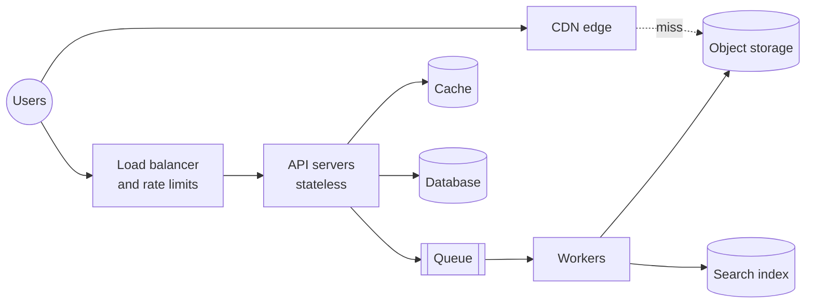

Notice that the request path stays short and synchronous: anything slow, bursty or optional goes
through the queue.

Every block buys something and costs something. Name both when you add one to a design.

| Block | Buys you | Costs you |
|---|---|---|
| [Load balancer](#/design/learn/building-blocks/load-balancing) | Horizontal scale, failover, one stable address | One more hop, and it must be redundant itself |
| [Cache](#/design/learn/building-blocks/caching) | Lower latency, less database load | Stale data, invalidation bugs, stampedes |
| [CDN](#/design/learn/building-blocks/cdns-and-edge-caching) | Content served near users, origin offload | Slow purges, and the risk of caching private data |
| [Queue or log](#/design/learn/building-blocks/message-queues-and-streams) | Decoupling, burst smoothing, retries, fan-out | Delay, duplicate deliveries, ordering work, more to operate |
| [Rate limiter](#/design/learn/building-blocks/rate-limiting) | Protection from abuse and overload, fairness | A check on every request; it can reject good traffic |
| [Consistent hashing](#/design/learn/building-blocks/consistent-hashing) | Few keys move when nodes join or leave | Uneven load unless you use virtual nodes |
| [ID generator](#/design/learn/building-blocks/unique-id-generation) | Unique, sortable IDs without a central bottleneck | Care with clocks and machine IDs |
| [Geospatial index](#/design/learn/building-blocks/geospatial-indexing) | Fast "what's near me" queries | Cell edges and very dense areas |
| [Search index](#/design/learn/building-blocks/search-and-inverted-indexes) | Full-text search with ranking | A second copy of the data that lags the database |
| [Probabilistic structures](#/design/learn/building-blocks/probabilistic-data-structures) | Counts and membership tests in tiny memory | A known error rate |
| [Object storage](#/design/learn/building-blocks/object-storage-and-large-uploads) | Cheap, durable storage for big files | Latency, no in-place edits, orphans to clean up |
| [Microservices](#/design/learn/building-blocks/microservices) | Independent deploys and scaling | Network calls, no transactions across services |
| [Stream processing](#/design/learn/building-blocks/stream-processing) | Real-time aggregates and derived data | State, late events, operational weight |

## Load balancing

A load balancer spreads requests across a pool of servers, takes unhealthy servers out of rotation,
and gives clients one stable address. It is how you scale a stateless tier horizontally (add more
servers) and survive a server dying.

### Layer 4 vs layer 7

| | Layer 4 (transport) | Layer 7 (application) |
|---|---|---|
| Sees | IP addresses and ports | HTTP method, path, headers, cookies |
| Can do | Forward TCP or UDP connections | Route by path or host, terminate TLS, retry, rewrite headers, rate limit |
| Cost | Very cheap: millions of packets per second | More CPU per request, since it parses every request |
| Use for | Databases, raw TCP, game servers, the outermost tier | Web and API traffic, microservice routing, canary releases |

A common production shape: DNS or anycast spreads users over a few L4 balancers, which spread
connections over a fleet of L7 proxies (Nginx, HAProxy, Envoy), which route each request to the
right service. Each tier is a pool, so no single box is a single point of failure.

> **Interview tip.** "An L7 load balancer terminates TLS and routes by path, using least connections
> to a stateless service tier, with health checks that only confirm the process can answer."

### Load balancing algorithms

| Algorithm | How it picks | Use when | Weak spot |
|---|---|---|---|
| Round robin (weighted) | The next server in turn; weights give bigger machines more | Requests cost about the same | Ignores how busy each server is |
| Least connections or least response time | The server with the fewest open connections or the fastest recent replies | Request costs vary; long-lived connections | Needs load information; a new, empty server gets flooded |
| Power of two choices | Pick two servers at random, send to the less loaded one | Large fleets with many balancers | Slightly worse than a perfect global choice, but needs no global state |
| Hash (IP, user ID or key) | The same key always reaches the same server, via [consistent hashing](#/design/learn/building-blocks/consistent-hashing) | Caches and sharded in-memory state | Uneven load and hot keys |

**Stateless servers beat sticky sessions.** Keep user state out of server memory (sessions in Redis
or a signed cookie), so any server can take any request and servers can come and go freely. If you
need affinity (a cookie or a key hash), say what it costs: losing a server loses its sessions.

### Health checks, draining and slow start

- **Active checks** probe a health endpoint every few seconds (say every 5 s, ejecting after 2 or 3
  failures). **Passive checks** eject a server after real requests to it fail.
- **Keep health checks shallow.** If the check also tests the shared database, then when the
  database has a problem every server fails its check, the balancer removes the whole fleet, and a
  partial outage becomes a total one. Check that the process can answer; report dependency trouble
  through metrics.
- **Drain before stopping.** For a deploy, stop sending new requests to a server, let in-flight
  requests finish (with a deadline such as 30 s), then stop it.
- **Slow start.** A freshly started server has cold caches, and with least connections it has zero
  connections, so it gets every new one and can fall over. Ramp its weight up over a minute or so.

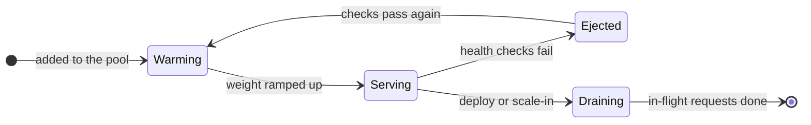

Notice that a server takes full traffic only after warming up, and leaves only after draining, so
neither event drops requests.

Retries are the other classic failure: clients, balancers and services all retrying a slow service
multiply its load. Cap retries with budgets and circuit breakers
([reliability](#/design/learn/reliability)).

### Long-lived connections and WebSockets

A request lasts milliseconds; a WebSocket connection for chat or live updates can last hours. The
balancer chooses a server once, at connect time, which changes the rules:

- Use least connections, not round robin.
- After a deploy or a scale-out, old servers hold most connections while new ones sit nearly empty.
  Rebalance gradually: close a slice of connections at a time, and let clients reconnect with
  jittered backoff so they don't all return at once.
- Something must know which gateway holds which user, so a message can find the connection: a
  connection registry (user to gateway, in Redis with a TTL refreshed by heartbeats), or a
  [pub/sub](#/design/learn/building-blocks/pubsub-vs-point-to-point) channel per user that the
  holding gateway subscribes to.
- If the user has no live connection, store the message and deliver it when they reconnect, or send
  a push notification.

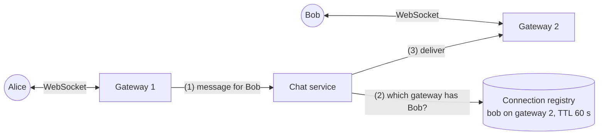

Notice that Alice and Bob are connected to different servers; the registry is what lets a message
cross from one to the other.

**Presence** (who is online) uses the same registry: each client heartbeats every 30 s or so,
refreshing a key with a TTL; when the heartbeats stop, the key expires and the user shows as
offline. One gateway server typically holds tens to hundreds of thousands of idle connections,
limited mostly by memory. The transports themselves (WebSockets, server-sent events, long polling)
are covered in [networking](#/design/learn/networking).

### Redundancy and global load balancing

- **The balancer is a single point of failure too.** Run an active-passive pair sharing a virtual
  IP, several balancers behind DNS, or anycast. Managed cloud balancers do this for you; say so.
- **Global load balancing** sends each user to the nearest healthy region with latency-based or
  geographic DNS, or with anycast; a regional balancer takes over from there.
- **Region failover is never instant.** With DNS it is bounded by record TTLs (say 60 s) and by
  clients that cache DNS longer than told, so plan for minutes. Anycast reroutes at the network
  layer and is faster.

## Caching

A cache keeps copies of hot data in fast memory, so repeated reads skip a slower and more expensive
source. It is the main lever for read latency and database load. Every cache is also a second copy
that can go stale, so always say what you cache, how it gets filled, how it goes stale, and what
happens when the cache is down.

### Where caches live

| Layer | Examples | Typical latency | Notes |
|---|---|---|---|
| Browser | HTTP cache, local storage | 0 (no network) | Controlled by Cache-Control and ETag headers |
| CDN edge | Static files, public API responses | 10-50 ms | Near the user; see [CDNs](#/design/learn/building-blocks/cdns-and-edge-caching) |
| In-process | A map or LRU inside each server | About 100 ns | Each server has its own copy, and copies drift apart |
| Distributed | Redis, Memcached | About 0.5-1 ms | Shared by all servers; one node does roughly 100K simple operations per second |
| Database | Buffer pool, OS page cache | Memory speed | Automatic; helps hot rows and indexes |

Each layer only sees the misses of the layer in front of it, so a request that reaches the database
has already missed several caches.

### Hit rate

Hit rate is hits divided by lookups. It sets both the average latency and how much traffic leaks
through to the database. With a 3 ms cache and a 40 ms database read, a 90% hit rate averages 0.9 ×
3 + 0.1 × (3 + 40) = 7 ms, and the database sees 10% of the reads.

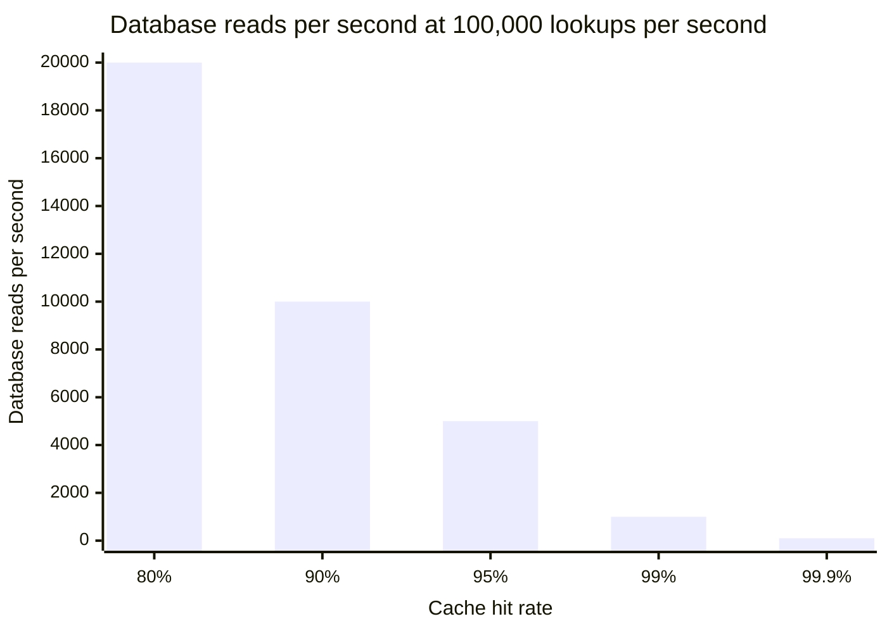

Notice that the misses, not the hits, set the database load: going from 90% to 99% cuts it tenfold.
The same arithmetic runs the other way, so a hit rate that falls from 98% to 90% looks small but
means five times the database reads.

> **Rule of thumb.** Size the cache for the working set, not the whole dataset. Access is usually
> skewed (a small share of items gets most reads), so caching the hottest 10-20% of items often gets
> most of the benefit.

### Cache-aside

The default pattern, also called lazy loading. The application owns the logic: check the cache; on a
miss, read the database and store the result in the cache with a TTL. On a write, update the
database, then delete the cache key so the next read loads the new value.

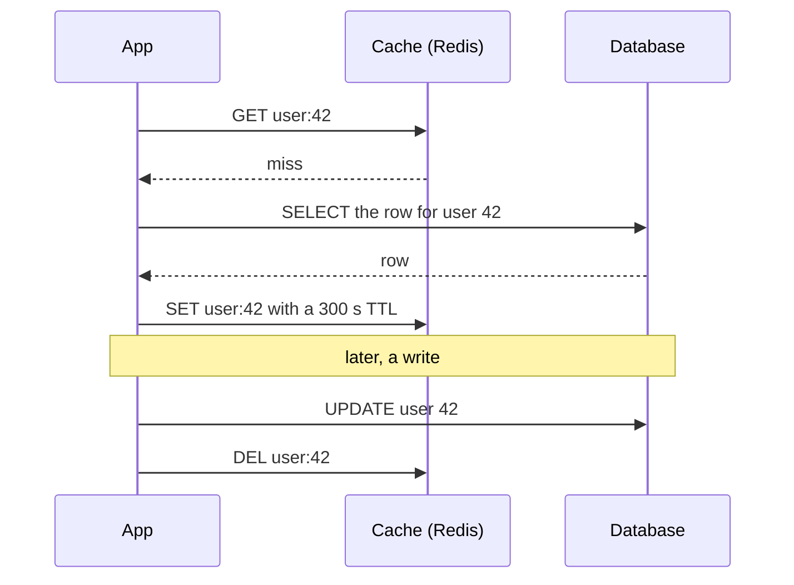

Notice that the cache fills only on demand, and that a write deletes the key instead of updating it.

- **Good:** simple; caches only what is read; if the cache dies, reads fall back to the database
  (which must survive the extra load).
- **Bad:** the first read after a miss is slow; data can be stale until the TTL or the delete; every
  caller repeats the miss logic.

**Delete, don't update, on write.** Two writers that each SET their new value can finish in the
opposite order and leave the older value cached indefinitely. A delete just forces the next read to
load the current row.

### Read-through and refresh-ahead

- **Read-through:** the cache loads from the database itself on a miss, through a loader function
  you register. The data flow matches cache-aside, but the loading logic lives in one place, and
  concurrent misses for one key can be merged into one load. It needs a cache with loaders (Caffeine
  in process, or a caching layer in front of the database).
- **Refresh-ahead:** the cache reloads a hot entry shortly before its TTL runs out (for example, on
  a read in the last 20% of its TTL). Hot keys never miss, at the cost of wasted reloads for keys
  that went cold. Use it for a few hot, predictable keys that are expensive to load: configuration,
  the home page feed.

### Write-through, write-around and write-behind

The write side of a caching strategy decides what a write does to the cache.

| Strategy | How it works | Good | Bad | Use when |
|---|---|---|---|---|
| Write-through | Write the cache and the database synchronously, in the request | The cache is always fresh; reads right after a write hit | Slower writes; caches data nobody may read; one of the two writes can fail | Data is read soon after it is written |
| Write-around | Write only the database; delete the key or let it expire | Write-once data doesn't push hot data out | The next read of that key misses | Logs, uploads, old messages: written once, rarely read |
| Write-behind (write-back) | Write the cache, reply, flush to the database later in batches | Fastest writes; batching cuts database load | Writes are acknowledged but lost if the cache dies before flushing | Counters, likes, view counts, where losing a few updates is fine |

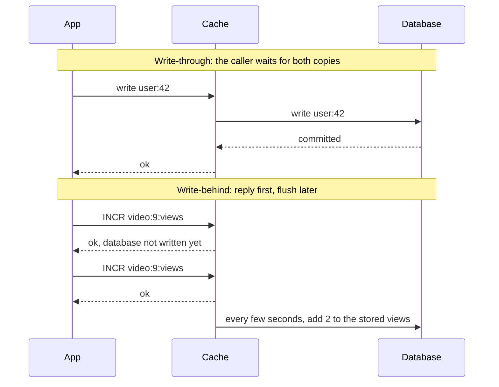

Notice the window in write-behind: anything acknowledged but not yet flushed is lost if the cache
node dies, so state that loss window out loud (or use a cache with durable storage, such as Redis
with its append-only file).

### Choosing a caching strategy

A strategy is one read choice plus one write choice. Common pairings:

- **Cache-aside with delete on write:** the interview default. Keep a TTL as a safety net.
- **Read-through with write-through:** the cache becomes the data access layer, and reads are always
  current.
- **Cache-aside with write-behind:** maximum write throughput for counters, with a stated loss
  window.
- **Cache-aside with write-around:** data that is written once and rarely read back.

**When not to cache:** data that must be exactly right at the moment of use (account balances, stock
levels at checkout: read the source of truth), data read only once, data cheaper to recompute than
to fetch, and private per-user data in a shared cache unless the key includes the user.

> **Interview tip.** Name the read pattern, the write pattern, the TTL, and the failure plan in one
> breath: "Cache-aside with a 5-minute TTL and delete on write. If Redis is down, reads go to the
> database behind a rate limit so it isn't flattened."

### Cache invalidation

| Method | How | Trade-off |
|---|---|---|
| TTL | Entries expire after a fixed time | Simple; staleness is bounded by the TTL |
| Delete on write | The writer deletes the key after committing | Fresh quickly; a failed or forgotten delete leaves stale data until the TTL |
| Change events | A consumer of the database's change stream ([CDC](#/design/learn/building-blocks/change-data-capture)) deletes or refreshes keys | Catches every write path, including scripts and other services; adds event lag |
| Versioned writes | A cache write is accepted only if its version is newer than the cached one | Old reads can't overwrite new values; needs a version on every row |

Keep a TTL even when you use the other methods: it heals whatever they miss.

**The stale-fill race.** Even cache-aside with delete on write can cache an old value:

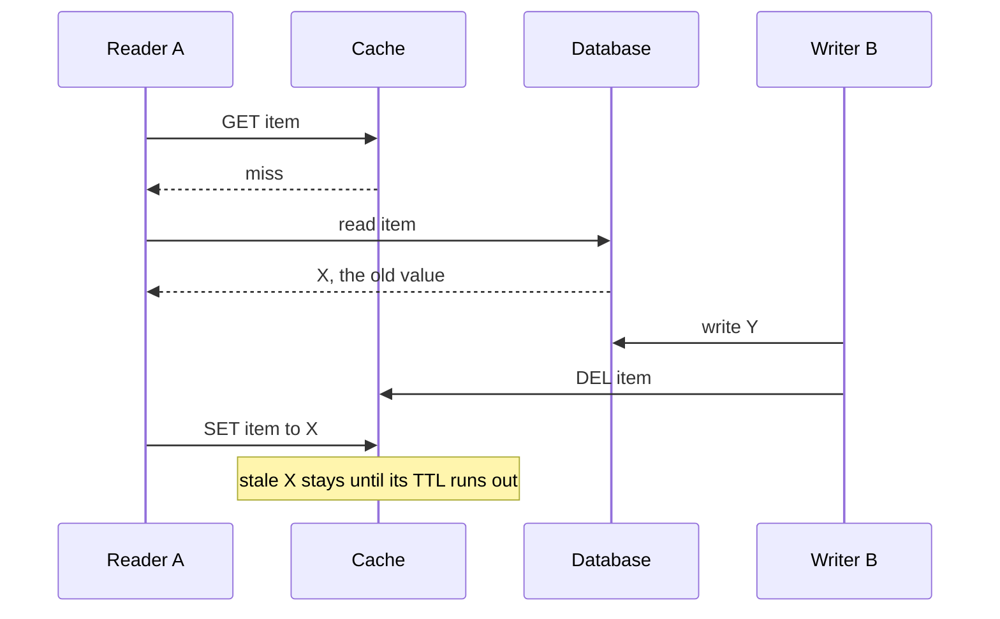

Notice that the delete ran before the stale fill, so there was nothing for it to delete. Fixes, none
perfect: a short TTL so the error heals itself; versioned writes; a lease (the cache hands reader A
a token on the miss, B's delete invalidates the token, and A's late SET is refused); or a brief
tombstone after each delete that refuses fills for a few seconds.

**Choosing a TTL.** Base it on how much staleness users can tolerate, how often the data changes,
how hot it is, and what a reload costs.

| Data | TTL |
|---|---|
| Static files with versioned names | A year: the name changes when the content does |
| Product catalog, profiles | Minutes to hours, plus delete on write |
| Search results | Seconds to minutes, keyed by the exact query |
| Balances, stock at checkout | Don't cache; read the source of truth |

Add random jitter (say ±10%) to TTLs, so keys written together don't all expire together.

**Read-your-writes.** After a user changes something, they expect to see the change. Options: return
the new value in the write response; read from the database instead of the cache for that user for a
few seconds after a write; or store a version with each entry and skip the cache when it is older
than the user's last write. Read replicas raise the same problem; see [data](#/design/learn/data).

### Eviction policies

When memory is full, the eviction policy decides which entries go.

| Policy | Evicts | Good for | Weak spot |
|---|---|---|---|
| LRU (least recently used) | The entry unused for longest | The default: recent use predicts reuse | One big scan of cold keys flushes the hot set |
| LFU (least frequently used) | The entry used least often | A stable set of popular items | Slow to forget items that were popular yesterday |
| FIFO | The oldest entry | Simplicity | Evicts hot entries just for being old |
| TTL first | Entries closest to expiry | Data with a natural lifetime | Not a complete policy on its own |

Redis approximates LRU and LFU by sampling a few keys rather than keeping exact order (the
`allkeys-lru` and `allkeys-lfu` policies). An exact LRU cache is a hash map plus a doubly linked
list kept in order of use: the map finds a node in O(1), and moving a node to the recent end or
dropping the oldest node is also O(1).

```linkedlist
values: A B C D
pointers: lru=0 mru=3
null: false
caption: capacity 4: least recently used on the left, most recently used on the right
---
values: A C D B
pointers: lru=0 mru=3
highlight: 3
null: false
caption: get(B) moves B to the most recent end
---
values: C D B E
pointers: lru=0 mru=3
highlight: 3
null: false
caption: put(E) when full: evict A from the least recent end, append E
```

Notice that nothing is ever searched: every step touches only the ends of the list or one node the
map already points at. Python's `OrderedDict` is exactly this structure:

```python
from collections import OrderedDict


class LRUCache:
    def __init__(self, capacity):
        self.capacity = capacity
        self.items = OrderedDict()  # least recently used first

    def get(self, key):
        if key not in self.items:
            return None
        self.items.move_to_end(key)  # now the most recently used
        return self.items[key]

    def put(self, key, value):
        self.items[key] = value
        self.items.move_to_end(key)
        if len(self.items) > self.capacity:
            self.items.popitem(last=False)  # evict the least recently used
```

### Cache failure modes

| Problem | What happens | Fixes |
|---|---|---|
| Stampede | A hot key expires and thousands of concurrent misses hit the database at once | Single-flight (one request refills, the rest wait or get the stale copy), a short lock, refresh-ahead |
| Avalanche | Many keys expire together, or the cache cluster restarts empty, and the database is flooded | TTL jitter, warming the cache before it takes traffic, a circuit breaker and rate limit in front of the database |
| Hot key | One key's traffic saturates the single shard that holds it | See [hot keys](#/design/learn/building-blocks/hot-keys) |
| Penetration | Lookups for keys that don't exist always miss and always reach the database (often an attack) | Cache "not found" with a short TTL (negative caching), or put a [Bloom filter](#/design/learn/building-blocks/bloom-filters) in front |

Single-flight with a short lock turns a stampede into one database query:

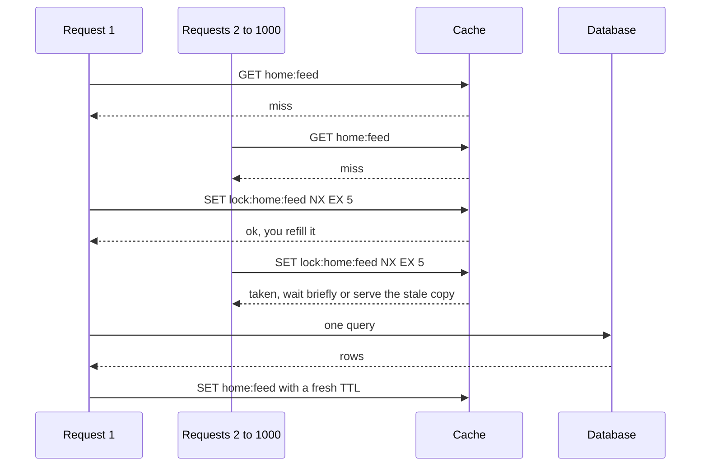

Notice that `NX` (set only if absent) lets exactly one request win the lock, and the 5-second expiry
frees the lock even if the winner crashes.

**What to watch:** hit rate, latency percentiles, evictions, memory use, and database queries per
second. Database load rising while the hit rate falls points to an avalanche, a lost cache node, a
hot key or a change in traffic. **Security:** a cache hit must not skip authorization (check
permissions on every request, or key entries by what the caller is allowed to see), don't cache
secrets, and never build shared entries from unvalidated input (cache poisoning).

### Hot keys

A hot key is a single key so popular that the one shard holding it saturates, however many shards
you have: a celebrity's profile, a viral post, a flash-sale item. Sharding spreads keys across
nodes; it can't spread the load of one key.

- **Local copy:** keep the value in each app server's memory for a few seconds. Thousands of reads
  per second per server become one cache read per server per refresh.
- **Replicate the key:** write N copies under different keys (`post:7:copy0` to `post:7:copy9`),
  which land on different shards; each reader picks one at random. Writes must update every copy.
- **Split the value:** break one big object into parts that are cached and fetched separately.
- **Split the writes:** for a hot counter, keep N sub-counters, increment a random one, and sum them
  on read.

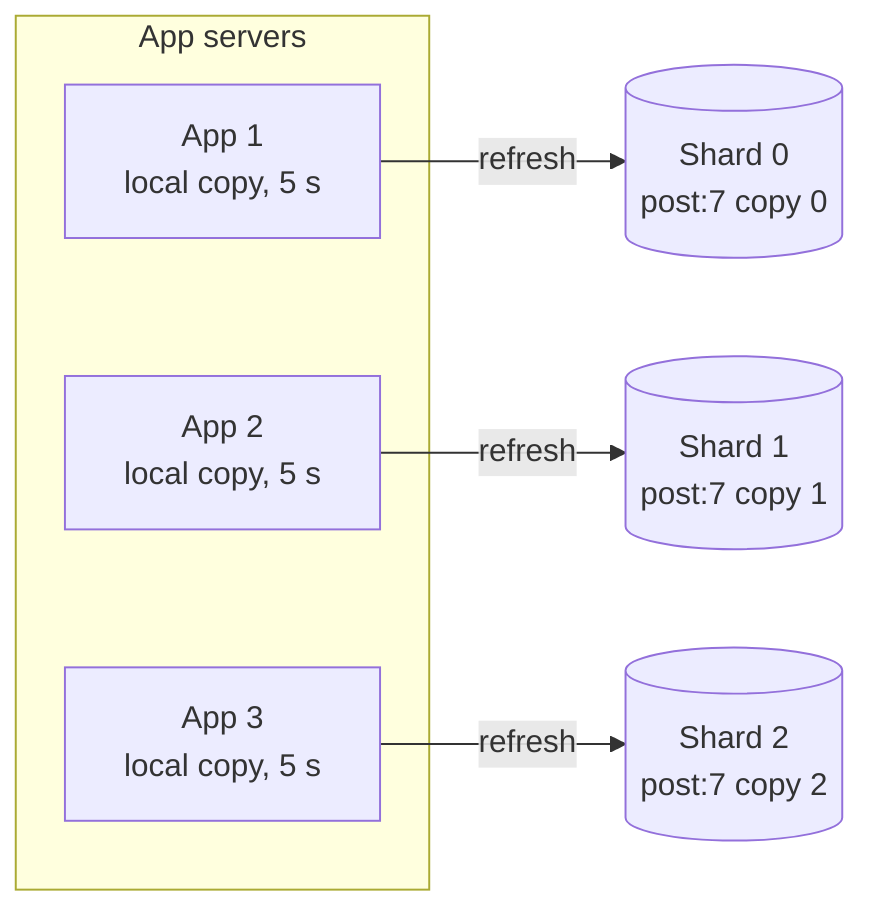

Notice the two layers: local copies absorb almost all reads, and the copies spread what is left over
three shards instead of one.

In a news feed, a celebrity with 50 million followers is a hot key twice over: everyone reads their
posts (cache and replicate them), and pushing each post into 50 million feeds is too much work (pull
their posts at read time instead; see
[fan-out](#/design/learn/building-blocks/fan-out-on-write-vs-fan-out-on-read)).

## CDNs and edge caching

A content delivery network (CDN) is a set of caches in many locations ("edges") that serve content
from near the user. For static content, distance is most of the latency, so a CDN cuts time to first
byte from hundreds of milliseconds to tens. It also offloads the origin (often 90% or more of the
bytes of a static-heavy product) and absorbs traffic spikes and some attacks.

DNS or anycast routes each user to a nearby edge. On a hit, the edge answers. On a miss, the edge
asks a regional "shield" cache, which goes to the origin only if it misses too, so a newly popular
file costs the origin one fetch instead of one per edge.

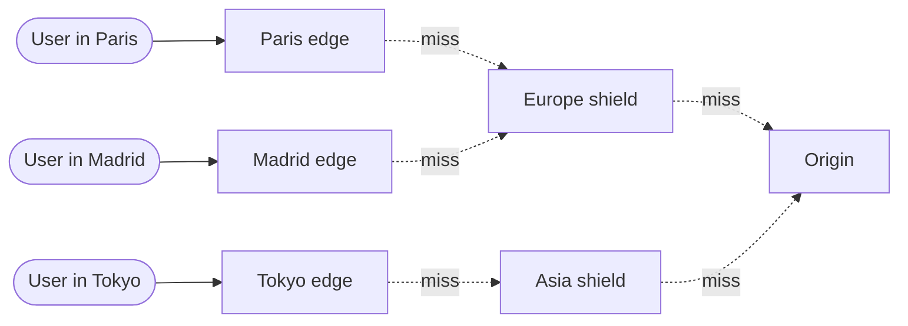

Notice that the origin only sees requests that missed at both the edge and the shield.

CDNs do more than cache: they terminate TLS close to users, keep warm connections back to the
origin, filter attacks (a web application firewall and DDoS protection), and run small functions at
the edge (redirects, auth checks, A/B routing). Edge compute is limited, so keep it to light, mostly
stateless work.

### Pull vs push CDNs

| Model | How content arrives | Use when |
|---|---|---|
| Pull (origin pull) | The edge fetches on the first request, then caches | The default: large or long-tail catalogs, content that changes |
| Push | You upload content to the CDN ahead of time | Small, known sets: a software release, a big launch, a video you know will be popular |

### What to put on a CDN

- **Static files** (JS, CSS, images, fonts): cache for a year, with a content hash in the file name
  (`app.3f9a1c.js`), so a new version is a new URL.
- **Video and large downloads**, cut into small segments, which makes them cacheable like any other
  file; see [video](#/design/learn/building-blocks/video-processing-and-adaptive-bitrate).
- **Public API responses** (catalog pages, public profiles) with short TTLs.
- **Not private, per-user data**, unless the cache key includes the user and you are certain of it.
  Serving one user's private page to another from a shared cache is a serious security bug.

### Cache-Control headers and cache keys

| Header | Effect |
|---|---|
| `Cache-Control: max-age=N` | Browsers and CDNs may reuse the response for N seconds |
| `s-maxage=N` | Overrides max-age for shared caches (CDNs) only |
| `public` or `private` | Whether shared caches may store it at all |
| `no-store` | Never store it anywhere |
| `no-cache` | Store it, but revalidate with the origin before every use |
| `ETag` with `If-None-Match` | Cheap revalidation: the origin answers `304 Not Modified` with no body |
| `stale-while-revalidate`, `stale-if-error` | Serve the old copy while refreshing, or while the origin is down |

> **Pitfall.** `no-cache` doesn't mean "don't cache"; it means "check before reusing". Use
> `no-store` for responses that must never be stored.

The **cache key** is the URL by default; the `Vary` header and CDN settings can add headers, cookies
or query parameters. Too much in the key (every cookie, tracking parameters) fragments the cache and
the hit rate falls. Too little serves the wrong variant: the wrong language, or another user's page.

### Versioned URLs and purging

Purging is possible but takes seconds to minutes to reach every edge, and it is easy to overuse.
Prefer:

- **Versioned URLs for assets.** The HTML has a short TTL and points at `app.3f9a1c.js`, which has a
  TTL of a year. A deploy changes the hash, so the new file is a new cache key and nothing needs
  purging.
- **Short TTLs plus `stale-while-revalidate`** for dynamic content.
- **Purge by tag** (also called a surrogate key) for emergencies: purge every page that shows
  product 42.

> **Interview tip.** "Static files and media go through a CDN with long TTLs and hashed file names,
> so the origin only sees misses, and a shield tier protects the origin. Personalized responses
> aren't cached at the edge."

## Message queues and streams

A queue or log sits between producers and consumers, so they don't have to run at the same speed or
at the same time. It buys you:

- **Decoupling:** the producer doesn't wait for the consumer, or even know it exists.
- **Buffering:** a spike becomes a backlog that workers drain at a steady pace.
- **Retries:** failed work is redelivered instead of lost.
- **Fan-out:** one event can feed several independent consumers.

It costs extra latency, duplicate deliveries, harder ordering and debugging, and one more system to
run.

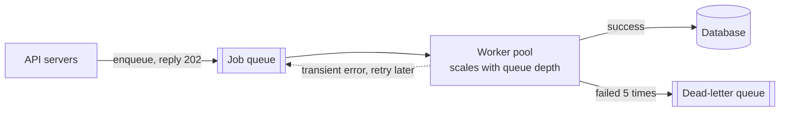

Notice that the API replies as soon as the job is queued; workers absorb the burst at their own
pace, and a message that keeps failing is parked in the dead-letter queue instead of blocking the
line.

### Queues vs logs

| | Queue (RabbitMQ, SQS-style) | Log or stream (Kafka, Kinesis, Pulsar) |
|---|---|---|
| Model | Each message goes to one consumer, then is deleted | An append-only, ordered log; each consumer tracks its own position (offset) |
| Replay | No: once acknowledged, it's gone | Yes: rewind and reprocess anything still within retention |
| Several independent readers | Needs a copy per reader (a fan-out exchange or topic) | Natural: every consumer group reads the whole log |
| Ordering | Best effort once there are several consumers and retries | Strict within a partition |
| Best for | Jobs and tasks: emails, thumbnails, webhooks | Event streams: analytics, change data capture, feeding many systems |

```array
label: orders log
values: e0 e1 e2 e3 e4 e5 e6 e7
pointers: billing=3 search=6 next=8
caption: two consumer groups at their own offsets; new events are appended at next
```

Notice that reading deletes nothing: each consumer group is just an offset into the same log, so the
search group can rewind and reprocess without affecting billing.

### Partitions and consumer groups

How a Kafka-style log scales:

- A **topic** is split into **partitions**. Each partition is an ordered log stored on one broker
  and replicated to others.
- The **partition key** chooses the partition (a hash of the key modulo the partition count). The
  same key always lands in the same partition, so events for one user or one order stay in order. A
  skewed key makes a hot partition.
- A **consumer group** divides the partitions among its members: each partition is read by exactly
  one consumer in the group. Parallelism is capped by the partition count, and extra consumers sit
  idle.
- Each consumer **commits its offset** to record progress; after a crash, another member resumes
  from the last committed offset.
- Adding partitions raises throughput but changes which partition each key maps to, so choose the
  count up front (a few times the consumers you expect). Plan for a few MB/s to a few tens of MB/s
  per partition.

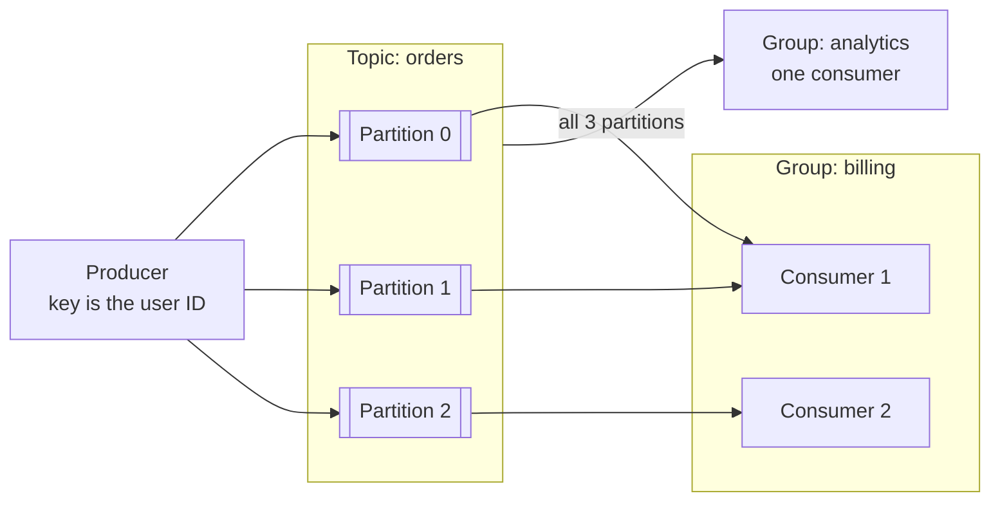

Notice that inside a group each partition belongs to exactly one consumer (billing splits three
partitions over two consumers), while every group sees every message (analytics reads all three with
one). Ordering holds only within a partition, so pick the key that groups what must stay in order.

### Delivery guarantees

| Guarantee | Meaning | How |
|---|---|---|
| At most once | May lose messages, never duplicates them | Commit the offset (or acknowledge) before processing |
| At least once | Never loses messages, may duplicate them | Commit after processing: the usual default |
| Exactly once, in effect | Each message's effect happens once | At-least-once delivery plus an idempotent consumer, or one transaction covering the effect and the offset |

Exactly-once delivery between separate systems isn't achievable in general; in practice "exactly
once" means at-least-once delivery plus deduplication. The phrase to use in an interview:
"at-least-once, with idempotent consumers".

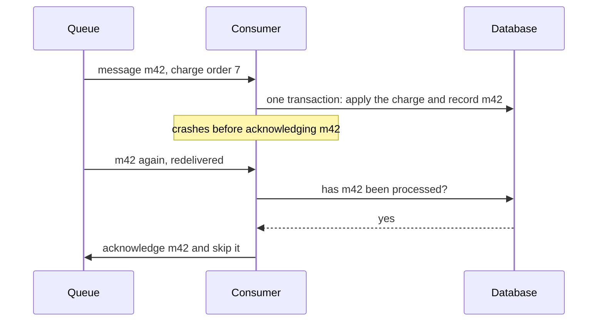

Notice that the redelivery is harmless only because the consumer recorded the message ID in the same
transaction as its effect. Other ways to be idempotent: use a natural key (upsert by order ID), or
make the effect itself repeatable (set a value instead of adding to it). Idempotency keys for APIs
are covered in [reliability](#/design/learn/reliability).

### Retries and dead-letter queues

- **Retry transient errors with exponential backoff and jitter** (about 1 s, 2 s, 4 s, 8 s, each
  randomized) so retries don't arrive in synchronized waves.
- **Dead-letter queue (DLQ):** after N attempts (say 5), move the message aside so one poison
  message doesn't block the rest. Alert on DLQ depth, and keep tools to inspect, fix and replay.
- **Visibility timeout** (SQS-style queues): a received message is hidden from other consumers for a
  while; if it isn't acknowledged in time, it becomes visible again and is redelivered. Set it
  longer than the processing time, and extend it during long jobs.
- **Ordering vs retries:** retrying one message while later ones go ahead breaks the order. Either
  block the partition until the message succeeds (strict order, but one bad message stalls
  everything behind it) or make processing order-tolerant (versions, last-write-wins).

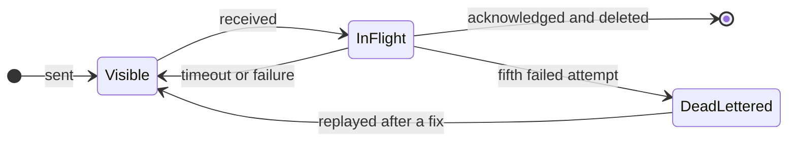

Notice that a message is deleted only when it is acknowledged: a consumer that crashes mid-job just
lets the timeout return the message to the queue.

### Backpressure and consumer lag

If producers outrun consumers, the backlog grows without limit. Watch **consumer lag**: messages
behind, or better, seconds behind (the age of the oldest unprocessed message). If 1,300 messages a
second arrive and consumers finish 1,000, the backlog grows by 300 a second, about 1.1 million an
hour.

When lag grows, check in order: did input rise, or did processing slow down (a deploy, a slow
dependency, a retry loop)? Is one partition hot? Are poison messages being retried over and over?
Then act: add consumers (up to the partition count), make each message cheaper (batch the writes),
shed or sample low-value work, or slow the producers down (a bounded queue that rejects, or 429s
upstream).

> **Key idea.** A queue hides overload; it doesn't fix it. An unbounded queue just moves the failure
> later and makes it bigger.

### Pub/sub vs point-to-point

- **Point-to-point (a work queue):** each message goes to one of the workers. It fits jobs: "resize
  this image".
- **Publish/subscribe:** each event goes to every subscriber. It fits facts several systems care
  about: "order placed" goes to email, analytics and the search indexer.

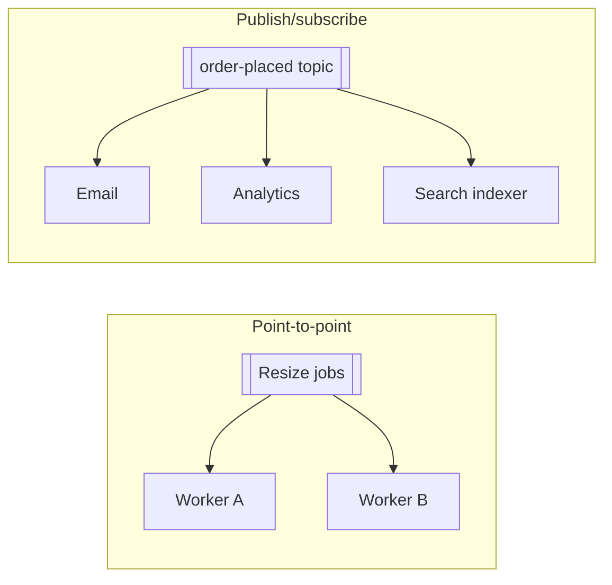

Notice that the work-queue workers share the messages between them, while each pub/sub subscriber
gets its own copy of every event.

Pub/sub also connects real-time servers: each chat gateway subscribes to a channel per connected
user, so a message published to `user:bob` reaches whichever gateway holds Bob's connection. Redis
pub/sub is fire-and-forget (a message for a disconnected subscriber is lost); use a log when
messages must survive restarts, and keep the durable copy in a database for offline users.

### Fan-out on write vs fan-out on read

Some systems deliver one item to many readers: a post to followers' feeds, a message to a group, an
alert to subscribers. There are two strategies:

| | Fan-out on write (push) | Fan-out on read (pull) |
|---|---|---|
| On write | Copy the item's ID into every recipient's inbox, through a queue and workers | Store the item once |
| On read | Read one precomputed list: fast | Fetch recent items from everyone followed and merge: slow |
| Hurts when | An author has millions of followers (write amplification) | A reader follows thousands of accounts (read amplification) |

The usual answer is a **hybrid**: push for normal authors, and for authors above a threshold (say
100K followers) skip the fan-out and merge their recent posts in at read time.

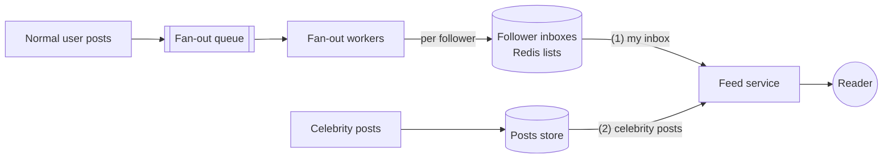

Notice that normal posts are pushed ahead of time while celebrity posts are pulled at read time, so
no single post costs 50 million writes. With 200 followers on average, each normal post costs 200
inbox writes: at 1,200 posts a second that is 240,000 small writes a second, which a Redis cluster
handles. The inbox is denormalized data, a copy shaped for the read; [data](#/design/learn/data)
covers denormalization in general.

### When to use a queue

Use a queue when the caller doesn't need the result right away (email, thumbnails, indexing,
analytics), when work arrives in bursts, or when a downstream dependency is slow or flaky (a
push-notification provider, a payment processor). Use a synchronous call when the user is waiting
for the answer. Async work needs a way to report back: a status endpoint the client polls (reply
`202 Accepted` with a job ID), a webhook, or a push notification.

Practical points worth saying:

- **Publish events reliably.** Writing to the database and then to the queue loses events when the
  second write fails. Write the event to an outbox table in the same transaction as the data change,
  and let a relay publish it ([reliability](#/design/learn/reliability)).
- **Keep messages small.** Put big payloads in object storage and send a pointer.
- **Version event schemas** and make only backward-compatible changes, since old and new consumers
  run side by side.
- **Choose retention for replay.** A log kept for 7 days lets you reprocess a week of events after
  fixing a bug.

## Rate limiting

A rate limiter caps how much a client can do in a period of time. It protects services from abuse
and overload, stops one noisy tenant from starving the others, controls cost (paid downstream APIs,
LLM tokens), and enforces plan quotas.

### Rate limiter decisions

1. **What do you limit by?** API key or user, IP address, tenant, endpoint, or a combination. IP
   addresses are weak (many users share one behind a NAT, and attackers rotate them); authenticated
   identity is better. Use both layers.
2. **Where does it run?** At the edge or API gateway (the cheapest place to reject, but coarse), in
   a shared limiter service or middleware (flexible), or inside each service (protects that service
   directly, for example with a concurrency limit). Large systems layer them.
3. **What happens to a client over the limit?** Reject with `429 Too Many Requests` and a
   `Retry-After` header; or queue and delay the request; or degrade (serve a cached or cheaper
   result). Return the limit, the remaining count and the reset time in response headers so
   well-behaved clients can slow down.
4. **What if the limiter's store is down?** See [fail open or fail
   closed](#/design/learn/building-blocks/fail-open-or-fail-closed).

### Fixed window counter

Count requests per key in each clock window (say per minute) and reset at the boundary: one counter
per key, such as a Redis key `rl:{key}:{minute}` that expires after the window. The flaw is the
boundary: a burst at the end of one window plus a burst at the start of the next lets twice the
limit through in a short span.

```intervals
windows: [0,59] [60,119]
10 requests: [50,59]
10 more: [60,69]
20 in 20 s: [50,69]
caption: limit 10 per minute: both bursts pass because the counter resets at 60 s
```

Notice that each window, taken alone, stayed under its limit, yet 20 requests landed within 20
seconds.

```python
import time

import redis

r = redis.Redis()


def allow(key, limit=100, window=60):
    bucket = f"rl:{key}:{int(time.time() // window)}"
    pipe = r.pipeline()  # MULTI/EXEC: the two commands run as one unit
    pipe.incr(bucket)  # atomic, even with many app servers calling at once
    pipe.expire(bucket, window)
    count, _ = pipe.execute()
    return count <= limit
```

### Sliding window log

Store a timestamp for every request (a Redis sorted set per key). On each request, drop the entries
older than the window, count what is left, and allow the request if the count is under the limit. It
is exact, but memory grows with traffic: one entry per request, so a limit of 1,000 an hour for a
million users can mean a billion stored timestamps.

```array
label: log
values: 12:00:05 12:00:31 12:00:52 12:01:10 12:01:38
dim: 0 1
caption: at 12:01:40 with a 60 s window, entries before 12:00:40 are dropped; 3 remain
```

Notice that the window moves with each request instead of jumping at the minute boundary, so there
is no boundary burst; the price is storing every timestamp.

### Sliding window counter

Keep the fixed-window counts for the current and the previous window, and weight the previous one by
how much of it the sliding window still covers:

estimate = current count + previous count × (1 − time into the current window ÷ window length)

```intervals
previous (8 requests): [0,59]
current (3 so far): [60,119]
last 60 s at t=75: [15,75]
caption: 15 s into the current window: estimate = 3 + 8 × 0.75 = 9
```

Notice that the sliding window still covers three quarters of the previous window, so three quarters
of its count is carried over. The method assumes the previous window's requests were spread evenly,
which is close enough in practice, and it needs only two counters per key: a good default for
per-minute or per-hour quotas.

### Token bucket

Each key has a bucket that holds up to `capacity` tokens and refills at `rate` tokens per second. A
request spends one token; with no token left, it is rejected. Capacity sets the largest burst and
rate sets the long-run average. The state is tiny: a token count and a last-refill time per key.
This is the default answer in interviews.

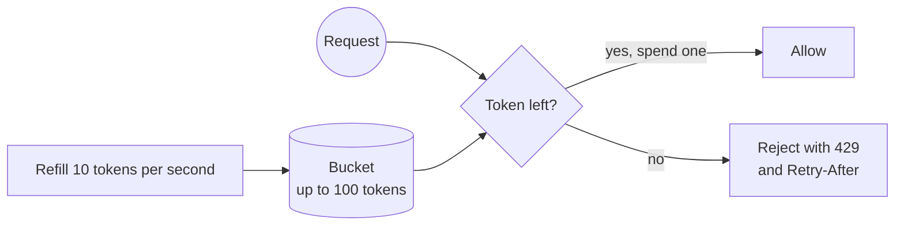

Notice that an idle client saves up to 100 tokens, so it can burst 100 requests at once and is then
held to 10 a second.

```python
import time


class TokenBucket:
    def __init__(self, rate, capacity):
        self.rate, self.capacity = rate, capacity
        self.tokens, self.last = capacity, time.monotonic()

    def allow(self):
        now = time.monotonic()
        # Refill lazily: no timer, just credit the time since the last call.
        self.tokens = min(self.capacity, self.tokens + (now - self.last) * self.rate)
        self.last = now
        if self.tokens >= 1:
            self.tokens -= 1
            return True
        return False
```

In Redis the same logic runs as a Lua script, so reading, refilling and spending happen as one
atomic step.

### Leaky bucket

Requests join a FIFO queue that drains at a fixed rate; when the queue is full, new requests are
dropped. The output is perfectly smooth, which suits a downstream that can't take bursts (a legacy
system, or a provider with a strict requests-per-second limit). The price is that bursts wait in the
queue (added latency) or are dropped. In short, a token bucket allows bursts up to its capacity; a
leaky bucket smooths them away.

### Rate limiting algorithms compared

| Algorithm | State per key | Bursts | Accuracy | Pick it when |
|---|---|---|---|---|
| Fixed window counter | 1 counter | Up to 2x the limit at a boundary | Rough | Simplicity matters most |
| Sliding window log | 1 timestamp per request | None | Exact | Low limits that must be exact (login attempts) |
| Sliding window counter | 2 counters | Smoothed | Close | Per-minute or per-hour quotas |
| Token bucket | Token count and timestamp | Up to the capacity | Exact for its model | General API limits: the default |
| Leaky bucket | A queue | Absorbed; output is smooth | Exact | Protecting a downstream that needs a steady rate |

### Distributed rate limiting with Redis

With many app servers, the counts must be shared. The options:

- **Central store (Redis):** every server checks one counter store. Accurate and simple; it costs a
  network hop (about 1 ms) per request, and the store must scale (shard it by key).
- **Local counters, synced:** each of N servers enforces a share of the limit and syncs now and
  then. Fast but approximate, and unfair if traffic is spread unevenly.
- **Sticky routing:** route each key to one limiter node so its state is local. Works until that
  node fails.
- **Hybrid:** a cheap local limit rejects obvious abuse; a central check applies the precise quota.

The classic bug is a race between reading and writing the count:

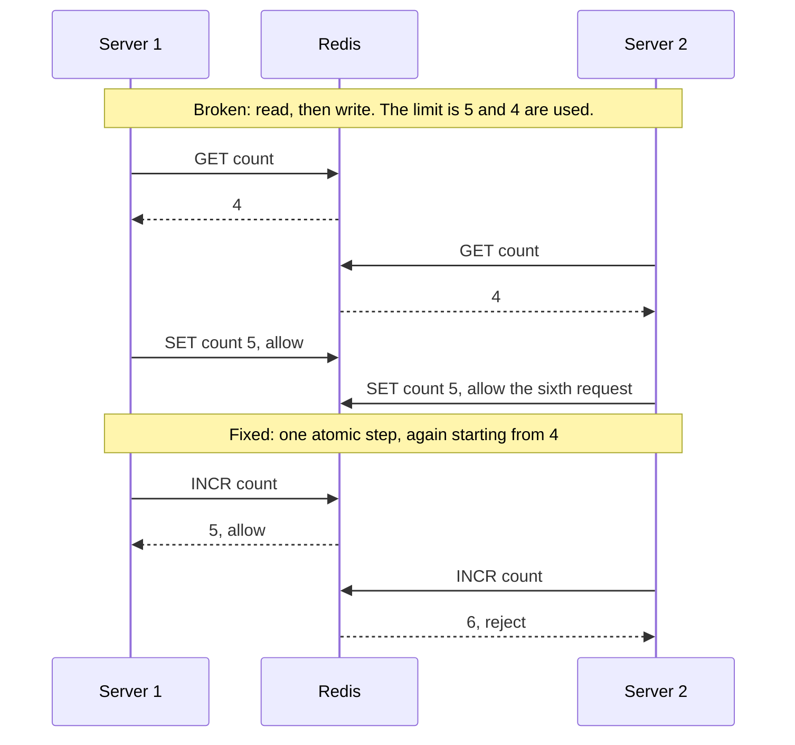

Notice that with GET then SET both servers see 4 and both allow; INCR hands each caller a different
count, so exactly one wins the last slot.

**Sizing.** A token bucket in Redis takes on the order of 100 bytes per key, so 10 million active
keys is about 1 GB, which fits one node. Throughput is the tighter limit: at roughly 100K operations
per second per node, 500K requests per second needs 5 shards plus headroom. One abusive key still
lands on one shard, so add a local pre-filter and per-IP limits at the edge.

### Fail open or fail closed

If the limiter's store is unreachable, you must choose:

| Choice | Behavior | Use for |
|---|---|---|
| Fail open | Allow requests, ideally under a coarse in-memory limit | General API traffic: a limiter outage shouldn't become a full outage |
| Fail closed | Reject requests | Security limits: login attempts, password resets, one-time codes, expensive or paid operations |

> **Interview tip.** "Token bucket per API key in Redis, checked at the gateway with an atomic Lua
> script. Reply 429 with Retry-After. Fail open on Redis errors, with a coarse in-memory limit as a
> backstop, but fail closed for login attempts."

Related protections: quotas (daily or monthly plan limits, stored durably), concurrency limits
(maximum in-flight requests per client), load shedding ([reliability](#/design/learn/reliability)),
and clients that retry with exponential backoff and jitter.

## Consistent hashing

To spread keys over N nodes (cache shards, database shards, partitions) you need a rule that maps
each key to a node, and the rule should move few keys when nodes join or leave.

### Why hash mod N breaks

The obvious rule, node = hash(key) mod N, moves almost every key when N changes: going from N to N +
1 nodes moves N/(N + 1) of the keys. For a cache that means a near-total cold start; for a database,
moving nearly all the data.

```array
label: mod 3
values: A B C A B C A B C A B C
caption: hash values 0 to 11 spread over nodes A, B and C
---
label: mod 4
values: A B C D A B C D A B C D
highlight: 3..11
caption: add node D: 9 of the 12 keys change node
```

Notice that only hash values 0, 1 and 2 stay where they were.

### The hash ring

Hash both the nodes and the keys onto the same circle (say 0 to 2^32 − 1). A key belongs to the
first node clockwise from it. When a node joins or leaves, only the keys between it and its neighbor
move: about K/N of K keys, instead of nearly all of them.

```ring
nodes: A@40 B@160 C@270
keys: k1@10 k2@100 k3@200 k4@300
caption: each key belongs to the next node clockwise
---
nodes: A@40 B@160 C@270 D@330
keys: k1@10 k2@100 k3@200 k4@300
highlight: D
caption: add D: only k4, which sits between C and D, moves (from A to D)
```

Notice that k1, k2 and k3 keep their nodes; D takes over only the arc just before it.

### Virtual nodes

With few nodes, the arcs are uneven (one node may own half the circle), and a failed node's whole
load falls on its single clockwise neighbor. The fix is to give each physical node many positions on
the ring, called virtual nodes (100 to 200 each is common). Load evens out, a failed node's keys
spread over all the survivors, and a bigger machine can simply take more virtual nodes.

```ring
nodes: A1@20 B1@60 C1@100 A2@140 C2@180 B2@220 A3@260 B3@300 C3@340
keys: k1@10 k2@120 k3@250
highlight: A1 A2 A3
caption: 3 servers with 3 virtual nodes each: if A fails, k1, k2 and k3 go to B, C and B
```

Notice that server A owns three small arcs instead of one big one, so its keys scatter across both
survivors when it fails.

For **replication**, store each key on the next R distinct physical nodes clockwise (as Cassandra
does), so copies survive the loss of a node.

### Hash slots and rendezvous hashing

| Scheme | How a key finds its node | Keys moved when a node joins | Notes |
|---|---|---|---|
| hash mod N | hash(key) mod N | Almost all | Fine only if N never changes |
| Ring with virtual nodes | The next node clockwise | About 1/N | Cassandra, many cache clients |
| Fixed hash slots | The key hashes to one of 16,384 slots (Redis Cluster); a table maps slots to nodes | Only the slots you reassign | Easy to reason about and rebalance |
| Rendezvous (highest random weight) | Each key picks the node with the highest hash(key, node) | About 1/N | Simple and even; costs O(N) per lookup |

None of these fixes a [hot key](#/design/learn/building-blocks/hot-keys): one key still lands on one
node. Resharding a live system means copying data in the background (or dual-writing) and then
cutting over, never moving everything at once; see [sharding](#/design/learn/data).

> **Interview tip.** "I'd shard by key with consistent hashing and virtual nodes, so adding a node
> moves only about 1/N of the keys and a failed node's load spreads evenly."

## Unique ID generation

Rows, messages, short URLs and events all need IDs. Decide what you need before you pick a scheme:
uniqueness only, rough time order (good for pagination and for index locality), shortness (for
URLs), or unguessability (for public links).

### ID schemes compared

| Scheme | Size | Sorts by time | Coordination | Watch out for |
|---|---|---|---|---|
| Database auto-increment | 64 bits | Yes | One database | A single point of contention; hard across shards; guessable, and reveals your volume |
| UUID v4 (random) | 128 bits | No | None | Random inserts scatter across a B-tree index; 36 characters as text |
| UUID v7 or ULID | 128 bits | Yes (millisecond prefix) | None | Reveals the creation time |
| Snowflake-style | 64 bits | Yes | A unique machine ID per generator | Clock skew, and clocks that jump backward |
| Ranges from a ticket server | 64 bits | Roughly | A central counter, rarely | The unused part of a range is lost on a crash |
| Random base62 code | 6 to 10 characters | No | A uniqueness check | Collisions grow as the space fills |

### Snowflake IDs

A Snowflake-style ID packs a timestamp, a machine ID and a sequence number into 64 bits. It fits in
a BIGINT column, sorts by creation time, and needs no coordination on the hot path.

```array
values: "1 bit: sign" "41 bits: time" "10 bits: machine" "12 bits: sequence"
indices: false
caption: milliseconds since a chosen epoch, then the generator ID, then a counter within the millisecond
```

Notice that the time is in the high bits, so sorting the IDs as numbers sorts them by creation time.

- 41 bits of milliseconds is 2^41 ms, about 69 years from the chosen epoch.
- 10 bits of machine ID allow 1,024 generators. Assign them from configuration, or lease them from
  ZooKeeper or etcd at startup so two processes never share one.
- 12 bits of sequence allow 4,096 IDs per millisecond per generator, about 4 million a second. If a
  generator runs out within a millisecond, it waits for the next one.

**Clocks.** Time-based IDs depend on clocks, which drift between machines and can jump backward when
NTP corrects them. A generator must refuse to issue IDs, or wait, until its clock passes the last
timestamp it used; otherwise it can repeat IDs. IDs from different machines are only roughly ordered
(within the clock skew). If you need a true global order, use a single sequencer or one log
partition.

### Ticket servers and ID ranges

A central counter (a database row, or a ZooKeeper or etcd node) hands each app server a block of
IDs, say 10,000 at a time, and the server issues them from memory. The counter sees one request per
10,000 IDs, so it is never a bottleneck, and the IDs stay small numbers, which suits short codes.
Two counters, one handing out odd-numbered blocks and one even-numbered, remove the single point of
failure.

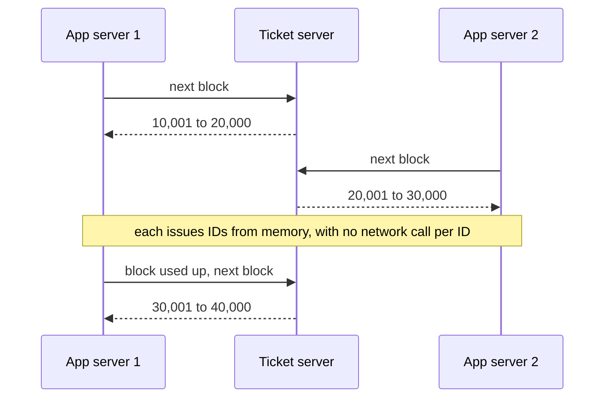

Notice that the central counter is touched once per 10,000 IDs; the cost is that IDs are only
roughly ordered across servers, and a crash loses the rest of a block.

### Short codes and base62

Base62 uses a-z, A-Z and 0-9, so each character carries almost 6 bits.

| Length | Possible codes |
|---|---|
| 6 | 62^6, about 57 billion |
| 7 | 62^7, about 3.5 trillion |
| 8 | 62^8, about 218 trillion |

Three ways to produce a short code:

1. **Encode a counter** (from ticket ranges). Unique by construction, so no collision checks. Codes
   are sequential, though, so they are guessable and reveal your volume; if that matters, scramble
   the number first with a reversible mapping (for example, multiply by a large constant that shares
   no factor with 62^7, modulo 62^7).
2. **Random code plus a uniqueness check.** Pick 7 random characters, insert with a unique
   constraint, and retry on a conflict. With 1 billion codes used out of 3.5 trillion, about one
   insert in 3,500 collides and retries.
3. **Hash the long URL and truncate.** The same URL always gets the same code (free deduplication),
   but truncated hashes collide, so you still need check-and-retry (for example, rehash with a
   salt).

```python
ALPHABET = "0123456789abcdefghijklmnopqrstuvwxyzABCDEFGHIJKLMNOPQRSTUVWXYZ"


def base62(n):
    out = ""
    while True:
        n, r = divmod(n, 62)
        out = ALPHABET[r] + out
        if n == 0:
            return out


print(base62(1_000_000_000))  # 15FTGg: a billion fits in 6 characters
```

> **Interview tip.** State the requirement before the scheme: "IDs must be unique and roughly
> time-ordered, with no coordination on the hot path, so Snowflake-style or UUID v7. For public
> short codes, a counter from ticket ranges encoded in base62, or random base62 with a uniqueness
> check."

## Geospatial indexing

"Restaurants within 2 km", "the nearest drivers" and "listings in this map view" all need search by
location. A B-tree index on (latitude, longitude) can narrow one dimension, but then it scans every
row in that band of the other. Spatial indexes instead turn the map into cells you can look up
directly.

### Geohash

A geohash interleaves the bits of longitude and latitude and writes the result in base32. Each extra
character splits a cell into 32 smaller ones, so a geohash is a path down a grid: points in the same
cell share a prefix, and a prefix scan on an ordinary index finds everything in a cell.

| Characters | Cell size at the equator |
|---|---|
| 4 | 39 km × 20 km |
| 5 | 4.9 km × 4.9 km |
| 6 | 1.2 km × 0.6 km |
| 7 | 153 m × 153 m |

Cells get narrower (east to west) toward the poles. The catch is the edges: two points a meter apart
on either side of a cell boundary can have completely different prefixes. Sharing a prefix means
"near", but being near doesn't mean sharing a prefix. So always query the cell and its 8 neighbors.

```grid
collabels: west _ east
rowlabels: north _ south
9q8zj 9q8zn 9q8zp
9q8yv 9q8yy 9q8yz
9q8yt 9q8yw 9q8yx
highlight: 1,1
caption: search 9q8yy and its 8 neighbors: the north row starts 9q8z, not 9q8y
```

Notice that a prefix search for `9q8y` alone would miss the whole northern row, even though those
cells touch the one you are in.

### Quadtrees

A quadtree splits a region into four quadrants, and splits again any quadrant holding more than a
set number of points. Dense cities end up with small cells and empty countryside with big ones, so
every leaf holds a similar number of points. It usually lives in memory and is rebuilt or updated
periodically, which suits places that rarely move.

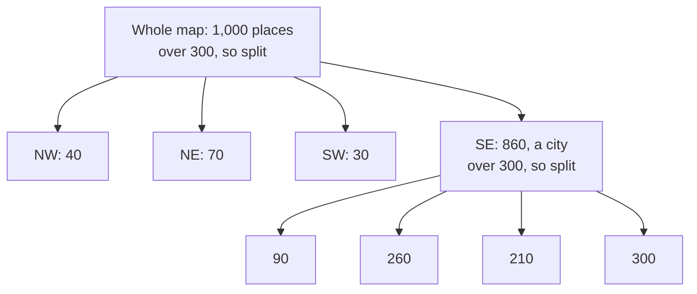

Notice that with at most 300 places per leaf, the sparse quadrants stay large and only the dense one
splits again.

### Geospatial indexes compared

| Index | Idea | Strength | Weakness |
|---|---|---|---|
| Fixed grid | Equal cells, indexed by cell ID | Very simple | Some cells overloaded, many empty |
| Geohash | Interleaved bits as a string prefix | Works in any key-value store or B-tree | Edge effects; cell size varies with latitude |
| Quadtree | Split any cell that gets too full | Adapts to density | Usually in memory; harder to shard |
| S2 or H3 cells | Hierarchical cells covering the sphere (S2 uses squares, H3 hexagons) | Even cells, clean neighbors, many resolutions | A library and its concepts to learn |
| R-tree (PostGIS, MySQL spatial) | A tree of bounding boxes | Rich queries: polygons, containment, distance | Harder to scale out than cell keys |

### Nearby search

The query is always a coarse filter followed by an exact check:

1. Pick a precision whose cells are about the size of the search radius, and compute the query
   point's cell.
2. Fetch candidates from that cell and its neighbors (or from the cells covering the circle or the
   map viewport).
3. Compute the exact distance (the haversine formula), filter by radius and other criteria, sort,
   and return the top K.

Cells are a coarse filter, never the answer: the corners of a 3 × 3 block of cells are farther away
than the radius. A map-viewport search (as in lodging search) queries the cells overlapping the box,
then applies filters such as price and dates with secondary indexes, often in a [search
engine](#/design/learn/building-blocks/search-and-inverted-indexes) that supports geo fields. Watch
the edge cases: the antimeridian (longitude wraps at ±180°) and the poles.

### Moving objects

Places such as restaurants and listings rarely move: build their index in the background, keep it in
a search engine or a database with geo support, and cache heavily. Drivers and couriers move
constantly: 1 million active drivers reporting every 4 seconds is 250,000 writes a second, which
argues for an in-memory index, not one on disk.

```mermaid
flowchart LR
  D((Drivers)) -->|"location every 4 s"| L[Location service]
  L --> G[("In-memory geo index<br/>Redis GEO, per city")]:::warn
  Rider((Rider)) --> M[Matching service]
  M -->|"nearest 10 within 2 km"| G
  J[Background indexer] --> SI[("Search index<br/>restaurants, listings")]:::accent
  Diner((Diner)) --> SI
```

Notice the two paths: moving points live in memory with a short TTL, so a driver who goes silent
drops out, while static places live in a search index updated in the background. Redis GEO stores
each point in a sorted set scored by a 52-bit geohash, and `GEOSEARCH` returns the members within a
radius or a box.

### Sharding by location

Shard by region or by cell prefix, so a query touches one or two shards rather than all of them.
Density is extremely uneven (a city center against open countryside, a stadium after a game), so
watch for hot cells and split or replicate them, or use an adaptive scheme (quadtree, or S2 or H3 at
variable levels). For moving objects, a natural shard is one city per partition of the in-memory
index.

> **Interview tip.** "I'd index listings by geohash or S2 cell, query the cell and its neighbors,
> then filter and rank by exact distance. Static listings go in a search index; live driver
> locations go in an in-memory, cell-partitioned store with a short TTL."

## Search and inverted indexes

A database index answers "find rows where field = value". It can't answer "find documents containing
these words, ranked by relevance, tolerant of typos". Full-text search needs an inverted index.

### Inverted indexes

An inverted index maps each term to its posting list: the sorted IDs of the documents that contain
it, often with positions and counts. A query looks up each term and intersects the lists (for AND)
or merges them (for OR). Sorted lists intersect in one pass, walking all lists together.

```array
label: red
values: 1 4 7 9
highlight: 1 3
indices: false
---
label: running
values: 2 4 9
highlight: 1 2
indices: false
---
label: shoes
values: 4 5 9 12
highlight: 0 2
indices: false
caption: red running shoes: only documents 4 and 9 appear in all three lists
```

Notice that the query never reads a document; it only walks three short sorted lists.

Terms come from a **text analysis** pipeline, which must be the same at index time and at query time
or nothing will match: split the text into tokens, lowercase it and strip accents, optionally drop
stop words ("the", "a"), and stem ("running" becomes "run"). Optional extras: synonyms, n-grams for
partial and prefix matches, and phonetic forms.

### Relevance ranking

Matching decides which documents qualify; ranking orders them. The classic score is **TF-IDF**: a
term counts more when it appears often in the document (term frequency) and less when it appears in
most documents (inverse document frequency). In a shoe store, "shoes" says little and "waterproof"
says a lot. **BM25** refines it (repeating a term has diminishing returns, and long documents are
normalized) and is the default in Lucene, Elasticsearch and OpenSearch. Production ranking also
blends in freshness, popularity, personalization, and often vector similarity (hybrid search).

### Search cluster architecture

- **A secondary index, not the system of record.** The database stays the source of truth.
- **Indexing pipeline.** Database changes flow out through change data capture or an outbox onto a
  queue, and an indexer updates the search cluster. Search is therefore eventually consistent: new
  data appears after seconds (Elasticsearch makes new documents searchable at its next refresh,
  every second by default, plus the pipeline's lag). Say this trade-off out loud.
- **Sharding.** The index is split into shards searched in parallel; a coordinator merges their top
  results (scatter-gather). Replicas add read capacity and availability. Shards of roughly 10 to 50
  GB are a common target; many tiny shards waste overhead.
- **Reindexing.** Changing the analysis rules or mappings means building a new index in the
  background and switching an alias over to it.

```mermaid
flowchart LR
  DB[("Database<br/>source of truth")]:::accent -->|"CDC or outbox"| Q[[Change queue]]:::purple
  Q --> IX[Indexer]
  IX --> S1[(Shard 1)]
  IX --> S2[(Shard 2)]
  IX --> S3[(Shard 3)]
  S1 --> QS[Query service<br/>scatter-gather]
  S2 --> QS
  S3 --> QS
  QS -->|"top 10"| U((User))
```

Notice that writes reach the index seconds after the database, and that every query asks all the
shards and merges their top results (scatter-gather). If search lags by minutes, look at the
indexer's consumer lag, a stalled change-capture connector, slow bulk indexing, or documents failing
into a dead-letter queue.

> **Interview tip.** "The database stays authoritative. Changes stream through a queue to a search
> cluster, sharded by document ID with replicas. Queries scatter-gather across shards and rank with
> BM25 plus a popularity boost. Results lag the database by a few seconds, which is fine for
> search."

### Autocomplete and typeahead

Typeahead has to answer within tens of milliseconds on every keystroke, so it reads precomputed
answers instead of searching:

- A **trie** (prefix tree) where every node stores the top K completions for its prefix, so a lookup
  is a walk down the typed prefix with no search below it.
- Or a flat **prefix table** (`"ca"` to `[car, cat, cart]`) in a key-value store or cache, which is
  easy to shard and replicate.
- **Rank by popularity** (query counts), perhaps blended with freshness and personalization.
- **Build it offline.** A batch job aggregates the query logs (hourly or daily), builds a new trie
  or prefix table, and swaps it in as a whole. If trending queries must appear within minutes, add a
  streaming [top-K](#/design/learn/building-blocks/top-k-heavy-hitters) path.
- **Cache hard.** Short prefixes are few and extremely hot, so serve them from memory or a CDN;
  clients wait for a pause in typing (debounce, 100 to 200 ms) and cache earlier answers.

```mermaid
flowchart LR
  R((root)) --> C["c<br/>car, cat, cart"]
  C --> CA["ca<br/>car, cat, cart"]
  CA --> CAR["car<br/>car, cart, care"]:::good
  CA --> CAT["cat<br/>cat, catch"]:::good
  CAR --> CART["cart"]:::good
  CAR --> CARE["care"]:::good
  CAT --> CATC["catc<br/>catch"]
  CATC --> CATCH["catch"]:::good
```

Notice that each node already holds its top 3 completions, so answering "ca" is a two-step walk with
no search of the subtree. Green nodes are complete queries.

```mermaid
flowchart LR
  L[(Query logs)] --> B[Hourly batch job<br/>count queries]
  B --> T[Build a new trie<br/>top 10 per prefix]
  T -->|"swap in"| S[Suggestion servers<br/>in memory]:::accent
  U((User typing)) --> CC[Cache or CDN<br/>short prefixes]:::good
  CC -.->|miss| S
```

Notice that the serving path only reads: all counting and ranking happens offline, and a fresh
version replaces the old one in one swap.

### Typos, filters and pagination

| Feature | How it's built |
|---|---|
| Typo tolerance | Fuzzy matching within an edit distance of 1 or 2, or n-gram overlap |
| Filters and facets | Structured fields (price, category, date) stored column by column for fast filtering and counting; filter before scoring |
| Geo search | Geo fields in the index, combined with text and filters ([geospatial](#/design/learn/building-blocks/geospatial-indexing)) |
| Pagination | Deep offsets are slow (every shard must produce offset + page size results), so use a cursor such as `search_after` |

**When not to use a search engine:** exact-match lookups (a database index is enough), strict
transactional needs, or a small scale where your database's own full-text search (such as PostgreSQL
`tsvector`) does the job.

## Probabilistic data structures

When an exact answer costs too much memory or time, a structure that answers approximately, with a
known error, can be hundreds or thousands of times smaller. Interviewers like them because they show
you know when "close enough" is the right trade.

| Structure | Answers | Error | Memory | Typical use |
|---|---|---|---|---|
| Bloom filter | "Is X in the set?" | False positives, never false negatives | About 10 bits per item for 1% false positives | Skipping lookups for absent keys, "is this username taken?", a crawler's seen-URL set |
| Count-Min Sketch | "About how many times has X appeared?" | Over-counts only | A small, fixed grid of counters | Heavy hitters, trending items |
| HyperLogLog | "About how many distinct items?" | About 0.8% | 12 KB, whatever the count | Unique visitors, distinct users per day |
| Top-K (sketch plus heap) | "Which K items are most frequent?" | Approximate | Small | Trending searches and hashtags |
| Reservoir sampling | A uniform random sample of a stream of unknown length | Statistical | K items | Sampling logs and events |

Always say what error is acceptable and why: approximate is fine for analytics and trending, never
for billing.

### Bloom filters

A Bloom filter is a bit array of m bits plus k hash functions. To add an item, set the k bits its
hashes point to. To check an item, test those k bits: any 0 means **definitely not present**; all 1s
mean **probably present**.

```array
label: bits
values: 0 1 0 1 0 0 1 0 0 0 0 1 0 0 1 0
highlight: 1 3 6 11 14
caption: after adding cat (bits 1, 6, 11) and dog (bits 3, 6, 14)
---
label: bits
values: 0 1 0 1 0 0 1 0 0 0 0 1 0 0 1 0
pointers: h1=3 h2=9 h3=14
caption: check cow (bits 3, 9, 14): bit 9 is 0, so cow was never added
---
label: bits
values: 0 1 0 1 0 0 1 0 0 0 0 1 0 0 1 0
pointers: h1=1 h2=3 h3=11
caption: check ant (bits 1, 3, 11): all set by other words, so "maybe", a false positive
```

Notice that the filter can only be wrong in one direction: a "no" is certain, a "yes" is a maybe.

- **Sizing:** about 1.44 × log2(1/p) bits per item for a false-positive rate p: 9.6 bits for 1%
  (with 7 hash functions) and 14.4 bits for 0.1%. A billion items at 1% fit in about 1.2 GB.
- **Limits:** you can't delete (a bit may belong to many items; counting Bloom filters and cuckoo
  filters allow deletes), the false-positive rate climbs once it holds more than it was sized for,
  and it can't list its members.
- **Common use:** in front of a database or each on-disk file, so lookups for absent keys skip the
  read (LSM-tree databases keep one per file); and in front of a cache to stop [cache
  penetration](#/design/learn/building-blocks/cache-failure-modes).

### Count-Min Sketch

A Count-Min Sketch is a small grid of counters: d rows, each with its own hash function, and w
columns. To record an item, increment one counter in each row. To estimate its count, take the
minimum of its d counters, since collisions with other items can only add.

```grid
collabels: 0 1 2 3 4 5 6 7
rowlabels: h1 h2 h3
3 0 12 4 1 7 0 2
0 6 2 1 3 9 4 5
2 15 0 3 8 1 6 0
highlight: 0,2 1,5 2,1
caption: count of cats ≈ min(12, 9, 15) = 9: other items share those counters, so it never undercounts
```

Notice that each highlighted counter includes other items' counts too; the minimum is simply the one
least polluted by collisions. With w = 2,000 and d = 4 (8,000 counters), the error stays under about
0.14% of the total count with about 98% confidence. It is good at frequent items and poor at rare
ones, whose relative error is large.

### HyperLogLog

HyperLogLog counts distinct items in fixed memory. Hash each item: a hash that starts with many zero
bits is rare, so the longest run of leading zeros seen hints at how many distinct items went by (a
run of 20 zeros suggests about a million). HyperLogLog splits the items into many buckets by their
first bits, keeps the longest run per bucket, and averages across buckets to cut the variance.

- In Redis it is `PFADD` and `PFCOUNT`: 12 KB per counter with 0.81% standard error, whether it has
  seen a thousand items or a billion. An exact set of a billion 8-byte IDs would need about 8 GB.
- Sketches merge by taking the maximum per bucket, so daily sketches combine into a weekly distinct
  count, and per-shard sketches into a global one, without double counting.

### Top-K heavy hitters

To find the most frequent items in a stream without storing every key, update a Count-Min Sketch
with each item and keep a min-heap of the K items with the highest estimates. When an item's
estimate beats the smallest entry in the heap, it replaces that entry. Run one per time window (say
every 5 minutes) to get "trending now"; memory is the sketch plus K entries, however many distinct
items arrive.

> **Interview tip.** "Exact distinct counts for billions of events would need gigabytes; HyperLogLog
> gives under 1% error in 12 KB and merges across shards. For trending, a Count-Min Sketch with a
> small heap per time window keeps the top K without storing every key."

## Object storage and large uploads

Object storage (S3 and its equivalents) stores immutable blobs by key in flat buckets: images,
video, backups, logs, datasets. It is extremely durable (S3 is designed for eleven nines,
99.999999999%), cheap, and effectively unlimited. It is not a filesystem or a database: there are no
in-place edits (you replace whole objects), no transactions across objects, and the first byte takes
tens of milliseconds.

> **Rule of thumb.** The bytes go in object storage; the database holds the metadata and a pointer
> (bucket, key, size, content type, checksum, owner, status). Never store large blobs in a
> relational database.

### Keys, metadata and lifecycle

- **Keys are strings;** "folders" are just prefixes (`users/42/avatar.jpg`). Listing a huge bucket
  by prefix is slow, so keep your own index of objects in the database.
- **Throughput scales per prefix.** S3 documents at least 3,500 writes and 5,500 reads per second
  per prefix and splits busy prefixes on its own, so spread hot data over prefixes, and don't let
  all users hammer one object: put a CDN in front.
- **Content-addressed keys** (the hash of the content) give free deduplication, and the objects are
  naturally immutable and cache-friendly.
- **Versioning** protects against overwrites and deletes. **Lifecycle rules** move cold data to
  cheaper tiers (infrequent access, then archive) and delete what has expired.

### Presigned URL uploads

Don't stream file bytes through your app servers. The standard flow uses a presigned URL: a URL
signed with your credentials that allows one operation on one key (say, PUT this object) until it
expires.

```mermaid
sequenceDiagram
  autonumber
  participant C as Client
  participant API
  participant DB as Metadata DB
  participant S as Object storage
  C->>API: POST /uploads (name, size, type)
  API->>DB: insert row, status pending
  API-->>C: presigned PUT URL, 15 min
  C->>S: PUT the bytes
  S->>API: object-created event, via a queue
  API->>DB: mark uploaded, start processing
```

Notice that the API only authorizes, signs and records; the gigabytes go straight from the client to
storage, and the database row tracks where the file is in its life. The signature can also pin the
maximum size and the content type.

### Multipart and resumable uploads

Split a big file into parts (S3 allows parts of 5 MB to 5 GB, up to 10,000 parts), upload them in
parallel, retry only the parts that fail, then ask the store to assemble them. Resumable protocols
(tus, or the cloud providers' resumable session URLs) let a phone pick up after a dropped
connection: the client asks which parts arrived and sends the rest.

```array
label: parts
values: 1 2 3 4 5 6 7 8 9 10
indices: false
highlight: 0..5 7
dim: 6
caption: parts 1-6 and 8 are stored, 9 and 10 are uploading, part 7 failed and is resent alone
---
label: parts
values: 1 2 3 4 5 6 7 8 9 10
indices: false
highlight: 0..9
caption: all parts stored: a final complete call joins them into one object
```

Notice that a failure costs one part, not the whole file. On flaky mobile networks, smaller parts (5
to 16 MB) waste less per failure; on fast, stable links, bigger parts mean fewer requests. Check
integrity with a checksum per part and for the whole file. Abandoned multipart uploads still cost
money, so add a lifecycle rule that deletes incomplete uploads after a few days.

### Upload states and cleanup

The metadata row's status is the source of truth for "available". The upload and the database write
can each fail on their own, so expect orphans in both directions (rows with no object, objects with
no row) and run a cleanup job.

```mermaid
stateDiagram-v2
  [*] --> Pending: presigned URL issued
  Pending --> Uploaded: storage event or complete call
  Pending --> Expired: nothing arrives in 24 h
  Uploaded --> Processing: scan, thumbnails, transcode
  Processing --> Available: all steps done
  Processing --> Failed: bad or unsafe file
  Available --> Deleted: user deletes it
  Deleted --> [*]: object purged after 30 days
  Expired --> [*]: cleanup job removes it
```

Notice that users see a file only once its row says Available, and that every dead end (Expired,
Failed, Deleted) has a cleanup path. Major object stores now give strong read-after-write
consistency, including for overwrites and deletes, but cross-region replication is asynchronous.
Delete in two steps: mark the row deleted first, then delete the object asynchronously after a grace
period, so a mistake can be undone.

### Serving downloads

- **Public or popular files** go through a CDN.
- **Private files** get short-lived signed GET URLs (minutes), issued after an authorization check.
- **Range requests** let video players seek and let downloads resume.
- **Security:** keep presigned URLs short-lived and scoped to one key and one operation; enforce
  size and type limits; scan uploads; never serve user-uploaded HTML from your main domain (use a
  separate domain, or `Content-Disposition: attachment`); encrypt at rest; and lock buckets down
  with policies.

### Video processing and adaptive bitrate

Video adds a processing pipeline and a streaming format to the upload flow:

1. The raw upload lands in object storage, and its event goes on a queue.
2. Workers transcode it into a ladder of renditions (say 240p up to 1080p or 4K), usually splitting
   the video into chunks and transcoding them in parallel.
3. Each rendition is cut into short segments (2 to 6 seconds is typical) with a manifest listing
   them: HLS (`.m3u8`) or DASH (`.mpd`).
4. Segments are ordinary files, so the CDN caches them like any other.

```mermaid
flowchart LR
  Raw[(Raw upload)] -->|event| Q[[Transcode queue]]:::purple
  Q --> W[Transcode workers<br/>chunks in parallel]
  W --> R1[1080p segments]
  W --> R2[720p segments]
  W --> R3[480p segments]
  R1 --> CDN[CDN]:::good
  R2 --> CDN
  R3 --> CDN
  CDN --> P((Player))
```

Notice that transcoding, the slow and CPU-heavy part, sits behind a queue with a worker pool that
can scale; once the segments exist, playback is just cached file downloads.

**Adaptive bitrate streaming (ABR):** the player reads the manifest, measures its download speed and
how much video it has buffered, and picks the rendition for each next segment. Segments of every
rendition start at the same points in the video, so the player can switch quality between segments
without a glitch.

```mermaid
sequenceDiagram
  participant P as Player
  participant CDN
  P->>CDN: GET master.m3u8
  CDN-->>P: renditions at 1, 3 and 6 Mbps
  P->>CDN: GET 720p segment 1
  CDN-->>P: segment 1, downloads quickly
  P->>CDN: GET 1080p segment 2
  CDN-->>P: segment 2
  Note over P: bandwidth drops and the buffer shrinks
  P->>CDN: GET 480p segment 3
  CDN-->>P: segment 3, playback never stalls
```

Notice that the player, not the server, chooses the quality, one segment at a time. Rough numbers:
480p about 1 Mbps, 720p about 3 Mbps, 1080p about 6 Mbps, so an hour of 1080p is about 2.7 GB, and
the full ladder takes roughly twice the space of the top rendition alone.

## Microservices

A microservice architecture splits a system into independently deployable services, each owning one
business capability and its data. The gains are largely organizational: teams deploy on their own
schedules, services scale separately, and failures can be contained. The costs are real: network
calls replace function calls (latency and partial failure), there are no joins or transactions
across services, and debugging, versioning and operations all get harder.

### Monolith first

A well-structured monolith, with clear internal modules, is the right start for most products. Split
a piece out when there is a concrete reason: many teams blocking each other's deploys, a part with
very different scaling or reliability needs (video transcoding next to the account settings page),
or a separate security boundary. In an interview, draw the 3 to 6 services the problem needs, not
15, and say why each boundary exists.

### Service boundaries and data ownership

- **Split by business capability** (orders, payments, catalog), not by technical layer ("the
  database service").
- **Each service owns its data.** Other services use its API or its events, never its tables: a
  shared database couples every team's deploys and schemas.
- **Avoid chatty calls on the hot path.** If two services always change and scale together, they are
  probably one service.

```mermaid
flowchart LR
  O[Orders service] -->|"API call: charge order 7"| P[Payments service]
  O --- ODB[(Orders DB)]:::accent
  P --- PDB[(Payments DB)]:::accent
  P -->|"event: payment succeeded"| BUS[[Event bus]]:::purple
  BUS --> O
  BUS --> SH[Shipping service]
```

Notice that Orders never reads the Payments database: it asks through the API or listens for events,
so Payments can change its schema freely, and Shipping reacts to the same event without Payments
knowing it exists.

### Communication between services

| Style | Use for | Watch out for |
|---|---|---|
| Synchronous (REST, gRPC) | Queries and commands where the caller needs the answer now | Latency adds up across hops, and one slow service stalls its callers; needs timeouts, retries with backoff and circuit breakers |
| Asynchronous (events, queues) | Notifications, workflows, keeping other services' copies current | Eventual consistency, ordering, duplicate delivery, harder tracing |

Availability compounds along a synchronous chain: a request that needs 5 services in a row, each
99.9% available, is at best 99.5% available (0.999^5).

There are no distributed ACID transactions in practice. Keep data consistent across services with
sagas (a sequence of local transactions, each with a compensating action), the outbox pattern for
reliable events, and idempotent handlers; all three are covered in
[reliability](#/design/learn/reliability). The supporting pieces: service discovery, an API gateway
or backend-for-frontend at the edge, a service mesh for uniform retries, mutual TLS and telemetry,
distributed tracing with a request ID passed along every hop, and backward-compatible API changes.

## Stream processing

Batch processing computes over a bounded dataset on a schedule (a nightly job over yesterday's
logs). Stream processing computes continuously over unbounded event streams (Flink, Kafka Streams or
Spark Structured Streaming, usually reading from Kafka). Use streaming for real-time metrics, fraud
detection, trending, alerting, and keeping derived data (search indexes, caches, aggregates) up to
date.

### Batch vs stream processing

| Architecture | Idea | Trade-off |
|---|---|---|
| Batch only | Recompute from raw data on a schedule | Simple and correct; results are hours old |
| Lambda | A batch layer (accurate, slow) plus a speed layer (approximate, fast), merged at query time | Two codebases computing the same thing |
| Kappa | Everything is a stream; to recompute, replay the log through the same code | One codebase; needs a replayable log and a capable stream engine |

Batch is often enough. Autocomplete suggestions or a daily report can come from an hourly or nightly
job over the logs; add a streaming path only for what must be fresh within minutes.

### Event time, windows and watermarks

**Event time** is when something happened; **processing time** is when the system saw it. Phones go
offline and networks delay, so events arrive late and out of order: compute on event time.
**Windows** turn an unbounded stream into finite groups:

```intervals
tumbling: [0,59] [60,119] [120,179]
caption: tumbling: fixed and back to back, so each event falls in exactly one window
---
sliding: [0,119] [60,179] [120,239]
caption: sliding: 2-minute windows starting every minute, so each event falls in two
---
sessions: [3,60] [95,134] [175,205]
caption: session: a window closes after 30 s without events, so lengths vary
```

Notice that only tumbling windows count each event once; sliding windows overlap on purpose, and
session windows follow the user's activity rather than the clock.

- **Watermark:** the engine's estimate that all events up to time T have arrived (for example, the
  newest event time seen minus 2 minutes). A window closes and emits its result when the watermark
  passes its end; stragglers after that are dropped, sent to a side output, or used to correct the
  result. A longer delay gives more complete results, later.
- **State and checkpoints:** counts, joins and aggregates keep state, which is checkpointed so a
  crashed job resumes from a consistent snapshot instead of from scratch. Exactly-once results come
  from checkpoints plus transactional or idempotent sinks.
- **Partitioning:** keyed state needs all events for a key on one worker, so streams are partitioned
  by key, which brings [hot keys](#/design/learn/building-blocks/hot-keys) back.

> **Interview tip.** "Events land in Kafka partitioned by user. A Flink job aggregates 1-minute
> tumbling event-time windows with a 2-minute watermark and writes counts to a low-latency store.
> The raw log, kept in object storage, lets us replay to fix bugs."

### Change data capture

Change data capture (CDC) streams a database's committed changes, read from its write-ahead log or
binlog (for example with Debezium), into a log that other systems follow. The application writes
only to its database; search indexes, caches and the warehouse update from the change stream.

```mermaid
flowchart LR
  App[Application] --> DB[(Primary database)]:::accent
  DB -->|"write-ahead log"| CDC[CDC connector]
  CDC --> K[[Change log]]:::purple
  K --> SI[Search indexer]
  K --> CI[Cache invalidator]
  K --> WH[Warehouse loader]
```

Notice that there are no dual writes: every consumer follows the same ordered stream of committed
changes, so none can miss a write the database accepted. The consumers are eventually consistent,
and they must cope with schema changes and with the order of events across partitions.

## Cheat sheet

### Which block for which problem

| Problem | Reach for | Say this |
|---|---|---|
| Read-heavy, repeated reads | [Cache-aside](#/design/learn/building-blocks/cache-aside) | "Cache-aside with a TTL; the hit rate drives the database load." |
| Global users, static files or media | [CDN](#/design/learn/building-blocks/cdns-and-edge-caching) | "Hashed file names and long TTLs; the origin only sees misses." |
| Spikes, slow downstreams, background work | [Queue](#/design/learn/building-blocks/message-queues-and-streams) | "At-least-once with idempotent consumers, and a DLQ for poison messages." |
| Many consumers of the same events, replay | [Log](#/design/learn/building-blocks/queues-vs-logs) | "Partition by the key that needs ordering." |
| One post to millions of followers | [Fan-out](#/design/learn/building-blocks/fan-out-on-write-vs-fan-out-on-read) | "Push for normal users, pull for celebrities." |
| Abuse, fairness, cost control | [Token bucket](#/design/learn/building-blocks/token-bucket) | "Token bucket per key in Redis; 429 with Retry-After." |
| Spreading keys over changing nodes | [Consistent hashing](#/design/learn/building-blocks/consistent-hashing) | "Virtual nodes; only about 1/N of the keys move." |
| Unique, sortable IDs without coordination | [Snowflake IDs](#/design/learn/building-blocks/snowflake-ids) | "Time-ordered, no central bottleneck." |
| Short public codes | [Base62](#/design/learn/building-blocks/short-codes-and-base62) | "7 characters cover 3.5 trillion codes." |
| Nearby search | [Geohash, S2 or H3](#/design/learn/building-blocks/nearby-search) | "Query the cell and its neighbors, then filter by exact distance." |
| Full-text search and ranking | [Inverted index](#/design/learn/building-blocks/search-cluster-architecture) | "A secondary index, seconds behind the database." |
| Typeahead | [Trie with top K per node](#/design/learn/building-blocks/autocomplete-and-typeahead) | "Precompute offline, serve from memory and cache." |
| "Have I seen this?" at huge scale | [Bloom filter](#/design/learn/building-blocks/bloom-filters) | "No false negatives; about 10 bits per item for 1% false positives." |
| Distinct counts at scale | [HyperLogLog](#/design/learn/building-blocks/hyperloglog) | "Under 1% error in 12 KB, and sketches merge." |
| Trending, top K | [Count-Min Sketch with a heap](#/design/learn/building-blocks/top-k-heavy-hitters) | "Approximate is fine for trending." |
| Large file uploads | [Presigned multipart upload](#/design/learn/building-blocks/presigned-url-uploads) | "The bytes bypass our servers; the database holds metadata." |
| Video playback | [Adaptive bitrate](#/design/learn/building-blocks/video-processing-and-adaptive-bitrate) | "Segments on a CDN; the player picks the quality." |
| Real-time aggregates | [Stream processing](#/design/learn/building-blocks/event-time-windows-and-watermarks) | "Event-time windows; the watermark trades completeness for latency." |

### Numbers worth remembering

| Thing | Number |
|---|---|
| Memory access | About 100 ns |
| Redis or Memcached round trip in one data center | About 0.5 to 1 ms |
| Indexed database read | About 1 to 10 ms |
| Cross-region round trip | 50 to 150 ms |
| One Redis node | Roughly 100K simple operations per second |
| One relational database | A few thousand to tens of thousands of queries per second, depending on the query |
| A Kafka cluster | Millions of messages per second; consumer parallelism is capped by partitions |
| Snowflake ID | 4,096 per millisecond per generator; 69 years of timestamps |
| Base62 codes | 62^7, about 3.5 trillion |
| Bloom filter | About 10 bits per item at 1% false positives |
| HyperLogLog | 12 KB, about 0.8% error |
| Geohash, 6 or 7 characters | About 1.2 km × 0.6 km, or 153 m × 153 m |
| Object storage | Tens of ms to first byte; eleven nines of durability |

### Practice questions

Answer each one aloud in two minutes, then check the linked section.

1. Your cache hit rate drops from 98% to 90% and the database starts to struggle. What could cause
   it, and how do you investigate? ([hit rate](#/design/learn/building-blocks/hit-rate), [failure
   modes](#/design/learn/building-blocks/cache-failure-modes))
2. A popular key expires and the database is overwhelmed. Explain the stampede and three fixes.
   ([failure modes](#/design/learn/building-blocks/cache-failure-modes))
3. Design a rate limiter for a public API with a free tier and a paid tier. Where does it run, which
   algorithm, and what happens when Redis is down? ([rate
   limiting](#/design/learn/building-blocks/rate-limiting))
4. Why does hash(key) mod N fail when you add a server, and how do virtual nodes help? ([consistent
   hashing](#/design/learn/building-blocks/consistent-hashing))
5. Compare UUID v4, UUID v7 and Snowflake IDs for a table with billions of rows. ([ID
   schemes](#/design/learn/building-blocks/id-schemes-compared))
6. A consumer crashes after processing a message but before committing its offset. What happens, and
   how do you make it safe? ([delivery
   guarantees](#/design/learn/building-blocks/delivery-guarantees))
7. Your queue backlog grows by a million messages an hour. What do you check, in order? ([consumer
   lag](#/design/learn/building-blocks/backpressure-and-consumer-lag))
8. How would you find the 10 nearest drivers to a rider, and how does that differ for restaurants?
   ([moving objects](#/design/learn/building-blocks/moving-objects))
9. When would you put a Bloom filter in front of your database, and what are its limits? ([Bloom
   filters](#/design/learn/building-blocks/bloom-filters))
10. Users upload 2 GB videos from phones on flaky networks. Walk through the upload and processing
    flow. ([multipart uploads](#/design/learn/building-blocks/multipart-and-resumable-uploads),
    [video](#/design/learn/building-blocks/video-processing-and-adaptive-bitrate))
11. Your search results lag the database by several minutes. What are the likely causes and fixes?
    ([search architecture](#/design/learn/building-blocks/search-cluster-architecture))
12. A celebrity with 50 million followers posts. What happens in a fan-out-on-write feed, and how do
    you fix it? ([fan-out](#/design/learn/building-blocks/fan-out-on-write-vs-fan-out-on-read))
13. When would you refuse to split a monolith into microservices? ([monolith
    first](#/design/learn/building-blocks/monolith-first))
