# Reliability and correctness

How systems stay correct and available when parts of them fail: timeouts, retries, idempotency, delivery guarantees, distributed transactions, concurrency control, overload protection, observability, safe rollouts and disaster recovery. The theme throughout is to assume everything fails, limit the damage, and make repeated or reordered work harmless.

This is where senior candidates separate themselves. A useful habit: for every arrow on your diagram, ask what happens if that call is slow, fails, or happens twice, and say the answer before the interviewer asks.

## How systems fail

Distributed systems fail partially. One replica dies while the others carry on, a network link drops packets for half a minute, a dependency answers in 20 seconds instead of 20 ms. The usual causes:

- **Changes:** deploys, config pushes, feature-flag flips, schema migrations, expired certificates. Most large outages follow a change, not a hardware fault.
- **Dependencies:** a database, cache or third-party API that is slow or returning errors.
- **Overload:** more traffic than capacity, often made worse by retries.
- **Machines and networks:** crashed processes, full or dead disks, rebooted hosts, dropped packets, partitions where two halves can't reach each other, a whole zone or region going dark.
- **People:** a mistyped command, a dropped table.

**Slow is worse than down.** A dead server fails fast: the connection is refused and the caller moves on. A slow one holds each caller's thread and connection while it waits, so the slowness spreads upstream until the callers run out of threads too. That's why every call needs a [timeout](#/design/learn/reliability/timeouts-and-deadlines).

**A timeout doesn't tell you what happened.** When a call times out, the caller can't tell these three cases apart:

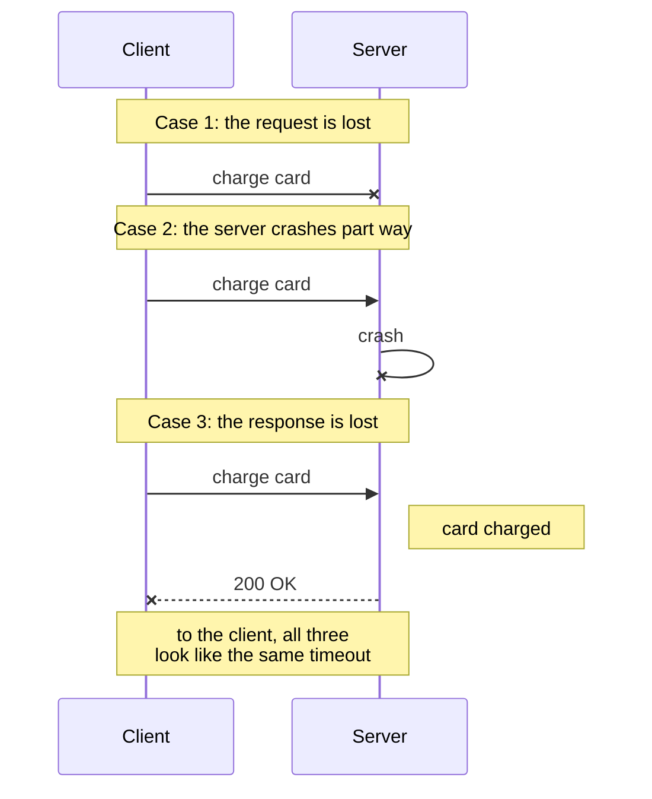

In case 3 the work was done, so a blind retry charges the card twice; in case 1 the same retry is exactly right. The client can't know which case it's in, so the server has to make the retry safe. That's what [idempotency](#/design/learn/reliability/idempotency) is for.

### Failure domains

A failure domain is a set of things that fail together. Put replicas in different domains so that one failure can't take them all.

| Domain | What takes it down | What you lose |
|---|---|---|
| Process | A crash, running out of memory, a bad input | One instance |
| Host | A hardware fault, a kernel panic, a reboot | Every process on it |
| Rack | Its top-of-rack switch or power feed | 20 to 40 hosts |
| Zone (a data center) | Power, cooling, network, fire | A third of a region |
| Region | A regional network or control-plane failure, a natural disaster | Everything there |
| Software version | A bad deploy, config push or expired certificate | Every replica running it |

The last row is the one people forget: spreading replicas across zones does nothing against a bad config pushed to all of them at once. The defense there is a [staged rollout](#/design/learn/reliability/rollout-strategies).

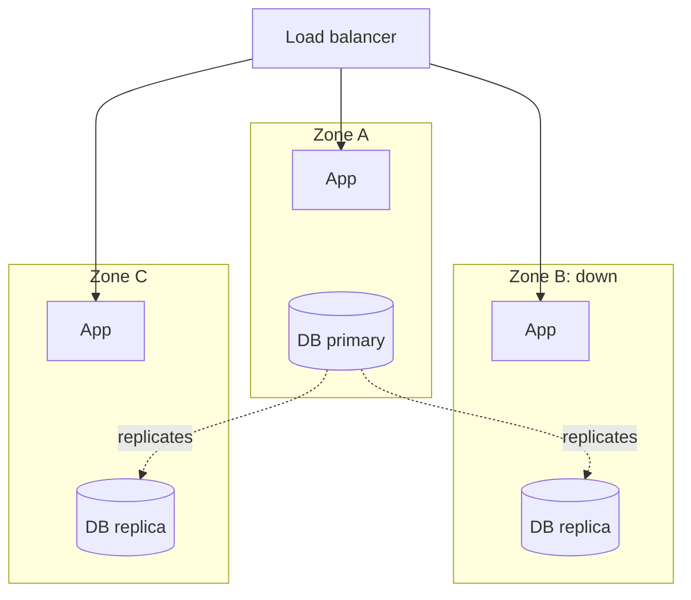

Losing zone B costs a third of the capacity, not the service: health checks take it out of the load balancer, and the database still has a replica in zone C. That only works if the surviving zones can carry the load, so with three zones each one should run under about 66% busy at peak.

> **Interview tip.** List your single points of failure out loud: one database primary, one load balancer, DNS, a config or secrets service, a certificate that expires, one region. Then say which ones you're fixing and which you're accepting.

## Availability and SLOs

Availability is the fraction of time, or of requests, that a service works. Two pieces of arithmetic and three acronyms cover what interviews ask.

### Availability math

| Availability | Downtime per year | Per month |
|---|---|---|
| 99% ("two nines") | 3.65 days | 7.3 hours |
| 99.9% | 8.8 hours | 43.8 minutes |
| 99.99% | 52.6 minutes | 4.4 minutes |
| 99.999% | 5.3 minutes | 26 seconds |

- **Dependencies in series multiply.** A request that needs three services at 99.9% each succeeds about 0.999³ ≈ 99.7% of the time: 26 hours of downtime a year instead of 9. Every hop on the critical path lowers availability.
- **Replicas in parallel add nines.** Two independent replicas at 99.9% are both down only 0.001² of the time, which is 99.9999% in theory. In practice their failures are correlated (same deploy, same zone, same bug), so the real number is much lower.
- **Shrink the critical path.** Make non-essential calls optional or asynchronous, so their failure degrades the page instead of failing it.

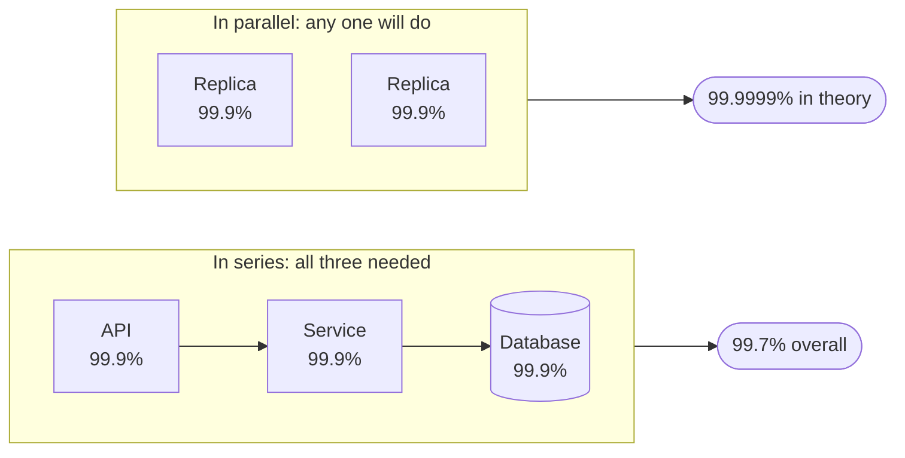

The chain loses availability with every box you add to it; the pair gains it, but only as long as the two replicas really fail independently.

### SLOs and error budgets

- A **service level indicator (SLI)** is a measurement, such as the fraction of requests that succeed in under 300 ms.
- A **service level objective (SLO)** is the target for it: 99.9% over a rolling 30 days.
- A **service level agreement (SLA)** is a contract with penalties. Set it looser than the SLO, so you breach the SLO long before the SLA.

The gap between 100% and the SLO is the **error budget**. At 99.9% that's 43 minutes of full downtime a month, or 1 failed request in 1,000 (10,000 a day for a service handling 10 million requests). Spend it on shipping changes and experiments; when it runs out, slow down launches and fix reliability. Each extra nine shrinks the budget tenfold, so choose the SLO from what users need, not from what sounds impressive.

> **Interview tip.** State SLOs as numbers on the user's critical path, such as "99.95% of booking requests succeed, with p99 under 500 ms", and then design to them.

## Redundancy and failover

Redundancy means running more than one of everything that matters, in different failure domains, plus a way to notice a failure and move work away from it. Stateless servers are easy: run several behind a load balancer and let health checks remove the bad ones. Anything with exactly one leader (a database primary, a scheduler, the owner of a partition) needs failover, and failover is where the subtle bugs live.

### Health checks

A load balancer or orchestrator probes every instance, typically every 5 to 10 seconds. It acts after 2 or 3 failures in a row, and wants 2 or 3 successes before trusting an instance again, so instances don't flap in and out.

- **Liveness** ("is the process alive?") is shallow. Failing it means the process is stuck: restart it.
- **Readiness** ("can this instance serve right now?") checks what the instance itself needs: warmed up, config loaded, not overloaded. Failing it means stop sending it traffic, but don't restart it.

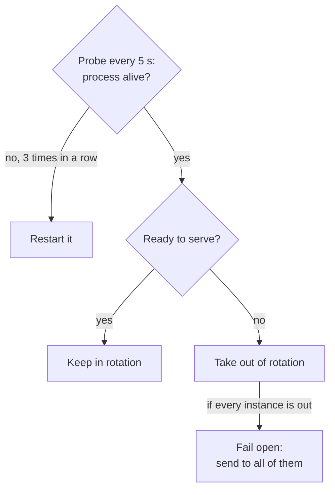

The two checks lead to different actions: a stuck process is restarted, a busy one just stops getting traffic. The last branch is there because of the trap below.

> **Pitfall.** A deep readiness check that calls a shared dependency (the database) fails on every instance at once when that dependency blips. The load balancer then removes the whole fleet, and a partial outage becomes a total one. Keep readiness about the instance itself, and have the load balancer fail open when every target looks unhealthy.

### Failover and leader election

When a leader dies, a standby has to take over. There are five steps, each with a trade-off:

1. **Detect.** Heartbeats stop for longer than a timeout, say 10 seconds. Too short, and a long garbage-collection pause triggers a needless failover; too long, and the outage drags on.
2. **Elect.** A consensus system (etcd, ZooKeeper, or Raft inside the database) picks exactly one new leader. Never let each node decide for itself that the old leader is dead.
3. **Fence.** The old leader may be paused rather than dead. Each new leader gets a higher epoch (or term) number, and storage rejects writes from older epochs. This is the same idea as a [fencing token](#/design/learn/reliability/distributed-locks-and-fencing-tokens).
4. **Redirect.** Clients find the new leader through service discovery, a proxy or DNS.
5. **Catch up.** With asynchronous replication the new leader may be missing the last few writes, so a failover can lose data.

A managed database failover typically takes from 30 seconds to a couple of minutes, end to end.

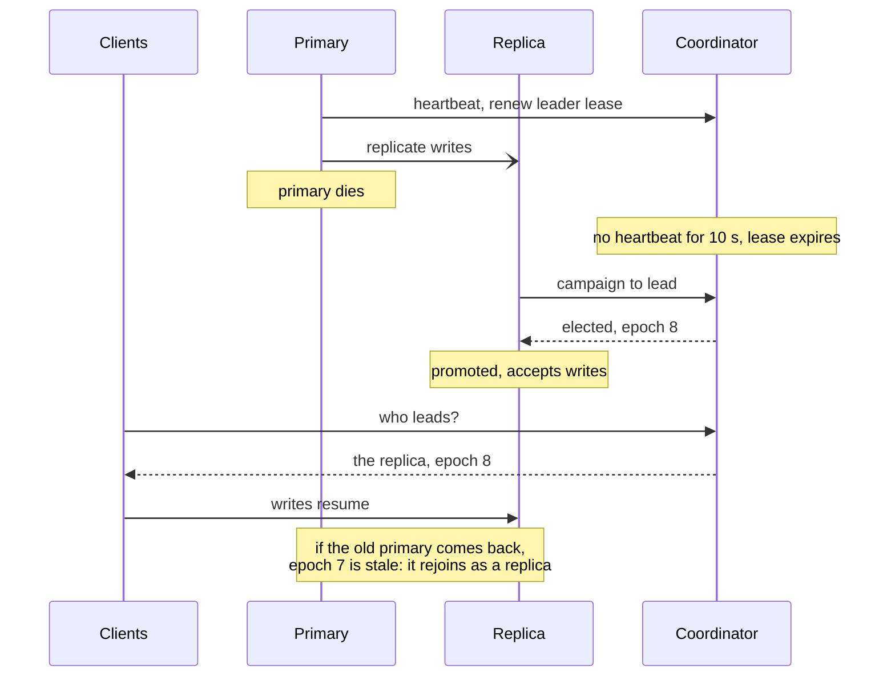

The coordinator decides who leads, not the replica, so two nodes can't both promote themselves. The epoch number is what lets everyone recognise and reject the old primary if it wakes up.

### Split brain and quorums

Split brain is two nodes both acting as leader and accepting conflicting writes. It happens during a network partition, when each side thinks the other is dead. The fix is a **quorum**: a node may lead, and a write may commit, only when a majority of the cluster agrees. Any two majorities share at least one node, so two leaders can never both have one.

- Use odd cluster sizes: 3 nodes tolerate 1 failure and 5 tolerate 2. Four nodes still tolerate only 1.
- Spread the nodes over three zones, so losing any one zone leaves a majority. Two sites alone can't break a tie; add a small witness node in a third.
- The minority side of a partition stops accepting writes. That's choosing consistency over availability, the trade-off in the [CAP theorem](#/design/learn/data), on purpose.

> **Interview tip.** "Failover is detect, elect, fence, redirect. The coordinator is a quorum system like etcd, and every leader carries an epoch number, so a zombie primary's writes are rejected."

## Timeouts, retries and circuit breakers

### Timeouts and deadlines

- **Every network call gets a timeout.** A missing timeout is how one hung dependency takes down every service that calls it.
- **Set it from measured latency:** a little above the dependency's p99 (the time 99% of its calls finish within). A p99 of 80 ms suggests a timeout of 100 to 150 ms, not a library default of 30 seconds. Use a separate, short connect timeout of about a second.
- **Propagate a deadline.** Give the whole request a time budget and pass the time remaining to each downstream call (gRPC deadlines do this). Every hop checks it, so nobody works on a request whose caller has already given up.

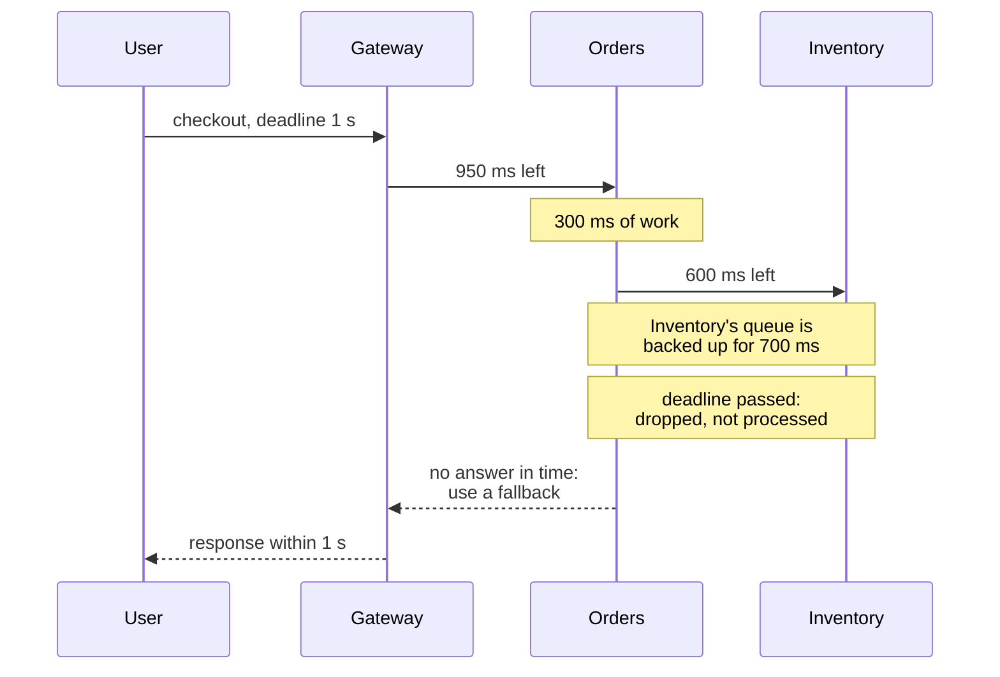

Each hop passes on the time left instead of starting a fresh timeout, so the whole chain fits inside the user's one second. Inventory skips work whose caller has already given up, instead of spending capacity on an answer nobody will read.

### Retries with backoff and jitter

Retries fix transient failures (a dropped connection, a node restarting) but multiply load during a real outage. The rules:

- **Retry only what's safe to repeat:** idempotent operations, or ones that carry an [idempotency key](#/design/learn/reliability/idempotency-keys).
- **Retry only retryable errors:** timeouts, connection resets, 502, 503 and 504, plus 429 and 408 after the server's `Retry-After` delay. Not other 4xx errors: a bad request fails the same way every time.
- **Back off exponentially:** wait about base × 2<sup>attempt</sup>, up to a cap (for example a base of 100 ms and a cap of 10 to 20 seconds).
- **Add jitter:** wait a random time between zero and that ceiling ("full jitter"), so clients that failed together don't retry together.
- **Cap attempts and total time:** 2 or 3 attempts for a user-facing call, and never past the deadline.
- **Retry at one layer only.** If the client, the gateway and the service each make 3 attempts, one failing database call becomes 3 × 3 × 3 = 27 calls, all landing on the dependency that is already struggling.
- **Use a retry budget:** retries may add at most about 10% to normal traffic, and once that's spent, calls fail instead of retrying. Load during an outage then grows 1.1 times, not 3 times.

```python
import random
import time


class TransientError(Exception):
    pass


def call_with_retries(op, attempts=3, base=0.1, cap=10.0):
    for attempt in range(attempts):
        try:
            return op()
        except TransientError:
            if attempt == attempts - 1:
                raise
            ceiling = min(cap, base * 2**attempt)
            time.sleep(random.uniform(0, ceiling))  # full jitter
```

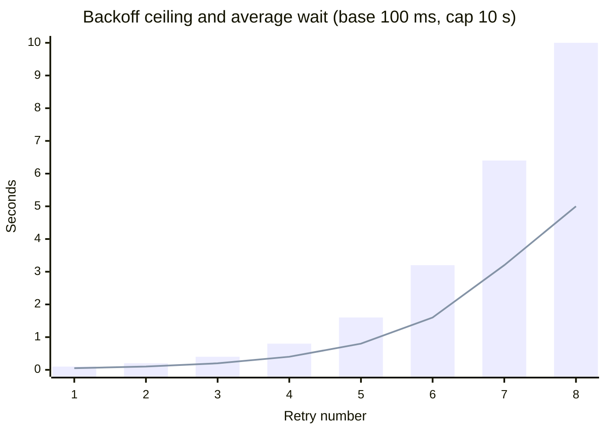

The bars are the ceiling for each retry, doubling until the cap stops them. The actual wait is drawn at random below the bar, so on average it's half of it (the line). That randomness spreads a crowd of clients over the whole window instead of letting them hit the server in lockstep.

### Circuit breakers

A circuit breaker wraps the calls to one dependency and stops calling it while it's failing.

- **Closed:** calls go through, and the breaker counts failures over a rolling window (the last 10 seconds, or the last 100 calls).
- **Open:** once failures pass a threshold (say 50% of at least 20 calls), every call fails immediately without being sent, for a cool-down of 5 to 60 seconds. The caller serves a fallback: a cached value, a default, or the page without that feature.
- **Half-open:** after the cool-down, a few trial calls go through. If they succeed the breaker closes; if any fails it opens again.

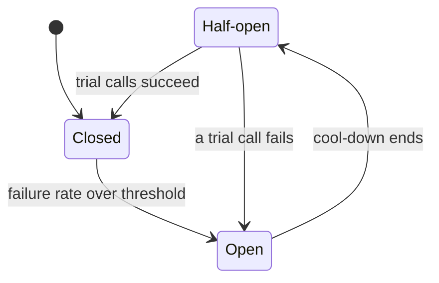

The only way out of Open is through Half-open: the breaker probes with a few calls instead of releasing full traffic onto a dependency that is just recovering. Meanwhile the caller keeps its threads, and the dependency gets room to recover instead of a stream of requests it can't serve.

### Hedged requests

Most requests are fast, and a few are slow because of a garbage-collection pause, a busy disk or a noisy neighbour. That tail matters more than it looks: if a page fans out to 100 backend calls and each is slow 1% of the time, 1 − 0.99<sup>100</sup> ≈ 63% of page loads wait for at least one slow call.

A **hedged request** sends the same read to a second replica if the first hasn't answered by about the p95 latency, uses whichever answer arrives first, and cancels the other. Only the slowest 5% get a second copy, so it costs about 5% more load, and it can cut the tail sharply. Use it only for idempotent, cheap reads, never for writes, and switch it off under overload, when extra load is the last thing you need.

> **Interview tip.** "Every call has a timeout taken from a propagated deadline. Retries happen at one layer, with exponential backoff, jitter and a retry budget, and only for idempotent calls. Each dependency sits behind a circuit breaker with a fallback."

## Idempotency

An operation is **idempotent** if doing it twice has the same effect as doing it once. Clients retry on timeouts, load balancers retry on connection errors, queues redeliver and operators replay, so every operation that can be retried will eventually run twice. Idempotency makes the second run harmless. It's what makes retries and at-least-once delivery safe, and it's the most useful correctness tool in system design.

### Naturally idempotent operations

| Operation | Idempotent? | Why |
|---|---|---|
| `PUT /users/42 {"name": "Ana"}` | Yes | It sets the state to a value |
| `DELETE /orders/7` | Yes, in effect | Deleting twice leaves it deleted (the second call may return 404) |
| `SET balance = 100` | Yes | An absolute value |
| `POST /payments {"amount": 50}` | No | Each call creates another payment |
| `balance = balance + 50` | No | Applying it twice adds 100 |
| Send an email or a push notification | No | Each call sends another one |

Redesign operations to be idempotent where you can:

- Absolute values instead of increments: `SET status = 'shipped'`, not "advance the status".
- Client-chosen ids: `PUT /orders/{id}` with an id the client generated, or an upsert, instead of `POST /orders`.
- "Make the state X" instead of "do action Y": "subscription active until 1 March" rather than "extend by a month".
- Conditional updates: `UPDATE ... WHERE status = 'PENDING'` or `WHERE version = 7` apply once and do nothing after that.

Absolute writes are idempotent, but they can still overwrite someone else's concurrent change, so pair them with a version check (see [optimistic locking](#/design/learn/reliability/optimistic-and-pessimistic-locking)).

### Idempotency keys

For operations that aren't naturally idempotent (payments, orders, bookings), the client generates a unique key, usually a UUID, for each *logical* operation, and sends the same key with every retry of it, commonly in an `Idempotency-Key` header. The server:

1. Tries to insert the key. If it's new, the server marks it **in progress**, does the work, and stores the **response** under the key.
2. If the key exists and is complete, it returns the stored response without doing the work again.
3. If the key exists and is still in progress (a concurrent duplicate), it returns 409 Conflict, and the client retries a little later.
4. If the key exists but came with a different request body, it rejects the request with 422: that's a client bug, not a retry.

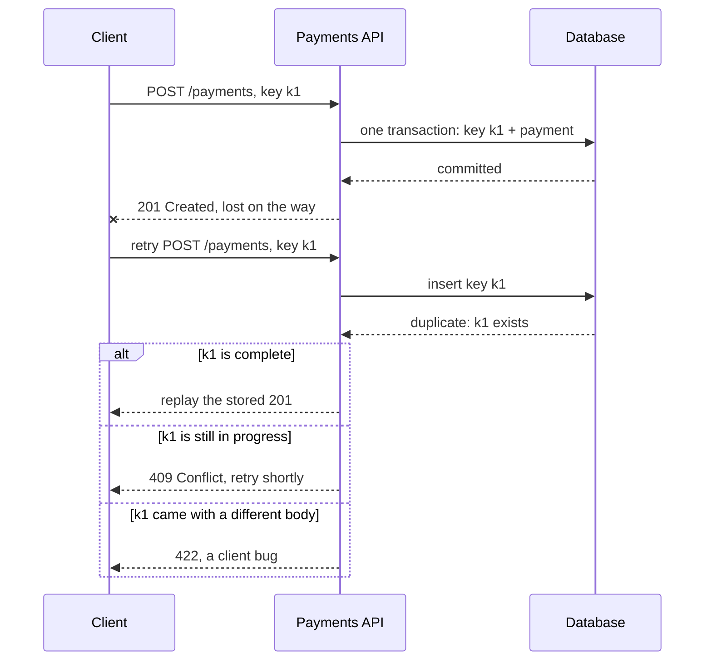

The retry never reaches the business logic: the unique key catches it and the stored response is replayed, so the card is charged once whichever of the three [timeout cases](#/design/learn/reliability/how-systems-fail) happened. The `alt` branches are the cases a real implementation has to handle.

The details that matter:

- **The key and the business write commit together.** Insert the key in the same database transaction as the change, with a unique constraint on it. If they're separate, a crash between them leaves a charge with no key (the retry charges again) or a key with no charge (the retry reports a success that never happened).
- **Scope keys to the caller,** with the unique constraint on `(merchant_id, key)`, and store a hash of the request to catch a key reused with a different body.
- **Keep keys longer than any client will retry:** 24 hours is common, and up to 7 days for slow batch retries.
- **Don't let a crash leave a key stuck.** If the server dies mid-request, the key stays "in progress". Give it a lease (a `locked_until` time) so a later retry can take it over, and make the steps safe to resume.
- **Pass a key on to third parties.** Your transaction can't cover the card provider's system, so send the provider its own idempotency key derived from yours, such as your payment id.

```sql
BEGIN;
INSERT INTO idempotency_keys (merchant_id, key, request_hash, status)
VALUES (42, 'k1', 'a3f9...', 'in_progress');  -- UNIQUE (merchant_id, key)
INSERT INTO payments (id, merchant_id, amount_cents, status)
VALUES ('pay_9', 42, 5000, 'pending');
COMMIT;
```

### Deduplicating consumers

Queue consumers see the same message more than once: a redelivery after a crash, a producer's retry, a relay publishing twice. Ways to make that harmless:

- **An inbox table.** In the same transaction as the effect, insert the message id into a `processed_messages` table with a unique key. If the insert conflicts, the message was already handled: skip it and ack.
- **Natural keys.** Upsert on a business key: `INSERT ... ON CONFLICT (order_id) DO NOTHING`.
- **Version checks.** Apply an event only if it's newer than what's stored (`WHERE version < :event_version`), which also makes reordered events harmless.
- **Deterministic outputs.** A worker that writes `output/{video_id}/720p.mp4` overwrites the same object when it's retried, so running it twice is fine.
- **A short-lived dedupe store** (Redis `SET key NX EX 86400`) when the effect isn't in your database, such as sending a push notification. It's best effort: the send and the mark can't be atomic, so a crash between them can still send twice.

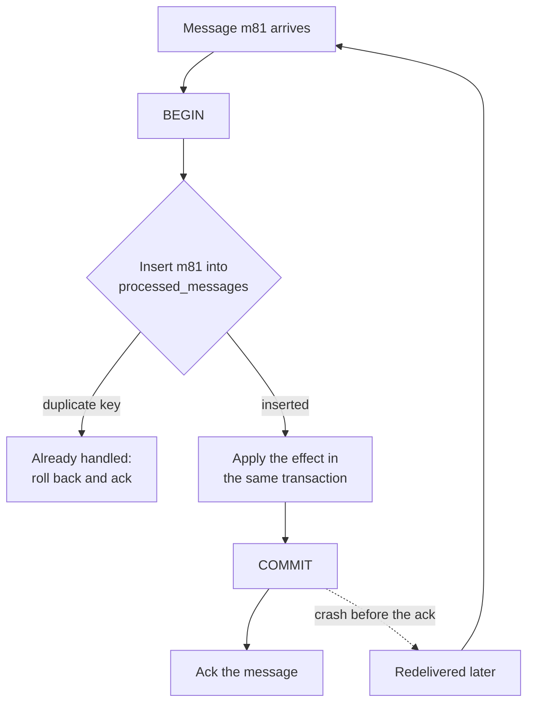

The dedupe record and the effect commit together, so a crash at any point leaves both or neither. A crash between the commit and the ack causes a redelivery, which lands on the duplicate branch and does nothing.

### Charging a card exactly once

Putting it together for the hardest case, where the effect happens in someone else's system:

1. The client creates a key and sends it with every attempt.
2. The server inserts the payment as `PENDING`, together with the key, in one transaction.
3. It calls the card provider, passing the payment id as the provider's idempotency key.
4. On a clear answer, it moves the payment to `SUCCEEDED` or `FAILED` with a conditional update (`WHERE status = 'PENDING'`), so a late webhook and a retry can't both apply.
5. On a timeout the outcome is unknown, so the payment stays `PENDING`. Never assume it failed, and never retry with a new key. A reconciliation job asks the provider what really happened.

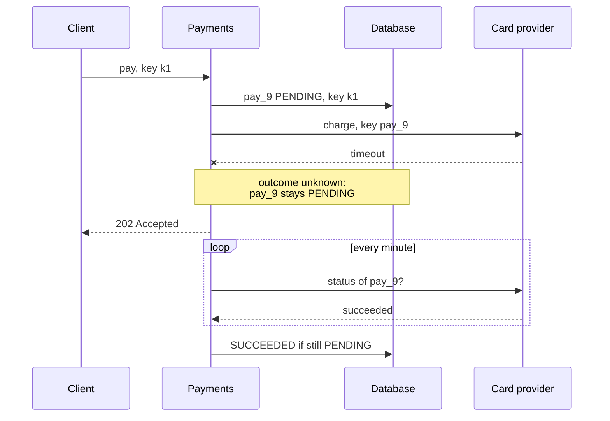

Two keys are at work. The client's key stops a duplicate request from creating a second payment; the payment id sent to the provider stops a retried charge from charging twice. Together they give an exactly-once *effect*, even though messages travel at least once.

> **Interview tip.** "Delivery is at-least-once, so every consumer and every mutating API is idempotent: client-generated keys, a unique constraint in the same transaction as the effect, stored responses for replays, and our id passed to the provider as its key."

## Delivery guarantees

A messaging system can promise one of three things, and where you put the acknowledgement (the ack) decides which one you get:

| Guarantee | How you get it | What goes wrong | Use it for |
|---|---|---|---|
| At-most-once | Ack (or commit the offset) before processing, never retry | A crash loses the message | Metrics samples, presence pings, live location updates |
| At-least-once | Ack after processing, retry until acked | A crash after the work but before the ack causes a duplicate | The default: orders, notifications, jobs |
| Exactly-once effect | At-least-once delivery plus idempotent processing | Holds only inside the boundary you control | Payments, ledgers, counters |

Exactly-once *delivery* across a network isn't possible in general, because the ack itself can be lost. What systems call exactly-once is an exactly-once *effect*: duplicates arrive but change nothing. Kafka's exactly-once mode covers reading from Kafka, processing, and writing back to Kafka in one transaction; the moment the consumer calls an outside API or database, you need idempotency again.

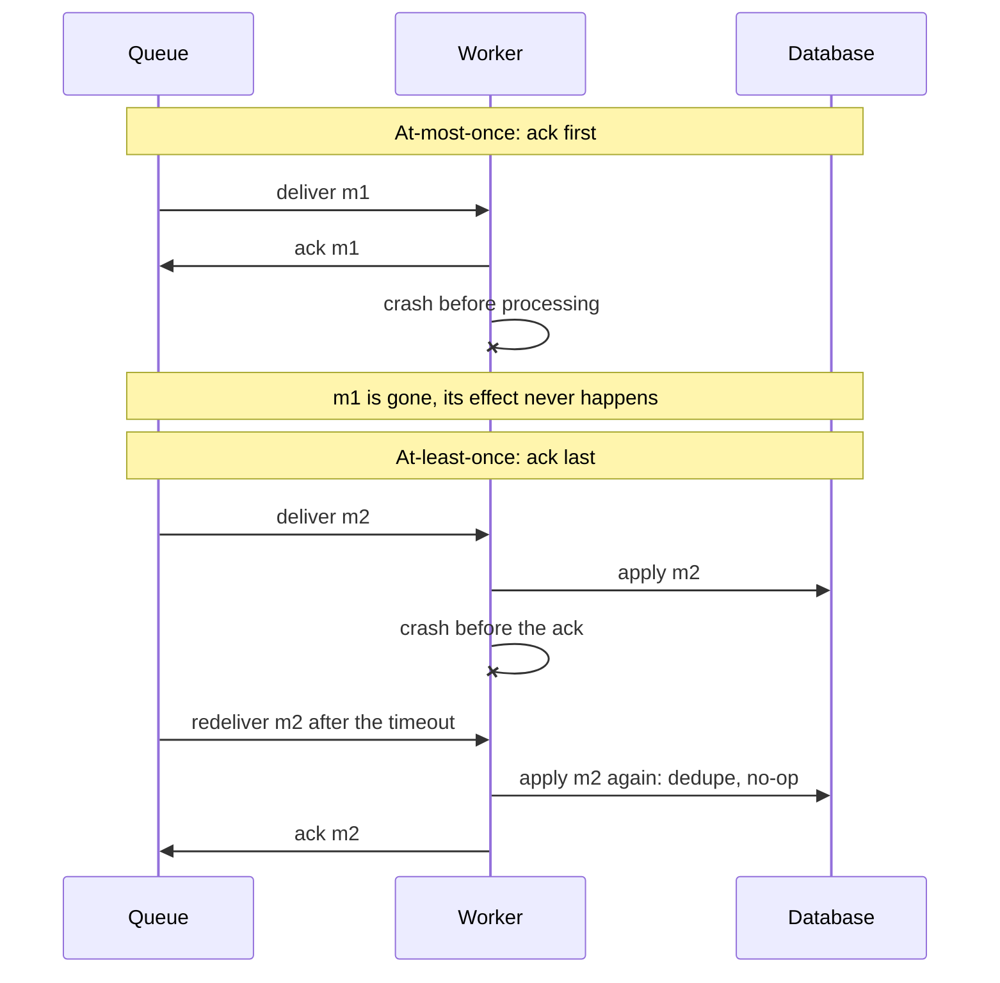

Moving the ack swaps one failure for the other: lost messages or duplicates. Duplicates can be made harmless with [deduplication](#/design/learn/reliability/deduplicating-consumers), but lost messages can't be recovered, so default to at-least-once.

### Acknowledgements and redelivery

- **Consumers.** A queue hides a delivered message for a *visibility timeout* (SQS, 30 seconds by default), or tracks the committed offset of each consumer group (Kafka). If no ack arrives in time, the message goes to another consumer. Set the timeout above your slowest normal processing time, or extend it with heartbeats for long jobs such as a video transcode; otherwise a slow but healthy worker has its job duplicated.
- **Producers.** A message counts as sent only once the broker has stored it durably, for example Kafka with `acks=all` and at least two in-sync replicas. Retry until then, with the same message id, so duplicates can be dropped.
- **Any write path.** Acknowledge only after the write is durable, so that "acked" means "won't be lost".

A chat service shows the whole pattern: store, then ack, then forward. The sender resends until it gets an ack, the server dedupes on the client's message id, and offline delivery is just the sync a client runs whenever it reconnects.

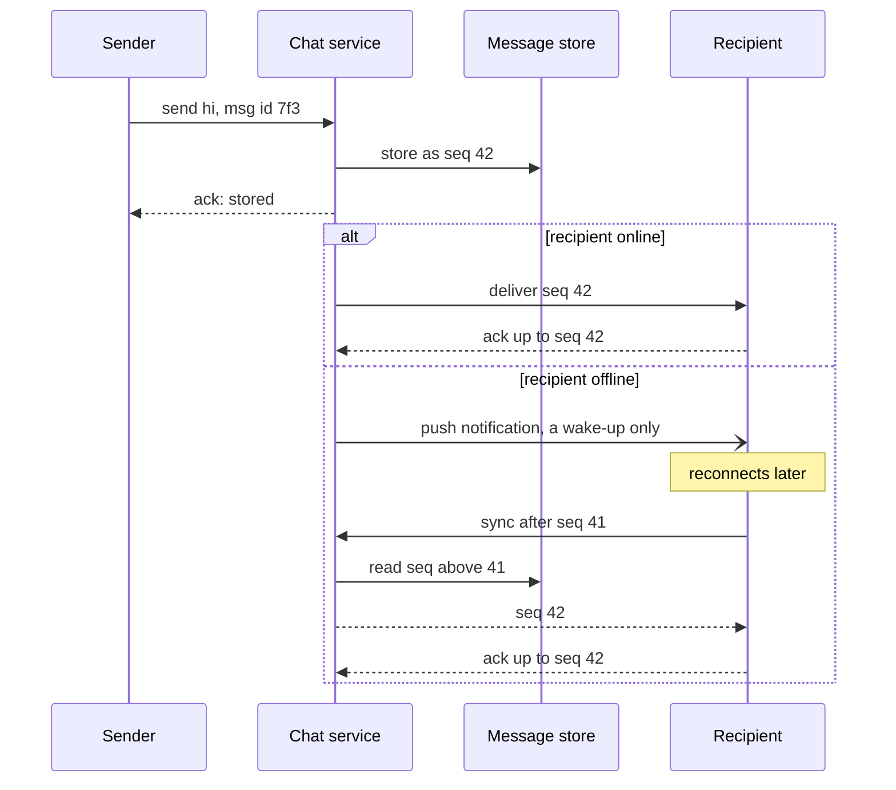

The sender's ack means "stored", not "delivered", so a server crash after the ack can't lose the message. Messages wait in the store until the recipient acks them, and a client that was offline for a week asks for everything after the last sequence number it acked.

### Message ordering

- **Order globally only if you must.** One sequencer for everything is a throughput ceiling and a single point of failure. You almost always need order **per entity**: per conversation, per account, per order.
- **Partition by the entity's key.** Kafka keeps order within a partition, so publish with the conversation id as the key and one consumer handles that conversation at a time. Or route each key to a single writer that assigns sequence numbers.
- **Know what breaks order:** several consumers working on the same key, retries (message 5 fails, 6 succeeds, then 5 succeeds on retry), several producers, and clocks. Timestamps from different machines drift by milliseconds or more, so don't rely on them for correctness.
- **Restore order with sequence numbers.** The receiver buffers anything that arrives early and waits for (or fetches) the gap, or it applies only updates with a higher version than the one it has.

```array
label: received
values: 39 40 41 _ 43 44
dim: 0..2
highlight: 3
pointers: next=3
caption: 42 is missing, so 43 and 44 wait in the buffer
---
label: received
values: 39 40 41 42 43 44
dim: 0..2
highlight: 3..5
pointers: next=6
caption: 42 arrives (or is fetched): 42, 43, 44 are shown in order
```

The receiver never shows a message past a gap. Sequence numbers make the gap visible, which timestamps can't do.

### Dead-letter queues

A **poison message** fails every time, because of bad data or a bug. Retried forever, it blocks everything behind it in an ordered partition and burns worker time. So:

- Retry transient failures with backoff, up to a limit (say 5 attempts). Send permanent errors, such as a validation failure, straight on.
- After the last attempt, move the message to a **dead-letter queue** (DLQ) instead of retrying it in place.
- Alert on the DLQ's size and the age of its oldest message, and build a tool to inspect, fix and replay messages. Replay is only safe because the consumers are idempotent.
- For delayed retries that don't block the partition, use retry queues with growing delays (1 minute, 10 minutes, 1 hour). Kafka has no per-message delay, so retry topics are the usual pattern there; SQS and RabbitMQ can delay and dead-letter messages natively.

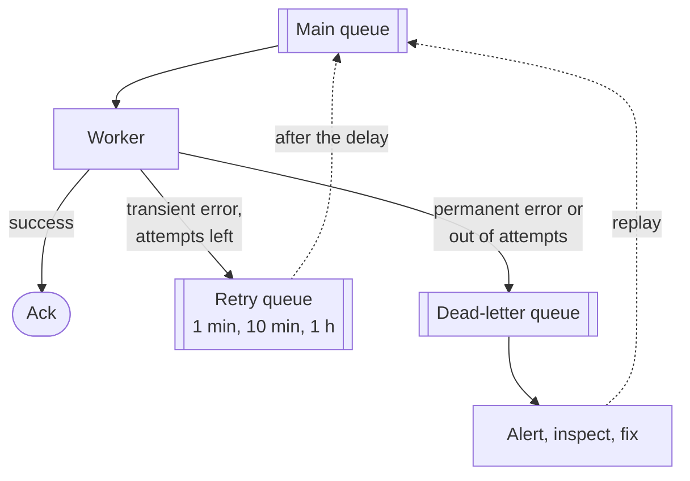

Nothing is retried in place: a failing message moves aside so the ones behind it keep flowing, and the dead-letter queue turns a silent infinite loop into an alert with a replay button.

> **Interview tip.** "Delivery is at-least-once: we ack after the durable write, consumers are idempotent, ordering is per key through partitioning, and after five attempts a message goes to a dead-letter queue with an alert on its depth."

## Distributed transactions

Inside one database, a transaction makes several changes all-or-nothing. Once a business action spans several services or databases (create the order, reserve stock, charge the card), no single transaction covers it. There are three honest options, in order of preference:

1. **Avoid it.** Keep data that must change together in one database, owned by one service. This is the right answer more often than candidates admit: if two services always need atomic updates, they probably belong together.
2. **Two-phase commit,** inside a system you fully control.
3. **A saga** with compensating actions, across services.

Whichever you choose, publish events through an [outbox](#/design/learn/reliability/the-outbox-pattern) and run a [reconciliation](#/design/learn/reliability/reconciliation) job to catch whatever slips through.

### Two-phase commit

A coordinator asks every participant to **prepare**: write the change durably, lock what it touches, and promise to commit if asked. If all vote yes, the coordinator logs the decision and tells everyone to **commit**; if any votes no, everyone aborts.

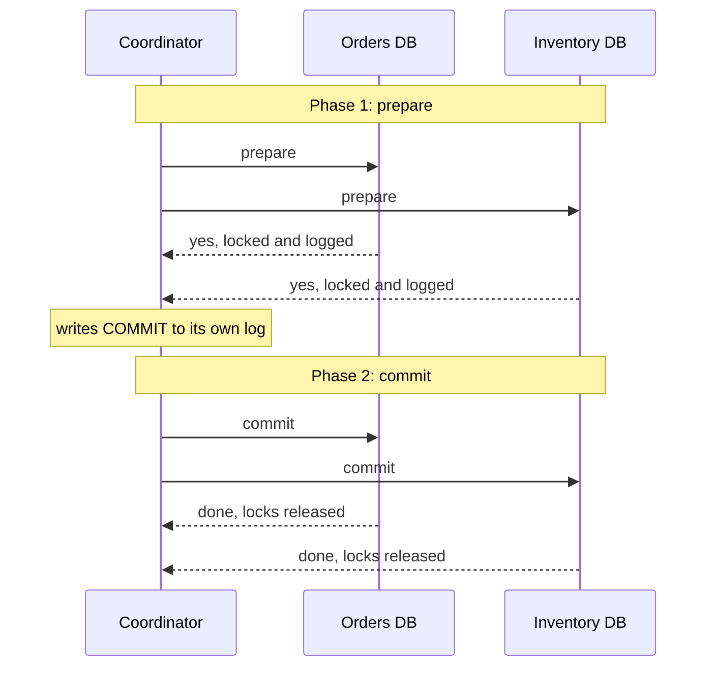

Between voting yes and hearing the decision, a participant can neither commit nor abort on its own. If the coordinator crashes in that window, the participants wait with their locks held until it recovers, which is why 2PC is called *blocking*.

The costs to name:

- **Blocking:** a coordinator failure freezes every row the transaction touched.
- **Latency:** two round trips plus forced disk writes on every participant, with locks held throughout.
- **Availability:** every participant must be up, so the transaction's availability is the product of theirs.
- **Support:** every participant must speak the protocol (XA). Most third-party APIs, message brokers and NoSQL stores don't.

Where it works: inside a distributed database, across its own shards. Spanner and CockroachDB make each participant a replicated consensus group, so one machine dying doesn't block anything. Across independent services, use a saga.

### Sagas and compensation

A saga breaks the action into a sequence of local transactions, each with a **compensating action** that undoes it in business terms if a later step fails.

| Step | Action | Compensation |
|---|---|---|
| 1 | Create the order (pending) | Cancel the order |
| 2 | Reserve inventory | Release the inventory |
| 3 | Charge the payment | Refund the payment |
| 4 | Confirm the order | None: it's the last step |

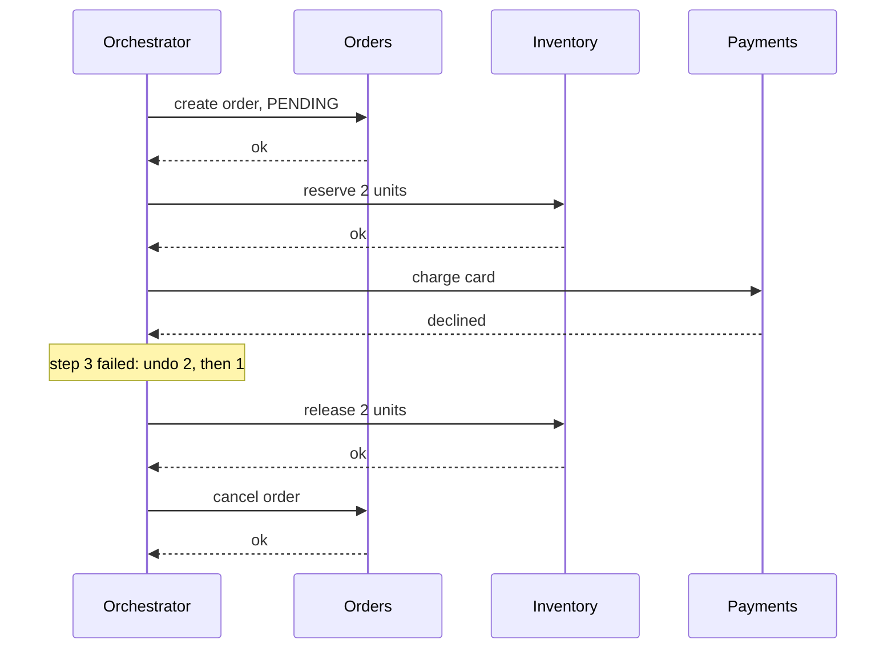

Compensations run in reverse order, and they are new forward actions (release, cancel, refund), not a database rollback: a customer may see both a charge and its refund. While the saga runs, other requests really do see the stock as reserved.

The rules:

- **There's no isolation.** Others see the intermediate states, so model them explicitly (`PENDING`, `RESERVED`) and treat them as locks in business terms: reserved stock can't be sold again, and a pending order isn't shipped.
- **Every step and every compensation is idempotent and retried until it succeeds.** A compensation that keeps failing goes to a queue for a person, never into a log nobody reads.
- **Order the steps around a pivot.** Steps that can be undone come first (reserve the stock, authorize the card). Then comes the pivot, the point of no return (capture the payment). After it come only steps that can't fail for business reasons and are retried until they succeed (send the confirmation email, ship). An email can't be unsent, so it never comes before the pivot.
- **Time out steps that never answer,** and be ready for a late success that arrives after you've compensated: undo it too.

### Orchestration vs choreography

- **Orchestration:** one orchestrator calls each step, records progress durably, retries, and runs the compensations. It can be a workflow engine such as Temporal or a managed workflow service, or a state machine in your own service backed by a table. It's easy to see where every order is and to change the flow; the cost is one more component to run.
- **Choreography:** each service reacts to events and emits its own (`OrderCreated`, then `StockReserved`, then `PaymentCharged`). There's no central component, but the flow exists only implicitly across services, which makes it hard to follow, debug and change, and easy to create cycles.

Use choreography for two or three simple steps. Use orchestration beyond that, and whenever the failure handling matters, as it does for payments and bookings.

> **Interview tip.** "This crosses services, so I'd avoid 2PC. An orchestrated saga: reserve, charge, confirm, each step with a compensation, all idempotent. Events go out through a transactional outbox, and a reconciliation job catches anything that slips through."

## Publishing events reliably

### The dual-write problem

A service often has to update its database **and** publish an event ("order placed") for other services. Doing that as two separate writes is unsafe whichever order you pick:

| Order | Failure between the two | Result |
|---|---|---|
| Commit, then publish | The publish fails, or the process dies | The change is saved but the event is lost: other services never hear of it |
| Publish, then commit | The commit fails, or the process dies | The event announces a change that never happened |

Retrying the publish doesn't fix it, because the process can die before the retry. The two writes have to become one.

### The outbox pattern

1. In one local transaction, write the business change **and** insert the event into an `outbox` table.
2. A separate relay reads new outbox rows, publishes them to the broker, then marks them sent (or deletes them). It either polls the table or tails the database's write-ahead log with change data capture (CDC, for example Debezium).
3. Delivery is at-least-once: the relay can publish and then crash before marking the row, so consumers must [deduplicate](#/design/learn/reliability/deduplicating-consumers).

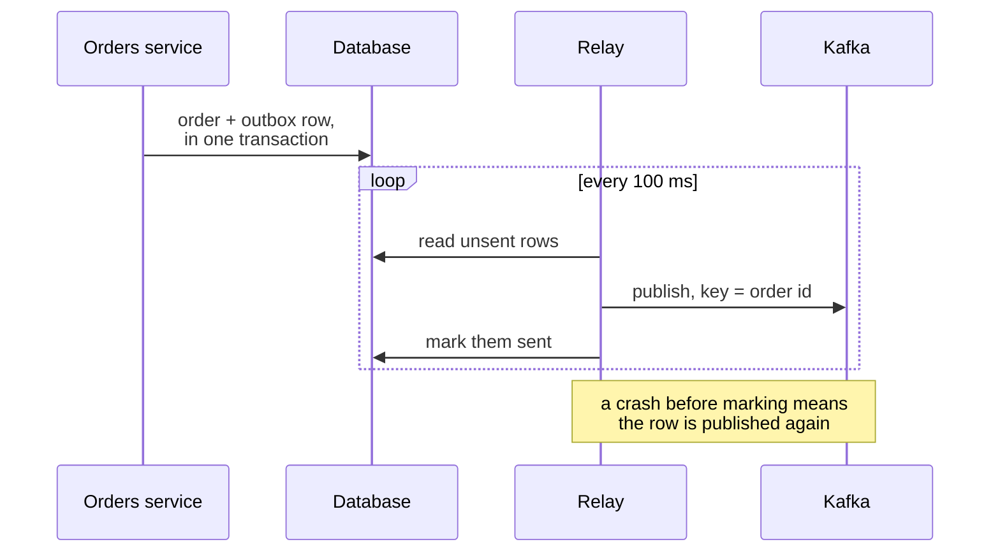

The request path makes one local transaction and never talks to the broker, so nothing can get out of step. Everything after the commit is retried until it succeeds, which is why consumers must dedupe on the event id. Publishing with the order id as the partition key keeps each order's events in order.

> **Pitfall.** A poller that reads `WHERE id > last_seen_id` can skip events. Ids are handed out when a row is inserted, not when its transaction commits, so a slow transaction can commit id 100 after the poller has already moved past 101. Select by a `sent = false` flag instead, or use CDC, which reads the log in commit order.

### Read models and search indexes

Search indexes, caches, feeds and analytics tables are **derived data**: copies built from the source of truth. Feed them from the change stream (the outbox or CDC) rather than writing to them from the request path, which would be the dual-write problem again.

- **They're eventually consistent.** A search result can be seconds stale. Let the source of truth make the decisions that must be right (the booking transaction checks availability again), and show "no longer available" when someone clicks a stale result.
- **Updates must be idempotent and safe to reorder.** Upsert each document with the source row's version and ignore anything older, so replays and reordering do no harm.
- **They can be rebuilt** by replaying the stream or re-reading the database, so losing an index is an outage, not data loss.
- **Measure the lag** from commit to indexed, and alert when it passes a threshold such as 30 seconds.

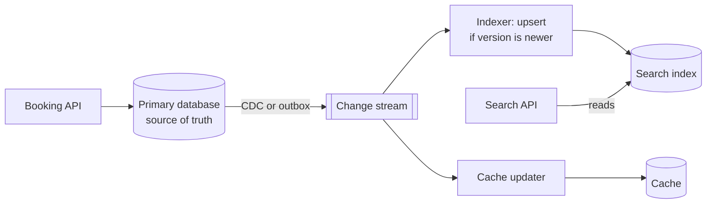

Reads that can be a few seconds stale go to the derived copies (amber), and the decision that must be right goes to the source of truth. Everything amber can be rebuilt from the stream.

### Event sourcing and CQRS

- **CQRS** (command query responsibility segregation) separates the model you write to from one or more read models, fed asynchronously from the change stream, exactly as in the picture above. The substance is accepting a short lag on reads.
- **Event sourcing** stores the sequence of events as the source of truth and derives the current state by replaying them. You get a full audit trail, the ability to rebuild any view, and answers to "what was the state on 1 May?". The costs: old events must stay readable forever while their schemas evolve, replays need snapshots to stay fast, and ad-hoc queries need read models. Mention it, but don't reach for it by default. A [double-entry ledger](#/design/learn/reliability/double-entry-ledgers) is where it fits naturally.

## Correctness checks

Idempotency, sagas and outboxes reduce errors; they don't eliminate them. A system can return 200 OK and still be wrong, which is often worse than being down, because nobody notices. These are the safety nets.

### Reconciliation

A reconciliation job compares two records of the same facts and flags every difference: your payments against the provider's settlement file, bookings against calendar rows, orders against shipments, the search index against the database. Every financial system has one; it's the net under everything else on this page.

- Run it daily against settlement files, and continuously (every few minutes) for anything stuck in a pending state for too long.
- Turn differences into tickets or audited corrections, never silent fixes, and track their count as a metric.

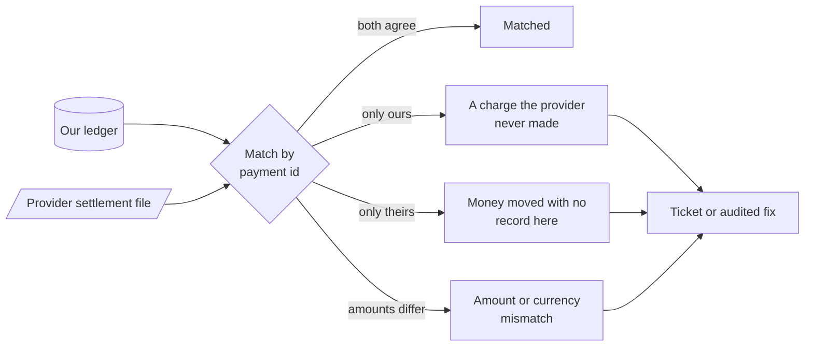

Each kind of mismatch points at a different bug. "Only theirs" is usually a timeout where the charge went through but the payment never left pending, which is exactly the case the [unknown-outcome handling](#/design/learn/reliability/charging-a-card-exactly-once) exists for.

### Double-entry ledgers

Record every movement of money as entries that balance: each transaction debits some accounts and credits others by the same total. Taking a $50.00 payment with a $1.50 fee:

| Entry | Account | Debit (cents) | Credit (cents) |
|---|---|---|---|
| 1 | Funds due from the card network | 5,000 | |
| 2 | Owed to the merchant | | 4,850 |
| 3 | Fee revenue | | 150 |
| | **Total** | **5,000** | **5,000** |

- **Append only.** Never update or delete an entry; a correction is a new, reversing entry.
- **A balance is the sum of its entries,** or a cached total updated in the same transaction as the entries.
- **Use integer minor units and a currency,** never floating point.
- **Any bug that creates or destroys money shows up as an imbalance,** which makes the ledger easy to audit and reconcile.

### Invariants and canary checks

- **Invariant queries** that should always return nothing: an order that is both paid and cancelled, a confirmed booking without its calendar rows, ledger entries that don't sum to zero.
- **Data-quality checks** on pipelines: row counts, null rates, freshness.
- **Canary transactions:** a synthetic user places a real test order every minute and checks the result end to end.

> **Interview tip.** End any design that moves money or inventory with: "A reconciliation job compares our records with the provider's every day, and mismatches become tickets, never silent fixes."

## Concurrency control and double booking

Two requests that touch the same data at the same moment can both read "1 seat left" and both book it. Whenever a problem has scarce inventory (seats, hotel nights, stock, usernames, an account balance), the interviewer is waiting to hear how you prevent this.

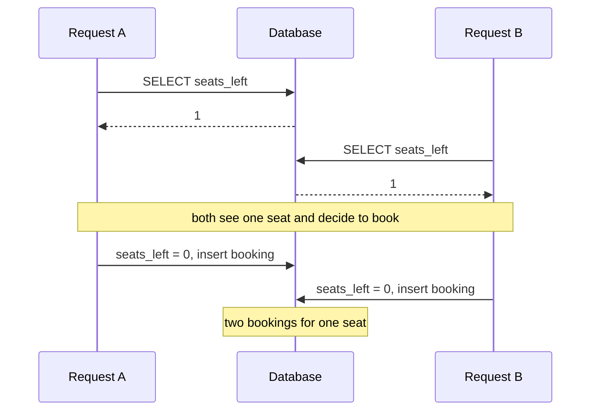

The bug is the gap between reading and writing: each request decides based on a value that changes before it writes. Every technique below closes that gap.

| Technique | How it works | Use when | Cost |
|---|---|---|---|
| Atomic conditional update | `UPDATE ... SET left = left - 1 WHERE id = ? AND left > 0`, then check the rows affected | A counter or a status on one row; the best default | Almost none |
| Unique constraint | A unique index rejects the second insert, for example on `(room_id, night)` | One owner per thing: a room-night, a seat, a username | The insert fails and you handle the conflict |
| Optimistic locking | Read a version, update `WHERE version = N`, retry if nothing changed | Rare conflicts, long think time (editing a document) | Retries under contention |
| Pessimistic locking | `SELECT ... FOR UPDATE` locks the row until commit | Frequent conflicts, a short critical section | Others wait; deadlocks if lock order differs |
| Serializable isolation | The database aborts transactions that conflict | Rules that span many rows | Aborted transactions to retry, lower throughput |
| Distributed lock or lease | A lock in etcd, ZooKeeper or Redis, with an expiry | Coordinating work that no single database sees | Subtle failure modes (see below) |
| Single writer | All operations for a key go to one owner: a queue partition, an actor, a shard leader | Very hot keys, or when order matters | The owner is a bottleneck and needs failover |

Pick the lightest tool that is correct, and prefer letting the database enforce the rule (a constraint or a conditional update) over locks in application code. The database is already the arbiter; every lock you add outside it is one more thing that can fail.

### Atomic conditional updates

Fold the check into the write, so the database does both under one row lock:

```sql
UPDATE inventory
SET seats_left = seats_left - 1
WHERE event_id = 7 AND seats_left > 0;
-- 1 row updated: you got a seat. 0 rows: sold out.
```

The same idea works for counters shared by many servers. Redis runs one command or Lua script at a time, so `INCR`, `DECR`, or a short script that checks and decrements in one step is atomic: two rate-limiter gateways can't both take the last token. Other stores offer the same thing as compare-and-set, a write that succeeds only if the value or version is still the one you read (etcd transactions, DynamoDB condition expressions).

For a booking over several nights, run the conditional update for every night in one transaction, and touch the rows in a fixed order (sorted by date), so that two overlapping bookings can't deadlock.

### Unique constraints

Make each scarce thing a row and let a unique key reject the second claim. For rooms, store one row per room per night. A three-night booking inserts three rows in one transaction; if any of the nights is taken, the whole booking fails, with no locks in application code.

```grid
collabels: Mon Tue Wed Thu Fri
rowlabels: 101 102 103
A A A _ _
_ C C _ _
_ _ D D D
highlight: 0,2
caption: B wants room 101, Wed to Fri: the Wed row already exists
```

Each cell is a row that can exist only once, under a unique key on (room, night). B's request collides on a single night, and because its three inserts share one transaction, B gets nothing rather than a partial stay.

- For "any of the 10 standard rooms", keep a count per (room type, night) and use a [conditional update](#/design/learn/reliability/atomic-conditional-updates) instead.
- PostgreSQL can reject overlapping date ranges directly with an exclusion constraint, `EXCLUDE USING gist (room_id WITH =, stay WITH &&)` (it needs the `btree_gist` extension), without per-night rows.
- Unique keys are also how [idempotency keys](#/design/learn/reliability/idempotency-keys), usernames and custom short links avoid duplicates.

### Optimistic and pessimistic locking

**Optimistic locking** assumes conflicts are rare. Read the row with its version, and write only if the version hasn't changed:

```sql
UPDATE listings SET price = 120, version = 5
WHERE id = 9 AND version = 4;
-- 0 rows updated: someone changed it first. Re-read, then retry or ask the user.
```

No lock is held while the user thinks, so it suits editing a profile, a document or a listing. Under heavy contention most attempts fail and retry, which wastes work.

**Pessimistic locking** assumes conflicts are likely. `SELECT ... FOR UPDATE` locks the row until the transaction commits, and other writers wait. It suits a short critical section on a busy row. Two rules: never hold a lock across a network call or a user's think time, and always lock rows in the same order (say, sorted by id), or two transactions can each hold the lock the other needs, which is a deadlock.

### Write skew and isolation levels

The classic booking bug is to check for an overlapping booking, then insert if there's none:

```sql
SELECT count(*) FROM bookings
WHERE room_id = 101 AND check_in < '2026-12-05' AND check_out > '2026-12-03';
-- returns 0, so the code goes on to:
INSERT INTO bookings (room_id, check_in, check_out)
VALUES (101, '2026-12-03', '2026-12-05');
```

Two transactions run the check at the same time, both see 0, and both insert. At the default isolation level of most databases nothing stops this, because they insert *different* rows and neither changes a row the other read. The anomaly is called **write skew**; the textbook version has two on-call doctors who each check that the other is on call, and both go off call.

| Isolation level | Prevents | Still allows |
|---|---|---|
| Read committed (the PostgreSQL default) | Reading uncommitted data | Lost updates, write skew |
| Snapshot (repeatable read) | Seeing data change mid-transaction | Write skew |
| Serializable | All of these | Nothing, but some transactions abort and must be retried |

The fixes, simplest first: turn the conflict into a row that both transactions must write (per-night rows with a unique key, or `SELECT ... FOR UPDATE` on the room's row), use an exclusion constraint, or run the transaction as `SERIALIZABLE` and retry when it's aborted. Isolation levels are covered in more depth on the [data page](#/design/learn/data).

### Holds that expire

When a user needs minutes to finish (entering payment details), don't lock the item: **hold** it. A hold is a row with an expiry, `status = HELD` and `expires_at = now + 10 minutes`, which makes it a lease on the inventory.

- **Enforce expiry in the query,** not in a job: availability counts a hold as taken only while `expires_at > now()`. Correctness then doesn't depend on a cleanup job running on time.
- **A sweeper job** releases expired holds every minute or so, to tidy up and return stock to the counters.
- **Confirm with a conditional update:** `UPDATE bookings SET status = 'CONFIRMED' WHERE id = ? AND status = 'HELD' AND expires_at > now()`. If no row changes, the hold lapsed: refund the payment, or claim the item again if it's still free.
- Typical holds last 5 to 15 minutes. Show the countdown to the user, but enforce the expiry on the server, never with the client's timer.

```mermaid
stateDiagram-v2
  direction LR
  [*] --> Held: reserve, expires in 10 min
  Held --> Confirmed: paid before expiry
  Held --> Released: expired or abandoned
  Confirmed --> Cancelled: guest cancels
  Released --> [*]
  Cancelled --> [*]
```

Held is the only state with a clock on it, and both ways out of it are conditional updates on the same row, so a late payment and the expiry sweep can't both win.

### Distributed locks and fencing tokens

A lock service (etcd, ZooKeeper, Redis) grants a lock with a **lease**, a time limit, so a crashed holder can't block everyone forever. The danger is a holder that isn't dead, only paused:

1. Client A takes the lock with a 10-second lease, then stalls: a long garbage-collection pause or a network delay.
2. The lease expires. Client B takes the lock and writes.
3. A wakes up, still believes it holds the lock, and writes too, overwriting B's work.

The fix is a **fencing token**: every grant comes with a number that only goes up, and the protected resource rejects any write that carries a lower token than the highest it has seen.

```mermaid
sequenceDiagram
  participant A as Client A
  participant L as Lock service
  participant B as Client B
  participant S as Storage
  A->>L: acquire lock
  L-->>A: token 33, lease 10 s
  Note over A: paused for 15 s
  Note over L: lease expires
  B->>L: acquire lock
  L-->>B: token 34
  B->>S: write, token 34
  S-->>B: ok, highest seen: 34
  A->>S: write, token 33
  S-->>A: rejected: 33 is stale
```

The lock service can't stop A from waking up and writing; only the storage can, by remembering the highest token it has accepted. So the resource itself must check tokens, and a lock without fencing is only an optimization (it avoids duplicate work most of the time), never a guarantee of correctness. Say that sentence in an interview.

Other hazards: leases measured by clocks that drift, a Redis primary failing over before the lock reached its replica (so two clients hold it; the safety of the multi-node Redlock scheme is debated), and long jobs that forget to renew their lease. For leader election and locks that must be right, use a consensus-backed system such as etcd or ZooKeeper (their revision and zxid numbers make natural fencing tokens), or a lease row in a database you already trust.

### Hot rows and flash sales

When thousands of requests want the same row (a concert's ticket count, a famous account's like counter), that row's lock becomes the bottleneck: updates queue up one at a time, at best a few hundred to a few thousand per second. Options:

- **A virtual waiting room** admits users at a rate the system can serve and shows everyone else their place in line.
- **Serialize per item:** route all requests for one event through one queue partition to a single writer, which can apply them in batches.
- **Split the counter:** store 1,000 tickets as 100 counters of 10, and have each buyer decrement a random counter that still has stock. Contention drops about a hundredfold, and the total is the sum. The same trick works for like and view counts.
- **Short holds,** so abandoned checkouts return stock quickly.

```array
label: counters
values: 10 7 0 10 3 9 0 10
highlight: 1 4
dim: 2 6
caption: 8 of the 100 counters: buyers spread out, empty ones are skipped
```

Two buyers updating different counters (highlighted) never wait for each other; only buyers who pick the same counter do, and sold-out counters (faded) are skipped.

> **Interview tip.** "I'd let the database enforce it: a unique constraint on room and night inside one transaction, and a hold with an expiry while the guest pays. No application locks. If I needed a distributed lock, it would have a lease and a fencing token, and I'd treat it as an optimization."

## Overload protection

A system pushed past its capacity doesn't slow down gracefully; it collapses. Queues grow, latency climbs past the clients' timeouts, clients retry, and the retries add load. The server ends up doing work for requests whose clients have already given up, so useful throughput falls just when demand is highest. The goal is to do less, deliberately, instead of everything, badly.

```mermaid
xychart-beta
  title "Successful requests as load grows (capacity 1,000 rps)"
  x-axis "Offered load (requests per second)" [250, 500, 750, 1000, 1250, 1500, 1750, 2000]
  y-axis "Successful requests per second" 0 --> 1100
  line [250, 500, 750, 1000, 1000, 1000, 1000, 1000]
  line [250, 500, 750, 950, 700, 400, 200, 100]
```

With load shedding (the line that stays flat), the excess is rejected cheaply and the server keeps serving at its capacity. Without it (the line that falls), every request waits in a queue, most time out after work was spent on them, and successful throughput collapses.

The tools, from the edge inward:

| Tool | What it does | Notes |
|---|---|---|
| [Rate limiting](#/design/learn/building-blocks) and quotas | Caps each client's load | Fairness between clients |
| Load shedding | Rejects excess requests early with a fast 503 | Reject before doing work, lowest priority first |
| Concurrency limits | Caps requests in flight and queues only briefly | Little's law sets the number |
| Backpressure | Tells the caller to slow down | Bounded queues, 429 or 503, flow control |
| Bulkheads | Separate pools per dependency or tenant | One slow dependency can't take every thread |
| Circuit breakers | Fail fast on a failing dependency | See [circuit breakers](#/design/learn/reliability/circuit-breakers) |
| Deadlines | Drop work whose caller has given up | See [timeouts and deadlines](#/design/learn/reliability/timeouts-and-deadlines) |
| Priorities | Serve checkout before recommendations | Classify requests at the edge |

### Load shedding

- **Reject early and cheaply:** return 503 (or 429 for a client over its limit) with a `Retry-After` header, before doing any real work, at the edge or as soon as requests in flight pass a limit.
- **Shed by priority:** classify requests at the edge (checkout and login are critical; recommendations, prefetching and analytics are best effort) and drop the lowest class first.
- **Drop requests that are already too old:** a request that waited in a queue past its deadline is wasted work, so discard it instead of serving it.
- **Typical triggers:** CPU above 80 to 90%, requests in flight above the concurrency limit, or time spent queueing above about 100 ms.

```mermaid
flowchart TD
  R["Request, classified at the edge:<br/>critical or best effort"] --> L{"Requests in flight,<br/>as a share of the limit"}
  L -->|under 60%| S1[Serve everything]:::good
  L -->|60 to 100%| S2["Serve critical, fast 503<br/>for best effort"]:::warn
  L -->|at the limit| S3["Fast 503 for everything,<br/>with Retry-After"]:::bad
```

Best-effort traffic is turned away well before the server is full, which keeps the remaining headroom for critical requests such as checkout and login. Each rejection costs microseconds, because it happens before any database call.

### Backpressure and concurrency limits

**Little's law:** requests in flight = arrival rate × latency. At 1,000 requests per second and 200 ms each, about 200 requests are in flight. If a dependency slows to 2 seconds, the same traffic needs 2,000 in flight, which is how one slow dependency exhausts a thread pool.

- **Cap requests in flight** per service and per dependency. Adaptive limits work like TCP congestion control: raise the limit while latency is fine, and cut it when latency climbs.
- **Keep queues bounded and short.** A queue absorbs bursts; under sustained overload it only adds latency, and an unbounded one hides the problem until memory runs out.
- **Push back instead of buffering:** block the producer, return 429 or 503, or use flow control (HTTP/2 and gRPC windows, consumers that pull at their own pace).

### Bulkheads

Isolate resources so that one failure can't consume all of them, like the watertight compartments in a ship's hull: a separate connection or thread pool per dependency, separate worker pools or queues per priority or tenant, and separate cells for the biggest customers. If the recommendations client may use only 20 of a server's 200 threads, a hung recommendations service ties up those 20 and nothing else.

### Retry storms

After an outage, a system can stay down even though the original cause is fixed: clients retry, the retries keep load above capacity, so requests keep timing out, so clients keep retrying. This is a **metastable failure**: the overload sustains itself. To prevent it and to escape it:

- Retry at one layer, with exponential backoff, jitter and a [retry budget](#/design/learn/reliability/retries-with-backoff-and-jitter).
- Shed load rather than queue it, and make clients honour `Retry-After`.
- Recover gradually: let traffic back in steps (10%, then 50%, then 100%), warm caches first, and ramp up new connections slowly. Otherwise a thundering herd hits cold caches and empty connection pools all at once.
- Collapse concurrent cache misses for the same key into a single database read (request coalescing).

### Autoscaling and capacity planning

**Autoscaling is not a defense on its own.** It reacts in minutes (detect, launch, warm up), new instances start cold, and scaling out the stateless tier can overload the database behind it. Pair it with load shedding for the first minutes of a spike, and with limits on downstream concurrency.

**Capacity planning:** load-test each tier to find where it saturates, and keep 30 to 50% headroom over peak, enough to lose a zone. With three zones, each should run under about 66% at peak so that the other two can absorb its share. Watch the saturation signals: CPU, memory, queue depth, connection pool use, p99 latency and error rate.

> **Interview tip.** "At peak I'd shed low-priority traffic at the gateway, cap concurrency per service with bounded queues, give each dependency its own pool, and degrade non-critical features instead of failing the whole request."

## Graceful degradation

Decide in advance what to turn off when a dependency fails or the system is overloaded, so the core action keeps working. The rule: a non-critical feature's failure never fails the core request.

```mermaid
flowchart TD
  D1{"Recommendations answer<br/>within 100 ms?"} -->|yes| A[Personalised shelf]:::good
  D1 -->|no| D2{"Cached copy less<br/>than an hour old?"}
  D2 -->|yes| B[Stale shelf from the cache]:::accent
  D2 -->|no| D3{"Popular-items list<br/>available?"}
  D3 -->|yes| C[Generic popular shelf]:::warn
  D3 -->|no| E[Page without the shelf]:::muted
```

Each "no" falls back to something cheaper that still answers, and the last resort is the page without the shelf, never an error page. The same ladder applies elsewhere: the search box works without suggestions, and checkout never waits on either.

Common moves: serve cached or stale data; drop personalization; switch off expensive features such as recommendations and related items; return partial results from the shards that answered; use a simpler ranker; queue non-urgent writes; go read-only. Build each one as a switch you can flip (a kill switch or feature flag), and exercise the degraded modes regularly, because a fallback that never runs quietly stops working.

### Fail open or fail closed

When a component that guards requests fails (a rate limiter, an auth check, a fraud score, the feature-flag service), you have to choose:

- **Fail open:** let requests through unchecked. You stay available, but lose the protection for a while.
- **Fail closed:** reject requests. You stay safe, but the guard's outage becomes your outage.

Decide per component by asking which is worse: a few minutes without the check, or a few minutes down.

| Component | Usual choice | Why |
|---|---|---|
| Rate limiter | Fail open, falling back to a local per-instance limit | Blocking everyone is a self-inflicted outage |
| Authentication and authorization | Fail closed | Letting strangers in is worse than downtime |
| Fraud or risk check | Depends on the amount: allow small payments, hold large ones | Bounded losses against lost revenue |
| Feature flags and config | Last known value or a safe default, cached locally | The flag service must never become a hard dependency |
| Cache | Fall back to the database, with load shedding | The database may not survive the full read load |

> **Interview tip.** Say the degraded behaviour out loud: "If the recommendations service is down, the page still renders without that shelf. If the rate limiter's Redis is down, the gateways fall back to local limits and fail open."

## Observability

Observability is being able to answer new questions about a running system from the data it emits. In an interview, end every design with a short observability paragraph: the SLOs, the few metrics that matter, how you'd trace a request, and what wakes someone up. It shows you've run things in production.

### Metrics, logs and traces

| Signal | What it is | Good for | Watch out for |
|---|---|---|---|
| Metrics | Numbers over time: counts, rates, latency histograms | Dashboards, alerts, trends; cheap to keep | High-cardinality labels: a user id as a label creates a series per user |
| Logs | Timestamped records, ideally structured (JSON) with a request id | The details of one event | Volume and cost; secrets and personal data |
| Traces | One request's path across services, as a tree of timed spans | Finding which hop is slow or failing | Every service must pass the trace id on; sample to control cost |
| Events and profiles | Deploy markers, config changes, CPU and memory profiles | Linking a change to a symptom | Only useful if recorded |

A trace stitches one request's spans together through a trace id passed in headers (the W3C `traceparent` header), including through queues. Keep a sample: for example 1% of requests, plus every error and every slow one.

### What to measure

- **RED for every service:** Rate (requests per second), Errors (the failing fraction), Duration (the latency distribution).
- **USE for every resource:** Utilization, Saturation (queue length, waiting), Errors.
- **The four golden signals:** latency, traffic, errors and saturation, which covers both.
- **Queues:** depth, and the age of the oldest message (the lag), which says how far behind consumers are.
- **Business metrics:** orders per minute, payment success rate. They're often the first sign of a problem that every technical metric misses.

### Percentiles, not averages

Report p50, p95 and p99 (and p99.9 for systems that fan out). The average hides the tail, and the tail is what users feel.

```mermaid
xychart-beta
  title "Latency of one endpoint (ms)"
  x-axis ["mean", "p50", "p90", "p95", "p99", "p99.9"]
  y-axis "Milliseconds" 0 --> 1000
  bar [80, 45, 110, 180, 420, 950]
```

The mean of 80 ms looks healthy, yet 1 request in 100 takes over 400 ms and 1 in 1,000 nearly a second. With fan-out the tail becomes the common case: a page that makes 100 calls meets at least one of those slow ones on 63% of loads (see [hedged requests](#/design/learn/reliability/hedged-requests)). Also chart successful and failed requests separately, because fast errors can make a latency graph look healthy.

### Alerting on symptoms

- **Page on what users feel** (error rate, latency, SLO burn), not on every possible cause (CPU at 80%). Causes go on dashboards.
- **Burn-rate alerts** fire when the error budget is being spent too fast. The burn rate is the observed error rate divided by the rate the SLO allows. With a 99.9% SLO, a 1.44% error rate is a burn rate of 14.4, which spends 2% of a month's budget in an hour.

| Alert | Burn rate | Window | Budget spent | Action |
|---|---|---|---|---|
| Fast burn | 14.4x | 1 hour | 2% | Page |
| Slow burn | 6x | 6 hours | 5% | Page |
| Simmering | 1x | 3 days | 10% | Ticket |

- **Every page is actionable and links to a runbook.** Alerts that need no action train people to ignore the one that does.
- **Synthetic probes** (a fake user running the key flow every minute) and a **dead man's switch** (an alert when metrics stop arriving) catch the failures that produce no errors at all.

### Debugging an incident

1. Start from the symptom on the SLO dashboard.
2. Narrow it down by dimension: region, version, endpoint, customer.
3. Look for a change at the same time: a deploy, a config flip, a traffic shift.
4. Use traces to find the slow or failing hop, then logs for the detail.

Mitigate first (roll back, shift traffic away, shed load, turn the feature off), and find the root cause once the bleeding stops. In a big incident, one incident commander coordinates. Afterwards, write a blameless postmortem with concrete follow-ups (an alert, a test, a guardrail), and track the time to detect, to mitigate and to recover.

> **Interview tip.** "I'd define SLOs for availability and p99 latency on the booking path, dashboard RED metrics per service, trace every request with an id that flows through the queues, page on error-budget burn, and run a reconciliation job comparing bookings to payments."

## Safe rollouts and migrations

Most large outages follow a change: a deploy, a config push, a schema migration, a flag flip, a certificate or credential rotation. Senior engineers are expected to design the change process, not just the steady state. Five principles:

1. **Limit the blast radius.** Roll out to a small slice first, then widen it.
2. **Make it observable.** Compare the new version with the old one automatically, on the SLO metrics.
3. **Make it reversible.** Rollback is fast, rehearsed, and doesn't depend on the thing that's broken.
4. **Separate deploy from release.** Ship code dark behind a flag, then turn it on gradually.
5. **Treat config as code.** Version it, review it, test it, and roll it out in stages like a binary. Config and flag changes cause as many incidents as code, but often skip the process.

### Rollout strategies

| Strategy | How it works | Good | Watch out for |
|---|---|---|---|
| Rolling | Replace instances a few at a time | Simple, no extra capacity | Old and new versions run side by side |
| Blue/green | Run a second full environment and switch traffic at the load balancer | Instant rollback by switching back | Double capacity; database changes still need care |
| Canary | Send 1 to 5% of traffic to the new version, compare, then ramp up | Problems reach a small audience | Needs automated comparison and enough traffic to mean something |
| Feature flags | Toggle code paths at runtime, per user, percentage or region | Release separate from deploy; an instant kill switch | Flag debt, untested combinations, the flag service as a dependency |
| Shadow (dark launch) | Copy production traffic to the new system and compare results, unseen by users | Safe validation of rewrites and migrations | Double load; side effects must be suppressed |
| One region or cell at a time | Deploy to one region or cell, wait, then the next | The blast radius is one cell | Slow; cells must be truly independent |

```mermaid
flowchart TD
  C1["Canary: 1% of traffic"]:::accent --> G1{"Errors and p99<br/>match baseline?"}
  G1 -->|"yes, after 1 h"| C2["One zone: 10%"]
  C2 --> G2{"Still fine after<br/>a daily peak?"}
  G2 -->|yes| ALL["All regions,<br/>one at a time"]:::good
  G1 -->|no| RB[Automatic rollback]:::bad
  G2 -->|no| RB
```

Metrics, not people's optimism, decide each step, and every gate has the same exit: an automatic rollback. The bake time at each stage is what catches slow problems, like memory leaks and daily traffic peaks.

Other safety nets worth a line: kill switches for risky features, circuit breakers around new dependencies, staged rollout of config, audited "break-glass" access, and a deploy freeze around peak events.

### Expand and contract migrations

During any rollout, old and new code run at the same time, so every schema change must work with both. Split it into steps that can each be undone:

1. **Expand:** add the new column or table (nullable, or with a default), and remove nothing.
2. **Dual-write:** deploy code that writes both the old and the new shape.
3. **Backfill:** copy existing data over in small batches (throttled, resumable, idempotent).
4. **Switch reads** to the new shape behind a flag, and verify by comparing old and new reads.
5. **Contract:** stop writing the old shape, then drop it in a later release, once you're sure you won't roll back.

Rules: avoid long locks on big tables (use online schema-change tools), never rename in place (add, migrate, then drop), and never ship a destructive schema change in the same release as the code that needs it. For example, to add a `NOT NULL` column to a table of 2 billion rows: add it as nullable (instant in modern databases), dual-write, backfill in batches of a few thousand rows, then add the constraint without a long lock (in PostgreSQL, add a `CHECK` constraint as `NOT VALID` and validate it afterwards), and only then rely on it.

The same rules apply to APIs and events: add fields, never remove or repurpose them; make consumers ignore fields they don't know; version breaking changes; and deprecate with telemetry that shows who still uses the old form.

### Migrating to a new system

Moving to a new datastore or service follows the same shape at a larger scale: run the new path in shadow, dual-write, backfill, compare reads, move a small percentage of traffic, increase it, keep the ability to fall back, and only then retire the old path. In a "re-architect this" question, the migration plan is often the most important part of the answer.

### Atomic snapshot swaps

Some data is rebuilt in batches and served read-only: an autocomplete index, a search index, a ranking model, a blocklist, a config bundle. Never update it in place, because readers would see a half-written state. Instead:

1. Build a complete new version offline.
2. Validate it: its size is within a few percent of the last version's, sample queries return sensible results, and checksums match.
3. Publish it under a new version name (`snapshots/v42/`) and let servers load it in the background.
4. Switch with one atomic pointer change: an index alias, a symlink, or a config key set to `current = v42`. Do it on a canary set of servers first.
5. Keep the previous version on disk or loaded, so rollback is flipping the pointer back.

```mermaid
flowchart TD
  B["Batch build: snapshot v42"] --> V{"Validate: size,<br/>sample queries"}
  V -->|fail| K[Keep serving v41]:::warn
  V -->|pass| L["Publish v42, servers load<br/>it in the background"]
  L --> P["Flip the pointer:<br/>current = v42"]:::good
  P -.->|rollback| R["current = v41"]:::muted
```

Readers only ever see a whole snapshot, old or new, never a half-built one. A broken build never reaches users, and a bad build that passed validation is one pointer change away from being undone.

> **Interview tip.** "I'd ship dark behind a flag, canary to 1% with an automated comparison of error rate and p99, bake over a traffic peak, then ramp up. The schema change is expand and contract, so every step is reversible until the final cleanup."

## Disaster recovery and multi-region

Disaster recovery (DR) is about surviving the loss of a zone, a region or your data.

### RPO and RTO

Two numbers frame every DR conversation:

- **RPO (recovery point objective):** how much data you can afford to lose, measured in time. An RPO of 5 minutes means losing up to the last 5 minutes of writes is acceptable.
- **RTO (recovery time objective):** how long you can be down before service is restored.

```intervals
lost writes (RPO): [-5,0]
down (RTO): [0,30]
serving again: [30,45]
caption: disaster at minute 0: 5 minutes of writes lost, back by minute 30
```

The two targets are met by different means: RPO by how you replicate and back up, RTO by how fast you detect, decide and fail over. Tighter targets cost much more, so ask for them, or state your assumption, before you choose. A payments system usually needs an RPO of zero for committed payments; a photo feed can lose a few minutes of likes.

### DR strategies

| Strategy | What runs in the second site | Typical RPO / RTO | Cost |
|---|---|---|---|
| Backup and restore | Nothing; backups are stored off-site | Hours / hours to days | Lowest |
| Pilot light | Data is replicated; core services are off or tiny | Minutes / tens of minutes to hours | Low |
| Warm standby | A scaled-down, running copy of the whole stack | Seconds to minutes / minutes | Medium |
| Hot standby (active-passive) | Full capacity, which takes over on failover | Near zero / minutes | High |
| Active-active | Both regions serve traffic all the time | Near zero / near zero, if designed for it | Highest, plus the hardest consistency problems |

### Zones and regions

| Hop | Round trip | Replication that fits |
|---|---|---|
| Within a zone | Under 1 ms | Synchronous |
| Between zones in a region | 1 to 2 ms | Synchronous |
| Between regions | 50 to 150 ms | Usually asynchronous |

Spreading across the zones of one region handles most hardware and facility failures at modest cost, with synchronous replication and no data loss; make it the default for anything that matters. Multiple regions protect against a region-wide failure and put data near users, but at 50 to 150 ms per round trip you either replicate asynchronously and accept some data loss on failover, or pay that latency on every commit.

### Multi-region data patterns

- **Single leader with regional read replicas:** writes go to one region and reads are local. Simple; failover promotes a replica and may lose the last few writes.
- **A home region per user:** each user or tenant has a home region that takes their writes, and the other regions hold replicas. No write conflicts, but routing must know each user's home. Works well for per-user data.
- **Multi-leader (active-active writes):** every region accepts writes, so concurrent writes conflict and need resolving: last-write-wins (which silently loses updates), version vectors, CRDTs, or merge logic in the application. Avoid it for balances and inventory; give each of those a single owner. Conflict resolution is covered with [replication](#/design/learn/data).
- **Globally consistent databases** (Spanner, CockroachDB) run consensus across regions, trading write latency for strong consistency.
- **Routing traffic:** DNS with health checks, anycast, or a global load balancer. DNS answers are cached, so DNS failover takes minutes unless TTLs are short (about 60 seconds), and some clients ignore TTLs anyway.

Failing over between regions needs the same care as any [leader failover](#/design/learn/reliability/failover-and-leader-election). Decide whether it's automatic or a human decision (for a whole region it's usually a person's call). Fence the old primary to avoid split brain. Check that the standby has the capacity, quotas, warm caches, config and secrets it needs, and treat failing back as a separate, careful operation. And test it: untested DR doesn't work, so run failover drills (game days) and chaos experiments that kill instances, zones and dependencies on purpose.

### Backups

Replication is not a backup: a bad delete, a buggy migration or corrupted data replicates to every copy within milliseconds. Keep:

- **Point-in-time recovery:** periodic snapshots plus a continuous archive of the write-ahead log, so you can restore to the second before the mistake.
- **Copies the same mistake can't reach:** immutable, in a separate account, out of reach of ransomware and of operators.
- **Restore tests on a schedule.** A backup you've never restored is a hope, not a backup. Know how long a full restore takes: 10 TB at 200 MB/s is about 14 hours.

### Cell-based architecture

Split users into independent **cells**, each a complete copy of the stack serving a slice of the users, with a thin routing layer that maps each user to a cell. A failure, a poison request or a bad deploy then hits one cell, not everyone, and you scale by adding cells. Keep the router simple (a lookup table), don't let cells call each other, and deploy one cell at a time.

> **Interview tip.** "I'd assume an RPO of seconds and an RTO of minutes: synchronous replication across zones in the region, and asynchronous replication to a warm standby in a second region, with health-based failover and fenced promotion. Backups are point-in-time with scheduled restore tests, and we run failover drills every quarter."

## Cheat sheet

| Failure or risk | Defense | Phrase to use |
|---|---|---|
| Slow or dead dependency | [Timeouts](#/design/learn/reliability/timeouts-and-deadlines), a [circuit breaker](#/design/learn/reliability/circuit-breakers) with a fallback, [bulkheads](#/design/learn/reliability/bulkheads) | "Fail fast, isolate, degrade." |
| Transient errors | [Retries](#/design/learn/reliability/retries-with-backoff-and-jitter) with backoff, jitter and a budget, at one layer | "Retries are safe because the operations are idempotent." |
| Duplicate requests or deliveries | [Idempotency keys](#/design/learn/reliability/idempotency-keys), [deduplicating consumers](#/design/learn/reliability/deduplicating-consumers), unique constraints | "At-least-once plus idempotent consumers." |
| Lost or reordered messages | [Ack after the durable write](#/design/learn/reliability/acknowledgements-and-redelivery), [sequence numbers per key](#/design/learn/reliability/message-ordering) | "Order per key, not globally." |
| A message that always fails | A [dead-letter queue](#/design/learn/reliability/dead-letter-queues) with an alert and replay | "Move it aside; don't retry forever." |
| Update a database and publish an event | A [transactional outbox](#/design/learn/reliability/the-outbox-pattern) with a relay or CDC | "No dual writes." |
| Business transaction across services | An orchestrated [saga](#/design/learn/reliability/sagas-and-compensation) with compensations | "Avoid 2PC across services." |
| Two users, one seat | A [conditional update](#/design/learn/reliability/atomic-conditional-updates) or a [unique constraint](#/design/learn/reliability/unique-constraints) | "Let the database arbitrate." |
| Lock holder pauses | A [lease plus a fencing token](#/design/learn/reliability/distributed-locks-and-fencing-tokens) | "A lock without fencing is only an optimization." |
| Traffic above capacity | [Load shedding](#/design/learn/reliability/load-shedding), bounded queues, priorities, rate limits | "Do less, deliberately." |
| Retry storm, cold restart | Backoff, a retry budget, a [gradual ramp-up](#/design/learn/reliability/retry-storms) | "Don't let the herd hit cold caches." |
| Non-critical dependency down | [Graceful degradation](#/design/learn/reliability/graceful-degradation); [fail open or closed](#/design/learn/reliability/fail-open-or-fail-closed) on purpose | "The page renders without that shelf." |
| Bad deploy or config | Flags, a [canary](#/design/learn/reliability/rollout-strategies), bake time, automatic rollback | "Limit the blast radius; make it reversible." |
| Schema change | [Expand and contract](#/design/learn/reliability/expand-and-contract-migrations) | "Every step is reversible until the last." |
| Bad batch-built data | An [atomic snapshot swap](#/design/learn/reliability/atomic-snapshot-swaps) that keeps the last good version | "Validate, then flip the pointer." |
| Region or data loss | [RPO and RTO](#/design/learn/reliability/rpo-and-rto) targets, replication, [backups](#/design/learn/reliability/backups), tested failover | "Replication is not a backup." |
| Silently wrong results | [Reconciliation](#/design/learn/reliability/reconciliation), invariants, canary checks | "200 OK can still be wrong." |

**Numbers worth remembering**

- 99.9% is about 8.8 hours of downtime a year (43 minutes a month); 99.99% is about 53 minutes a year.
- Dependencies in series multiply: three at 99.9% give 99.7%.
- Little's law: 1,000 requests per second at 200 ms means about 200 requests in flight.
- Fan-out: with 100 calls per page, each slow 1% of the time, 63% of pages are slow.
- Retries: 3 layers × 3 attempts = 27 calls for one failure.
- A 99.9% SLO allows 43 minutes a month; a 14.4x burn rate spends 2% of that in an hour.
- Round trips: under 1 ms within a zone, 1 to 2 ms between zones, 50 to 150 ms between regions.
- Holds last 5 to 15 minutes; idempotency keys live 24 hours to 7 days.
- Headroom: 30 to 50% over peak; with three zones, run each under about 66%.

## Practice questions

Answer each one out loud in about two minutes.

1. A payment request times out on the client. What might have happened on the server, and how do you make the retry safe? ([how systems fail](#/design/learn/reliability/how-systems-fail), [idempotency keys](#/design/learn/reliability/idempotency-keys))
2. Place an order across inventory, payment and shipping services without a distributed transaction. What happens if the payment fails after inventory is reserved? ([sagas](#/design/learn/reliability/sagas-and-compensation))
3. Your service writes to PostgreSQL and publishes to Kafka. Describe the ways this can lose or duplicate events, and how the outbox pattern fixes them. ([the outbox pattern](#/design/learn/reliability/the-outbox-pattern))
4. Prevent two guests from booking the same room for overlapping dates. Compare a unique constraint, row locks and a distributed lock. ([concurrency control](#/design/learn/reliability/concurrency-control-and-double-booking))
5. A distributed lock's lease expires while its holder is paused. What goes wrong, and what fixes it? ([fencing tokens](#/design/learn/reliability/distributed-locks-and-fencing-tokens))
6. A dependency's latency goes from 20 ms to 20 seconds. Describe the cascade, and every defense that would limit it. ([timeouts](#/design/learn/reliability/timeouts-and-deadlines), [bulkheads](#/design/learn/reliability/bulkheads))
7. After an outage, load stays high and the service won't recover, even though the cause is fixed. Why, and what do you do? ([retry storms](#/design/learn/reliability/retry-storms))
8. A message must reach a user who has been offline for a week, once and in order. Walk through the acks, the sequence numbers and the sync. ([delivery guarantees](#/design/learn/reliability/delivery-guarantees))
9. A search index is rebuilt every hour. How do you ship each new one without ever serving a half-built or broken index? ([atomic snapshot swaps](#/design/learn/reliability/atomic-snapshot-swaps))
10. Roll out a new pricing calculation that changes how totals are computed. How do you know it's correct before users see it? ([rollout strategies](#/design/learn/reliability/rollout-strategies))
11. Add a `NOT NULL` column to a table with 2 billion rows, with zero downtime. Describe the steps. ([expand and contract](#/design/learn/reliability/expand-and-contract-migrations))
12. Choose an RPO and RTO for a payments service and for a photo-sharing feed. Which DR strategy fits each, and why? ([RPO and RTO](#/design/learn/reliability/rpo-and-rto))
13. Which three alerts would you set up for a checkout service, and what would you put on dashboards instead? ([alerting](#/design/learn/reliability/alerting-on-symptoms))
14. Tell me about a production incident you were part of: what failed, how you mitigated it, and what guardrail you added afterwards. Have a real story ready; this is where production experience shows.
