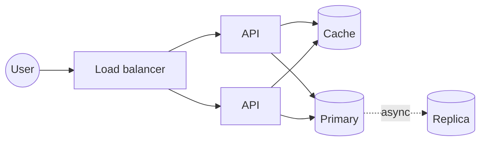

# Writing study content

How the study material is laid out, the markdown it uses, how to draw diagrams, and how to check
your work. Everything here is plain files: edit them, reload the page, and the app shows the change.

| What | Where |
|---|---|
| System design foundations pages | `designs/foundations/NN_slug.md` |
| System design questions | `designs/dNN_name/design.json` and `reference.md` |
| Algorithms foundations pages | `algorithms/foundations/NN_slug.md` |
| Algorithm problems | `algorithms/<id>/` (see [Algorithm problems](#algorithm-problems)) |
| Tech investigations | `tech/NN_slug.md`, about a project in `tech/<slug>/` (see [Tech investigations](#tech-investigations)) |

## Foundations pages

A foundations page is one markdown file. The number in the file name orders the pages; the rest
of the name is the page's address, with `_` turned into `-`
(`designs/foundations/02_data.md` is `#/design/learn/data`).

```markdown
# Data

One paragraph that says what the page covers. It is shown on the page's card on the home page,
so keep it to two sentences.

## Choosing a database

Text, tables, diagrams...

### Relational databases

...
```

- The file must start with a `# Title` line, then the summary paragraph.
- `##` headings are the page's sections and `###` headings their subsections. Both appear in the
  table of contents and both can be linked to.
- Section titles must be unique within a page. Don't rename one casually: other pages and the
  hints of the questions link to it by its id.

### Section ids and links

A heading's id is its text in lower case, with punctuation removed and spaces turned into
hyphens:

| Heading | Id |
|---|---|
| `## Choosing a database` | `choosing-a-database` |
| `## SQL vs NoSQL` | `sql-vs-nosql` |
| `### Caching & CDNs` | `caching-cdns` |
| `### The CAP theorem (and PACELC)` | `the-cap-theorem-and-pacelc` |

Link to another page or section with an ordinary markdown link:

```markdown
See [consistent hashing](#/design/learn/data/consistent-hashing) for how keys move.
Two pointers are covered in [the patterns page](#/algo/learn/patterns/two-pointers).
Try [Merge intervals](#/algo/problem/a16_merge_intervals) next.
```

| Route | Shows |
|---|---|
| `#/design/learn` | the list of system design foundations pages |
| `#/design/learn/<page>` | one page |
| `#/design/learn/<page>/<section>` | one page, scrolled to a section |
| `#/algo/learn/...` | the same, for the algorithms foundations |
| `#/algo/problem/<id>` | an algorithm problem's card |

### Writing style

- Plain words and short sentences. Define a term the first time you use it.
- Lead with what matters in an interview: what the thing is, when to use it, what it costs, and
  the trade-off you'd say out loud.
- Prefer a diagram or a table to a long paragraph. Put a number on things when you can
  ("a disk seek is about 10 ms", "a node holds about 100 GB of hot data").
- Keep code short and runnable (Python unless the topic needs something else).
- Put code blocks and diagrams between paragraphs or list items, never inside a list item: the
  app's markdown renderer turns a fenced block nested in a list into one line of inline code. To
  show steps with code, write each step as a short paragraph (`**Step 1.** ...`) and put the block
  after it.
- Callouts are blockquotes that start with a bold label:

  ```markdown
  > **Interview tip.** Say which consistency level you need before picking a database.

  > **Pitfall.** Retrying a non-idempotent request can charge the customer twice.
  ```

  Use `Interview tip`, `Pitfall`, `Rule of thumb`, `Example` or `Key idea`.
- Don't name companies or interview platforms. Say "a large social network", "a ride-sharing
  app" or "a video site". Names of technologies are fine (PostgreSQL, Redis, Kafka, DynamoDB).
- No emoji.

## Diagrams

Two kinds of diagram are available, both written as fenced code blocks.

- **Mermaid** for architecture, flows, sequences and state machines. Drawn in the browser.
- **Data-structure blocks** for arrays, trees, linked lists, grids, intervals and hash rings.
  Drawn on the server as SVG.

A broken diagram shows as a red "Diagram error" box with the message, so you'll see it straight
away when you preview the page.

### Mermaid

[Mermaid](https://mermaid.js.org/intro/syntax-reference.html) version 11.4 is bundled. These
diagram types are themed for the app and look right:

| Type | Use it for |
|---|---|
| `flowchart LR` / `flowchart TD` | architecture, request paths, decision trees |
| `sequenceDiagram` | who calls whom, in order: handshakes, retries, protocols |
| `stateDiagram-v2` | state machines: circuit breakers, order or payment states |
| `erDiagram` | table schemas and relationships |
| `xychart-beta` | numbers on axes: latency percentiles, growth |
| `quadrantChart` | two-axis comparisons |
| `timeline` | ordered steps with times |
| `pie` | shares of a whole |
| `classDiagram`, `mindmap`, `block-beta` | occasionally |



Every diagram can colour nodes with these classes, without defining them: `accent` (blue),
`good` (green), `warn` (amber), `bad` (red), `purple` and `muted` (grey). Write `A[Cache]:::good`
on a node, or `class A,B bad` on its own line; `class` also works on a subgraph.

Tips:

- `LR` suits pipelines; `TD` suits hierarchies and decisions. Keep a diagram to about 12 nodes;
  split a bigger one in two.
- Shapes: `[box]`, `([stadium])`, `[(database)]`, `{decision}`, `((circle))`, `[[queue]]`,
  `[/parallelogram/]`.
- Edge labels: `A -- yes --> B` or `A -->|yes| B`. Dotted: `A -.-> B`. Thick: `A ==> B`.
- Line breaks inside a label: `A[CDN<br/>static files]`.
- Quote a label that has brackets, parentheses or other punctuation: `A["GET /users/{id}"]`.
- Don't start a label with a list marker: `A["1. read"]`, `A["2) write"]`, `A["- item"]` and
  `-->|1. first|` are drawn as the words "Unsupported markdown: list", with no error. This holds
  for flowchart, subgraph and state labels. Write `A["Step 1: read"]` or `A["(1) read"]`
  instead. Sequence diagrams aren't affected. `tools/check_content.py` reports these labels.
- Avoid `;` in text (it ends a statement), and don't call a node `end`.
- `---` is a line without an arrowhead, for undirected graphs. `-->` points one way, `<-->` both.
- A circle sizes itself to its label, so a one-character circle is tiny. Pad it:
  `A(("#nbsp;A#nbsp;"))`.
- A subgraph whose nodes have no links outside it ignores the diagram's direction. Give it its
  own `direction LR` (or `TB`) line.
- In sequence diagrams, `A->>B: call` is a request and `B-->>A: reply` a response. Use
  `alt`/`else`, `loop`, `par`/`and`, `Note over A,B: ...` and `autonumber` freely.
- Group with `subgraph id [Title] ... end`.

### Data-structure blocks

Each block is a list of `key: value` lines. Draw several frames (before and after, step 1 and
step 2) in one block by separating them with a line holding only `---`. Every frame can have a
`caption:`. A caption is one line: keep it to about 70 characters, because a longer one widens
the figure, which then shrinks to fit the page. Explain the rest in the text around the diagram.
A key the block doesn't know, such as a misspelt `hightlight:`, is reported as a diagram error.

**array** (also a stack, with `direction: vertical`)

````markdown
```array
label: nums
values: 2 7 11 15
pointers: lo=0 hi=3
highlight: 0 3
caption: 2 + 15 = 17 > 9, so move hi left
---
values: 2 7 11 15
pointers: lo=0 hi=2
dim: 3
```
````

| Key | Meaning |
|---|---|
| `values` | the cells, space separated. `"two words"` for a cell with spaces, `_` for an empty cell |
| `pointers` | `name=index` pairs drawn as arrows under the cells. An index may be one past the end; a negative one counts from the end |
| `highlight`, `dim` | indices or ranges (`0 2 4..6`); negative indices count from the end |
| `label` | a name shown to the left |
| `indices: false` | hide the index numbers |
| `direction: vertical` | draw a stack, index 0 at the bottom |

Keys apply only to their own frame, so repeat `label` on every frame that should show it. The
frames of a block share one label column, so a frame without a label still lines up with the
labelled ones.

**tree** (binary trees, level order like the usual `[1,null,2]` notation)

````markdown
```tree
values: 4 2 7 1 3 6 9
highlight: 2 7
---
values: 4 7 2 9 6 3 1
caption: inverted
```
````

`values` is level order with `null` (or `-`) for a missing child. `highlight` and `dim` take node
values, so nodes with equal values are marked together.

**linkedlist**

````markdown
```linkedlist
values: 1 2 3 4 5
pointers: slow=1 fast=3
cycle: 1
```
````

Keys: `values`, `pointers`, `highlight`, `dim`, `label`, `caption`, `cycle: index` (the tail
links back to that node), `null: false` (hide the trailing null).

**grid** (matrices, DP tables, boards)

````markdown
```grid
collabels: _ a c e
rowlabels: _ a b c
0 0 0 0
0 1 1 1
0 1 1 1
0 1 1 1
highlight: 1,1
path: 0,0 1,1 2,2
caption: dp[i][j] = longest common subsequence of the prefixes
```
````

Each line that isn't a known key is a row of values. `highlight`, `dim` and `path` take `row,col`
cells; `path` draws a line through the cells in order. `rowlabels` and `collabels` label the edges.
Cells are square and as wide as the longest value. Column labels don't widen them, so keep each
one to a few characters. Grid frames don't share a label column: give every frame of a block the
same `rowlabels` and `collabels`, or the frames won't line up.

**intervals**

````markdown
```intervals
input: [1,3] [2,6] [8,10]
merged: [1,6] [8,10]
caption: sort by start, then extend or start a new interval
```
````

One row per line, `name: [start,end] ...`. Overlapping intervals in a row are stacked. With
several rows the last one is drawn in green, as the result.

**ring** (consistent hashing)

````markdown
```ring
nodes: A@30 B@150 C@260
keys: k1@80 k2@200 k3@300
highlight: B
caption: each key belongs to the next node clockwise
```
````

Positions are degrees, 0 at the top, increasing clockwise. Each key is joined to its owner.

## Design questions

`designs/dNN_name/design.json` holds a question's metadata. Its `foundations` list links the
question's hints and review to the foundations sections it needs, as `"page/section"` (or just
`"page"`):

```json
"foundations": ["building-blocks/rate-limiting", "data/sharding", "reliability/idempotency"]
```

They show up as "Foundations to review" in the hints box and on the review page. `reference.md`
(the worked answer) can also link to foundations sections inline.

`reference.md` draws the design as it grows. It needs at least one Mermaid diagram
(`tools/check_content.py` reports one without), and the ten questions follow this pattern:

- **Requirements**: a map of the requirements paragraph, as a `flowchart LR` three columns wide.
  Actors are circles, each with a solid arrow to the operations they perform. Each non-functional
  requirement is an amber stadium (`(["..."]):::warn`), joined with a plain dotted line (`-.-`)
  to the operation it constrains. Out-of-scope features are `:::muted` boxes on a dotted arrow
  from the actor who would want them. The line above it reads "Amber marks the non-functional
  requirements, each beside the operation it constrains.", with " Grey is out of scope." added
  when there are grey boxes. The diagram says only what the paragraph says.
- **Data model**: the tables as an `erDiagram` under the data model text. Use the column names
  from the text, mark keys with `PK`, `FK` and `UK` (a composite key is several `PK` columns),
  and keep comments to a few words, since a comment column widens the box. Label each
  relationship with what it means ("one row per night"). Where a question's data isn't a set of
  tables, draw the structure instead, as autocomplete's trie does.
- **High-level design**: the first architecture, as a `flowchart TD` with no colours.
- The flow the question hinges on, as a `sequenceDiagram` or `stateDiagram-v2`: two requests
  racing, a retry after a timeout, a payment's states.
- **The design after the deep dives**: the same architecture again, with every box the deep dives
  added or changed marked `:::good` (green), and the line "Green marks what they added or
  changed." above it.

The review's compare tab shows the reference beside the user's notes, in a column about 500 px
wide, and a wider diagram shrinks to fit. Keep a flowchart to about 12 nodes and at most four
side by side; prefer `TD` to a long `LR` chain. A sequence diagram gets 150 px per participant, so
use three participants where you can, and break long messages and notes with `<br/>`.

## Algorithm problems

Each problem is a folder `algorithms/<id>/`. The format is described in
[algorithms/README.md](../algorithms/README.md).

## Tech investigations

A tech investigation is a page, `tech/NN_slug.md`, about a small project in the folder next to
it named after the page's slug: `tech/01_react_swapi.md` explains `tech/react-swapi/`. The page
works like a foundations page (title, one-paragraph summary, `##` sections with ids, Mermaid) and
its address is `#/tech/<slug>`, so a section is `#/tech/react-swapi/the-api-boundary`.

To show one of the project's files, name it in an `include` block, relative to `tech/`:

````markdown
```include
react-swapi/src/api/swapi.ts
```
````

When the page is served, the block becomes the file's contents as a code block, under a tab with
its path, and coloured by its extension (`.ts`, `.tsx`, `.js`, `.css`, `.json`, `.html`, `.md`;
others stay plain). The path links to the file in the file browser. The page never holds a copy of the code, so it can't drift from what runs, and the code's
own comments are part of the explanation. Write them for a reader learning the technology: say
why, not only what. A path that doesn't exist, or that leaves `tech/`, shows a red error box.

A useful order for the page: what the project does and how to run it, the stack and why, then
one section per part of the code (an include, then the points worth explaining), then best
practices, common mistakes, interview questions and exercises.

### The file browser

When the project folder exists, the page gets a Files tab: `#/tech/<slug>/files` shows the whole
project as a folder tree, and `#/tech/<slug>/files/<path>` opens one file, for example
`#/tech/react-swapi/files/src/App.tsx`. Each file shows the sections whose `include` blocks show
it, so the page doesn't need to include every file: config files can be left to the browser.
Link to a file from the page with that route; the checks report links to files that aren't there.
Because `files` is that route, no section of a tech page can be called "Files".

The browser lists every file in the folder except:

- what the project's `.gitignore` ignores (names and simple patterns like `*.log` or `/dist/`),
- `node_modules/`, build output (`dist/`, `build/`, `coverage/`) and caches,
- `.env` and `.env.*` (but not `.env.example`) and `*.local`, so secrets stay out even if the
  `.gitignore` forgets them. The static site publishes every file the browser lists.

A file over 100 KB (usually a lock file) or one that isn't text is listed without its contents.

## Checking your work

```sh
python tools/check_content.py            # everything
python tools/check_content.py designs    # or: algorithms, tech
```

It renders every page and reports data-structure blocks that don't parse, `include` blocks whose
file doesn't exist, links to pages, sections, problems or project files that don't exist, a tech
page section called "Files", design questions whose
`foundations` don't resolve, reference designs without a diagram, and Mermaid labels that start
like a list. The test suite runs it too.

Otherwise Mermaid is only drawn in the browser: run the app (`python -m swe_prac`) and open the
page. A broken diagram is a red box with the parser's message.
