# SWE Practice: interview practice

Live site: https://jarlowrey.github.io/swe-prac/practice/ (the whole app: your code runs in the browser)

This is the practice section of the repo. The site's other section, the job tracker and AI
skills, is in [../jobs/](../jobs/README.md); [the root README](../README.md) covers both and the
build. Commands below run from this folder (`cd practice`), with the virtual environment at the
repo root (`..\.venv`).

Practice for three kinds of software engineering interview: 90-minute, four-level coding
assessments, classic algorithm problems against a 20 to 40-minute clock, and 45-minute system
design rounds. You write code in Python, Java or C++. The home page lets you pick one. The algorithms and system design sections
also have foundations pages to study from, with diagrams. A fourth section, tech investigations,
studies one technology at a time through a small project you can run.

## Overview

### Coding assessments

A common way to screen software engineers is a 90-minute coding assessment. Instead of a set of
separate puzzles, it gives you one realistic task, such as an in-memory database or a bank, split
into four levels. Each level adds requirements to the same class, and you only see a level after
passing the one before it. Pace matters, and so does a design that still holds up when the later
levels arrive.

Practicing in a plain editor leaves out most of that pressure: the clock, levels you can't read
ahead, and tests you can't see. This app recreates those conditions in your browser. Afterwards it
shows where your time went against a pacing target for each level.

It comes with seven problems. Each has four levels, shown and hidden tests, hints, a solution
analysis and a reference solution:

- In-memory file store
- Banking ledger
- Rental booking calendar
- In-memory database
- Worker time tracker
- Transactional key-value store
- Inventory and point of sale

To add your own, see [Developing](#developing).

### Algorithms

The algorithms section practices the classic data structures and algorithms round. You get one
problem and write a `Solution` class in Python, Java or C++. The clock is 20 minutes for Easy, 30 for Medium and
40 for Hard. **Run** checks your code against the examples. **Submit** adds hidden tests, from edge
cases to inputs big enough that only an efficient algorithm finishes in time. So a correct brute
force still fails. Afterwards the review shows hints and an explanation with diagrams, which
includes the commented reference solution.

It comes with 45 problems (10 Easy, 31 Medium, 4 Hard) on hashing, two pointers, sliding windows,
binary search, intervals, linked lists, stacks, heaps, trees, graphs, greedy choices and dynamic
programming. Filter them by difficulty, pattern or status, or start a random one.

### Foundations

Both the algorithms and the system design sections start with foundations pages: study notes
with diagrams (data-structure drawings, flowcharts, sequence and state diagrams) on what the
questions build on.

| Algorithms | System design |
|---|---|
| How to approach a problem | Networking and APIs |
| Big O and complexity | Data |
| Data structures toolbox | Building blocks |
| Problem patterns | Reliability and correctness |
| Dynamic programming | |

Every algorithm explanation links to the sections it builds on. Every system design question
lists the sections to review in its hints, and its reference design links to them inline. The
pages are plain markdown files; [docs/writing-content.md](docs/writing-content.md) explains how
to edit them.

### System design

The system design section practices the 45-minute design round. You get one deliberately vague
prompt and work through seven timed steps: requirements, estimates, API, data model, high-level
design, deep dives and wrap-up. Each step has its own notes tab, and a diagram tab lets you draw
boxes and arrows. Nothing is auto-graded. Afterwards you compare your notes with a reference design
and tick a self-review checklist, and that is your score.

It comes with ten questions. Each has hints, key points to check yourself against and a reference
design:

- URL shortener
- Rate limiter
- News feed
- Chat and messaging
- Booking and availability calendar
- Proximity and listing search
- Payments system
- Video upload and streaming
- Notification system
- Search autocomplete

A framework guide (System design > Read the framework guide) explains what each step should
produce, what interviewers grade and the common mistakes, with a worked example.

### Tech investigations

Each tech investigation (Tech in the top bar) studies one technology through a small, complete
project in `tech/`. Its page shows every file of the project with the file's own comments, and
explains the choices: what is current best practice, what it replaces, the common mistakes, the
questions an interviewer would ask, and exercises. The code on the page is read from the project
when the site is built, so it is always the code that runs. A file browser (the Files tab) has the
whole finished project as a folder tree, every file in full with line numbers, and links back to
the sections of the guide that explain it. Nothing is timed or graded.

- **React: fetching data the modern way** (`tech/react-swapi/`): a Star Wars character browser
  on [SWAPI](https://swapi.dev), with search as you type, pagination and a detail page. It uses
  React 19 with the React Compiler, TypeScript, TanStack Query, React Router, Zod, and Vitest
  with Testing Library and MSW. It also has a version of the data fetching written with only
  `useEffect`, for interviews that don't allow libraries. To run it you need Node 22.22 or newer:

  ```
  cd tech\react-swapi
  npm install
  npm run dev      # http://localhost:5173
  npm test
  ```

## Start

Open https://jarlowrey.github.io/swe-prac/practice/. There's nothing to install: the whole app runs in the
browser. Opening a session starts loading its language in the background. The first time, the
browser downloads about 25 MB for Python and ruff, 8 MB for Java or 40 MB for C++; after that
they come from its cache.

### Running a local copy

To practice offline, or to see content changes before you push them, build the site and serve
it. It needs Python 3.12 or newer, and Node 22 or newer: the build precompiles the C++ standard
headers with the same clang the browser runs. From the repo root:

```
python -m venv .venv
.venv\Scripts\python -m pip install -r practice\requirements.txt
.venv\Scripts\python build.py --serve    # builds site/, opens http://127.0.0.1:8765/
```

That builds the whole site: the landing page, this section in `site/practice/` and the Jobs
section in `site/jobs/`. `--port 9000` and `--no-browser` change how it serves; without `--serve`
it only builds `site/` (gitignored). `tools\build_static.py --serve`, run in this folder, builds
and serves this section alone, in `practice/site/` (its "Job search" link has nothing to go to
there). The first build downloads the runtimes your code runs with in the browser, Pyodide
(Python), ruff, javac with TeaVM (Java) and clang (C++), from the npm registry at pinned
versions, checks them against their published hashes and keeps them in `practice/.cache/` for
later builds, with the precompiled headers (about half a minute to make). The local server only hands the
files to the browser and listens on 127.0.0.1. Any static file server would do, but opening
`site/index.html` as a file won't work: browsers don't run its modules and workers from a
`file://` page.

A local copy keeps its own history, separate from the live site's (see
[Your history](#your-history)).

## Publishing (GitHub Pages)

`.github/workflows/pages.yml` publishes the site at https://jarlowrey.github.io/swe-prac/ on every
push to `master`: it builds it with the root `build.py`, runs this section's and the Jobs
section's test suites and deploys `site/`. One-time setup: Settings > Pages > Source: GitHub
Actions. Links from before the move to `practice/` (such as `.../swe-prac/#/algo`) still work:
the landing page sends them on.

Everything the browser runs is in the site, so it gives the answers away to anyone who looks: every
problem's tests, hidden ones included, are in `tests/`, and the reference solutions, explanations
and reference designs are in `data.json`. The app itself shows hidden tests only as pass counts,
and asks before opening a spoiler.

## Screenshots

The session screenshots use demo questions that aren't in the practice set ("Parking garage" for
coding, "Daily Temperatures" for algorithms, "Pastebin" for system design), so they don't spoil the
real ones.

**Home:** choose coding, algorithms, system design or the tech investigations.

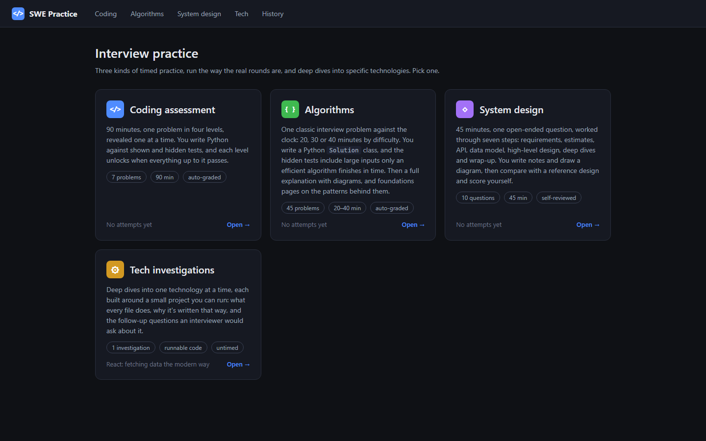

**Coding problems:** start a problem or a random one, or open its question, hints or reference
solution without starting a session.

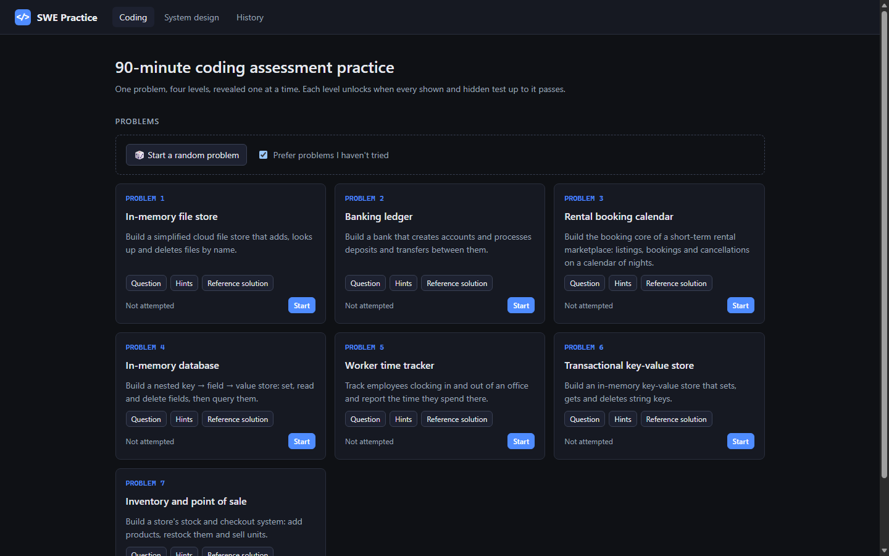

**Run:** shown tests list every call with the expected value, what you returned and your `print()`
output. Here the Level 3 code charges the rate at exit instead of the rate at entry.

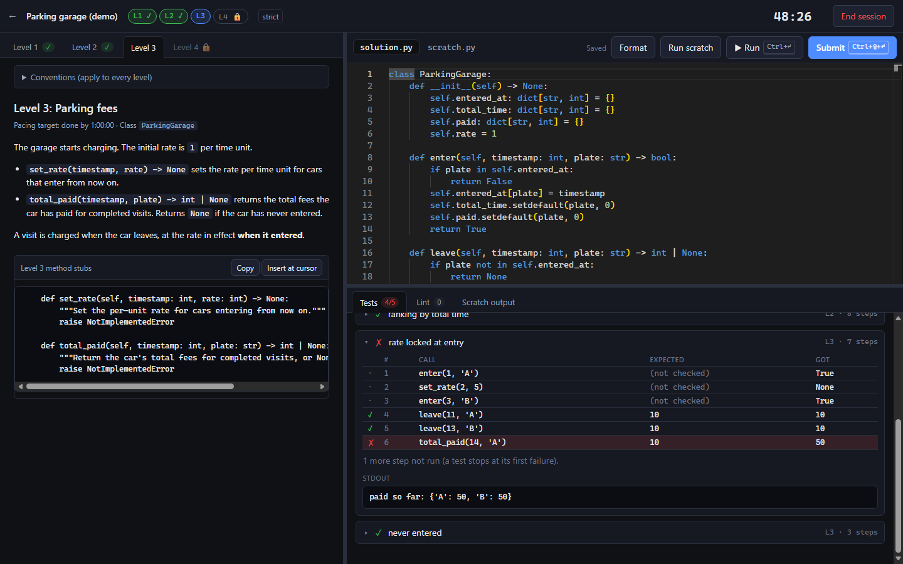

**Submit:** hidden tests run as well but report only counts. When everything passes, the next
level unlocks.

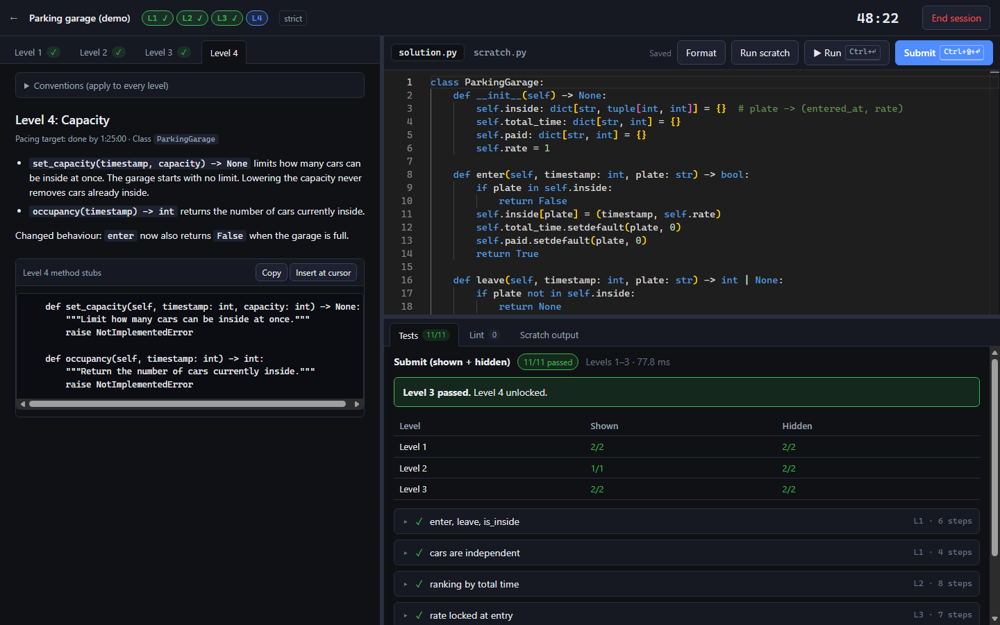

**Review:** the timed result next to the result including overtime, pacing against the targets,
then the analysis, hints, reference solution, your code and a timeline.

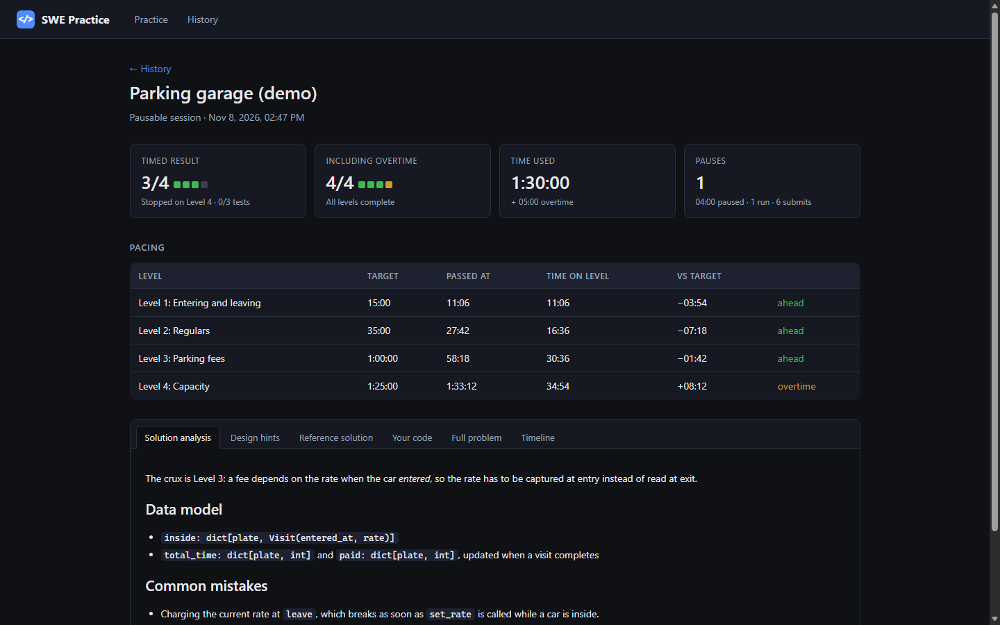

**History:** every attempt, newest first.

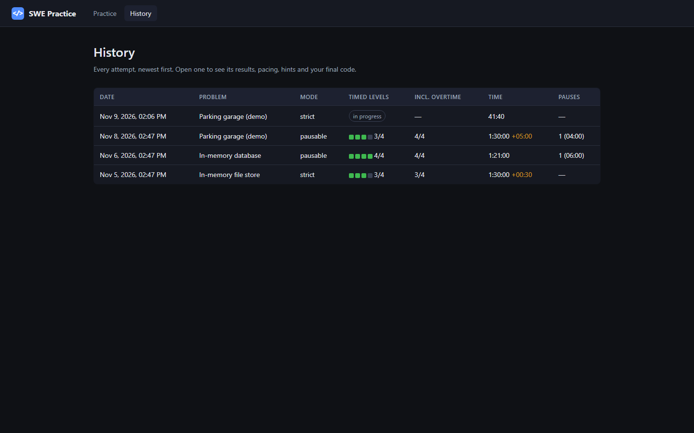

**Algorithms:** the foundations pages, then the problems, filtered by difficulty, pattern or
status. Each card opens the question, hints or solution without starting a session.

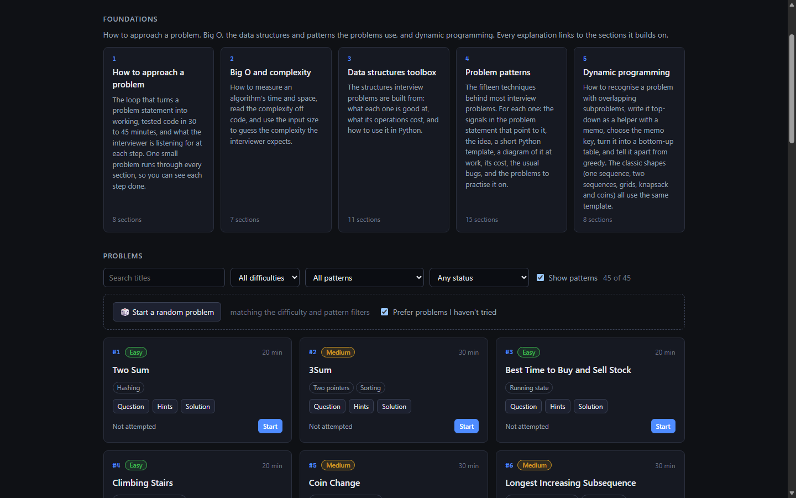

**Algorithms session:** a correct brute force passes the examples, but a large hidden test runs
past its time limit, so the submit stops there.

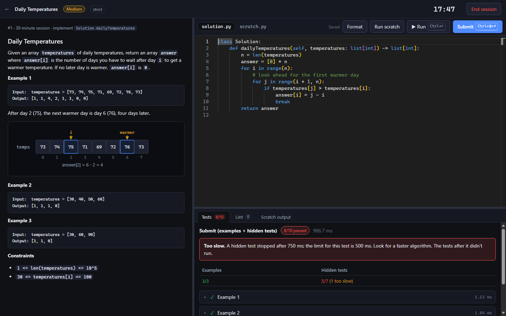

**Algorithms review:** the timed result, links to the foundations sections to study next, then the
explanation with diagrams and the commented solution, hints, your code and a timeline.

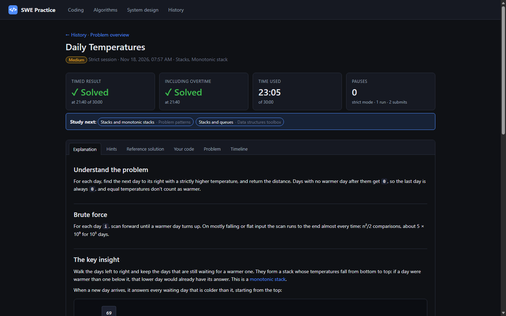

**Foundations page:** sections and subsections on the left; every section can be linked to.
Diagrams like this hash ring are drawn from a few lines of markdown.

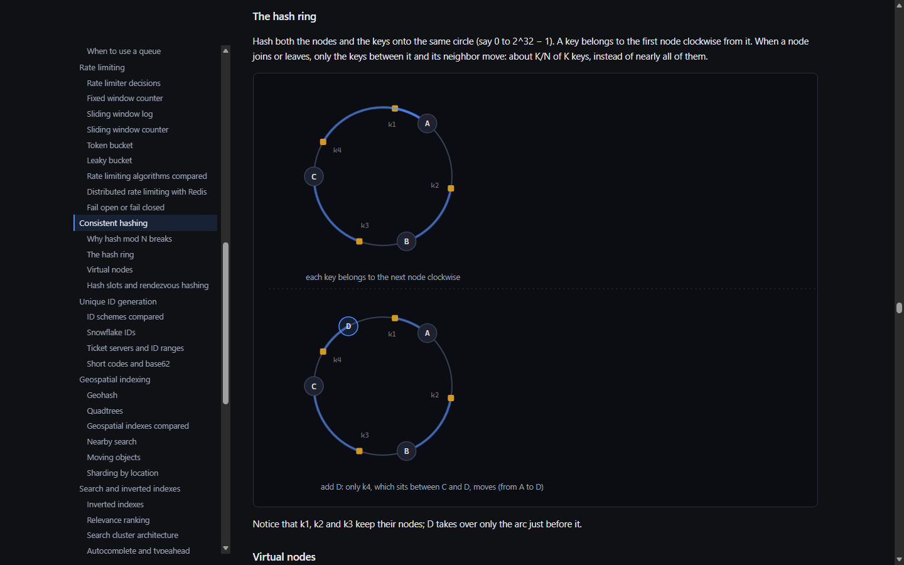

**System design session:** the steps on the left with a clock for each, and your notes and diagram
on the right. Here you're 21 minutes in, drawing the high-level design.

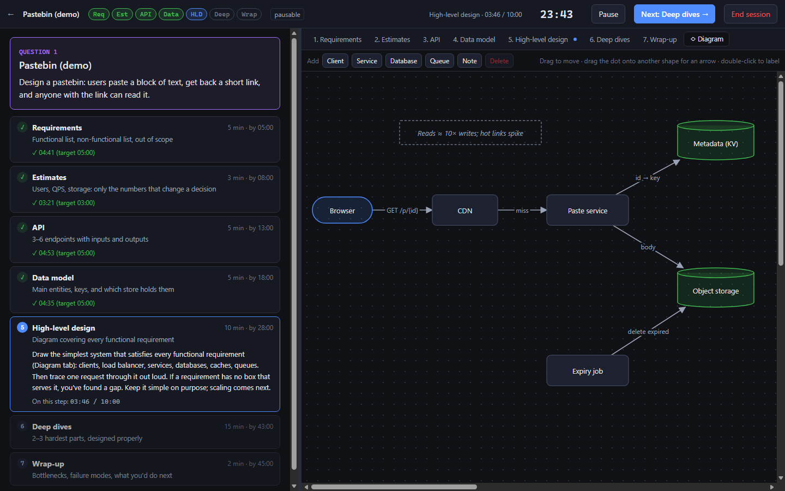

**System design review:** time on each step against its target, then the self-review, your notes
beside the reference design, and your diagram.

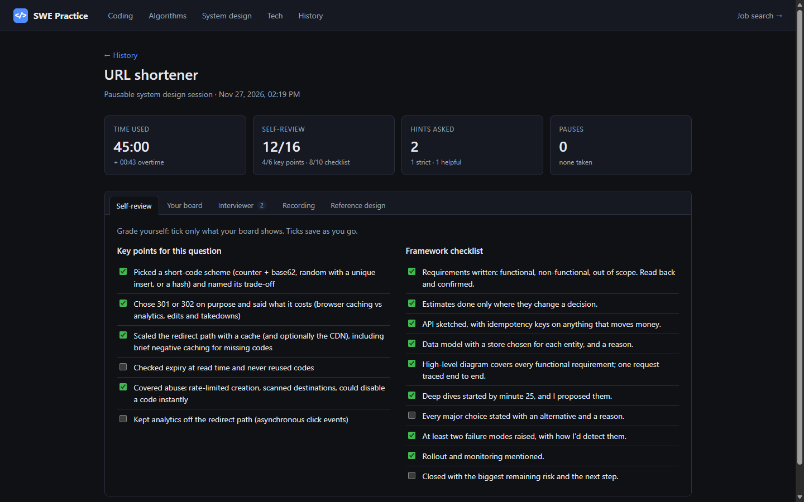

**Tech investigation:** the React page, at the section on queries. Each file of the project is
shown under its path, with the explanation around it.

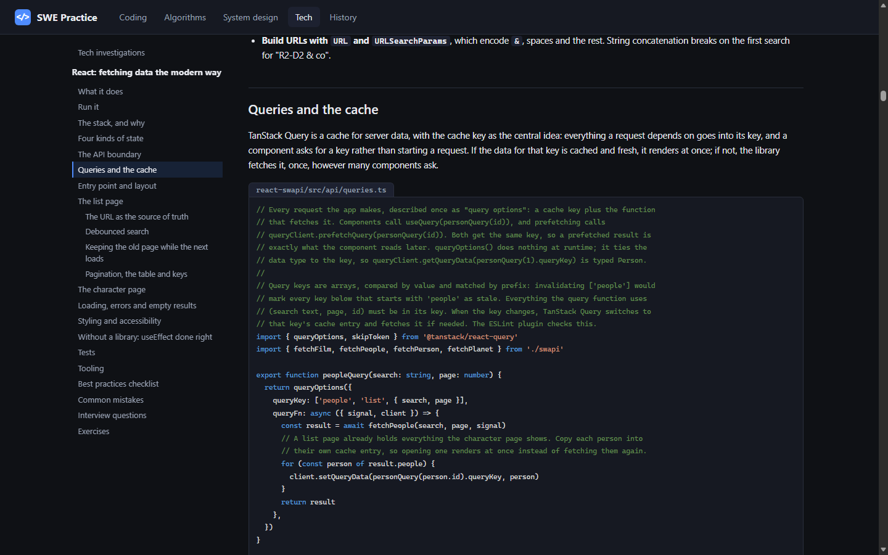

**Tech file browser:** the finished React project as a folder tree, with `swapi.ts` open and a
link to the section of the guide that explains it.

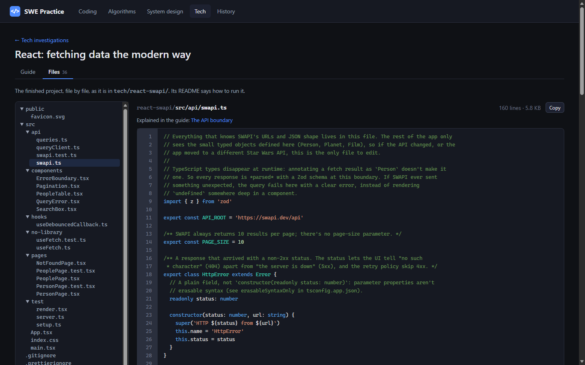

## How a coding session works

- **Pick a problem** or a random one. You can prefer problems you haven't tried yet. Then choose the timer mode:
  - **Strict:** 90 minutes, no pausing. The clock is wall time saved with the session, so closing
    the tab doesn't stop it.
  - **Pausable:** pausing blurs the problem and your code and makes the editor read-only.
    Every pause is recorded in your history.
- **Pick a language:** Python, Java or C++ (the page remembers it). Each gets its own starter
  code, stubs, tests view and scratch file. The hints, the solution analysis and the reference
  solution stay in Python.
- **Levels are revealed one at a time.** Level N+1 unlocks when *every* shown and hidden test for
  levels 1..N passes, so a regression in an earlier level blocks the unlock.
- **Run** (`Ctrl+Enter`) runs the shown tests with full detail: each call, the expected value,
  what you returned, your `print()` output and the traceback.
- **Submit** (`Ctrl+Shift+Enter`) also runs the hidden tests. Hidden results are counts only, per level.
- **Lint and format** use [ruff](https://docs.astral.sh/ruff/). Lint runs as you type and on every run,
  with markers in the editor and a Lint tab. It never blocks a level. **Format** (`Shift+Alt+F`)
  reformats your code. The rules are in `swe_prac/user_ruff.toml`. In Java and C++ the Lint tab
  shows the compiler's warnings instead, and there is no Format.
- **tests.py** is a read-only editor tab with the shown tests of every level you've unlocked, written
  as plain Python (`assert obj.method(...) == expected`). **Run** executes exactly these, and it
  grows when a level unlocks. Hidden tests aren't listed there; **Submit** runs them and reports
  counts only. In Java and C++ it's `Tests.java` or `tests.cpp`, written as `assertEquals(...)`
  or `EXPECT_EQ(...)` calls.
- **scratch.py** is another editor tab for quick experiments (`from solution import *`). It starts
  with an example test case, the first shown test of Level 1, plus a small `check(got, expected)`
  helper. Copy it to try your own calls, then press **Run scratch**. In Java and C++ it's
  `Scratch.java` or `scratch.cpp`: a `main` that calls your class and prints with `show(...)`.
- **At 0:00** your timed score is locked in. You can keep going untimed; anything finished after
  that is marked as overtime.
- **End session** opens the review: timed and overtime results, time to each level against the
  pacing targets (L1 15 min, L2 35, L3 60, L4 85), pauses, a run/submit timeline, design
  hints, solution analysis, the reference solution, your final code and the full problem.

Each problem card on the coding page also has **Question**, **Hints** and **Reference solution**
buttons. They open the full problem, the design hints or the reference solution without starting a
session. On a problem you haven't attempted they ask you to confirm first, and they stay locked
while a session on that problem is running.

Your code runs in your browser, in Pyodide (CPython 3.14 compiled to WebAssembly), with a fresh
interpreter in its own Web Worker for every run, so nothing one run does carries over to the next.
A run is stopped at 10 s, so an infinite loop can't hang the page, and it has only what the
browser allows a web page: no access to your files. Two things differ from Python on your
machine. There are no threads. And recursion that passes through built-in code is limited to a
few hundred levels: plain recursive calls are fine (the limit is 200,000 for algorithm problems),
and so are `functools.cache` and `max`, `min`, `sum`, `any`, `all` and `sorted` over a generator,
which the runner swaps for pure-Python versions in the browser. Recursion through others, such as
`list(...)` over a generator, stops Python, and the result says why.

Java and C++ are compiled in the browser too, to WebAssembly: Java with javac and TeaVM, C++
with clang (C++20, with `#include <bits/stdc++.h>`), in a Web Worker that stays loaded, so a
compile takes a second or two. Each run then gets a fresh worker, with the same 10 s stop. A
compile error is the run's result, with the line marked in the editor. The time limits are a
tenth of Python's: compiled code is that much faster, and a quadratic solution still fails them.
A few things differ from your machine:

- **Java:** a NullPointerException, an array index out of range or a stack overflow can't be
  caught: it ends the test with that error. Other exceptions behave as usual. The class library
  is TeaVM's, which has nearly everything interview code uses but not `StringJoiner`: use
  `String.join` or `Collectors.joining`.
- **C++:** exceptions are off, so `throw` doesn't compile, and a library call that would throw
  (`.at()` out of range, for example) ends the test with what it would have thrown. The standard
  library's debug checks are on, so `v[i]` out of range ends the test with a message instead of
  reading past the end. The library is LLVM's libc++, not GCC's: `<bits/stdc++.h>` works, and so
  do GCC's `__gcd` and `__lg`, but `pb_ds` doesn't, and `<regex>` needs its own `#include`. It's
  C++20, so C++23 additions such as `std::print` aren't there.
- **Both:** recursion goes a few thousand calls deep at most (Python's goes much deeper here).
  Deeper than that, use a loop or an explicit stack.

Whatever ends a test, the next one starts in a fresh copy of the program.

## How an algorithms session works

- **Pick a problem** or a random one that matches the difficulty and pattern filters. You can
  prefer problems you haven't tried yet. Then choose strict or pausable and the language, as for
  coding. An algorithms session can run alongside a coding or design session; only one of each
  can be active.
- **The clock** is 20, 30 or 40 minutes by difficulty.
- **Run** (`Ctrl+Enter`) runs the examples from the statement with full detail: the input, the
  expected answer, what you returned and your `print()` output.
- **Submit** (`Ctrl+Shift+Enter`) also runs the hidden tests: edge cases first, then large inputs.
  Hidden results are counts only. A large input has a time limit, and the first one your code
  runs past stops the submit and is reported as too slow, so a correct but slow answer doesn't pass.
- **Solved** means one submit passed every test. The first time that happens is recorded; after
  0:00 it counts as overtime. You can keep tidying your code afterwards.
- **scratch.py** starts with a call on the first example. For linked lists, trees and graphs it
  imports helpers that build them from plain lists and print them back. **Run scratch** runs it.
  `Scratch.java` and `scratch.cpp` do the same, with `makeList`, `makeTree` and `makeGraph`.
- **Lint and format** work as for coding, except that camelCase method names are allowed, because
  the problems use them. The rules are in `swe_prac/user_ruff_algo.toml`.
- **In Java and C++** the statement shows the method's signature in that language, and lists,
  trees and graphs are the usual `ListNode`, `TreeNode` and `Node` classes. The explanation and
  its solution are in Python.
- **End session** opens the review: the timed result and the result including overtime, then
  tabs for the explanation (with the commented solution), hints, your code, the problem and a timeline of
  runs and submits. Links at the top lead to the foundations sections the problem builds on.

Each problem card also has **Question**, **Hints** and **Solution** buttons, and a problem's title
opens its overview page with your past attempts. Explanations and foundations pages link to
problems through that overview, so following a link offers a timed attempt before any spoilers.
As with coding, the study views ask you to confirm first on a problem you haven't attempted, and
they stay locked while a session on that problem is running.

## How a system design session works

- **Pick a question** or a random one, then the timer mode. Strict and pausable work as for coding,
  with a 45-minute clock. A design session can run alongside a coding session; only one of each
  can be active.
- **Seven steps, each with a target:** requirements 5 min, estimates 3, API 5, data model 5,
  high-level design 10, deep dives 15, wrap-up 2. The current step shows its guide and a clock
  against its target. **Next** moves on, and steps only go forward. You can still open any step's
  notes tab, for example to fill a gap you noticed later.
- **Notes:** each step has a tab that starts with a short template (for example functional,
  non-functional and out of scope for requirements). Notes save every few seconds.
- **Diagram:** add clients, services, databases, queues and notes. Drag a shape to move it, drag
  its dot onto another shape to draw an arrow, double-click to label, and press Delete to remove.
- **No spoilers while you work.** The hints, key points and reference design stay hidden until
  the session ends.
- **At 0:00** you can keep going; steps you start after that are marked as overtime.
- **End session** opens the review: time on each step against its target, then tabs for the
  self-review, your notes next to the reference design, your diagram and the reference design.
  The self-review has the question's key points and the framework checklist (ten items). Your
  ticks save as you go and become the score shown in history. The reference design tab starts
  with the hints and the foundations sections to review, grouped by page.

Each question card also has **Hints** and **Reference design** buttons. As with coding, they ask
you to confirm first on a question you haven't attempted, and they stay locked while a session on
that question is running.

## Your history

Your attempts are saved in the browser's localStorage, separately for each browser and each site
address: the live site and a local copy keep separate histories. **Export history** on the coding
History page saves every track's attempts to a JSON file, and **Import history** adds a file's
attempts to the browser's (ones it already has are skipped). That's how to keep a backup or move
to another browser. Clearing the site's data in the browser resets it.

Before the app moved into the browser, a local server kept history in `data/prac.db` (SQLite).
`tools/export_history.py` writes that to a file Import history accepts:

```
..\.venv\Scripts\python tools\export_history.py    # writes swe-prac-history-<date>.json
```

## Architecture

**While you practice.** The app is a set of static files, and everything runs in the browser tab:
the sessions, the clock, the scoring, your code and ruff.


- **There is no server.** The pages call `api()` (`common.js`), which lands in `backend.js`: it
  answers with the JSON the pages expect, and keeps the sessions, the clock, the level gating,
  the scoring and your history in localStorage. Questions, study pages and reviews come from
  `data.json`, and a problem's tests from `tests/<track>/<id>.json` the first time you run it.
- **Code runs in a Web Worker.** `python.js` hands each Run, Submit or Run scratch to a fresh
  worker (`py-worker.js`, with Pyodide and `runner.py` loaded) and starts the next one ahead of
  time. The page enforces the limits by ending the worker: the whole run at 10 s, and a call with
  a time limit at 1.5 times that limit (the runner says when each such call starts). Tests that
  finished keep their results either way.
- **One runner, two homes.** `runner.py` runs in the browser and also natively, where the build
  tools check every reference solution through it in a subprocess (`execution.py`). In the
  browser it swaps the C code that recursive solutions recurse through for pure-Python versions,
  and keeps every test's linked lists and trees alive, because freeing a long one recurses in C
  past the small WebAssembly stack.
- **Java and C++ compile in a worker that stays loaded.** `compiled.js` gives each the same
  interface as `python.js`, and reuses a build while the code is unchanged. `lang-compile.js`
  holds the compiler (`compilers.js`: javac and TeaVM, or clang with the precompiled headers).
  `lang-run.js` runs each build in a fresh worker. The harness (`lang-job.js`) feeds the program the
  tests as JSON and gets back what each call returned. `judge.js` compares that with the expected
  answers and reports each test the way `runner.py` does, so the rest of the app treats every
  language alike. A problem with its own validator has it in both `checker.py` and `checker.js`.
- **The Java and C++ versions are generated.** The build reads the type annotations on each
  problem's Python signatures (`langs.py`). From them it writes each language's starter code,
  stubs, tests view and scratch file. It also writes the harness that decodes the test values
  into typed arguments; `static/lang/` holds the parts every problem shares.
- **Lint is ruff compiled to WebAssembly** (`lint.js`), with `user_ruff.toml` and
  `user_ruff_algo.toml` merged into `data.json` by the build.
- **Hidden tests show as counts.** `backend.js` returns full detail for shown tests and only pass
  counts per level for hidden ones. They aren't secret, though: they're in the site's files.
- **tests.py and the scratch example are generated, not stored.** `testsource.py` renders them
  from the shown entries in `tests.json` at build time, so every problem gets them and they can
  never drift from what Run executes. Only unlocked levels are shown, so nothing leaks from later
  levels.
- **The timer is wall clock minus recorded pauses**, saved with the session, so refreshing or
  closing the tab changes nothing.
- **System design and algorithms reuse the same clock.** `backend.js` keeps each track's
  sessions apart and runs the same timer, pause and finish code for all three. Questions and the
  framework are plain files in `designs/`, read by `designs.py`. `algorithms.py` reads
  `algorithms/<id>/`. Tests are stored as plain lists, and the runner gets each problem's
  options: adapters that build linked lists, trees and graphs before the call, an answer
  comparison that ignores order or calls the problem's own validator, and a per-test time limit
  that stops a submit at the first test that's too slow.
- **Study pages are markdown, rendered at build time.** Python-Markdown renders the foundations
  pages and the tech investigations (`pages.py`, which also builds their tables of contents and
  section links), the statements, explanations and reference designs into `data.json`. A tech
  page's ```` ```include ```` blocks are replaced with the project files they name, and `tech.py`
  adds the whole project for the file browser. The browser colours Python, TypeScript, CSS, JSON,
  HTML and Markdown with Monaco's tokenizers, without loading an editor. `diagrams.py` draws the
  data-structure blocks (arrays, trees, linked lists, grids, intervals, hash rings) as SVG.
  Mermaid, bundled in `static/vendor/`, draws the flowcharts and sequence and state diagrams in
  the browser, and is only loaded on pages that have one.

**Building problems.** `tools/build_problem.py` turns the spoiler sources in `reference/` into
what the app serves from `problems/`, and checks the hidden tests along the way.
`tools/build_algo.py` does the same for an algorithm problem: it computes the expected answers
with the reference solution, checks them against a brute-force solution on every test and on
random inputs, and runs both the reference and the empty starter code through the real runner.

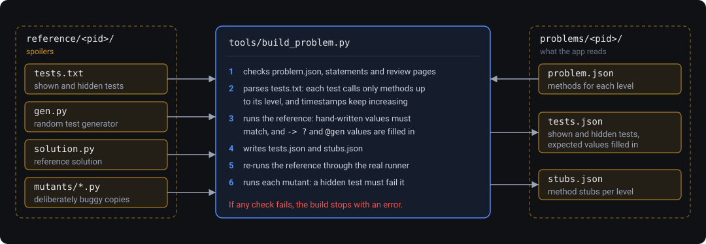

## Layout

```
swe_prac/static/     the app as the browser runs it: the pages, backend.js, python.js, lint.js,
                     compiled.js and the Java and C++ workers (Monaco and Mermaid are bundled)
swe_prac/static/lang/  the Java and C++ sources every problem's harness shares
swe_prac/            runner.py (runs the tests, in the browser and for the build tools), langs.py
                     (the Java and C++ versions of each problem), and the Python that renders the
                     content into the site
problems/<pid>/      what the app reads: statements, review pages, built tests.json and stubs.json
reference/<pid>/     SPOILERS: reference solution, test source, random generator, mutants
algorithms/<id>/     algorithm problems: problem.json, statement.md, test inputs (cases.py) and
                     the built tests.json; SPOILERS: hints.md, explanation.md, solution.py
algorithms/foundations/  the algorithms foundations pages (markdown)
designs/<qid>/       system design questions: design.json (prompt, hints, key points) and
                     reference.md (SPOILER: the reference design)
designs/foundations/ the system design foundations pages (markdown)
designs/framework.*  the seven steps, the self-review checklist and the framework guide
tech/NN_slug.md      a tech investigation's page (markdown, with ```include blocks)
tech/<slug>/         the project it walks through, named after the page's slug, e.g.
                     tech/react-swapi/ for 01_react_swapi.md (a Vite + React app; npm install
                     creates node_modules/ there, which its .gitignore excludes)
tools/               build_static.py (build the site; --serve serves it), build_problem.py
                     (compile and verify problems), dsl.py (test format parser), build_algo.py
                     (build and verify algorithm problems), check_content.py (check the study
                     pages' diagrams and links), export_history.py (old history to an import file),
                     build_cpp_pch.mjs (precompiles the C++ headers for build_static.py)
tests/               the Python tests (unittest); tests/js/ the browser side, run in Node
docs/                README screenshots, architecture diagrams (SVG, edit them directly) and
                     writing-content.md (how to write study pages and diagrams)
```

The hidden tests are in `problems/<pid>/tests.json` and `algorithms/<id>/tests.json`, the
reference solutions are in `reference/` and `algorithms/<id>/solution.py` (and some in Java and
C++ in `tests/js/solutions/`), and the reference designs are in `designs/<qid>/reference.md`.
Don't open them before you've practiced.

## Developing

```
cd practice
..\.venv\Scripts\python -m unittest discover -s tests  # content, build, runner, every problem natively
..\.venv\Scripts\python ..\build.py                    # then the browser side, in Node 22 or newer:
node --test "tests/js/*.test.mjs"                       # backend, every problem in Pyodide, ruff, Java, C++
..\.venv\Scripts\python tools\build_problem.py --all    # rebuild and verify all problems
..\.venv\Scripts\python tools\build_algo.py --check     # verify every algorithm problem (no writes)
..\.venv\Scripts\python tools\check_content.py          # diagrams and links in the study pages
..\.venv\Scripts\python -m ruff check . && ..\.venv\Scripts\python -m ruff format --check swe_prac tools tests algorithms designs
```

The Python tests import `swe_prac` from this folder, so run them from here. `ruff format` also
formats the Python code blocks in the study pages' markdown. The lint tests compare against native
ruff: if `ruff` isn't on your PATH, set `RUFF` to `..\.venv\Scripts\ruff.exe`.

The JavaScript tests run the built site (`../site/practice/`, else `site/`, or `$SWE_PRAC_SITE`),
so build it first; they test what ships. They run
`backend.js` against the real `data.json` with fakes for Python and ruff, every reference solution
against every test in Pyodide within the time limits the page enforces, `python.js` through its
real worker script (a stand-in gives Node the browser's `Worker`), and ruff's WebAssembly build
against native ruff. `java.test.mjs` and `cpp.test.mjs` compile with the site's own javac and
clang: that solutions pass and fail as they should, that a crash fails only its test, the time
limits, and that every problem's starter code builds without a warning and runs, at every level.
They take a couple of minutes.

`languages.test.mjs` is the quicker basic check of both languages, about a minute:

- Correct solutions to 15 problems (`tests/js/solutions/<language>/<id>.java` or `.cpp`) must pass
  every test, hidden ones included, at the page's time limits. Together they use every argument
  and return type, adapter and answer comparison the problems have, and a test fails when a new
  problem brings one they don't: then add a solution to it.
- `tests/js/apis/Scratch.java` and `scratch.cpp` run the standard library and language features
  interview code uses (collections, streams, records, ranges, `std::format` and more) as scratch
  files that check themselves.
- `StringJoiner` and `throw` still don't compile, so the notes above stay true.

```
node --test tests/js/languages.test.mjs
```

`build_problem.py` compiles `reference/<pid>/tests.txt` into `tests.json`. The build fails if any of these checks fail:
- hand-written expectations must match the reference solution
- every test may only call methods from its own level or earlier
- timestamps must increase within each test
- the reference must pass through the real runner
- every deliberately buggy **mutant** in `reference/<pid>/mutants/` must fail at least one hidden test

To add a problem, follow `reference/AUTHORING.md`.

To add an algorithm problem, follow [algorithms/README.md](algorithms/README.md): it covers the
folder layout, linked list, tree and graph arguments, answers in any order, and sizing the large
tests so that a slow solution fails.

To add a system design question, create `designs/<qid>/` with a `design.json` (copy an existing
one: `id` must match the folder name, `number` sets the order and `foundations` lists the
sections to review) and a `reference.md` with the reference design. `tests/test_designs.py`
checks that every question is complete.

To write or edit a foundations page, an explanation or a reference design, see
[docs/writing-content.md](docs/writing-content.md): the markdown, section links, Mermaid and the
data-structure diagram blocks. Then run `tools/check_content.py`.

To add a tech investigation, write the page as `tech/NN_slug.md` (`NN` sets the order, `slug`
becomes the route `#/tech/<slug>`) and put the project, with its own tests and README, in
`tech/<slug>/`: a folder with the page's slug is what gives the page its file browser. Show the
project's files with ```` ```include ```` blocks (see
[docs/writing-content.md](docs/writing-content.md#tech-investigations)), then run
`tools/check_content.py tech`, which reports includes and links that don't resolve. The file
browser lists every file except what the project's `.gitignore` ignores, `node_modules/`, build
output and `.env` files; the static site publishes the rest. For the React project:

```
cd tech\react-swapi
npm run typecheck && npm run lint && npm test && npx prettier --check .
```

These environment variables point the build at other directories: `SWE_PRAC_PROBLEMS` (problem
set), `SWE_PRAC_REFERENCE` (reference solutions shown on the review page), `SWE_PRAC_ALGO` (algorithm problems and their foundations pages), `SWE_PRAC_DESIGNS`
(system design questions, foundations pages and framework) and `SWE_PRAC_TECH` (tech
investigations). The README screenshots were taken
with them set to throwaway demo sets.
