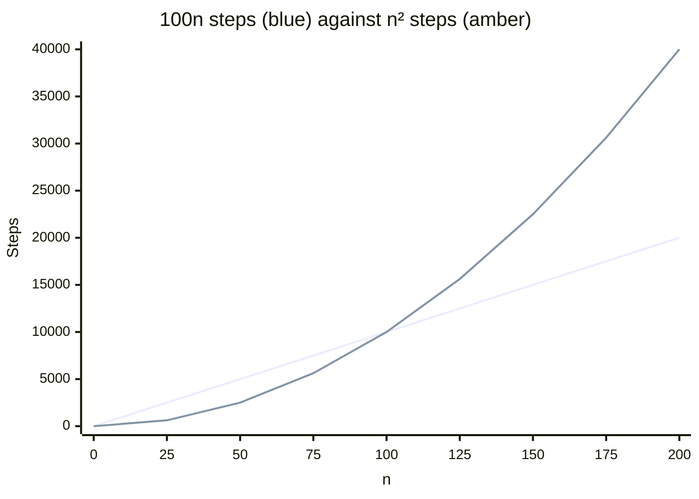
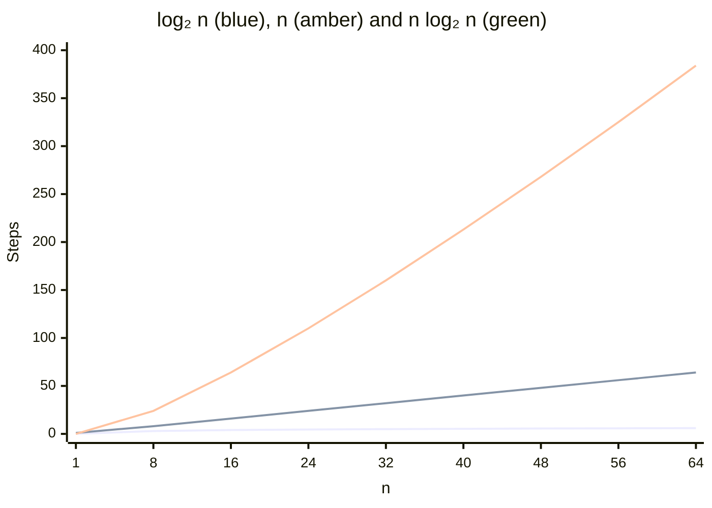
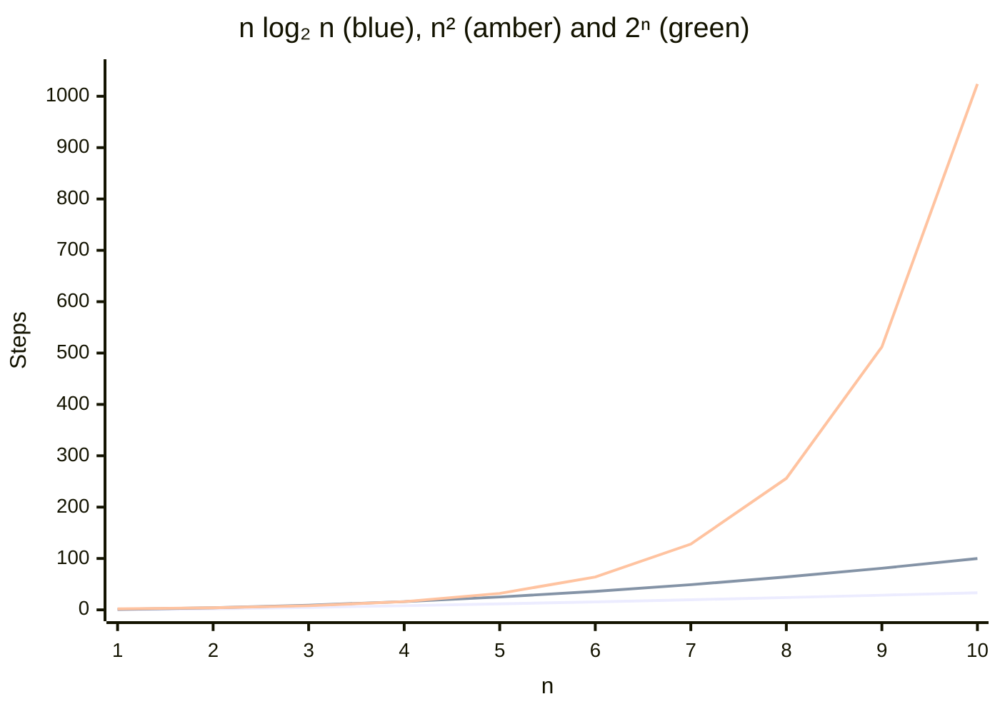
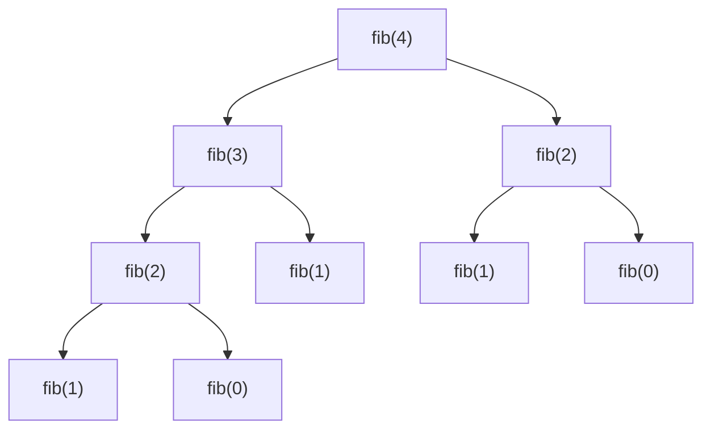
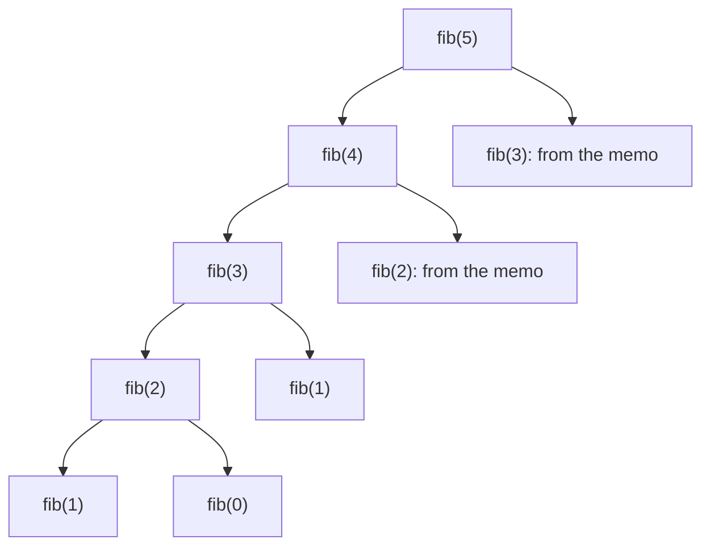
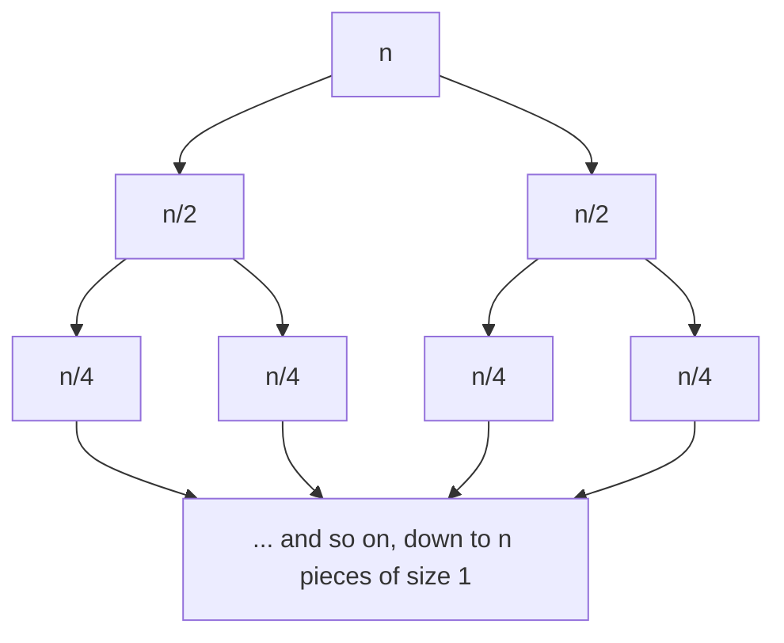
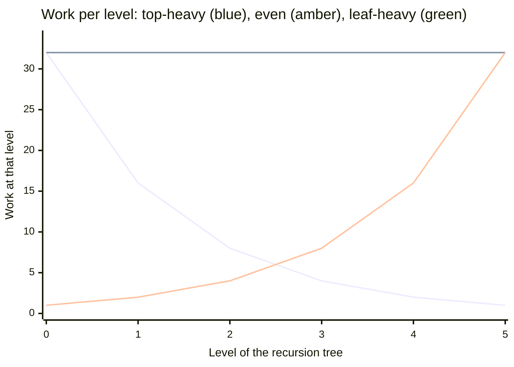
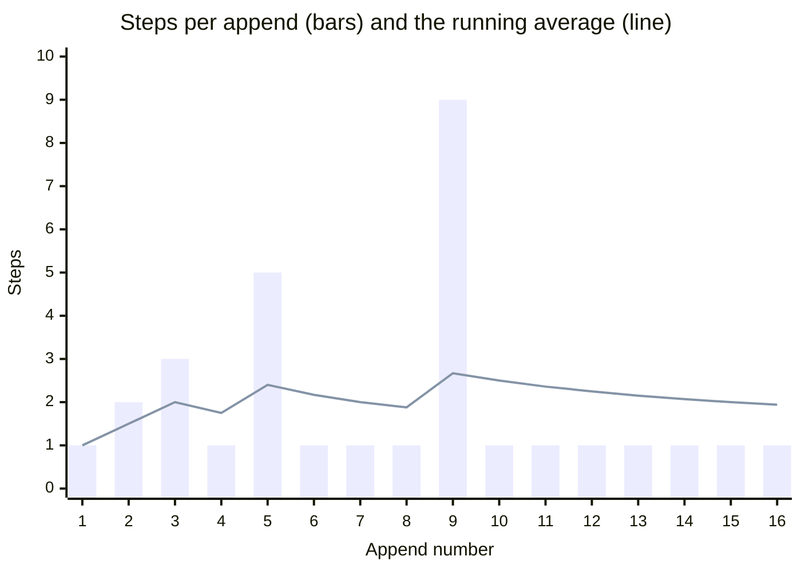
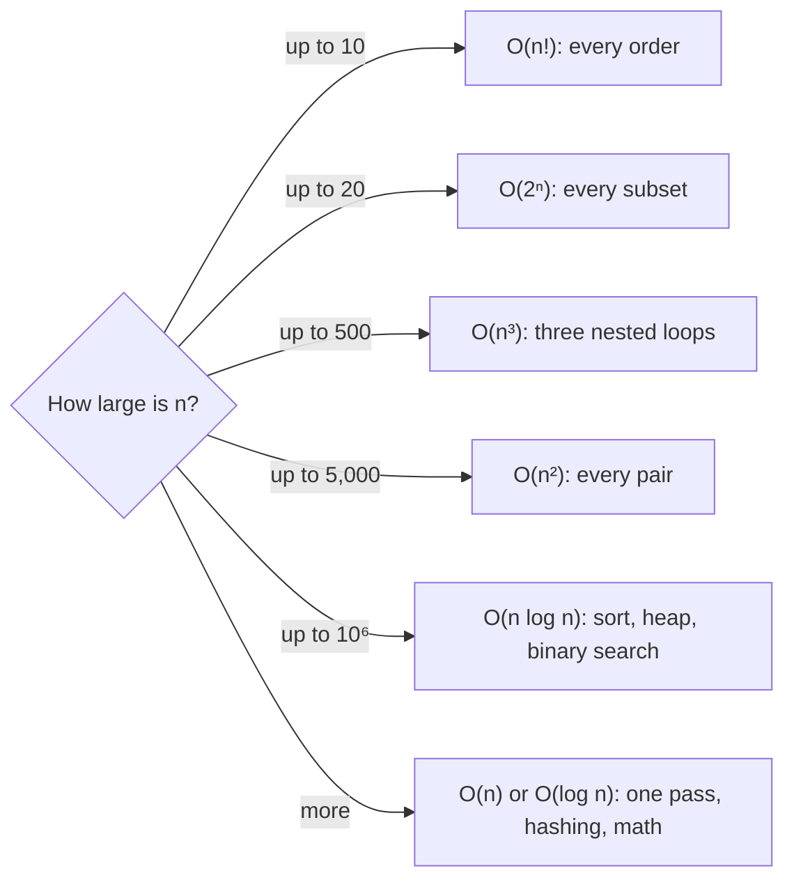

# Big O and complexity

Measure time and space, read complexity off code, and guess the expected complexity from the input size.

## What Big O measures

Big O describes how an algorithm's cost **grows** as its input grows. It counts steps, not
seconds, so the answer doesn't depend on the machine. And it keeps only the fastest-growing part,
because for large inputs that part decides everything.

To find it, write the number of steps as a formula in n, the size of the input, then:

1. **Drop constant factors**: 3n and n/2 are both O(n).
2. **Drop the smaller terms**: n² + 5n + 100 is O(n²).

```python
def count_pairs(nums: list[int], target: int) -> int:
    count = 0  # 1 step
    for i in range(len(nums)):  # n iterations
        for j in range(i + 1, len(nums)):  # n - 1, n - 2, ..., 1, 0 iterations
            if nums[i] + nums[j] == target:  # n(n - 1)/2 checks in all
                count += 1
    return count  # about n²/2 steps: O(n²)
```

Why is it fine to drop the constants? Because growth wins in the end. An algorithm that takes 100n
steps is slower than one that takes n² steps on small inputs, but from n = 100 on it's faster, and
the gap keeps widening:



Formally, f(n) is O(g(n)) when some constant multiple of g(n) is at least f(n) for every n past
some point. Big O describes the right-hand side of that chart: what happens as n gets large.

A practical way to feel the difference is to ask what happens when the input doubles:

| Complexity | Double n, and the time... |
|---|---|
| O(1) | stays the same |
| O(log n) | grows by one step |
| O(n) | doubles |
| O(n log n) | slightly more than doubles |
| O(n²) | grows 4 times |
| O(n³) | grows 8 times |
| O(2ⁿ) | is squared (each extra element doubles it) |

> **Interview tip.** Timing your code at n and at 2n tells you its complexity in practice: if the
> time grows about 4 times, something in it is quadratic.

### O, Ω and Θ

| Notation | Means | Example |
|---|---|---|
| O(g) | grows **no faster** than g: an upper bound | Binary search is O(log n), and also, uselessly, O(n) |
| Ω(g) | grows **at least** as fast as g: a lower bound | Any sort that only compares items is Ω(n log n) |
| Θ(g) | both: grows **exactly** like g, up to constants | Merge sort is Θ(n log n) |

In interviews people say "O" and mean the tight bound. Give the tightest bound you can justify:
saying binary search is O(n) is true, but it tells the listener nothing.

### Best, average and worst case

One algorithm can cost different amounts on different inputs of the same size, so say which case
you mean:

| Algorithm | Best | Average | Worst | The worst case happens when |
|---|---|---|---|---|
| Linear search | O(1) | O(n) | O(n) | the target is last, or missing |
| Hash map lookup | O(1) | O(1) | O(n) | every key lands in the same slot |
| Quicksort | O(n log n) | O(n log n) | O(n²) | the pivot is always the smallest or largest item |
| Insertion sort | O(n) | O(n²) | O(n²) | the input is in reverse order |

Quote the worst case unless you say otherwise. Hash maps are the accepted exception: "O(1)" for a
hash map means O(1) on average.

### More than one input

When the input has several independent sizes, give each its own letter, and don't merge them into
n:

| Input | Sizes | Example costs |
|---|---|---|
| Two lists | n and m | Merging them: O(n + m). Comparing every pair across them: O(n·m) |
| A graph | V vertices, E edges | BFS or DFS: O(V + E) |
| n strings of length up to L | n·L characters | Hashing every string: O(n·L) |
| A grid | r rows, c columns | Visiting every cell: O(r·c) |
| A stream, keeping the top k | n items, k kept | A heap of size k: O(n log k) |

Practice: [Two Sum](#/algo/problem/a01_two_sum), [Contains Duplicate](#/algo/problem/a07_contains_duplicate)

## Common complexities

Nearly every algorithm you'll meet in an interview falls in one of these classes, from fastest to
slowest:

| Big O | Name | Where it comes from | Examples |
|---|---|---|---|
| O(1) | constant | A fixed number of steps | Index into a list, dict lookup, push or pop on a stack |
| O(log n) | logarithmic | Halving the problem at each step | Binary search, a balanced search tree, heap push and pop |
| O(n) | linear | Constant work per element | One pass, two pointers, a sliding window, BFS and DFS (O(V + E)) |
| O(n log n) | linearithmic | Sorting; n operations on a heap; splitting in half and merging | `sorted`, merge sort, pushing all n items through a heap |
| O(n²) | quadratic | Every pair; a loop inside a loop | Brute-force pairs, insertion sort, DP over two strings (n·m) |
| O(n³) | cubic | Every triple | Brute-force triples, Floyd–Warshall all-pairs shortest paths |
| O(2ⁿ) | exponential | Every subset; recursion that branches twice with no memo | All subsets, naive recursive Fibonacci |
| O(n!) | factorial | Every ordering | All permutations, brute-force travelling salesman |

The first three grow slowly. At n = 64, n log n is still only 384 steps:



The others don't. Here n only goes up to 10, and 2ⁿ has already passed 1,000:



Notice that 2ⁿ is *below* n² at n = 3 (8 < 9) and level with it at n = 4, then overtakes it for
good from n = 5. Small inputs can hide the order of growth; large inputs never do.

| n | log₂ n | n log₂ n | n² | 2ⁿ |
|---|---|---|---|---|
| 10 | 3 | 33 | 100 | 1,024 |
| 100 | 7 | 664 | 10,000 | 1.3 × 10³⁰ |
| 1,000 | 10 | about 10⁴ | 10⁶ | about 10³⁰¹ |
| 10⁶ | 20 | 2 × 10⁷ | 10¹² | far beyond counting |

### Why log n is so small

log₂ n is how many times you can halve n before reaching 1: log₂ 1,000 ≈ 10, log₂ 10⁶ ≈ 20,
log₂ 10⁹ ≈ 30. Any algorithm that throws away a fixed fraction of what's left at every step is
O(log n). Binary search for 25 in 16 sorted values:

```array
label: a
values: 1 3 4 6 8 9 11 14 15 17 20 22 25 27 30 31
pointers: lo=0 mid=7 hi=15
highlight: 0..15
caption: 16 candidates. a[7] = 14 < 25, so keep the right half
---
label: a
values: 1 3 4 6 8 9 11 14 15 17 20 22 25 27 30 31
pointers: lo=8 mid=11 hi=15
highlight: 8..15
dim: 0..7
caption: 8 candidates. a[11] = 22 < 25, so keep the right half
---
label: a
values: 1 3 4 6 8 9 11 14 15 17 20 22 25 27 30 31
pointers: lo=12 mid=13 hi=15
highlight: 12..15
dim: 0..11
caption: 4 candidates. a[13] = 27 > 25, so keep the left half
---
label: a
values: 1 3 4 6 8 9 11 14 15 17 20 22 25 27 30 31
pointers: lo=12 mid=12 hi=12
dim: 0..11 13..15
highlight: 12
caption: 1 candidate: found after 4 steps, and log₂ 16 = 4
```

The base of the logarithm doesn't matter in Big O: log₂ n and log₁₀ n differ by a constant factor
(about 3.3), so both are just O(log n).

### How much fits in a second

A simple Python loop runs about 20 to 50 million iterations a second; with real work in the body
(a dict lookup, a comparison, an append) it's closer to 10 million. Built-ins written in C, such as
`sorted`, `sum`, `set` and `Counter`, are 10 to 100 times faster per element.

| Complexity | Largest n in about 1 second of Python |
|---|---|
| O(log n) | anything |
| O(n) | about 10⁷ |
| O(n log n) | about 5 × 10⁵ in a Python loop; the built-in `sorted` sorts 10⁶ numbers in about 0.2 s |
| O(n²) | about 3,000 |
| O(n³) | about 200 |
| O(2ⁿ) | about 23 |
| O(n!) | about 10 |

> **Rule of thumb.** Budget about 10⁷ simple steps per second of Python. Compiled languages
> manage 10⁸ to 10⁹.

Practice: [Search in Rotated Sorted Array](#/algo/problem/a38_search_in_rotated_sorted_array), [Merge Intervals](#/algo/problem/a16_merge_intervals), [3Sum](#/algo/problem/a02_three_sum)

## Reading complexity from code

Most code can be costed with a handful of rules:

| Code shape | Cost | Example |
|---|---|---|
| Steps one after another | Add them, keep the biggest | Sort, then scan: O(n log n + n) = O(n log n) |
| A loop of n iterations doing O(k) work each | Multiply | O(n·k) |
| Nested loops over the same input | Multiply | O(n²) |
| An inner loop that starts at `i + 1` | Still O(n²): n(n − 1)/2 is half of n² | Every pair |
| A loop variable that halves or doubles | O(log n) | `while n > 1: n //= 2` |
| Loops over different inputs | Separate letters | O(n + m) one after the other, O(n·m) nested |
| A function call inside a loop | Its cost, once per iteration | `x in some_list` in a loop is O(n) per iteration |

```python
for x in a:  # O(n)...
    ...
for y in b:  # ...then O(m): O(n + m) in total
    ...

for x in a:  # O(n) iterations...
    for y in b:  # ...of O(m) each: O(n·m)
        ...

while n > 1:  # n, n/2, n/4, ..., 1: about log₂ n iterations
    n //= 2

for x in a:  # O(n) iterations...
    if x in b:  # ...each searching the list b, O(m): O(n·m).
        ...  # Make b a set first and it's O(n + m).
```

Why is "every pair" O(n²) even though it skips half the grid? Each cell below is a pair `(i, j)`,
and the loop only visits the highlighted ones, with `j > i`:

```grid
collabels: j=0 j=1 j=2 j=3 j=4 j=5
rowlabels: i=0 i=1 i=2 i=3 i=4 i=5
_ _ _ _ _ _
_ _ _ _ _ _
_ _ _ _ _ _
_ _ _ _ _ _
_ _ _ _ _ _
_ _ _ _ _ _
highlight: 0,1 0,2 0,3 0,4 0,5 1,2 1,3 1,4 1,5 2,3 2,4 2,5 3,4 3,5 4,5
caption: 15 of the 36 pairs: n(n - 1)/2, which is still O(n²)
```

### A loop inside a loop isn't always O(n²)

What matters is the total number of times the inner loop runs, across the whole program. If the
inner loop moves a pointer that never moves back, it can run at most n times in total, however the
work is spread out:

```python
def longest_window_with_k_zeros(bits: list[int], k: int) -> int:
    """Length of the longest stretch of bits that contains at most k zeros."""
    best = left = zeros = 0
    for right in range(len(bits)):  # right moves n times in total
        if bits[right] == 0:
            zeros += 1
        while zeros > k:  # left also moves at most n times in total,
            if bits[left] == 0:  # because it never moves back
                zeros -= 1
            left += 1
        best = max(best, right - left + 1)
    return best
```

```array
label: bits
values: 1 0 1 1 0 0 1 1 0 1
pointers: left=0 right=3
highlight: 0..3
caption: k = 1: the window 1 0 1 1 holds one zero
---
label: bits
values: 1 0 1 1 0 0 1 1 0 1
pointers: left=2 right=4
highlight: 2..4
dim: 0 1
caption: a second zero arrives: left moves past the first one, and never moves back
```

Each index enters the window once and leaves it at most once: at most 2n pointer moves, so O(n).
This is why the [sliding window](#/algo/learn/patterns/sliding-window) and the
[monotonic stack](#/algo/learn/patterns/stacks-and-monotonic-stacks) are linear despite their
nested loops. The same argument has a name, [amortized analysis](#/algo/learn/complexity/amortized-analysis).

### Python operations that hide a loop

One line of Python can do O(n) work. These are the costs worth knowing by heart:

| Operation | Cost | Why |
|---|---|---|
| `x in a_list`, `a_list.index(x)`, `.count(x)`, `.remove(x)` | O(n) | Scans the list |
| `x in a_set`, `x in a_dict` | O(1) on average | A hash lookup |
| `a_list.pop(0)`, `a_list.insert(0, x)`, `del a_list[0]` | O(n) | Shifts every other element |
| `a_list.append(x)`, `a_list.pop()` | O(1), amortized | Works at the end |
| `a_deque.popleft()`, `a_deque.appendleft(x)` | O(1) | Built for both ends |
| `a[i:j]`; `a[::-1]`, `list(a)`, `a.copy()` | O(j − i); O(n) | Copies |
| `a + b` (lists or strings) | O(len(a) + len(b)) | Builds a new object |
| `"".join(parts)` | O(total length) | One allocation |
| `sorted(a)`, `a.sort()` | O(n log n) | Timsort; O(n) when already sorted |
| `min(a)`, `max(a)`, `sum(a)`; `len(a)` | O(n); O(1) | Scans; the length is stored |
| `a == b` for lists or strings | O(n) | Compares element by element |
| `heapq.heappush`, `heapq.heappop`; `heapq.heapify` | O(log n); O(n) | Sift up or down; build bottom-up |
| `bisect.bisect_left(a, x)`; `bisect.insort(a, x)` | O(log n); O(n) | Search; the insert shifts elements |
| `set(a)`, `Counter(a)`, `dict(pairs)` | O(n) | One pass |
| `s.split()`, `s.replace(...)`, `s.lower()` | O(len(s)) | Build new strings |

Measured on a laptop, the slow and fast versions of the same task:

| Task | Slow way | Time | Fast way | Time |
|---|---|---|---|---|
| Empty a 100,000-item queue | `list.pop(0)` | about 10 s | `deque.popleft()` | about 3 ms |
| 10,000 membership tests on 10,000 items | `x in a_list` | 0.26 s | `x in a_set` | 0.4 ms |
| Build a 200,000-character string from the front | `s = c + s` | 0.38 s | collect a list, `"".join` once | 6 ms |
| Sum 5,000 numbers recursively | pass the slice `a[1:]` | 65 ms | pass an index | 0.6 ms |

> **Pitfall.** Strings can't be changed in place, so `s = s + t` makes a new string every time.
> CPython can often extend `s += t` in place when nothing else refers to `s`, but that's an
> implementation detail: prepend instead, or keep a second reference, and the loop becomes O(n²).
> Collect the pieces in a list and `"".join` them once.

The same goes for queues: a BFS that uses `list.pop(0)` is quietly O(V²).

```python
from collections import deque

queue = deque([start])
while queue:
    node = queue.popleft()  # O(1); list.pop(0) would be O(n)
    ...
```

Practice: [Longest Substring Without Repeating Characters](#/algo/problem/a31_longest_substring_without_repeating_characters), [Minimum Window Substring](#/algo/problem/a30_minimum_window_substring), [Contains Duplicate](#/algo/problem/a07_contains_duplicate)

## Recursion

A recursive function costs **(the number of calls) × (the work in one call, not counting the calls
it makes)**. To count the calls, draw the call tree: each call is a node, and its children are the
calls it makes. The number of nodes is the time; the height of the tree is the
[stack space](#/algo/learn/complexity/space-complexity).

### Recursion trees

Naive Fibonacci makes two calls per call:

```python
def fib(n: int) -> int:
    if n < 2:
        return n
    return fib(n - 1) + fib(n - 2)
```



The tree branches twice at every level and is about n levels deep, so it has O(2ⁿ) nodes (more
precisely about 1.6ⁿ). Even this small tree computes `fib(2)` twice (amber); `fib(30)` makes 2.7
million calls to compute 30 different values.

Remembering each answer (**memoization**) means every value is computed once, and a repeated call
returns at once:

```python
from functools import cache


@cache  # remembers fib(k) for every k already computed
def fib(n: int) -> int:
    return n if n < 2 else fib(n - 1) + fib(n - 2)
```



Now there are about 2n calls, each doing O(1) work: O(n). The rule for any memoized recursion is
**(number of distinct arguments) × (work per call)**. [Coin Change](#/algo/problem/a05_coin_change)
is `amount` distinct arguments times one loop over the coins: O(amount × coins). The
[dynamic programming page](#/algo/learn/dynamic-programming/top-down-helper-plus-memo) builds on
exactly this.

### Divide and conquer

Merge sort splits the input in half, sorts each half recursively, and merges the two sorted halves
in O(n):



Add up the work level by level instead of call by call:

| Level | Calls | Size of each | Work at this level |
|---|---|---|---|
| 0 | 1 | n | n |
| 1 | 2 | n/2 | n |
| 2 | 4 | n/4 | n |
| k | 2ᵏ | n/2ᵏ | n |
| log₂ n | n | 1 | n |

Every level does n work in total, and there are log₂ n + 1 levels: **O(n log n)**.

### The three shapes

Most divide-and-conquer recursions look like T(n) = a·T(n/b) + f(n): **a** calls, each on 1/**b**
of the input, plus **f(n)** work outside the calls. (This is what the *master theorem* covers.) In
plain words, compare the work done at the top of the tree with the work done at the leaves:



1. **Top-heavy**: the work shrinks quickly as you go down, so the root's work dominates. The total
   is O(f(n)). Quickselect averages T(n) = T(n/2) + n, and n + n/2 + n/4 + ... is under 2n: O(n).
2. **Even**: every level does the same work, so multiply by the number of levels:
   O(f(n) log n). Merge sort, and binary search (O(1) work, log n levels).
3. **Leaf-heavy**: the number of calls grows faster than the work shrinks, so the leaves dominate.
   Visiting every node of a tree, T(n) = 2T(n/2) + O(1), does O(1) at each of about n nodes: O(n).

Recursions that shrink by subtraction instead of division are simpler still: count the depth and
the branching.

| Recurrence | Example | Total |
|---|---|---|
| T(n) = T(n/2) + O(1) | Binary search | O(log n) |
| T(n) = T(n/2) + O(n) | Quickselect, on average | O(n) |
| T(n) = 2T(n/2) + O(1) | Visiting every node of a tree | O(n) |
| T(n) = 2T(n/2) + O(n) | Merge sort; quicksort on average | O(n log n) |
| T(n) = T(n − 1) + O(1) | Walking a linked list recursively | O(n) |
| T(n) = T(n − 1) + O(n) | Selection sort; quicksort at worst | O(n²) |
| T(n) = 2T(n − 1) + O(1) | Naive Fibonacci (roughly), all subsets | O(2ⁿ) |
| T(n) = n·T(n − 1) + O(1) | All permutations | O(n!) |
| b branches, depth d | Any search without a memo | O(bᵈ) calls |

### Backtracking

[Backtracking](#/algo/learn/patterns/backtracking) explores a tree of choices. Count its leaves
and the work at each one: generating all subsets has 2ⁿ leaves and copies up to n items at each,
O(n·2ⁿ); all permutations has n! leaves, O(n·n!). Pruning (giving up on a branch as soon as it
can't succeed) helps hugely in practice, but rarely changes the worst case.

Practice: [Climbing Stairs](#/algo/problem/a04_climbing_stairs), [Coin Change](#/algo/problem/a05_coin_change), [Word Break](#/algo/problem/a19_word_break)

## Amortized analysis

Some operations are usually cheap and occasionally expensive. Their **amortized** cost is the total
cost of a long sequence of them divided by the number of operations, in the worst case. The
standard example is appending to a dynamic array (a Python `list`): when the array is full, it
allocates a bigger one and copies everything across.

```array
label: cap 1
values: a
caption: append a: there's room
---
label: cap 2
values: a b
highlight: 1
caption: append b: full, so copy 1 item into a new array of 2
---
label: cap 4
values: a b c _
highlight: 2
caption: append c: full, so copy 2 items into a new array of 4
---
label: cap 4
values: a b c d
highlight: 3
caption: append d: there's room, O(1)
---
label: cap 8
values: a b c d e _ _ _
highlight: 4
caption: append e: full, so copy 4 items into a new array of 8
```

The copies are expensive, but each doubling buys as many cheap appends as it copied:



Over n appends the copies total at most 1 + 2 + 4 + ... + n, which is under 2n, plus n writes: under
3n steps in all, so **O(1) amortized per append**, even though one append in a while costs O(n).

> **Key idea.** The array must grow by a constant *factor*, not a constant *amount*. Growing by
> 100 slots at a time copies the whole array every 100 appends: about n²/200 copies in total, O(n)
> per append. CPython actually grows lists by about an eighth, not double; any constant factor gives
> amortized O(1).

The same argument shows up all over interview problems:

| Structure or technique | The expensive step | Why it averages out |
|---|---|---|
| Dynamic array append | A resize copies every item | Each resize is followed by as many cheap appends |
| Hash table insert | A resize re-inserts every key | The same doubling argument (Python resizes a dict at two-thirds full) |
| Sliding window | One step moves `left` many times | `left` moves at most n times in total |
| Monotonic stack | One item pops many others | Every item is pushed once and popped at most once |
| Queue built from two stacks | Moving the whole in-stack to the out-stack | Each item is moved once |
| Union-find with path compression | One long `find` | It flattens the path, so later finds are short |

**Amortized is not the same as average.** An average-case bound is about *typical inputs* (a hash
map is O(1) when keys spread out evenly). An amortized bound holds for *every* sequence of
operations, however unlucky: n appends always cost O(n) in total.

> **Pitfall.** Amortized O(1) still allows an occasional O(n) step. That matters when every single
> request must be fast (the request that triggers the resize is slow), though not for the total
> running time an interviewer asks about.

Practice: [Longest Substring Without Repeating Characters](#/algo/problem/a31_longest_substring_without_repeating_characters), [Longest Repeating Character Replacement](#/algo/problem/a32_longest_repeating_character_replacement)

## Space complexity

Space complexity is how the extra memory an algorithm needs grows with its input. "Extra" usually
means not counting the input itself, and often not the output either; say which you mean ("O(1)
extra space, not counting the output").

| Where the memory goes | Example | Space |
|---|---|---|
| A few variables, counters, pointers | Two pointers on an array | O(1) |
| A copy or a slice | `sorted(a)`, `a[1:]` | O(n) |
| A hash map or set over the input | Values seen so far | O(n) |
| A table of fixed size | Counts for 26 letters | O(1): it doesn't grow with n |
| A DP table | n × m cells | O(n·m), or O(m) keeping only the last row |
| Recursion | Depth d | O(d) for the call stack |
| A BFS queue | The widest level of the graph | Up to O(n) |

### The call stack

Every call that has started but not yet returned keeps a **frame** on the call stack: its local
variables and the place to resume. So recursion uses memory even when you never build a data
structure: the space is the deepest the recursion goes.

```python
def size(node) -> int:
    """Number of nodes in the tree rooted at node."""
    if node is None:
        return 0
    return 1 + size(node.left) + size(node.right)
```

```tree
values: 1 null 2 null 3 null 4
highlight: 4
caption: skewed: while size(4) runs, size(1), size(2) and size(3) wait. 4 frames for 4 nodes
---
values: 1 2 3 4 5 6 7
highlight: 1 2 4
caption: balanced: at most 3 frames for 7 nodes, the height plus one
```

```array
label: call stack
direction: vertical
values: size(1) size(2) size(3) size(4)
pointers: top=3
caption: the deepest moment in the skewed tree
```

A balanced tree needs O(log n) stack, a skewed one O(n). Python stops recursion at a depth of 1,000
by default (`sys.getrecursionlimit()`) and raises `RecursionError`, so recursing over a
100,000-node linked list or a long chain fails. Rewrite it with an explicit stack, or raise the
limit with `sys.setrecursionlimit`.

> **Pitfall.** Top-down DP can recurse as deep as its largest argument: a memoized coin-change
> recursion on `amount = 10_000` with a coin worth 1 goes 10,000 calls deep and hits the limit. A
> bottom-up table avoids the call stack entirely.

### Trading space for time

Many speed-ups spend memory: a hash set turns an O(n) search into O(1), a memo turns exponential
recursion into polynomial time, prefix sums answer any range sum in O(1). Going the other way, a
few standard tricks save memory:

| Trick | Saves | Example |
|---|---|---|
| Keep only the last row (or last few values) of a DP table | O(n·m) to O(m), or O(n) to O(1) | Each Fibonacci number needs only the previous two |
| Two pointers on sorted input, instead of a hash set | O(n) to O(1) | Pair sums in a sorted array |
| Modify the input in place (ask first) | A copy | Mark visited grid cells by overwriting them |
| Iterate instead of recursing | The call stack | An explicit stack, or a loop |
| Generators instead of lists | Intermediate lists | `sum(x * x for x in a)` |

```python
def fib(n: int) -> int:
    prev, cur = 0, 1  # only the last two values are ever needed: O(1) space
    for _ in range(n):
        prev, cur = cur, prev + cur
    return prev
```

Practice: [Reorder List](#/algo/problem/a40_reorder_list), [Maximum Depth of Binary Tree](#/algo/problem/a22_maximum_depth_of_binary_tree), [House Robber](#/algo/problem/a33_house_robber)

## Input size tells you the target

Problem constraints are a hint. Problem setters pick limits so that the intended solution runs
comfortably and the next slower one doesn't, which means the size of n tells you which complexity
to aim for:

| n up to | Aim for | What fits |
|---|---|---|
| 10 | O(n!) | Trying every order |
| 20 | O(2ⁿ), or O(n·2ⁿ) | Trying every subset; DP over subsets as bitmasks |
| 500 | O(n³) | Three nested loops; DP over intervals |
| 5,000 | O(n²) | Every pair; DP over two sequences |
| 10⁶ | O(n log n) | Sorting, a heap, a binary search per element |
| More than 10⁶ | O(n), or O(log n) | One pass, hashing, two pointers; math or binary search when n is a value rather than a length |



These limits come from the classic figure of about 10⁸ simple steps per second, true of compiled
languages. Python manages about 10⁷ (see [how much fits in a second](#/algo/learn/complexity/how-much-fits-in-a-second)),
so the same constraint leaves it less slack: O(n²) at n = 5,000 is 25 million steps, a couple of
seconds of Python. Read the table as the complexity the author intended, and keep the constant
factor low (built-ins, no needless copies).

Other clues in a statement:

| Clue | Suggests |
|---|---|
| Values in a small range, such as 0 to 10⁴ | A counting array instead of sorting or hashing |
| "Return the k largest" with k much smaller than n | A heap of size k: O(n log k) |
| The answer is a number in a huge range, up to 10⁹ | [Binary search on the answer](#/algo/learn/patterns/binary-search): O(log range) checks |
| Many queries on data that doesn't change | Precompute once, then answer each query in O(1) or O(log n) |
| A grid up to 1,000 × 1,000 | O(rows × columns): visit each cell a constant number of times |
| "Use O(1) extra space" | Two pointers, in-place updates, or bit tricks |
| A handful of items with small quantities | Search every state, with a memo keyed on what's left |

Practice: [Shopping Offers](#/algo/problem/a44_shopping_offers), [Koko Eating Bananas](#/algo/problem/a45_koko_eating_bananas), [Top K Frequent Elements](#/algo/problem/a14_top_k_frequent_elements)
