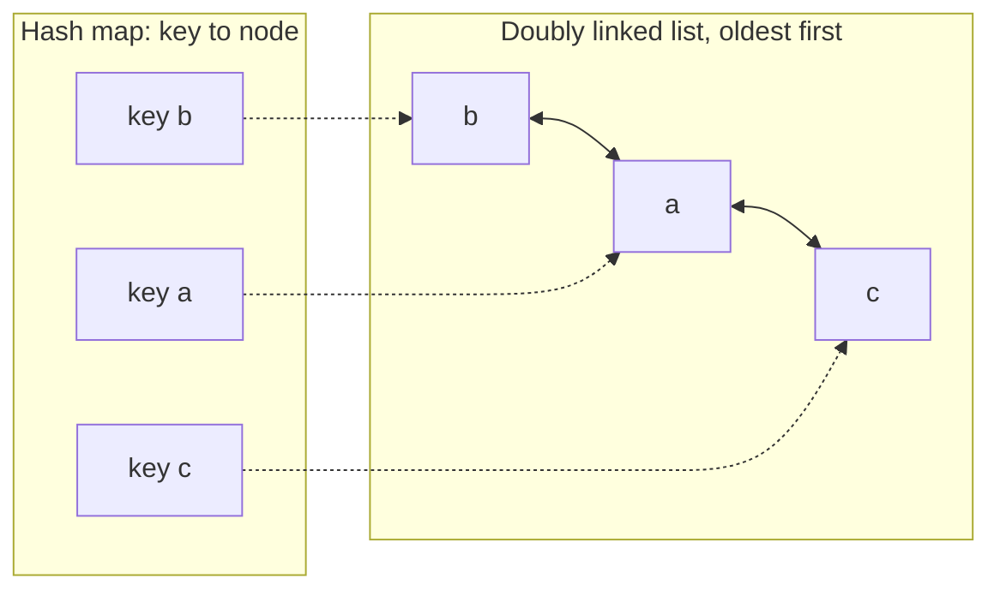
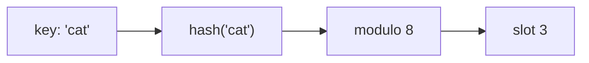
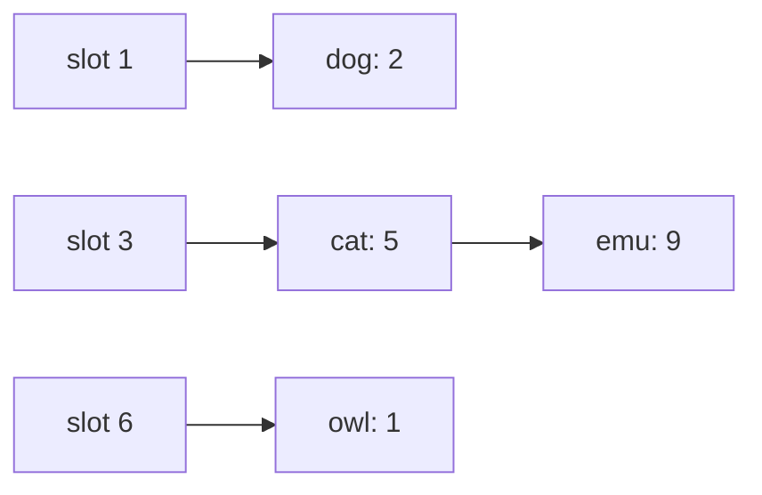
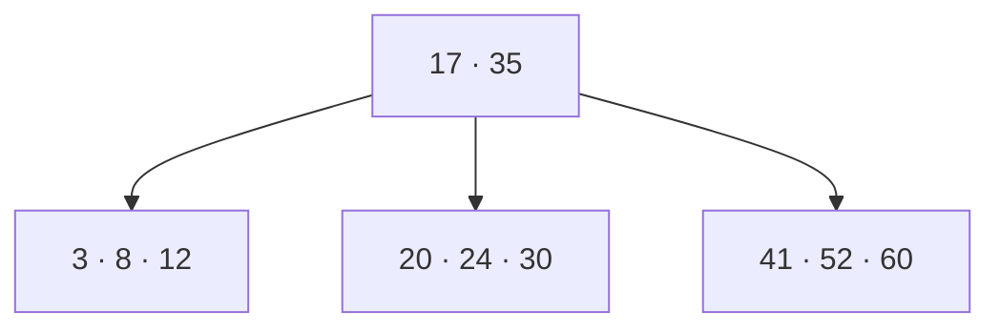
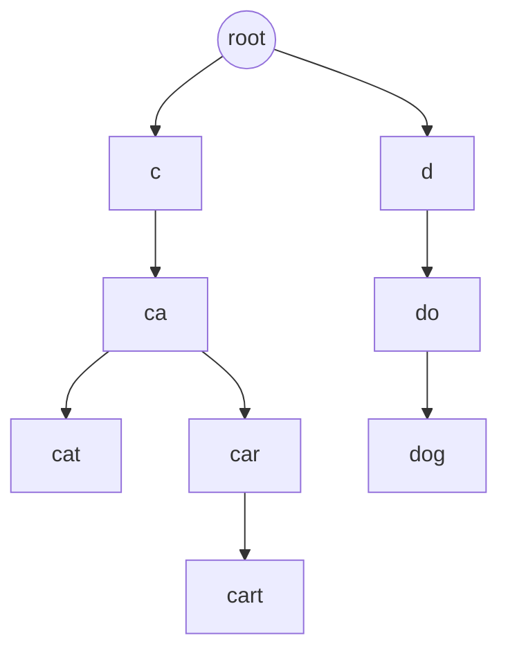
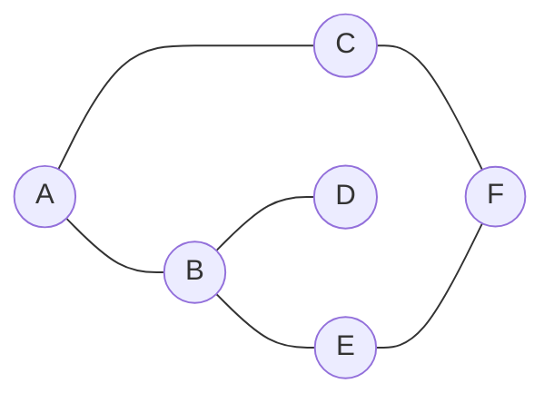
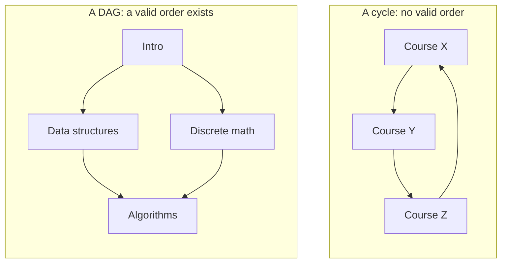
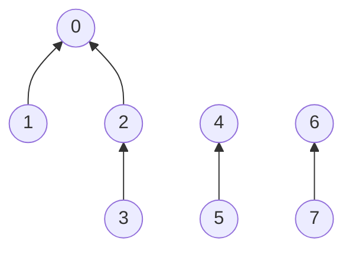
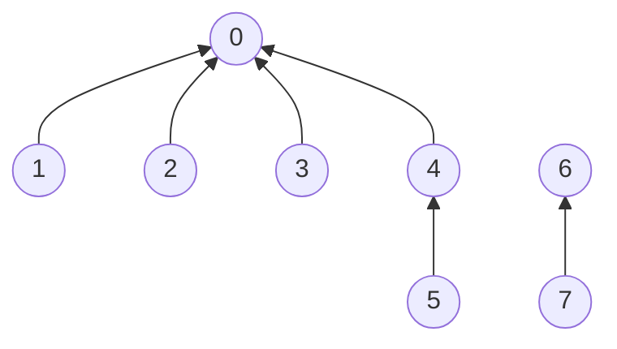
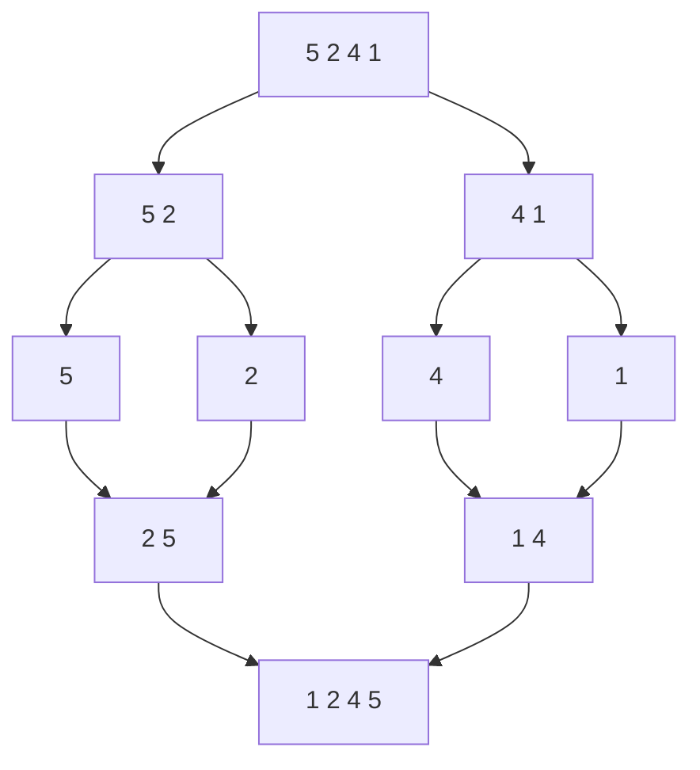

# Data structures toolbox

What each structure is good at, what its operations cost, and how to use it in Python.

Pick a structure by the question your algorithm asks most often:

| Your algorithm keeps asking | Use | Cost | In Python |
|---|---|---|---|
| "What's at position i?" | [Array](#/algo/learn/data-structures/arrays-and-strings) | O(1) | `list` |
| "Have I seen x?", "How many x?", "Where was x?" | [Hash set or map](#/algo/learn/data-structures/hash-maps-and-sets) | O(1) on average | `set`, `dict`, `Counter`, `defaultdict` |
| "What's the most recent unfinished item?" | [Stack](#/algo/learn/data-structures/stacks-and-queues) | O(1) | `list` with `append` and `pop` |
| "What's the oldest waiting item?" | [Queue](#/algo/learn/data-structures/stacks-and-queues) | O(1) | `collections.deque` |
| "What's the smallest (or largest) right now?" | [Heap](#/algo/learn/data-structures/heaps) | O(1) to look, O(log n) to change | `heapq` |
| "What's the next value above x?" | A sorted list, or a [balanced search tree](#/algo/learn/data-structures/balanced-trees) | O(log n) to search | `bisect` on a sorted `list` |
| "Which words start with this prefix?" | [Trie](#/algo/learn/data-structures/tries) | O(length of the prefix) | Nested `dict`s or small node objects |
| "What's connected to x?" | [Graph](#/algo/learn/data-structures/graphs) | O(V + E) to explore | A `dict` of lists |
| "Are x and y in the same group?" | [Union-find](#/algo/learn/data-structures/union-find) | Almost O(1) | Two lists |

## Arrays and strings

An **array** keeps its items side by side in one block of memory, so the address of item i is
start + i × (size of an item): reading or writing any position is a single calculation, O(1). The
price is that inserting or deleting anywhere except the end shifts every item after it, O(n).

```array
label: a
values: 3 8 1 9 4
highlight: 3
caption: a[3] lives at start + 3 × 8 bytes: one calculation, no searching
---
label: a
values: 3 7 8 1 9 4
highlight: 1
caption: a.insert(1, 7): the four items from index 1 on each move one place right, O(n)
```

Python's `list` is a *dynamic array*. It stores references, so its items can be of any type, and
it grows by itself as you append, at O(1) amortized cost per append
([how that works](#/algo/learn/complexity/amortized-analysis)).

| Operation | Python | Cost |
|---|---|---|
| Read or write position i | `a[i]`, `a[i] = x` | O(1) |
| Add or remove at the end | `a.append(x)`, `a.pop()` | O(1) amortized |
| Add or remove at the front or in the middle | `a.insert(i, x)`, `a.pop(i)`, `del a[i]` | O(n) |
| Search an unsorted list | `x in a`, `a.index(x)` | O(n) |
| Search a sorted list | `bisect.bisect_left(a, x)` | O(log n) |
| Copy a slice | `a[i:j]` | O(j − i) |
| Sort | `a.sort()`, `sorted(a)` | O(n log n) |
| Length | `len(a)` | O(1) |

Most array problems are solved by walking the array cleverly rather than by reaching for another
structure: [two pointers](#/algo/learn/patterns/two-pointers), a
[sliding window](#/algo/learn/patterns/sliding-window),
[prefix sums](#/algo/learn/patterns/prefix-sums-and-products), or a write pointer that compacts
the array in place. The everyday idioms:

```python
nums = [5, 2, 8, 2]
for i, x in enumerate(nums):
    ...  # index and value together
for a, b in zip(nums, nums[1:]):
    ...  # neighbouring pairs (the slice is a copy)
nums[::-1]  # a reversed copy: [2, 8, 2, 5]
evens_squared = [x * x for x in nums if x % 2 == 0]  # [4, 64, 4]
```

### Strings

A string is an array of characters with one big difference in Python (and Java): it's
**immutable**. Every "change" builds a new string, so build long strings as a list of pieces and
join them once at the end.

Each character is stored as a number, its *code point*: `ord("a") == 97` and `chr(97) == "a"`.
ASCII covers the first 128 (`"A"` is 65, `"a"` is 97, `"0"` is 48) and Unicode covers every
script. Lowercase letters are consecutive, so `ord(c) - ord("a")` maps `"a"` to `"z"` onto 0 to
25, and a list of 26 counters is a cheap alternative to a `Counter`:

```grid
collabels: a b c d e f g h i j k l m n
3 1 0 0 0 0 0 0 0 0 0 0 0 2
highlight: 0,0 0,1 0,13
caption: letter counts for "banana" at index ord(c) - ord("a"); o to z are all 0
```

```python
words = ["data", "structures", "toolbox"]
title = " ".join(w.capitalize() for w in words)  # "Data Structures Toolbox", built once
counts = [0] * 26
for c in "banana":
    counts[ord(c) - ord("a")] += 1  # a: 3, b: 1, n: 2
```

| Operation | Python | Cost |
|---|---|---|
| Read a character | `s[i]` | O(1) |
| Compare, or hash (as a dict key) | `s == t`, `d[s]` | O(length); Python caches a string's hash after the first time |
| Concatenate | `s + t` | O(len(s) + len(t)): a new string |
| Slice or reverse | `s[i:j]`, `s[::-1]` | O(length of the result) |
| Join pieces | `"".join(parts)` | O(total length) |
| Find a substring | `t in s`, `s.find(t)` | O(len(s) × len(t)) at worst, usually far less |
| Split, replace, change case | `s.split()`, `s.replace(a, b)`, `s.lower()` | O(len(s)) |

> **Pitfall.** When the keys of a hash map are strings, each lookup costs O(L) for a key of length
> L, not O(1): the string must be hashed and compared. Grouping n words of length L costs O(n·L).

### Grids

A grid, or matrix, is a list of rows, indexed `grid[r][c]`. Most grid problems treat each cell as a
node joined to its four neighbours, which makes the grid a [graph](#/algo/learn/data-structures/graphs).

```grid
collabels: 0 1 2 3 4
rowlabels: 0 1 2 3
_ _ _ _ _
_ _ ↑ _ _
_ ← ● → _
_ _ ↓ _ _
highlight: 1,2 2,1 2,3 3,2
caption: the four neighbours of (2, 2): one row up or down, or one column left or right
```

```python
rows, cols = 4, 5
grid = [[0] * cols for _ in range(rows)]  # a new list for every row


def neighbours(r: int, c: int):
    for dr, dc in ((-1, 0), (1, 0), (0, -1), (0, 1)):
        nr, nc = r + dr, c + dc
        if 0 <= nr < rows and 0 <= nc < cols:  # stay inside the grid
            yield nr, nc
```

> **Pitfall.** `[[0] * cols] * rows` repeats one row object `rows` times, so setting
> `grid[0][0] = 1` changes every row. Build grids with a comprehension, as above.

Practice: [Product of Array Except Self](#/algo/problem/a08_product_of_array_except_self), [Longest Palindromic Substring](#/algo/problem/a26_longest_palindromic_substring), [Group Anagrams](#/algo/problem/a29_group_anagrams), [Pacific Atlantic Water Flow](#/algo/problem/a21_pacific_atlantic_water_flow)

## Linked lists

A linked list stores each item in its own **node**, which holds the value and a reference to the
next node. There's no index arithmetic: reaching the i-th node means following i links, O(i). In
exchange, once you hold a node, inserting or removing next to it is O(1), with nothing to shift. A
**doubly linked** list also links each node to the previous one, so you can walk both ways and
unlink a node knowing only the node itself.

```linkedlist
values: 1 2 3 4
pointers: head=0
caption: each node holds a value and a reference to the next; the last one points to None
```

```linkedlist
values: 1 2 3 4
pointers: prev=1
highlight: 2
caption: to remove 3, link its predecessor past it: prev.next = prev.next.next
---
values: 1 2 4
pointers: prev=1
caption: O(1) once you hold the node before it, and nothing shifts
```

| Operation | Singly linked | Doubly linked, with a tail reference | Python `list` |
|---|---|---|---|
| Reach the i-th item | O(i) | O(i) | O(1) |
| Insert or remove at the front | O(1) | O(1) | O(n) |
| Insert or remove at the back | O(n); O(1) to insert with a tail reference | O(1) | O(1) amortized |
| Insert or remove next to a node you hold | O(1), after it | O(1), on either side | O(n) |
| Search for a value | O(n) | O(n) | O(n) |

In interviews, linked lists are mostly about careful pointer surgery on a node class like this one.
Reversing a list is the classic warm-up:

```python
class ListNode:
    def __init__(self, val=0, next=None):
        self.val = val
        self.next = next


def reverse(head: ListNode | None) -> ListNode | None:
    prev, cur = None, head
    while cur:
        nxt = cur.next  # save the rest of the list before overwriting the link
        cur.next = prev  # turn this node's arrow around
        prev, cur = cur, nxt
    return prev  # the old tail is the new head
```

```linkedlist
label: prev
values: 2 1
caption: halfway through reversing 1 → 2 → 3 → 4: the first two nodes already point backwards...
---
label: cur
values: 3 4
caption: ...and cur is the part still to do
```

Three techniques come up again and again (more on the
[patterns page](#/algo/learn/patterns/linked-list-techniques)):

- **A dummy node** in front of the head, so that removing or replacing the real head works like any
  other node. Return `dummy.next` at the end.
- **Fast and slow pointers**: one moves two steps for each step of the other. When the fast one
  reaches the end, the slow one is in the middle; if the list loops, they meet inside the loop.
- **Two pointers a fixed gap apart**: start one n steps ahead, and when it reaches the end the
  other is n from the end.

```linkedlist
values: D 1 2 3
pointers: dummy=0 head=1
caption: a dummy node before the head: removing the head is now an ordinary removal
```

```linkedlist
values: 1 2 3 4 5
pointers: slow=2 fast=4
caption: slow moved 2 steps while fast moved 4: fast is at the end, so slow is in the middle
---
values: 1 2 3 4 5 6
cycle: 2
pointers: slow=4 fast=4
caption: when the tail links back to node 3, fast never reaches an end; it laps round and meets slow
```

```python
def middle(head: ListNode) -> ListNode:
    slow = fast = head
    while fast and fast.next:
        slow = slow.next  # one step
        fast = fast.next.next  # two steps
    return slow  # for an even length, the second of the two middle nodes
```

> **Pitfall.** After splitting or reordering a list, set the new tail's `next` to `None`. A
> leftover link creates a loop, and the next traversal never ends.

Where linked lists really earn their keep is in combination with a hash map. An **LRU cache**
(when full, evict the least recently used entry) keeps a map from each key to its node, plus a
doubly linked list in order of use. The map finds a key's node in O(1); a hit unlinks that node
and moves it to the newest end in O(1); an eviction unlinks the node at the oldest end in O(1).



Here b (amber) was used longest ago, so it's the next to go. Python's `OrderedDict` is exactly that
pair, a dict whose entries are also linked in order, so an LRU cache takes a few lines:

```python
from collections import OrderedDict


class LRUCache:
    def __init__(self, capacity: int):
        self.capacity = capacity
        self.items = OrderedDict()  # a dict plus a doubly linked list

    def get(self, key):
        if key not in self.items:
            return -1
        self.items.move_to_end(key)  # now the most recently used: O(1)
        return self.items[key]

    def put(self, key, value) -> None:
        self.items[key] = value
        self.items.move_to_end(key)
        if len(self.items) > self.capacity:
            self.items.popitem(last=False)  # evict the least recently used: O(1)
```

Practice: [Reorder List](#/algo/problem/a40_reorder_list), [Remove Nth Node From End of List](#/algo/problem/a41_remove_nth_node_from_end_of_list), [Merge k Sorted Lists](#/algo/problem/a42_merge_k_sorted_lists)

## Stacks and queues

Both are lists with a rule about which item comes out next.

- A **stack** is last in, first out (LIFO): push onto the top, pop from the top. Use one when the
  most recent unfinished thing must be finished first: matching brackets, undo, evaluating
  expressions, depth-first search without recursion. The call stack is one, which is why any
  recursion can be rewritten with an explicit stack.
- A **queue** is first in, first out (FIFO): add at the back, remove from the front. Use one to
  handle things in arrival order: breadth-first search, scheduling, buffering a stream.
- A **deque** (double-ended queue, said "deck") does both, with O(1) at either end.

| Structure | Add | Remove | Look at the next item | Python |
|---|---|---|---|---|
| Stack | push: O(1) | pop: O(1) | top: O(1) | `list`: `append(x)`, `pop()`, `s[-1]` |
| Queue | enqueue: O(1) | dequeue: O(1) | front: O(1) | `deque`: `append(x)`, `popleft()`, `q[0]` |
| Deque | either end: O(1) | either end: O(1) | either end: O(1) | `deque`: also `appendleft(x)` and `pop()` |

A stack at work: evaluating reverse Polish notation, where each operator applies to the two values
before it, so `2 1 + 3 *` means (2 + 1) × 3.

```array
label: stack
direction: vertical
values: 2 1
pointers: top=1
caption: read 2 and 1: push both
---
label: stack
direction: vertical
values: 3 3
pointers: top=1
caption: read +: pop 1 and 2, push 3. Read 3: push it
---
label: stack
direction: vertical
values: 9
pointers: top=0
caption: read *: pop 3 and 3, push 9, the answer
```

```python
import operator


def eval_rpn(tokens: list[str]) -> int:
    """eval_rpn(["2", "1", "+", "3", "*"]) == 9"""
    ops = {"+": operator.add, "-": operator.sub, "*": operator.mul}
    stack = []
    for tok in tokens:
        if tok in ops:
            right, left = stack.pop(), stack.pop()  # the top is the right-hand operand
            stack.append(ops[tok](left, right))
        else:
            stack.append(int(tok))
    return stack.pop()
```

A queue at work: counting the requests made in the last three seconds. New timestamps join at the
back, and old ones leave from the front.

```array
label: queue
values: a b c
pointers: front=0 back=3
caption: new items join at the back; the oldest leaves from the front
---
label: queue
values: b c d
pointers: front=0 back=3
caption: after popleft() returns a, and append(d)
```

```python
from collections import deque


class RecentCounter:
    """Counts the requests made in the last 3,000 ms."""

    def __init__(self):
        self.times = deque()

    def ping(self, t: int) -> int:
        self.times.append(t)  # the newest joins at the back
        while self.times[0] < t - 3000:  # the expired ones leave from the front
            self.times.popleft()
        return len(self.times)
```

> **Pitfall.** `list.pop(0)` is O(n), so a "queue" made from a list turns BFS quadratic. Use
> `collections.deque`. (`queue.Queue` is for passing work between threads: it locks on every
> call, which makes it slower, and an algorithm doesn't need it.)

A **monotonic stack** keeps its items in increasing or decreasing order by popping everything a
new item beats. It finds, for every element, the next larger (or smaller) one in O(n) total; see
[monotonic stacks](#/algo/learn/patterns/monotonic-stacks). A
**monotonic deque** does the same for the maximum of a sliding window.

Practice: [Valid Parentheses](#/algo/problem/a27_valid_parentheses), [Convert Stack Samples to Trace Events](#/algo/problem/a43_stack_samples_to_trace_events), [Binary Tree Level Order Traversal](#/algo/problem/a25_binary_tree_level_order_traversal), [Shortest Path in Binary Matrix](#/algo/problem/a35_shortest_path_in_binary_matrix)

## Hash maps and sets

A **hash map** (Python's `dict`) maps keys to values with O(1) insert, lookup and delete on
average. A **hash set** (`set`) is the same thing with keys only. Keys are unique; Python keeps a
dict's keys in insertion order, but neither structure is sorted.

Behind the scenes, a hash function turns the key into a large integer, and that integer modulo
the table's size picks a slot in an array:



```array
label: slots
values: _ dog:2 _ cat:5 _ _ owl:1 _
highlight: 3
caption: a lookup computes the slot and jumps straight to it: no searching
```

Two keys can land in the same slot, a **collision**. One fix, *chaining*, keeps a short list in
each slot; Python's dict instead tries other slots in a fixed sequence (*open addressing*).



Here `emu` also hashed to slot 3, so a lookup for it checks two entries instead of one. With a
good hash function and plenty of empty slots, collisions stay rare and every operation is O(1) on
average. Python's dict keeps at least a third of its slots empty: when it gets fuller it moves to
a bigger table and re-inserts everything, which is O(1)
[amortized](#/algo/learn/complexity/amortized-analysis) per insert. If every key collided, they would
all be O(n), which is why the worst case is quoted as O(n).

| Operation | Python | Average | Worst |
|---|---|---|---|
| Insert or update | `d[k] = v`, `s.add(x)` | O(1) | O(n) |
| Look up | `d[k]`, `d.get(k, default)`, `k in d`, `x in s` | O(1) | O(n) |
| Delete | `del d[k]`, `d.pop(k)`, `s.discard(x)` | O(1) | O(n) |
| Iterate | `for k, v in d.items()` | O(n) | O(n) |
| Union, intersection, difference | `a | b`, `a & b`, `a - b` | O(len(a) + len(b)) | O(len(a) × len(b)) |

Keys must be **hashable**, which in practice means immutable: strings, numbers, tuples of
hashable things, `frozenset`. Lists, dicts and sets can't be keys; turn a list into a tuple first,
for example `tuple(sorted(word))`.

```python
from collections import Counter, defaultdict

counts = Counter("mississippi")  # Counter({'i': 4, 's': 4, 'p': 2, 'm': 1})
counts.most_common(1)  # [('i', 4)]
counts["z"]  # 0: a missing key counts as zero

groups = defaultdict(list)  # a missing key starts as an empty list
for word in ["apricot", "avocado", "banana"]:
    groups[word[0]].append(word)  # {'a': ['apricot', 'avocado'], 'b': ['banana']}

index_of = {x: i for i, x in enumerate(["a", "b", "c"])}  # {'a': 0, 'b': 1, 'c': 2}
index_of.get("z", -1)  # -1: a default instead of a KeyError

seen = set()
seen.add(3)
3 in seen  # True, in O(1) on average
```

> **Interview tip.** Reach for a hash map whenever the brute force keeps asking "have I seen this
> before?", "how many times?" or "where was it?". It trades O(n) memory for O(1) lookups, and
> turns many O(n²) searches into one O(n) pass ([hashing](#/algo/learn/patterns/hashing)).

Three things trip people up. Reading a missing key from a `defaultdict` *creates* it, so test with
`k in d` first. Adding or removing keys while looping over a dict raises `RuntimeError`, so loop
over `list(d)` instead. And iteration order is insertion order, not sorted order: sort the keys if
you need them in order.

Practice: [Two Sum](#/algo/problem/a01_two_sum), [Contains Duplicate](#/algo/problem/a07_contains_duplicate), [Group Anagrams](#/algo/problem/a29_group_anagrams), [Longest Consecutive Sequence](#/algo/problem/a11_longest_consecutive_sequence)

## Heaps

A **binary heap** keeps the smallest item (a *min-heap*) or the largest (a *max-heap*) at the top,
and keeps everything else only roughly in order. That partial order is cheap to maintain: O(1) to
look at the top, O(log n) to add an item or remove the top. Use one whenever you repeatedly need
"the smallest so far": the next event in time order, the k largest items of a stream, the closest
unvisited node in a shortest-path search. A heap is the usual way to build a *priority queue*.

The rule is that every parent is at most its children (for a min-heap). The tree is *complete*,
every level full except the last, which fills from the left, so it fits in a plain list with no
pointers: the children of index i are at 2i + 1 and 2i + 2, and its parent is at (i − 1) // 2.

```tree
values: 1 3 2 7 4 5 8
highlight: 1
caption: a min-heap: every parent is at most its children, so the smallest is at the root
```

```array
label: heap
values: 1 3 2 7 4 5 8
pointers: i=1 left=3 right=4
caption: the same heap as a list: the children of index 1 are at 2·1 + 1 = 3 and 2·1 + 2 = 4
```

**Push**: add the item at the end, then swap it with its parent while it's smaller (sift up).
Pushing 0:

```array
label: heap
values: 1 3 2 7 4 5 8 0
highlight: 7
caption: append 0 at index 7; its parent is index (7 - 1) // 2 = 3
---
label: heap
values: 1 3 2 0 4 5 8 7
highlight: 3
caption: 0 < 7: swap. Its new parent is index 1
---
label: heap
values: 1 0 2 3 4 5 8 7
highlight: 1
caption: 0 < 3: swap. Its new parent is index 0
---
label: heap
values: 0 1 2 3 4 5 8 7
highlight: 0
caption: 0 < 1: swap. It's the root: at most log₂ n swaps
```

**Pop**: take the root, move the last item into its place, then swap that item with its smaller
child while it's bigger (sift down). Popping the 0 again:

```tree
values: 7 1 2 3 4 5 8
highlight: 7
caption: return the root, 0; the last leaf, 7, moves up to the root
---
values: 1 7 2 3 4 5 8
highlight: 7
caption: 7 is bigger than its smaller child, 1: swap
---
values: 1 3 2 7 4 5 8
highlight: 7
caption: 7 is bigger than its smaller child, 3: swap. 7 is a leaf now: done
```

Both walk one path between the root and a leaf, so both are O(log n). Pushing random values is
cheaper still on average: about half the nodes of a heap are leaves, so a new value usually stops
after a level or two.

| Operation | Python | Cost |
|---|---|---|
| Look at the smallest | `h[0]` | O(1) |
| Push | `heapq.heappush(h, x)` | O(log n) |
| Pop the smallest | `heapq.heappop(h)` | O(log n) |
| Push, then pop (in one step) | `heapq.heappushpop(h, x)` | O(log n) |
| Turn a list into a heap | `heapq.heapify(a)` | O(n) |
| The k smallest or largest of n items | `heapq.nsmallest(k, a)`, `heapq.nlargest(k, a)` | O(n log k) |
| Find or remove an arbitrary item | `x in h`, `h.remove(x)` then `heapify(h)` | O(n) |

`heapq` works on an ordinary list and only provides a min-heap. For a max-heap, push negated values
(Python 3.14 also added `heappush_max` and `heappop_max`, but negation works in every version). To
order things by a priority, push tuples, which compare field by field:

```python
import heapq

h = []
for x in [5, 1, 8, 3]:
    heapq.heappush(h, x)  # O(log n) each
h[0]  # 1: the smallest, O(1)
heapq.heappop(h)  # 1, leaving 3, 5 and 8

max_heap = []
for x in [5, 1, 8, 3]:
    heapq.heappush(max_heap, -x)  # a max-heap: negate on the way in...
-heapq.heappop(max_heap)  # ...and on the way out: 8

tasks = []
heapq.heappush(tasks, (2, "write tests"))  # (priority, item)
heapq.heappush(tasks, (1, "fix the bug"))
heapq.heappop(tasks)  # (1, 'fix the bug')
```

The most common heap pattern keeps the **k largest** items of a stream in a min-heap of size k.
Its root is the smallest of the k kept, the bar a new item must clear:

```python
def k_largest(nums: list[int], k: int) -> list[int]:
    heap = []  # min-heap of the k largest so far
    for x in nums:
        heapq.heappush(heap, x)
        if len(heap) > k:
            heapq.heappop(heap)  # drop the smallest of the k + 1
    return sorted(heap, reverse=True)  # O(n log k) in all, and O(k) memory
```

To keep the k *smallest* instead, flip it: a max-heap of size k (push `-x`), whose root is the
largest of the k kept and the first to go. More uses, such as merging k sorted lists, are under
[heaps and top-k](#/algo/learn/patterns/heaps-and-top-k).

> **Pitfall.** When two tuples tie on priority, Python compares their next field, and raises
> `TypeError` if that's something without an order, such as a `ListNode`. Put a unique counter
> between them as a tie-breaker: `(priority, next(counter), node)` with `counter = itertools.count()`.

| | Heap | Sorted list | Balanced search tree |
|---|---|---|---|
| Look at the smallest | O(1) | O(1) | O(log n) |
| Insert | O(log n) | O(n): the items after it shift | O(log n) |
| Remove the smallest | O(log n) | O(1), if sorted largest first so the smallest is last | O(log n) |
| Search for any value | O(n) | O(log n) | O(log n) |
| Build from n items | O(n) | O(n log n) | O(n log n) |

Practice: [Top K Frequent Elements](#/algo/problem/a14_top_k_frequent_elements), [Merge k Sorted Lists](#/algo/problem/a42_merge_k_sorted_lists), [Course Schedule III](#/algo/problem/a13_course_schedule_iii), [Values in K Sorted Streams](#/algo/problem/a36_k_common_in_sorted_streams)

## Trees

A **tree** is a connected graph with no cycles. In code it's almost always *rooted*: one node at
the top, and every other node with exactly one parent. A tree with n nodes has exactly n − 1
edges.

```tree
values: 8 3 10 1 6 null 14 null null 4 7 13
highlight: 8
caption: a binary tree with root 8 and leaves 1, 4, 7 and 13
```

| Term | Meaning | In the tree above |
|---|---|---|
| Root | The node with no parent | 8 |
| Leaf | A node with no children | 1, 4, 7, 13 |
| Parent, child | A node and the nodes directly below it | 6 is the parent of 4 and 7 |
| Subtree | A node and everything below it | 6 with 4 and 7 |
| Depth of a node | Edges from the root down to it | 6 has depth 2 |
| Height of the tree | Edges on the longest path from the root down to a leaf | 3 (8 to 3 to 6 to 4) |
| Level | All the nodes at one depth | Level 1 is 3 and 10 |

Some problems count nodes instead of edges, so that a single node has depth 1 rather than 0. Check
which one the problem means.

A **binary tree** gives each node at most two children, `left` and `right`:

| Kind | Rule | Why it matters |
|---|---|---|
| Complete | Every level full except the last, which fills from the left | Fits in an array with no gaps: this is how heaps are stored |
| Perfect | Every level completely full | A tree of height h holds 2ʰ⁺¹ − 1 nodes |
| Balanced | Height O(log n) | Anything that walks down from the root stays fast: a million nodes is about 20 levels |
| Skewed | Every node has one child | Height n − 1: really a linked list |

```python
class TreeNode:
    def __init__(self, val=0, left=None, right=None):
        self.val = val
        self.left = left
        self.right = right
```

Recursion fits trees naturally, because every subtree is a tree. Information flows one of two
ways:

```python
def count_nodes(node) -> int:
    """Bottom-up: each subtree reports its answer, and the parent combines them."""
    if node is None:
        return 0
    return 1 + count_nodes(node.left) + count_nodes(node.right)


def print_depths(node, depth: int = 0) -> None:
    """Top-down: the parent passes what it knows down to its children."""
    if node is None:
        return
    print(node.val, depth)
    print_depths(node.left, depth + 1)
    print_depths(node.right, depth + 1)
```

Both visit each node once, O(n) time, and use O(h) space for the call stack on a tree of height h.

Practice: [Maximum Depth of Binary Tree](#/algo/problem/a22_maximum_depth_of_binary_tree), [Invert Binary Tree](#/algo/problem/a24_invert_binary_tree)

### Binary search trees

A **binary search tree** (BST) adds an ordering rule: at every node, *every* value in the left
subtree is smaller and every value in the right subtree is larger. A search can then discard one
subtree at every step, like binary search on a sorted array:

```tree
values: 4 2 6 1 3 5 7
highlight: 4 6 5
caption: searching for 5: 5 > 4, go right; 5 < 6, go left; found in 3 steps
```

An in-order traversal (left subtree, node, right subtree) visits a BST's values in sorted order,
here 1 to 7.

| Operation | Balanced BST | Skewed BST |
|---|---|---|
| Search, insert, delete | O(log n) | O(n) |
| Smallest or largest value | O(log n) | O(n) |
| Next larger value (the successor) | O(log n) | O(n) |
| Every value, in sorted order | O(n) | O(n) |

Everything costs O(h), the height, and a plain BST only stays short if the values arrive in a lucky
order. Insert 1, 2, 3, 4, 5 in sorted order and you get a linked list:

```tree
values: 1 null 2 null 3 null 4 null 5
caption: inserting sorted values builds a chain of height n - 1
```

```python
def search(node, target):
    while node and node.val != target:
        node = node.left if target < node.val else node.right  # discard one side
    return node  # None if it's absent


def insert(node, val):
    if node is None:
        return TreeNode(val)
    if val < node.val:
        node.left = insert(node.left, val)
    else:
        node.right = insert(node.right, val)
    return node
```

Deleting has three cases: a leaf is simply removed; a node with one child is replaced by that
child; a node with two children takes the value of its in-order successor (the smallest value in
its right subtree), which is then deleted from there.

> **Pitfall.** Checking that each node is in order with its own children doesn't prove a tree is
> a BST. Below, every parent and child are in the right order, yet 3 sits in the right subtree of
> 5. Pass the allowed range (low, high) down the tree instead.

```tree
values: 5 1 6 null null 3 7
highlight: 3
caption: not a BST: 3 < 6 is fine locally, but 3 is in 5's right subtree
```

### Balanced trees

A **self-balancing** search tree reshapes itself on every insert and delete so that its height
stays O(log n) whatever order the data arrives in, which makes search, insert and delete
O(log n) in the worst case. You won't be asked to implement one; know what each kind guarantees and
where it's used.

The basic move is a **rotation**, which changes the shape without changing the in-order sequence,
so the BST rule still holds:

```tree
values: 1 null 2 null 3
caption: 1, 2 and 3 inserted in order: a chain of height 2
---
values: 2 1 3
caption: after a left rotation at 1: the same in-order sequence, height 1
```

| Tree | The rule it keeps | Height | Where it's used |
|---|---|---|---|
| AVL | At every node, the heights of the two subtrees differ by at most 1 | At most about 1.44 log₂ n | In-memory indexes that are read far more often than written |
| Red-black | Every node is red or black; no red node has a red child; every path from a node down to an empty leaf passes the same number of black nodes | At most 2 log₂ n | Most standard-library ordered maps, such as Java's `TreeMap` and C++'s `std::map` |
| B-tree, B+ tree | Each node holds many sorted keys, often hundreds, and an inner node has one more child than it has keys; all leaves are at the same depth | 3 or 4 levels for billions of keys | Database indexes and file systems |

Why do the red-black rules bound the height? Every path down from the root passes the same number
of black nodes, say b, and red nodes can't be adjacent, so the shortest possible path is b black
nodes and the longest alternates red and black, 2b nodes. No path is more than twice as long as
another. AVL trees balance more strictly, so lookups are slightly faster; red-black trees
rebalance less, so inserts and deletes are cheaper.

A B-tree is built for storage: each node fills a disk page, so one read brings in hundreds of keys
and the tree stays only a few levels deep.



The root's two keys split its three children: values below 17, between 17 and 35, and above 35.

Python's standard library has no balanced search tree. Use `bisect` on a sorted list when you need
sorted order (O(log n) to search; O(n) to insert, but it's a fast memory move, fine up to about
10⁵ items), a heap if you only ever need the smallest, or a `dict` if you don't need order at all.
The third-party `sortedcontainers.SortedList` gives O(log n) sorted operations where it's installed.

### Tree traversals

Four orders cover every traversal. On the BST from above:

```tree
values: 4 2 6 1 3 5 7
caption: the same tree visited in four orders
```

| Order | Visits | Here | Use it for |
|---|---|---|---|
| Pre-order | node, left, right | 4 2 1 3 6 5 7 | Copying or serializing a tree; passing information down from the root |
| In-order | left, node, right | 1 2 3 4 5 6 7 | A BST's values in sorted order; the k-th smallest |
| Post-order | left, right, node | 1 3 2 5 7 6 4 | Combining the children's answers: heights, sizes, freeing a tree |
| Level order (BFS) | level by level, left to right | 4 2 6 1 3 5 7 | Anything per level; the nearest node; the shortest path |

The first three are depth-first: they go all the way down one branch before starting the next, and
differ only in *when* the node itself is visited.

```python
def preorder(node, out: list) -> None:
    if node:
        out.append(node.val)  # pre-order: before both children
        preorder(node.left, out)
        preorder(node.right, out)
    # In-order appends between the two calls; post-order appends after both.
```

Without recursion, in-order uses an explicit stack:

```python
def inorder(root) -> list:
    out, stack, node = [], [], root
    while stack or node:
        while node:  # go as far left as possible
            stack.append(node)
            node = node.left
        node = stack.pop()  # the leftmost node not yet visited
        out.append(node.val)
        node = node.right  # then its right subtree
    return out
```

Level order uses a queue:

```python
from collections import deque


def level_order(root) -> list:
    out, queue = [], deque([root] if root else [])
    while queue:
        node = queue.popleft()
        out.append(node.val)
        for child in (node.left, node.right):
            if child:
                queue.append(child)
    return out
```

Grouping the values level by level takes one more loop; see
[BFS by levels](#/algo/learn/patterns/bfs-by-levels-and-shortest-paths).

All four take O(n) time. Depth-first traversals use O(h) space for the stack, from O(log n) on a
balanced tree to O(n) on a skewed one; level order uses O(w), the widest level, which is about
n/2 for a complete tree.

Practice: [Same Tree](#/algo/problem/a23_same_tree), [Binary Tree Level Order Traversal](#/algo/problem/a25_binary_tree_level_order_traversal)

## Tries

A **trie** (said "try"), or prefix tree, stores strings character by character. Each edge adds one
character, so each node stands for the prefix spelled on the way down to it, and words that share
a prefix share a path. A flag on a node marks where a complete word ends.



A trie holding the words cat, car, cart, do and dog. Each box shows the prefix its node stands for,
and the green ones end a word: "ca" is only a prefix, while "car" is both a word and the prefix of
"cart". Looking a word up costs O(L) for a word of length L, no matter how many words the trie
holds.

| Operation | Trie | Hash set of the words |
|---|---|---|
| Insert a word of length L | O(L) | O(L), to hash it |
| Is this exact word stored? | O(L) | O(L) |
| Does any word start with this prefix? | O(P), for a prefix of length P | Check every word |
| List the words with a prefix | O(P + the size of the output) | Check every word |
| Memory | O(total characters), shared prefixes stored once; but a dict per node is heavy | O(total characters) |

```python
class TrieNode:
    def __init__(self):
        self.children = {}  # character -> TrieNode
        self.is_word = False


class Trie:
    def __init__(self):
        self.root = TrieNode()

    def insert(self, word: str) -> None:
        node = self.root
        for ch in word:
            if ch not in node.children:
                node.children[ch] = TrieNode()
            node = node.children[ch]
        node.is_word = True

    def _find(self, prefix: str) -> TrieNode | None:
        node = self.root
        for ch in prefix:
            node = node.children.get(ch)
            if node is None:
                return None
        return node

    def search(self, word: str) -> bool:
        node = self._find(word)
        return node is not None and node.is_word

    def starts_with(self, prefix: str) -> bool:
        return self._find(prefix) is not None
```

Extra data on the nodes answers more questions: a count of the words passing through each node
gives "how many words start with this prefix?" in O(P), and storing the whole word at its end node
saves rebuilding it.

Tries suit prefix problems and little else: autocomplete, spell checking, finding dictionary words
in a grid of letters (abandon a path as soon as it isn't a prefix), and routing tables (the longest
matching prefix of an address, on bits instead of letters). Listen for "prefix", "starts with" and
"autocomplete". These problems aren't common, but they're very hard without the structure.

Practice: [Word Break](#/algo/problem/a19_word_break) (a trie finds every dictionary word that starts at a given index in one walk)

## Graphs

A **graph** is a set of **vertices** (nodes) joined by **edges**: people and friendships, cities and
roads, courses and prerequisites, anything made of things and the connections between them. Trees
are graphs, and so are grids, whose cells are joined to their neighbours.



Coloured by distance from A: A itself (blue), then B and C one edge away (purple), then D, E and F
two edges away (green).

| Term | Meaning |
|---|---|
| Undirected, directed | Edges go both ways (friendship: A – B), or one way (a prerequisite: A → B) |
| Weighted | Each edge has a cost: a distance, a time, a price |
| Neighbours, degree | The vertices joined to a vertex, and how many there are |
| Path | A sequence of vertices joined by edges; its length is the number of edges, or their total weight |
| Cycle | A path that returns to where it started |
| Connected, components | Connected when every vertex can reach every other; otherwise the graph splits into separate components |
| DAG | A directed acyclic graph: directed, with no cycles. Prerequisites and build steps form one |

A directed graph with a cycle has no valid order, which is what "can every course be finished?"
problems come down to:



Graphs are stored in one of two ways:

| | Adjacency list | Adjacency matrix |
|---|---|---|
| Stores | For each vertex, a list of its neighbours | A V × V grid of 0s and 1s, or of weights |
| Space | O(V + E) | O(V²) |
| Is there an edge from u to v? | O(degree of u), or O(1) with sets | O(1) |
| Visit all neighbours of u | O(degree of u) | O(V) |
| Best for | Sparse graphs, which most interview graphs are | Dense graphs, or a small V |

```python
from collections import defaultdict

edges = [("A", "B"), ("A", "C"), ("B", "D"), ("B", "E"), ("C", "F"), ("E", "F")]
graph = defaultdict(list)
for a, b in edges:
    graph[a].append(b)
    graph[b].append(a)  # undirected: store each edge in both lists. Drop this if directed.
```

### Depth-first search

**DFS** goes as deep as it can along one path, then backs up to the last branch point and tries
the next way. Recursion, or an explicit stack, remembers the way back. Mark every vertex the first
time you reach it, so that cycles can't trap you. It runs in O(V + E): each vertex is visited once
and each edge looked at once from each end. Use it to explore everything reachable, count
components, detect cycles, or order a DAG ([topological sort](#/algo/learn/patterns/topological-sort-and-cycles)).

```python
def dfs(graph, start) -> list:
    seen, order = {start}, []

    def visit(node):
        order.append(node)
        for nxt in graph[node]:
            if nxt not in seen:
                seen.add(nxt)
                visit(nxt)

    visit(start)
    return order  # A B D E F C on the graph above


def dfs_iterative(graph, start) -> list:
    seen, order, stack = set(), [], [start]
    while stack:
        node = stack.pop()
        if node in seen:
            continue
        seen.add(node)
        order.append(node)
        stack.extend(reversed(graph[node]))  # reversed, so neighbours come off in list order
    return order  # the same order, with no recursion limit
```

To cover a graph that may be disconnected, loop over every vertex and start a new search from each
one not yet seen; the number of searches started is the number of components. The patterns page
shows how to [build the graph](#/algo/learn/patterns/building-the-graph) from a problem's input and
when to [search backwards from the goal](#/algo/learn/patterns/searching-backwards-from-the-goal).

### Breadth-first search

**BFS** visits vertices in order of distance from the start: the start, then everything one edge
away, then two, and so on, using a queue. In an unweighted graph, the first time BFS reaches a
vertex is along a shortest path, so BFS finds shortest paths. It's also O(V + E).

```python
from collections import deque


def bfs(graph, start) -> dict:
    dist = {start: 0}  # doubles as the set of vertices seen
    queue = deque([start])
    while queue:
        node = queue.popleft()
        for nxt in graph[node]:
            if nxt not in dist:  # mark when adding to the queue, not when removing
                dist[nxt] = dist[node] + 1
                queue.append(nxt)
    return dist  # {'A': 0, 'B': 1, 'C': 1, 'D': 2, 'E': 2, 'F': 2}
```

| Search | Order from A (neighbours in alphabetical order) | How it moves |
|---|---|---|
| DFS | A B D E F C | Down B's branch to D, back up to E, across to F, and only then C |
| BFS | A B C D E F | By distance: A; then B and C; then D, E and F |

> **Pitfall.** In BFS, mark a vertex as seen when you *add* it to the queue, not when you take it
> out. Otherwise a vertex that is a neighbour of several vertices in the current level gets added
> several times.

On a grid, the same BFS gives every open cell its distance from the start (# is a wall). Walking
back from any cell through neighbours whose distance is one less retraces a shortest path, outlined
here for the far corner:

```grid
collabels: 0 1 2 3 4
rowlabels: 0 1 2 3 4
0 1 # 7 8
# 2 # 6 #
4 3 4 5 6
5 # # # 7
6 7 8 # 8
dim: 0,2 1,0 1,2 1,4 3,1 3,2 3,3 4,3
highlight: 0,0 0,1 1,1 2,1 2,2 2,3 2,4 3,4 4,4
caption: BFS distances from the top-left corner
```

When you know both the start and the target, a **bidirectional BFS** searches from both ends at
once and stops where the two searches meet. Each side only goes half as deep, and the number of
vertices within reach grows exponentially with depth: with 10 neighbours per vertex and a target 6
edges away, two searches 3 deep explore about 2 × 10³ = 2,000 vertices instead of 10⁶, a million.

### Beyond BFS and DFS

| Problem | Algorithm | Cost |
|---|---|---|
| Shortest path, unweighted | BFS | O(V + E) |
| Shortest path, weights 0 or more | [Dijkstra](#/algo/learn/patterns/weighted-edges-dijkstra): BFS with a heap ordered by distance so far | O((V + E) log V) |
| Shortest path, some weights negative | Bellman–Ford | O(V·E) |
| Shortest paths between all pairs, small V | Floyd–Warshall | O(V³) |
| An order that respects every arrow | [Topological sort](#/algo/learn/patterns/topological-sort-and-cycles) | O(V + E) |
| Connect everything at the least total cost | Kruskal's (sorted edges plus [union-find](#/algo/learn/data-structures/union-find)) or Prim's (a heap) | O(E log E) |

Practice: [Clone Graph](#/algo/problem/a10_clone_graph), [Course Schedule](#/algo/problem/a12_course_schedule), [Pacific Atlantic Water Flow](#/algo/problem/a21_pacific_atlantic_water_flow), [Shortest Path in Binary Matrix](#/algo/problem/a35_shortest_path_in_binary_matrix)

## Union-find

**Union-find**, also called a *disjoint set union*, tracks which items are in the same group while
groups merge. It has two operations:

- `find(x)` returns the representative, or root, of x's group. Two items are in the same group
  exactly when they have the same root.
- `union(a, b)` merges the groups of a and b.

Each group is a tree stored as a list of parent links, and a root is its own parent:



```array
label: parent
values: 0 0 0 2 4 4 6 6
highlight: 0 4 6
caption: three groups, {0, 1, 2, 3}, {4, 5} and {6, 7}; the roots (0, 4, 6) point to themselves
```

Two tricks keep the trees nearly flat:

- **Union by size**: hang the smaller tree under the root of the larger one, so that no path grows
  longer than log₂ n.
- **Path compression**: as `find` walks up to the root, point the nodes it passes closer to the
  root, so the next `find` from there is shorter.

Calling `union(3, 5)`: `find(3)` walks 3 → 2 → 0 and re-points 3 straight at 0 on the way, `find(5)`
returns 4, and 4's group is the smaller, so root 4 goes under root 0 (the changed links are amber):



```array
label: parent
values: 0 0 0 0 0 4 6 6
highlight: 3 4
caption: after union(3, 5): two groups left
```

```python
class UnionFind:
    def __init__(self, n: int):
        self.parent = list(range(n))  # every item starts as its own root
        self.size = [1] * n

    def find(self, x: int) -> int:
        while self.parent[x] != x:
            self.parent[x] = self.parent[self.parent[x]]  # path halving: skip a level
            x = self.parent[x]
        return x

    def union(self, a: int, b: int) -> bool:
        ra, rb = self.find(a), self.find(b)
        if ra == rb:
            return False  # already together: this edge closes a cycle
        if self.size[ra] < self.size[rb]:
            ra, rb = rb, ra
        self.parent[rb] = ra  # the smaller tree goes under the larger
        self.size[ra] += self.size[rb]
        return True
```

| Version | Cost of `find` and `union` |
|---|---|
| Neither trick | O(n) at worst: the trees can become chains |
| Union by size only | O(log n) |
| Both tricks | O(α(n)) amortized, where α (the inverse Ackermann function) is at most 4 for any n you'll meet: effectively constant |

Typical uses: counting connected components (start at n and subtract one for every successful
union), spotting a cycle in an undirected graph (an edge whose ends already share a root),
Kruskal's minimum spanning tree, and grouping things that are linked through chains, such as
accounts that share an email address. For example: six people, and friendships learned one at a
time; after each one, how many friend groups are there? See also
[union-find for connectivity](#/algo/learn/patterns/union-find-for-connectivity).

> **Key idea.** BFS or DFS is simpler when the whole graph is known up front. Union-find wins when
> edges arrive one at a time and you must answer "are these connected?" in between. It can't
> remove an edge, can't tell you the path between two items, and only describes undirected
> connections.

Practice: [Longest Consecutive Sequence](#/algo/problem/a11_longest_consecutive_sequence) (it can also be solved by joining each value to value + 1)

## Sorting and searching

Sorting is often the first step that makes everything else easy: once sorted, equal items sit
together, and two pointers, binary search and greedy sweeps all work. In Python you'll call
`sorted` rather than write a sort, but you should know how the main algorithms work and what they
cost.

### Sorting algorithms

| Algorithm | Average | Worst | Extra space | Stable | How it works |
|---|---|---|---|---|---|
| Bubble sort | O(n²) | O(n²) | O(1) | Yes | Swap neighbours that are out of order; repeat until nothing moves |
| Selection sort | O(n²) | O(n²) | O(1) | No | Find the smallest remaining item and move it to the front; repeat |
| Insertion sort | O(n²) | O(n²) | O(1) | Yes | Insert each item into the sorted part on its left; O(n) on nearly sorted input |
| Merge sort | O(n log n) | O(n log n) | O(n) | Yes | Sort each half recursively, then merge the two sorted halves |
| Quicksort | O(n log n) | O(n²) | O(log n), for the recursion | No | Partition around a pivot (smaller left, larger right), then sort each side |
| Heap sort | O(n log n) | O(n log n) | O(1) | No | Build a max-heap, then repeatedly swap the max to the end |
| Counting sort | O(n + k) | O(n + k) | O(n + k) | Yes | Count each value in a small range of k values, then write them out in order |
| Radix sort | O(d·(n + b)) | O(d·(n + b)) | O(n + b) | Yes | A stable counting sort on each digit, least significant first (d digits in base b) |
| Timsort, Python's `sorted` | O(n log n) | O(n log n) | O(n) | Yes | Finds runs that are already in order and merges them; O(n) on sorted input |

*Stable* means equal items keep their original order. That's what lets you sort by one field
without scrambling an earlier sort by another.

Merge sort splits down to single items, then merges sorted halves back up. Each level of merging
does O(n) work, and there are log₂ n levels:



Quicksort picks a pivot and partitions around it, which puts the pivot in its final place:

```array
label: a
values: 3 7 1 5 2 4
highlight: 5
caption: the pivot is the last item, 4
---
label: a
values: 3 1 2 4 7 5
highlight: 3
caption: after partitioning: smaller items to its left, larger to its right; 4 is in its final place
```

It then sorts each side the same way. Good pivots split the input roughly in half, for
O(n log n). The worst pivot every time (the largest, as when you take the last item of input that
is already sorted) leaves one side empty, for O(n²); a random pivot makes that vanishingly
unlikely.

No sort that works by comparing items can beat O(n log n) in the worst case: there are n! possible
orders, each comparison at best halves the possibilities, so it takes about log₂(n!) ≈ n log₂ n
comparisons. Counting and radix sort get round this by not comparing at all: they use the values
themselves as positions.

### Sorting in Python

```python
people = [("ana", 31), ("bo", 25), ("cy", 31)]
sorted(people, key=lambda p: p[1])  # by age: bo, ana, cy (ana stays before cy)
sorted(people, key=lambda p: (-p[1], p[0]))  # oldest first, then by name: ana, cy, bo
people.sort(key=lambda p: p[0], reverse=True)  # in place, by name, descending: cy, bo, ana
```

`key=` computes one sort key per item, and tuples compare field by field, so `(-age, name)` sorts
by age descending and then by name. For an order a key can't express, `functools.cmp_to_key` turns
a two-argument comparison function into a key.

> **Pitfall.** `nums = nums.sort()` sets `nums` to `None`: `list.sort()` sorts in place and
> returns nothing. Write `nums.sort()`, or `nums = sorted(nums)` for a sorted copy.

### Binary search

Binary search finds a target in a **sorted** array by comparing it with the middle item and
discarding the half that can't contain it: O(log n).

```array
label: a
values: 1 3 4 6 8 9 11 14
pointers: lo=0 mid=3 hi=7
highlight: 0..7
caption: looking for 11: a[3] = 6 < 11, so lo = mid + 1
---
label: a
values: 1 3 4 6 8 9 11 14
pointers: lo=4 mid=5 hi=7
highlight: 4..7
caption: a[5] = 9 < 11, so lo = mid + 1
---
label: a
values: 1 3 4 6 8 9 11 14
pointers: lo=6 mid=6 hi=7
highlight: 6
caption: a[6] = 11: found
```

```python
def binary_search(a: list[int], target: int) -> int:
    lo, hi = 0, len(a) - 1  # the target, if present, is always in a[lo..hi]
    while lo <= hi:
        mid = (lo + hi) // 2
        if a[mid] == target:
            return mid
        if a[mid] < target:
            lo = mid + 1  # it can only be in the right half
        else:
            hi = mid - 1  # it can only be in the left half
    return -1
```

The `bisect` module does the searching for you, and also answers "where would it go?":

```python
from bisect import bisect_left, bisect_right, insort

a = [1, 3, 3, 3, 8]
bisect_left(a, 3)  # 1: the first index whose value is >= 3
bisect_right(a, 3)  # 4: the first index whose value is > 3
bisect_right(a, 3) - bisect_left(a, 3)  # 3: how many 3s there are
insort(a, 5)  # a is now [1, 3, 3, 3, 5, 8]; O(n), for the shift
```

Binary search isn't only for arrays. Whenever a yes-or-no question flips just once as x grows ("can
all the bananas be eaten at speed x?"), you can binary search over x: see
[binary search on the answer](#/algo/learn/patterns/binary-search-on-the-answer).

> **Interview tip.** Say the loop's invariant before writing it ("the answer, if there is one, is
> always between `lo` and `hi`"), and test with arrays of size 0, 1 and 2. That's where binary
> search's off-by-one errors show up.

Practice: [Merge Intervals](#/algo/problem/a16_merge_intervals), [3Sum](#/algo/problem/a02_three_sum), [Search in Rotated Sorted Array](#/algo/problem/a38_search_in_rotated_sorted_array), [Koko Eating Bananas](#/algo/problem/a45_koko_eating_bananas)

## Bit manipulation

Integers are stored in binary, and the bitwise operators work on all of their bits at once. Bit
problems are rare in interviews, but a few tricks are worth knowing, and a bitmask is the standard
way to represent a small set.

| Operator | Name | A result bit is 1 when | Example |
|---|---|---|---|
| `&` | AND | both bits are 1 | `0b101 & 0b100 == 0b100` |
| `|` | OR | either bit is 1 | `0b101 | 0b100 == 0b101` |
| `^` | XOR | the bits differ | `0b101 ^ 0b100 == 0b001` |
| `~` | NOT | the bit was 0: it flips every bit | `~5 == -6` in Python (see below) |
| `<<` | Left shift | (moves every bit left, multiplying by 2 per place) | `5 << 2 == 20`: `0b101` becomes `0b10100` |
| `>>` | Right shift | (moves every bit right, halving and rounding down) | `10 >> 1 == 5` |

### Masks

A **mask** is a number with 1s in the bit positions you care about. Make one by shifting 1 to the
left: `1 << i` has only bit i set, counting from 0 at the right.

| Task | Code | How it works |
|---|---|---|
| Is bit i set? | `(x >> i) & 1` | Shift bit i to the end, then keep only it |
| Set bit i | `x | (1 << i)` | OR forces it to 1 |
| Clear bit i | `x & ~(1 << i)` | `~(1 << i)` is all 1s except bit i |
| Toggle bit i | `x ^ (1 << i)` | XOR with 1 flips a bit |
| Set bit i to v (0 or 1) | `(x & ~(1 << i)) | (v << i)` | Clear it, then OR in the new value |

```grid
collabels: 3 2 1 0
rowlabels: x mask x&mask
1 0 1 0
0 1 0 0
0 0 0 0
highlight: 0,1 1,1 2,1
caption: is bit 2 of 1010 set? The mask 1 << 2 = 0100 keeps only bit 2, and the AND is 0: no
```

A few tricks come up again and again:

| Trick | Code | Example |
|---|---|---|
| Clear the lowest set bit | `x & (x - 1)` | 180 (`10110100`) becomes 176 (`10110000`) |
| Is x a power of two? | `x > 0 and x & (x - 1) == 0` | 64 is, 96 isn't |
| Keep only the lowest set bit | `x & -x` | 180 gives 4 |
| Count the set bits | `x.bit_count()` (Python 3.10+), or `bin(x).count("1")` | 180 has 4 |
| Bits needed to write x | `x.bit_length()` | 180 needs 8 |
| Find the value that appears an odd number of times | XOR everything: `a ^ a == 0` and `a ^ 0 == a` | `4 ^ 1 ^ 2 ^ 1 ^ 2 == 4` |

```grid
collabels: 7 6 5 4 3 2 1 0
rowlabels: x x-1 x&(x-1)
1 0 1 1 0 1 0 0
1 0 1 1 0 0 1 1
1 0 1 1 0 0 0 0
highlight: 0,5 1,5 1,6 1,7 2,5
caption: x = 180: subtracting 1 flips the lowest 1 and the 0s below it, so the AND clears that bit
```

Python's integers have no fixed size and never overflow. `bin(10) == "0b1010"`,
`int("1010", 2) == 10`, and `f"{x:08b}"` pads to 8 digits. Negative numbers behave as if they had
infinitely many 1s on the left (two's complement), which is why `~5` is `-6` rather than `0b010`:
NOT flips all of those 1s too, and `~x == -x - 1` always. To work in a fixed width, mask the result:
`~5 & 0b111 == 0b010`. Right-shifting a negative number rounds down: `-7 >> 1 == -4`, the same as
`-7 // 2`.

### Bitmasks as sets

With up to about 20 items, an integer from 0 to 2ⁿ − 1 can stand for a subset: bit i set means item
i is in. Counting through every mask visits every subset, which is how "try every subset" and DP
over subsets are usually written (and why n ≤ 20 in the constraints
[hints at 2ⁿ](#/algo/learn/complexity/input-size-tells-you-the-target)):

```grid
collabels: c b a
rowlabels: 0 1 2 3 4 5 6 7
0 0 0
0 0 1
0 1 0
0 1 1
1 0 0
1 0 1
1 1 0
1 1 1
highlight: 1,2 2,1 3,1 3,2 4,0 5,0 5,2 6,0 6,1 7,0 7,1 7,2
caption: masks 0 to 7 for the items a, b, c: mask 5 = 101 is the subset {a, c}
```

```python
items = ["a", "b", "c"]
for mask in range(1 << len(items)):  # 0 to 7
    subset = [items[i] for i in range(len(items)) if (mask >> i) & 1]
    print(f"{mask:03b}", subset)  # 000 [], 001 ['a'], ..., 111 ['a', 'b', 'c']
```

Flags work the same way. A game might give each kind of object its own bit (enemy, ally,
power-up) and decide whether two layers interact with a single AND, which is far cheaper than
comparing lists of types.
