# Problem patterns

The fifteen techniques behind most problems: the signals for each, a Python template, and problems to practice on.

Most problems are one of these patterns, or two of them glued together. To find it, start from the
[brute force](#/algo/learn/approach/brute-force-first) and ask what work it keeps redoing: the
pattern is usually the tool that stops the repetition.

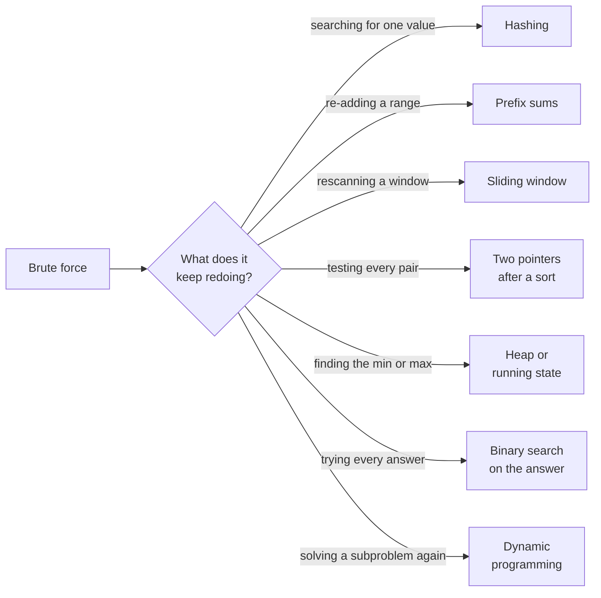

| The statement mentions... | Try |
|---|---|
| a pair that sums to a target, "seen before", counts, duplicates, grouping | [Hashing](#/algo/learn/patterns/hashing) |
| sorted input, pairs or triplets, "in place", palindromes | [Two pointers](#/algo/learn/patterns/two-pointers) |
| the longest or shortest substring or subarray with some property | [Sliding window](#/algo/learn/patterns/sliding-window) |
| an answer that depends on the past through one number: the lowest price so far, the furthest reach | [Running state](#/algo/learn/patterns/running-state-in-one-pass) |
| many range sums, "subarrays that sum to k", "the product of all the others" | [Prefix sums](#/algo/learn/patterns/prefix-sums-and-products) |
| sorted or rotated input, O(log n), "the minimum speed such that..." | [Binary search](#/algo/learn/patterns/binary-search) |
| `[start, end]` pairs: meetings, bookings, flights | [Intervals](#/algo/learn/patterns/intervals) |
| a linked list, O(1) extra space, the middle, a cycle, "the nth from the end" | [Linked list techniques](#/algo/learn/patterns/linked-list-techniques) |
| brackets, nesting, undo, "the next greater element" | [Stacks](#/algo/learn/patterns/stacks-and-monotonic-stacks) |
| "the k largest", "the k most frequent", merging k sorted inputs | [Heaps](#/algo/learn/patterns/heaps-and-top-k) |
| connected, reachable, islands, regions, cloning | [Graph traversal](#/algo/learn/patterns/graph-traversal) |
| "the minimum number of steps", the nearest, level by level | [BFS](#/algo/learn/patterns/bfs-by-levels-and-shortest-paths) |
| prerequisites, dependencies, a build order | [Topological sort](#/algo/learn/patterns/topological-sort-and-cycles) |
| "return all", "generate every", combinations, permutations | [Backtracking](#/algo/learn/patterns/backtracking) |
| "how many ways", "the minimum cost", "is it possible", with choices that interact | [Dynamic programming](#/algo/learn/dynamic-programming) |
| "the most non-overlapping...", "can you reach the end" | [Greedy](#/algo/learn/patterns/greedy) |

The input size hints at the target too: n up to about 20 allows exponential search, while n around
100,000 needs O(n log n) or better ([more](#/algo/learn/complexity/input-size-tells-you-the-target)).
When nothing fits, two moves help. **Sort first**: order enables binary search, two pointers and
greedy choices. **Rephrase** the input as something you know: a graph whose nodes are grid cells,
words or states, or a smaller problem you can run twice (House Robber on a circle is House Robber
on two straight lines).

## Hashing

**Signals:** an inner loop that asks "have I seen x?", "how many x?" or "where was x?"; two values
that complete each other, such as a pair summing to a target; duplicates; grouping items that are
"the same" (anagrams); counting.

A [hash map or set](#/algo/learn/data-structures/hash-maps-and-sets) answers a lookup in O(1) on
average. When the brute force scans the array again for every element, scan it once into a map
instead: O(n²) becomes O(n), paid for with O(n) memory. The whole skill is deciding what you will
search for, and indexing the data by it.

```python
def two_sum(nums, target):
    seen = {}  # value -> index, for the elements left of i
    for i, x in enumerate(nums):
        if target - x in seen:  # look the partner up first...
            return [seen[target - x], i]
        seen[x] = i  # ...then record x, so it never pairs with itself
    return []
```

### Choosing what to store

| The inner loop asks | Store | Python |
|---|---|---|
| Have I seen x? | a set | `seen = set()`, then `x in seen` |
| How many x? | value → count | `Counter(nums)`, or `count[x] = count.get(x, 0) + 1` |
| Where was x? | value → index | `pos[x] = i` keeps the last, `pos.setdefault(x, i)` the first |
| Which items belong together? | key → list | `groups = defaultdict(list)`, then `groups[key].append(item)` |
| Have I solved this already? | input → answer | a [memo](#/algo/learn/dynamic-programming/top-down-helper-plus-memo) |

Membership can also replace sorting. Longest Consecutive Sequence asks for the longest run of
consecutive integers in an unsorted array. Sorting costs O(n log n); a set does it in O(n), as long
as you only start counting at the beginning of a run.

```array
label: nums
values: 100 4 200 1 3 2
highlight: 0 2 3
caption: only 100, 200 and 1 start a run: 99, 199 and 0 are not in the set
---
label: nums
values: 100 4 200 1 3 2
highlight: 1 3 4 5
caption: from 1, count up while the next number is present: 1 2 3 4, length 4
```

```python
def longest_consecutive(nums):
    present = set(nums)
    best = 0
    for x in present:
        if x - 1 not in present:  # x starts a run (otherwise skip it)
            y = x
            while y + 1 in present:
                y += 1
            best = max(best, y - x + 1)
    return best
```

The inner `while` looks nested, but it only ever walks a run from its first number, so each number
is stepped over once in total: O(n).

### Designing the key

When "the same" means something looser than equal, compute a key that is identical for the items
that belong together. Anagrams share their sorted letters:

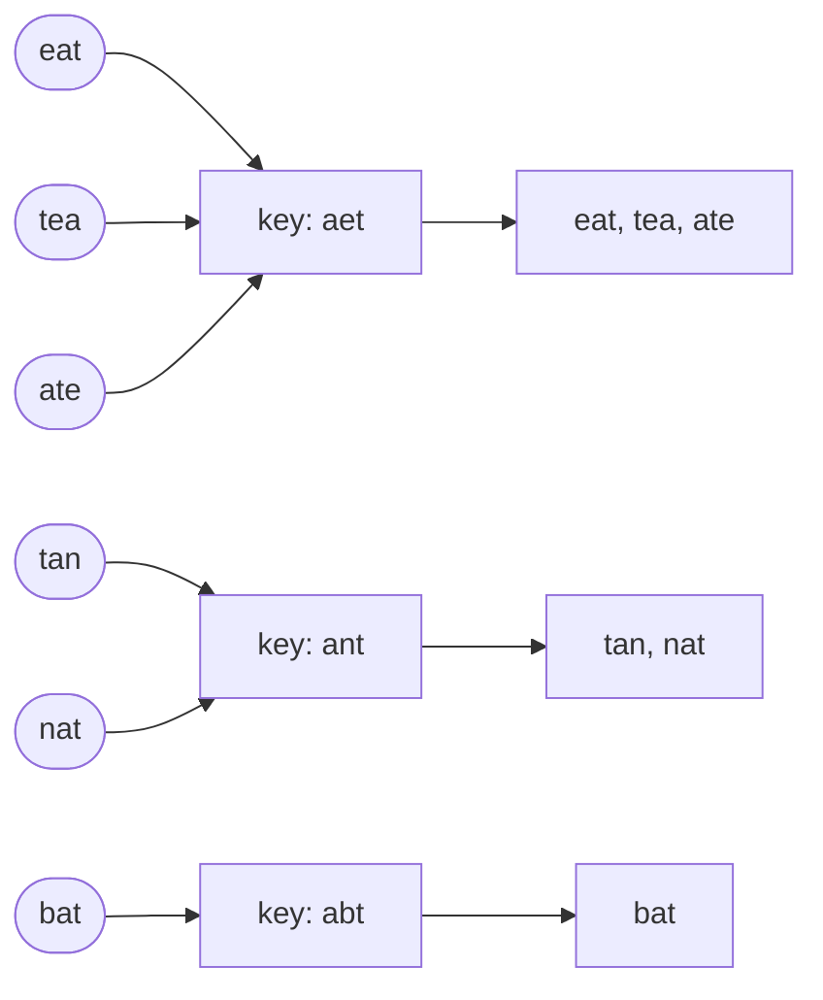

```python
from collections import defaultdict


def group_anagrams(words):
    groups = defaultdict(list)
    for w in words:
        groups["".join(sorted(w))].append(w)  # anagrams share a sorted spelling
    return list(groups.values())
```

Sorting each word costs O(m log m) for a word of length m; a tuple of 26 letter counts is an
equally good key built in O(m). Keys must be hashable: a tuple, a string or a frozenset, never a
list or a dict.

When the question is about prefixes ("starts with", autocomplete, finding words on a board), a map
of whole words can't help: a [trie](#/algo/learn/data-structures/tries) answers a prefix query in
O(length of the prefix).

**Cost:** O(n) time on average and O(n) extra space. Hashing a key costs O(its length), so a map
keyed by strings of length m does O(m) work per operation.

> **Pitfall.** Inserting before looking up lets an element pair with itself: Two Sum on
> `[3, 2, 4]` with target 6 would answer `[0, 0]`. Look up first, then insert.

**Practice:** [Two Sum](#/algo/problem/a01_two_sum), [Contains Duplicate](#/algo/problem/a07_contains_duplicate), [Valid Anagram](#/algo/problem/a28_valid_anagram), [Group Anagrams](#/algo/problem/a29_group_anagrams), [Longest Consecutive Sequence](#/algo/problem/a11_longest_consecutive_sequence), [Top K Frequent Elements](#/algo/problem/a14_top_k_frequent_elements), [Clone Graph](#/algo/problem/a10_clone_graph)

## Two pointers

**Signals:** sorted input, or input you are allowed to sort; pairs or triplets with a target sum;
"in place" or "O(1) extra space"; palindromes; merging or comparing two sorted sequences.

A nested loop tries every pair `(i, j)`. Two pointers try only the pairs that can still matter:
each pointer moves in one direction only, so together they make at most n moves, O(n) instead of
O(n²). What makes it correct is a reason to discard: every time a pointer moves, the element it
leaves behind can no longer be part of an answer.

### Pointers from both ends

On sorted data, compare the sum of the two ends with the target. If it's too small, the left
element is too small even with the largest partner still available, so it can never be part of an
answer, and `lo` moves right. If it's too big, the same argument moves `hi` left.

```array
label: sorted
values: 1 2 4 6 8 9
pointers: lo=0 hi=5
caption: target 12. 1 + 9 = 10 is too small, and 9 is the largest partner: lo moves
---
label: sorted
values: 1 2 4 6 8 9
pointers: lo=1 hi=5
dim: 0
caption: 2 + 9 = 11, still too small: lo moves
---
label: sorted
values: 1 2 4 6 8 9
pointers: lo=2 hi=5
dim: 0 1
caption: 4 + 9 = 13 is too big, and 4 is the smallest partner left: hi moves
---
label: sorted
values: 1 2 4 6 8 9
pointers: lo=2 hi=4
dim: 0 1 5
highlight: 2 4
caption: 4 + 8 = 12: found
```

```python
def pair_with_sum(nums, target):  # nums is sorted
    lo, hi = 0, len(nums) - 1
    while lo < hi:  # lo < hi: an element can't pair with itself
        s = nums[lo] + nums[hi]
        if s == target:
            return [lo, hi]
        if s < target:
            lo += 1  # nums[lo] is too small for every partner left
        else:
            hi -= 1  # nums[hi] is too big for every partner left
    return []
```

The same walk checks a palindrome (compare `s[lo]` with `s[hi]`, move both inwards), reverses an
array in place (swap, move both) and finds the container that holds the most water (move the
shorter side). Run it the other way and it **expands from a center**: Longest Palindromic Substring
grows two pointers outwards from every letter, and from every gap between two letters, while the
two ends match.

```python
def longest_palindrome(s):
    best = ""
    for center in range(2 * len(s) - 1):  # a letter (even), or a gap (odd)
        lo, hi = center // 2, (center + 1) // 2
        while lo >= 0 and hi < len(s) and s[lo] == s[hi]:
            lo, hi = lo - 1, hi + 1  # grow while the ends match
        if hi - lo - 1 > len(best):
            best = s[lo + 1 : hi]
    return best
```

### From 3Sum to k-sum

Sorting costs O(n log n), so it's free whenever the rest of the work is O(n²) or more. 3Sum (every
distinct triplet that sums to 0) fixes the first number with an outer loop and runs the two-pointer
search for the other two: n searches of O(n), O(n²) in all. Duplicates are avoided by never fixing
the same value twice, and by moving `lo` past repeats after a match.

```array
label: sorted
values: -4 -1 -1 0 1 2
pointers: i=1 lo=2 hi=5
highlight: 1 2 5
caption: i = 0 (-4) found nothing. Fix -1: -1 + 2 completes it, record [-1, -1, 2]
---
label: sorted
values: -4 -1 -1 0 1 2
pointers: i=1 lo=3 hi=4
highlight: 1 3 4
caption: move both pointers in: 0 + 1 completes it too, record [-1, 0, 1]
---
label: sorted
values: -4 -1 -1 0 1 2
pointers: i=2
dim: 2
caption: nums[2] equals nums[1]: fixing it would find the same triplets, so skip it
```

```python
def three_sum(nums):
    nums.sort()
    out = []
    for i in range(len(nums) - 2):
        if i > 0 and nums[i] == nums[i - 1]:
            continue  # same first number, same triplets
        lo, hi = i + 1, len(nums) - 1
        while lo < hi:
            s = nums[i] + nums[lo] + nums[hi]
            if s < 0:
                lo += 1
            elif s > 0:
                hi -= 1
            else:
                out.append([nums[i], nums[lo], nums[hi]])
                lo += 1
                while lo < hi and nums[lo] == nums[lo - 1]:
                    lo += 1  # skip repeats of the middle number
                hi -= 1
    return out
```

4Sum adds one more outer loop, O(n³). In general k-sum is k - 2 nested loops around one
two-pointer search.

> **Pitfall.** Sorting moves the elements. Two Sum must return the original indices, which is why
> it uses a hash map (or sorts `(value, index)` pairs) instead of sorting `nums` itself.

### Same direction and one per sequence

| Shape | How the pointers move | Used for |
|---|---|---|
| Both ends inwards | `lo` right, `hi` left, until they meet | pair sums on sorted data, palindromes, reversing in place |
| Fixed plus a pair | an outer loop fixes one element, a pair converges on the rest | 3Sum, 4Sum |
| Read and write | both go left to right; `write` only advances when it keeps an element | removing duplicates or zeros in place, partitioning |
| One per sequence | each pointer walks its own input; advance the one at the smaller value | merging sorted lists, intersecting sorted arrays, the closest pair across two lists |
| Window | both go left to right; the gap between them is the window | [sliding window](#/algo/learn/patterns/sliding-window) |
| Fast and slow | one moves twice as fast, or starts n steps ahead | [linked lists](#/algo/learn/patterns/linked-list-techniques) |

Read and write pointers compact an array in place:

```python
def remove_duplicates(nums):  # nums is sorted; keep one copy of each
    write = 0
    for x in nums:
        if write == 0 or x != nums[write - 1]:  # differs from the last value kept
            nums[write] = x
            write += 1
    return write  # nums[:write] holds the answer
```

**Cost:** O(n) for the walk, O(n log n) if you sort first, O(n²) for 3Sum. O(1) extra space
besides the sort.

> **Pitfall.** Use `while lo < hi`, not `lo <= hi`, when an element may not be used twice. And after
> a match, move at least one pointer, or the loop never ends.

**Practice:** [3Sum](#/algo/problem/a02_three_sum), [Two Sum](#/algo/problem/a01_two_sum) (the sorted variant), [Longest Palindromic Substring](#/algo/problem/a26_longest_palindromic_substring), [Remove Nth Node From End of List](#/algo/problem/a41_remove_nth_node_from_end_of_list), [Reorder List](#/algo/problem/a40_reorder_list)

## Sliding window

**Signals:** a **contiguous** substring or subarray; "the longest", "the shortest", "at most k",
"contains all of", "without repeating"; a window of fixed size k.

A window is a pair of pointers `left <= right` over the input. `right` advances on every step;
`left` advances only when the window must shrink. Neither ever moves back, so each element enters
the window once and leaves at most once: O(n), however many times the inner loop runs. Keep a
summary of what's inside (counts, a sum, last positions) and update it as elements enter and leave,
instead of rescanning the window.

### Longest valid window

Grow the window by one on the right; while it's invalid, shrink it from the left; now it's valid,
so record its length.

```python
from collections import Counter


def longest_window(s, is_valid):
    count = Counter()  # what's inside the window
    left = best = 0
    for right, ch in enumerate(s):
        count[ch] += 1  # 1. grow: s[right] enters
        while not is_valid(count, right - left + 1):
            count[s[left]] -= 1  # 2. shrink: s[left] leaves
            left += 1
        best = max(best, right - left + 1)  # 3. valid again: record it
    return best
```

Each problem supplies its own `is_valid(count, length)`. No repeated letters:
`max(count.values()) <= 1`. Longest Repeating Character Replacement (change at most k letters to
make the window a single letter): `length - max(count.values()) <= k`. At most k distinct letters:
at most k nonzero counts.

For "no repeats" the summary can be sharper: remember where each letter was last seen, and jump
`left` past the earlier copy in one step.

```array
label: s
values: a b c a b c b b
pointers: left=0 right=2
highlight: 0..2
caption: abc has no repeats: best = 3
---
label: s
values: a b c a b c b b
pointers: left=1 right=3
highlight: 1..3
dim: 0
caption: a was last seen at 0, inside the window: left jumps to 1
---
label: s
values: a b c a b c b b
pointers: left=5 right=6
highlight: 5 6
dim: 0..4
caption: b was last seen at 4: left jumps to 5. The best stays 3
```

```python
def length_of_longest_substring(s):
    last = {}  # letter -> index where it was last seen
    left = best = 0
    for right, ch in enumerate(s):
        if last.get(ch, -1) >= left:  # a copy inside the window
            left = last[ch] + 1  # jump past it
        last[ch] = right
        best = max(best, right - left + 1)
    return best
```

### Shortest window that covers

When the window must contain something ("the shortest substring of s holding every letter of t"),
turn the loop around: grow until the window is valid, then shrink **while** it stays valid,
recording each time. A single counter of missing letters makes the validity check O(1).

```array
label: s
values: A D O B E C O D E B A N C
pointers: left=0 right=5
highlight: 0..5
caption: t = ABC. At C the window first holds A, B and C: record ADOBEC, then drop A
---
label: s
values: A D O B E C O D E B A N C
pointers: left=5 right=10
highlight: 5..10
dim: 0..4
caption: the next A makes it valid again: shrink to CODEBA, no shorter, then drop C
---
label: s
values: A D O B E C O D E B A N C
pointers: left=9 right=12
highlight: 9..12
dim: 0..8
caption: the last C: shrink to BANC, length 4, the answer
```

```python
from collections import Counter


def min_window(s, t):
    need = Counter(t)  # how many of each letter the window still needs
    missing = len(t)  # total letters still needed
    left, best = 0, None
    for right, ch in enumerate(s):
        if need[ch] > 0:
            missing -= 1  # ch was needed
        need[ch] -= 1  # below zero means a spare copy
        while missing == 0:  # valid: record it, then shrink
            if best is None or right - left < best[1] - best[0]:
                best = (left, right)
            need[s[left]] += 1
            if need[s[left]] > 0:
                missing += 1  # dropped a letter we needed
            left += 1
    return "" if best is None else s[best[0] : best[1] + 1]
```

A **fixed-size** window (the largest sum of any k consecutive numbers) is the simplest case: add
`nums[right]`, and subtract `nums[right - k]` once the window is longer than k.

**Cost:** O(n) time, since each pointer moves at most n times. O(k) or O(size of the alphabet)
space for the summary.

> **Pitfall.** A window needs a condition that only gets worse as the window grows: more repeats, a
> bigger sum. With negative numbers a longer window can have a smaller sum, so "shrink while the sum
> is too big" breaks; use [prefix sums with a hash map](#/algo/learn/patterns/prefix-sums-and-products)
> instead. And a subsequence (not contiguous) is never a window: that's
> [dynamic programming](#/algo/learn/dynamic-programming).

**Practice:** [Longest Substring Without Repeating Characters](#/algo/problem/a31_longest_substring_without_repeating_characters), [Longest Repeating Character Replacement](#/algo/problem/a32_longest_repeating_character_replacement), [Minimum Window Substring](#/algo/problem/a30_minimum_window_substring)

## Running state in one pass

**Signals:** the brute force compares every element with everything before it, but the comparison
only needs one fact about the past: the lowest price so far, the furthest index reached, where a
word was last seen.

Ask: *what does the current element need to know about everything before it?* If the answer is one
or two numbers, carry them forward in a single pass: O(n) time and O(1) space. If the answer is a
whole table of earlier results, it's [dynamic programming](#/algo/learn/dynamic-programming), and
if that table only ever reads its last entry, it collapses back into running state.

| Problem | Carry | At each element |
|---|---|---|
| Best Time to Buy and Sell Stock | the lowest price so far | `best = max(best, p - low)`, then `low = min(low, p)` |
| Jump Game | the furthest index reachable | fail if `i > reach`, then `reach = max(reach, i + nums[i])` |
| Shortest Word Distance | the last index of each word | when either word appears, compare with the other's last index |
| Maximum Subarray (Kadane) | the best sum of a subarray ending here | `cur = max(x, cur + x)`, `best = max(best, cur)` |
| Product of Array Except Self | the product of everything to the left, then to the right | see [prefix products](#/algo/learn/patterns/prefix-sums-and-products) |

For a fixed sell day, the best buy day is simply the cheapest day before it. So one number, the
lowest price so far, replaces the inner loop over all earlier days:

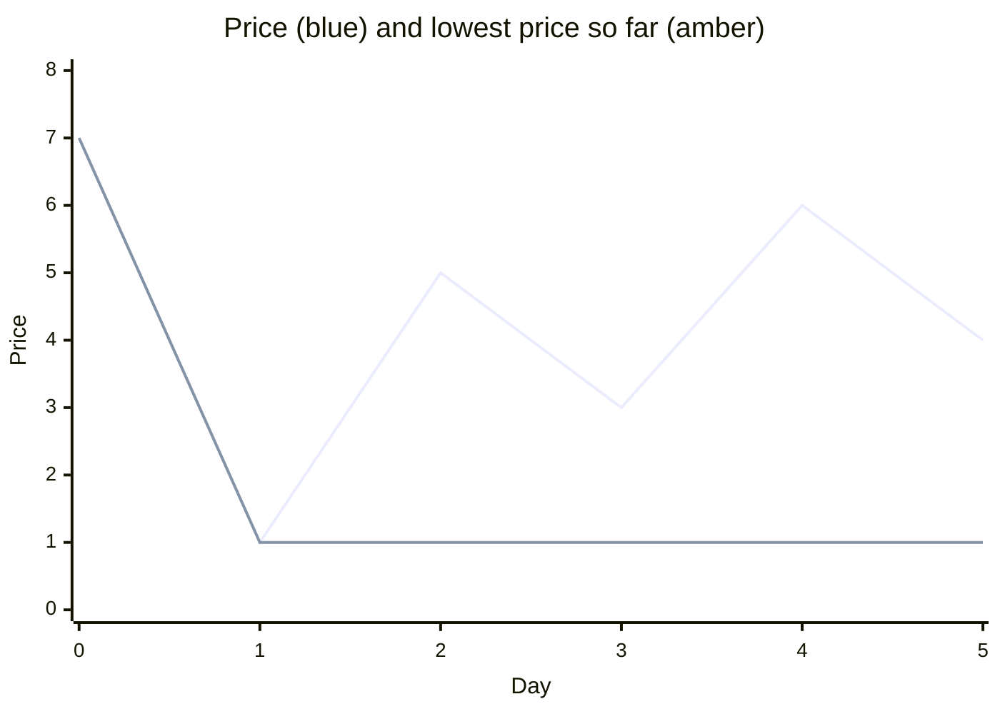

The gap between the two lines is the profit of selling on that day; the answer is the largest gap,
6 - 1 = 5 on day 4.

```python
def max_profit(prices):
    low, best = float("inf"), 0
    for p in prices:
        best = max(best, p - low)  # sell today, having bought at the lowest earlier price
        low = min(low, p)
    return best
```

Jump Game carries the furthest reachable index. Every index up to `reach` is reachable, so that one
number describes the whole set:

```array
label: nums
values: 3 2 1 0 4
pointers: i=0 reach=3
highlight: 1..3
caption: from index 0 we can reach up to index 3
---
label: nums
values: 3 2 1 0 4
pointers: i=3 reach=3
highlight: 3
caption: 1 + 2, 2 + 1 and 3 + 0 all stop at 3: reach never grows past 3
---
label: nums
values: 3 2 1 0 4
pointers: i=4
dim: 4
caption: i = 4 is beyond reach: the end can't be reached
```

```python
def can_jump(nums):
    reach = 0
    for i, jump in enumerate(nums):
        if i > reach:
            return False  # a gap that nothing before i can cross
        reach = max(reach, i + jump)
    return True
```

Shortest Word Distance (the smallest index difference between two given words) carries the last
position of each word. The closest pair always involves the most recent occurrence of the other
word, so nothing older is worth remembering:

```array
label: words
values: a c b d c a b
pointers: "last a=0" "last b=2"
highlight: 0 2
caption: at index 2 (b): the last a is at 0, distance 2
---
label: words
values: a c b d c a b
pointers: "last a=5" "last b=2"
highlight: 2 5
caption: at index 5 (a): the last b is at 2, distance 3, the best stays 2
---
label: words
values: a c b d c a b
pointers: "last a=5" "last b=6"
highlight: 5 6
caption: at index 6 (b): the last a is at 5, distance 1, the answer
```

```python
def shortest_distance(words, word1, word2):
    last1 = last2 = -1  # last index of each word; -1 means not seen yet
    best = len(words)
    for i, w in enumerate(words):
        if w == word1:
            last1 = i
        elif w == word2:
            last2 = i
        if last1 >= 0 and last2 >= 0:
            best = min(best, abs(last1 - last2))
    return best
```

If the same list gets many queries, pay once: build `positions[word]`, each word's sorted indices,
in one pass. Then answer a query by walking the two position lists with one pointer each, always
advancing the one at the smaller index: O(occurrences of the two words) per query.

**Cost:** O(n) time and O(1) space, which is the point of the pattern.

> **Interview tip.** Say the state out loud before coding: "all I need from the past is the lowest
> price so far." Finding that one sentence is most of the problem.

**Practice:** [Best Time to Buy and Sell Stock](#/algo/problem/a03_best_time_to_buy_and_sell_stock), [Jump Game](#/algo/problem/a39_jump_game), [Shortest Word Distance](#/algo/problem/a37_shortest_word_distance), [Product of Array Except Self](#/algo/problem/a08_product_of_array_except_self)

## Prefix sums and products

**Signals:** the sum of a range, asked many times; "the number of subarrays that sum to k",
especially with negative numbers; "the product of everything except this element"; how many
intervals cover each point.

Pay once to save: one O(n) pass builds `prefix[i]`, the sum of the first i elements, and then every
range sum is one subtraction.

```python
def prefix_sums(nums):
    prefix = [0]  # prefix[i] = sum(nums[:i]): n + 1 entries
    for x in nums:
        prefix.append(prefix[-1] + x)
    return prefix


# sum(nums[l:r]) == prefix[r] - prefix[l], in O(1)
```

### Range sums

```array
label: nums
values: 3 1 4 1 5 9
highlight: 2..4
---
label: prefix
values: 0 3 4 8 9 14 23
highlight: 2 5
caption: sum(nums[2:5]) = prefix[5] - prefix[2] = 14 - 4 = 10
```

Drawing the two arrays one above the other settles the off-by-one: `prefix` has n + 1 entries, and
`prefix[i]` sums everything **before** index i.

### Subarray sums with a hash map

A subarray `nums[j:i]` sums to k exactly when `prefix[i] - prefix[j] == k`. So walk once, keep a
running total, and ask a [hash map](#/algo/learn/patterns/hashing) how many earlier prefixes equal
`total - k`. Unlike a sliding window, this works with negative numbers.

```array
label: prefix
values: 0 1 3 4 6 7
pointers: j=1 i=3
highlight: 1 3
caption: nums = [1, 2, 1, 2, 1], k = 3. At i = 3 the total is 4; a prefix of 1 came earlier
```

That pair says `nums[1:3] = [2, 1]` sums to 3.

```python
def subarray_sum(nums, k):
    seen = {0: 1}  # prefix total -> how many times it occurred
    total = count = 0
    for x in nums:
        total += x
        count += seen.get(total - k, 0)  # earlier prefixes that leave exactly k
        seen[total] = seen.get(total, 0) + 1
    return count
```

The seed `{0: 1}` is the empty prefix, so subarrays that start at index 0 are counted.

### Products from both sides

Product of Array Except Self forbids division. Build the product of everything to the **left** of
each index in one pass, then multiply in everything to the **right** in a second pass, backwards:

```grid
collabels: 0 1 2 3
rowlabels: nums left right answer
1 2 3 4
1 1 2 6
24 12 4 1
24 12 8 6
highlight: 1,2 2,2 3,2
caption: answer[2] = (1 × 2) × 4 = 8: the product to its left times the product to its right
```

```python
def product_except_self(nums):
    n = len(nums)
    answer = [1] * n
    left = 1
    for i in range(n):  # answer[i] = product of nums[:i]
        answer[i] = left
        left *= nums[i]
    right = 1
    for i in range(n - 1, -1, -1):  # times the product of nums[i + 1:]
        answer[i] *= right
        right *= nums[i]
    return answer
```

The same idea runs in reverse as a **difference array**, for many range *updates*: add +1 where an
interval starts and -1 where it ends, and a prefix sum gives how many intervals cover each point.
That's the [sweep line](#/algo/learn/patterns/intervals) behind Number of Airplanes in the Sky.
Prefix sums also work in two dimensions: with `P[r][c]` the sum of the rectangle above and left of
`(r, c)`, a rectangle's sum is `P[r2][c2] - P[r1][c2] - P[r2][c1] + P[r1][c1]`.

**Cost:** O(n) to build, O(1) per range query, O(n) space. The product version reuses the output
array, so it needs O(1) extra.

> **Pitfall.** Forgetting the seed `{0: 1}` misses every subarray that starts at index 0, and a
> division shortcut for products breaks as soon as the input contains a 0.

**Practice:** [Product of Array Except Self](#/algo/problem/a08_product_of_array_except_self), [Number of Airplanes in the Sky](#/algo/problem/a18_number_of_airplanes_in_the_sky)

## Binary search

**Signals:** sorted input; "in O(log n)"; the first or last position of a value; where a value
would be inserted; a sorted array that has been rotated; "the minimum speed, capacity or number of
days such that...", "the smallest maximum", "the largest minimum".

Keep an interval `[lo, hi]` known to contain the answer, look at the middle, and discard the half
that can't contain it. Each step halves the interval, so a billion candidates take 30 steps. Binary
search doesn't really need a sorted array: it needs a yes-or-no question that is **monotonic**,
false, false, ..., false, true, true, ..., true. The answer is the first true.

### Searching a sorted array

One template covers almost everything: find the first index where a condition becomes true.

```python
def lower_bound(nums, target):
    """First index i with nums[i] >= target (len(nums) if none): where target would go."""
    lo, hi = 0, len(nums)  # the answer is always in [lo, hi]
    while lo < hi:
        mid = (lo + hi) // 2
        if nums[mid] >= target:
            hi = mid  # mid qualifies: the answer is mid or left of it
        else:
            lo = mid + 1  # mid doesn't: the answer is right of it
    return lo  # lo == hi: the first index that qualifies
```

```array
label: nums
values: 1 3 5 7 7 9 11
pointers: lo=0 mid=3 hi=7
highlight: 3
caption: find the first 7. nums[3] = 7 >= 7: the answer is 3 or to its left, hi = 3
---
label: nums
values: 1 3 5 7 7 9 11
pointers: lo=0 mid=1 hi=3
highlight: 1
dim: 4..6
caption: nums[1] = 3 < 7: the answer is right of 1, lo = 2
---
label: nums
values: 1 3 5 7 7 9 11
pointers: lo=2 mid=2 hi=3
highlight: 2
dim: 0 1 4..6
caption: nums[2] = 5 < 7: lo = 3
---
label: nums
values: 1 3 5 7 7 9 11
pointers: lo=3 hi=3
highlight: 3
dim: 0..2 4..6
caption: lo == hi: index 3 holds the first 7
```

`hi` starts one past the end, so "nothing qualifies" comes back as `len(nums)`. The same loop
answers the other questions: the last 7 is at `lower_bound(nums, 8) - 1`; "is 7 present?" is
`i < len(nums) and nums[i] == 7`; and Python's `bisect.bisect_left` is this function.

### Binary search on the answer

When the question asks for the smallest value that works, search over the **answers** instead of
over indices. It applies when (1) the answer lies in a known range, (2) one candidate can be
checked quickly with `feasible(x)`, and (3) feasibility is monotonic: if x works, everything bigger
works too.

Koko Eating Bananas: piles `[3, 6, 7, 11]` and 8 hours. At speed k, a pile of p bananas takes
`ceil(p / k)` hours. Eating faster never takes longer, so "fits in 8 hours" reads no, no, ..., yes,
yes:

```grid
rowlabels: speed hours "fits in 8?"
1 2 3 4 5 6 7 8 9 10 11
27 15 10 8 8 6 5 5 5 5 4
no no no yes yes yes yes yes yes yes yes
highlight: 0,3 1,3 2,3
caption: the hours only fall as the speed rises, so binary search finds the first yes: speed 4
```

```python
def min_eating_speed(piles, h):
    def hours(k):
        return sum((p + k - 1) // k for p in piles)  # ceil(p / k) without floats

    lo, hi = 1, max(piles)  # max(piles) always fits: one pile per hour
    while lo < hi:
        mid = (lo + hi) // 2
        if hours(mid) <= h:
            hi = mid  # fast enough: try slower
        else:
            lo = mid + 1  # too slow
    return lo
```

That's O(n log m) for n piles and a largest pile of m: about 30 checks of O(n) each, instead of up
to a billion. "The minimum capacity to ship everything within d days" and "split an array into k
parts minimizing the largest sum" are the same code with a different `feasible`.

### Rotated sorted arrays

`[4, 5, 6, 7, 0, 1, 2]` is a sorted array rotated at an unknown point. Wherever you cut it at
`mid`, **one half is sorted**: check whether the target lies within that sorted half's range, and
keep that half or the other one.

```array
label: nums
values: 4 5 6 7 0 1 2
pointers: lo=0 mid=3 hi=6
highlight: 0..3
caption: target 0. 4 5 6 7 is sorted and 0 is outside it: go right
---
label: nums
values: 4 5 6 7 0 1 2
pointers: lo=4 mid=5 hi=6
highlight: 4 5
dim: 0..3
caption: 0 1 is sorted and 0 is inside it: go left
---
label: nums
values: 4 5 6 7 0 1 2
pointers: lo=4 mid=4 hi=4
highlight: 4
dim: 0..3 5 6
caption: found at index 4
```

```python
def search_rotated(nums, target):
    lo, hi = 0, len(nums) - 1
    while lo <= hi:
        mid = (lo + hi) // 2
        if nums[mid] == target:
            return mid
        if nums[lo] <= nums[mid]:  # the left half is sorted
            if nums[lo] <= target < nums[mid]:
                hi = mid - 1
            else:
                lo = mid + 1
        else:  # the right half is sorted
            if nums[mid] < target <= nums[hi]:
                lo = mid + 1
            else:
                hi = mid - 1
    return -1
```

This one uses `lo <= hi` with `hi = mid - 1`, because it stops as soon as it sees the target.

**Cost:** O(log n) steps, each multiplied by the cost of `feasible` when searching on the answer.
O(1) space.

> **Pitfall.** Most binary search bugs are an infinite loop or an off-by-one. Match the loop to
> the updates: `lo < hi` goes with `hi = mid` and `lo = mid + 1`, which always shrink the range
> because `mid` rounds down. If you ever need `lo = mid`, round up instead:
> `mid = (lo + hi + 1) // 2`. Then test arrays of length 0, 1 and 2, and targets smaller and larger
> than everything.

**Practice:** [Search in Rotated Sorted Array](#/algo/problem/a38_search_in_rotated_sorted_array), [Koko Eating Bananas](#/algo/problem/a45_koko_eating_bananas), [Longest Increasing Subsequence](#/algo/problem/a06_longest_increasing_subsequence) (the [O(n log n) version](#/algo/learn/dynamic-programming/longest-increasing-subsequence))

## Intervals

**Signals:** pairs `[start, end]`: meetings, bookings, flights, ranges of numbers; "merge",
"overlap", "insert", "the fewest to remove", "the most at the same time", "how many rooms".

Sort by start time first, and overlapping intervals become neighbours: one pass then compares each
interval only with the last one kept. Once sorted, interval `b` overlaps the interval `a` before it
when `b.start <= a.end`.

> **Key idea.** Decide whether touching counts as overlapping before you code. Merge Intervals
> joins `[1, 3]` and `[3, 5]` into `[1, 5]`; Non-overlapping Intervals treats them as compatible;
> a plane that lands at 3 and another that takes off at 3 are never in the air together. The whole
> difference is `<=` or `<`.

### Merging

```intervals
input: [1,3] [2,6] [8,10] [9,12] [15,18]
merged: [1,6] [8,12] [15,18]
caption: sorted by start, each interval extends the last merged one or starts a new one
```

```python
def merge(intervals):
    out = []
    for start, end in sorted(intervals):
        if out and start <= out[-1][1]:  # overlaps the last merged interval
            out[-1][1] = max(out[-1][1], end)  # extend it; max, in case it's inside
        else:
            out.append([start, end])
    return out
```

### Inserting

When the list is already sorted and non-overlapping, inserting is O(n): three loops share one
pointer. Copy what ends before the new interval, absorb what overlaps it, copy the rest.

```intervals
intervals: [1,2] [3,5] [6,7] [8,10] [12,16]
new: [4,8]
result: [1,2] [3,10] [12,16]
caption: [1,2] ends before 4: copy. [3,5] [6,7] [8,10] start by 8: absorb. [12,16]: copy
```

```python
def insert(intervals, new):
    out, i, n = [], 0, len(intervals)
    start, end = new
    while i < n and intervals[i][1] < start:  # ends before new starts: copy
        out.append(intervals[i])
        i += 1
    while i < n and intervals[i][0] <= end:  # overlaps new: absorb it
        start = min(start, intervals[i][0])
        end = max(end, intervals[i][1])
        i += 1
    out.append([start, end])
    out.extend(intervals[i:])  # starts after new ends: copy
    return out
```

### Removing the fewest

To keep the most non-overlapping intervals, and so remove the fewest, sort by **end** and keep
every interval that starts at or after the last kept end. Ending early leaves the most room for the
rest; the [greedy section](#/algo/learn/patterns/greedy) proves it.

```intervals
input: [1,3] [2,4] [4,6] [5,9] [7,8]
kept: [1,3] [4,6] [7,8]
caption: by end time: keep [1,3], drop [2,4], keep [4,6], keep [7,8], drop [5,9]: 2 removed
```

```python
def erase_overlap_intervals(intervals):
    removed, last_end = 0, float("-inf")
    for start, end in sorted(intervals, key=lambda iv: iv[1]):  # earliest end first
        if start >= last_end:
            last_end = end  # fits after the last kept one: keep it
        else:
            removed += 1  # overlaps a kept one that ends sooner: drop it
    return removed
```

### Counting overlaps with a sweep line

"The most planes in the air at once" or "the fewest meeting rooms" doesn't care which interval is
which, only how many are open. Split every interval into two events, +1 at its start and -1 at its
end, sort them, and keep a running count.

```intervals
flights: [1,10] [2,3] [4,7] [5,8]
caption: three planes are in the air between 5 and 7
```

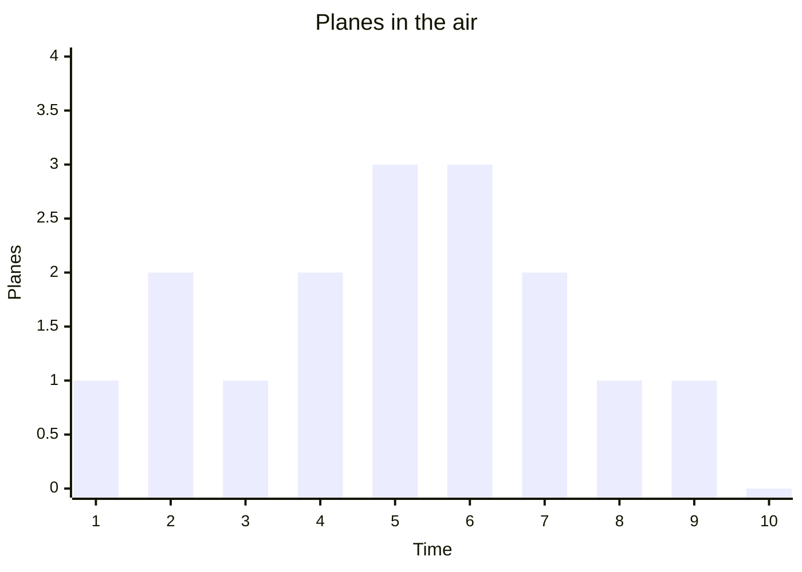

```python
def count_of_airplanes(airplanes):
    events = []
    for start, end in airplanes:
        events.append((start, 1))  # take-off
        events.append((end, -1))  # landing
    events.sort()  # at equal times -1 sorts first: land, then take off
    count = best = 0
    for _, change in events:
        count += change
        best = max(best, count)
    return best
```

A min-heap of end times gives the same answer for meeting rooms: sort the meetings by start, pop
every meeting that has ended before the new one starts, push the new one, and the heap's largest
size is the number of rooms.

**Cost:** O(n log n) for the sort; the passes are O(n). Insert Interval on sorted input is O(n).

> **Pitfall.** Comparing each interval with the previous *input* interval instead of the last
> *merged* one, or setting the end to the new interval's end instead of the max: `[1, 10]` followed
> by `[2, 3]` must stay `[1, 10]`.

**Practice:** [Merge Intervals](#/algo/problem/a16_merge_intervals), [Insert Interval](#/algo/problem/a15_insert_interval), [Non-overlapping Intervals](#/algo/problem/a17_non_overlapping_intervals), [Number of Airplanes in the Sky](#/algo/problem/a18_number_of_airplanes_in_the_sky), [Course Schedule III](#/algo/problem/a13_course_schedule_iii)

## Linked list techniques

**Signals:** a linked list in the input; "in place" or "O(1) extra space"; the middle node; a cycle;
"the nth node from the end"; reversing, merging or reordering.

Most [linked list](#/algo/learn/data-structures/linked-lists) problems are two to four small
primitives glued together. Learn the primitives until you can write them without thinking, and
spend the interview on the glue.

| Problem | Primitives |
|---|---|
| Reorder List | find the middle, reverse the second half, merge alternately |
| Palindrome Linked List | find the middle, reverse the second half, compare |
| Remove Nth Node From End of List | a dummy head, a fixed gap |
| Merge k Sorted Lists | a dummy head, a [heap](#/algo/learn/patterns/heaps-and-top-k) of the list fronts |
| Linked List Cycle | fast and slow pointers |

```python
class ListNode:
    def __init__(self, val=0, next=None):
        self.val = val
        self.next = next
```

### Fast and slow pointers

Move `slow` one node and `fast` two nodes per step. When `fast` reaches the end, `slow` is at the
middle.

```linkedlist
values: 1 2 3 4 5 6
pointers: slow=0 fast=0
---
values: 1 2 3 4 5 6
pointers: slow=1 fast=2
---
values: 1 2 3 4 5 6
pointers: slow=2 fast=4
highlight: 0..2
caption: fast can't move two more: slow ends the first half, 1 2 3
```

```python
def end_of_first_half(head):  # head must not be None
    slow = fast = head
    while fast.next and fast.next.next:
        slow = slow.next
        fast = fast.next.next
    return slow  # the middle; for even lengths, the first of the two
```

If the list has a cycle, `fast` never reaches an end. It enters the loop and gains one node on
`slow` every step, so the two must meet (Floyd's algorithm):

```linkedlist
values: 3 2 0 -4
cycle: 1
pointers: slow=0 fast=0
caption: both start at the head
---
values: 3 2 0 -4
cycle: 1
pointers: slow=1 fast=2
---
values: 3 2 0 -4
cycle: 1
pointers: slow=2 fast=1
caption: fast has gone round the loop and is now one node behind slow
---
values: 3 2 0 -4
cycle: 1
pointers: slow=3 fast=3
highlight: 3
caption: fast catches up: they meet, so there is a cycle
```

```python
def has_cycle(head):
    slow = fast = head
    while fast and fast.next:
        slow = slow.next
        fast = fast.next.next
        if slow is fast:
            return True
    return False
```

To find where the cycle starts, move one pointer back to the head and step both one node at a
time: they meet at the first node of the cycle.

### A fixed gap: the nth from the end

Start `fast` n + 1 nodes ahead of `slow`, both from a dummy node placed in front of the head, then
move both until `fast` falls off the end. `slow` stops just before the node to remove.

```linkedlist
values: D 1 2 3 4 5
pointers: slow=0 fast=3
dim: 0
caption: n = 2. fast starts n + 1 = 3 nodes ahead of slow (D is the dummy)
---
values: D 1 2 3 4 5
pointers: slow=3 fast=6
dim: 0
highlight: 4
caption: fast falls off the end: slow is just before 4, the 2nd node from the end
---
values: D 1 2 3 5
dim: 0
caption: slow.next = slow.next.next unlinks it; return dummy.next
```

```python
def remove_nth_from_end(head, n):
    dummy = ListNode(0, head)  # removing the head then needs no special case
    slow = fast = dummy
    for _ in range(n + 1):
        fast = fast.next
    while fast:
        slow = slow.next
        fast = fast.next
    slow.next = slow.next.next
    return dummy.next
```

### Reversing in place

Walk the list once and flip one pointer per step. Three names do it: `prev` (the reversed part),
`cur` (the next node to flip) and `nxt` (saved first, because flipping `cur.next` loses it).

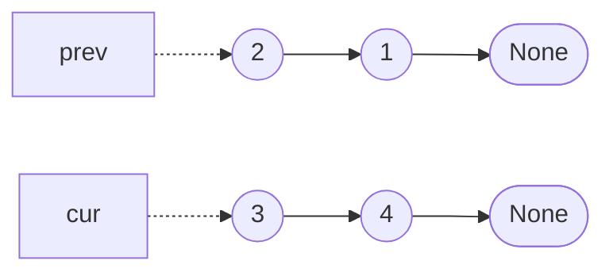

Halfway through: 1 and 2 already point backwards, 3 and 4 not yet. The next step saves `nxt = 4`,
points 3 at 2, and moves `prev` to 3 and `cur` to 4.

```python
def reverse(head):
    prev, cur = None, head
    while cur:
        nxt = cur.next  # save the rest
        cur.next = prev  # flip one pointer
        prev = cur  # step forward
        cur = nxt
    return prev  # the old tail is the new head
```

### Dummy heads and merging

A **dummy** node in front of the output removes every "is this the first node?" special case:
append after `tail`, and return `dummy.next` at the end. Merging two sorted lists takes the smaller
front each time, and attaches whatever is left when one list runs out.

```linkedlist
label: a
values: 5 7
---
label: b
values: 4 6 8
---
label: out
values: D 1 2 3
pointers: tail=3
dim: 0
caption: tail.next takes the smaller front, 4 from b
```

```python
def merge_two(a, b):
    dummy = tail = ListNode()
    while a and b:
        if a.val <= b.val:
            tail.next, a = a, a.next
        else:
            tail.next, b = b, b.next
        tail = tail.next
    tail.next = a or b  # one list ran out: attach the rest of the other
    return dummy.next
```

**Cost:** O(n) time and O(1) extra space for every primitive: they only rewire the nodes they're
given. A recursive version uses O(n) call stack, which breaks an O(1) space requirement.

> **Pitfall.** Save `next` before you overwrite it. Cut the list (`mid.next = None`) when you split
> it, or the halves stay joined and the merge builds a cycle. Check `fast and fast.next` before
> stepping. And test lengths 0, 1, 2 and 3, which catch most mistakes.

**Practice:** [Reorder List](#/algo/problem/a40_reorder_list), [Remove Nth Node From End of List](#/algo/problem/a41_remove_nth_node_from_end_of_list), [Merge k Sorted Lists](#/algo/problem/a42_merge_k_sorted_lists)

## Stacks and monotonic stacks

**Signals:** matching or nesting (brackets, tags, function calls); "the most recent unfinished
thing must finish first"; undo; evaluating or decoding nested expressions; "the next greater (or
smaller) element", "how many days until a warmer day".

A [stack](#/algo/learn/data-structures/stacks-and-queues) is last in, first out. In Python it's a
list: `append` to push, `pop()` to pop, `stack[-1]` to peek, all O(1).

### Matching and nesting

Valid Parentheses: push every opener; a closer must match the opener on top of the stack. Anything
still open at the end was never closed.

```array
label: stack
direction: vertical
values: { [ (
pointers: top=2
caption: reading {[()]}: after { [ ( the latest opener is on top
---
label: stack
direction: vertical
values: { [
pointers: top=1
caption: ) matches the ( on top: pop it. Then ] and } pop the rest: valid
---
label: stack
direction: vertical
values: ( [
pointers: top=1
highlight: 1
caption: reading ([)]: the ) meets [ on top, not (: invalid
```

```python
def is_valid(s):
    match = {")": "(", "]": "[", "}": "{"}
    stack = []
    for ch in s:
        if ch in match:  # a closer
            if not stack or stack.pop() != match[ch]:
                return False  # nothing open, or the wrong kind
        else:
            stack.append(ch)  # an opener
    return not stack  # leftovers were never closed
```

The same shape turns stack samples into trace events. Compare each sample with the previous one:
the frames after the common prefix have ended (emit them innermost first, as a stack pops), then the
new frames have started (emit them outermost first, as a stack pushes).

```grid
collabels: 0 1 2 3
rowlabels: "t = 1" "t = 2"
main parse read _
main parse eval emit
highlight: 0,0 0,1 1,0 1,1
caption: common prefix main, parse. At t = 2: end read, then start eval and emit
```

### Monotonic stacks

For every element, find the nearest larger element to its right. Brute force scans right from each
element, O(n²). The insight: once a later, larger element arrives, the smaller earlier ones have
their answer and never matter again. So keep a stack of the elements still waiting for an answer.
Their values decrease from bottom to top, which is why it's called monotonic. Each new element pops
everything smaller than itself, and each popped element has just found its answer.

Daily Temperatures: for each day, how many days until a warmer one?

```array
label: temps
values: 73 74 75 71 69 72 76 73
pointers: i=5
highlight: 2 3 4
dim: 0 1
caption: days 2, 3 and 4 are waiting (75, 71, 69). 72 is warmer than 69 and 71
---
label: temps
values: 73 74 75 71 69 72 76 73
pointers: i=6
highlight: 2 5
dim: 0 1 3 4
caption: 76 is warmer than 72 and 75: day 5 waited 1 day, day 2 waited 4
```

```array
label: stack
direction: vertical
values: "d2 75" "d3 71" "d4 69"
caption: waiting days when day 5 (72) arrives
---
label: stack
direction: vertical
values: "d2 75" "d5 72"
highlight: 1
caption: 69 and 71 popped with answers 1 and 2, then day 5 pushed
```

```python
def daily_temperatures(temps):
    answer = [0] * len(temps)
    stack = []  # waiting indices; their temps decrease upwards
    for i, t in enumerate(temps):
        while stack and temps[stack[-1]] < t:
            j = stack.pop()
            answer[j] = i - j  # day j's warmer day is today
        stack.append(i)
    return answer  # days never popped keep 0: no warmer day
```

The `while` inside the `for` looks quadratic, but each index is pushed once and popped at most
once: 2n operations, O(n) in total.

| For each element, find | Keep the stack | Pop while the top is |
|---|---|---|
| the next greater element to the right | decreasing | smaller than the new element |
| the next smaller element to the right | increasing | larger than the new element |
| the previous greater element | decreasing | smaller or equal; then the top, if any, is the answer |
| the largest rectangle in a histogram | increasing heights | taller: its rectangle ends here |

**Cost:** O(n) time, O(n) space for the stack.

> **Pitfall.** Popping an empty stack (a `)` as the first character), and forgetting what's left on
> the stack at the end: unclosed brackets, or elements that never found a larger one. Store
> **indices** rather than values when the answer is a distance.

**Practice:** [Valid Parentheses](#/algo/problem/a27_valid_parentheses), [Convert Stack Samples to Trace Events](#/algo/problem/a43_stack_samples_to_trace_events)

## Heaps and top-k

**Signals:** "the k largest, smallest, most frequent or closest"; "the kth largest"; merging k
sorted lists or streams; repeatedly taking the smallest or largest remaining item; scheduling by
deadline; a running median.

A [heap](#/algo/learn/data-structures/heaps) keeps the smallest item on top: peek in O(1), push and
pop in O(log n). Python's `heapq` works on a plain list and is a **min-heap** only.

| Operation | `heapq` | Cost |
|---|---|---|
| Turn a list into a heap | `heapify(a)` | O(n) |
| Peek at the smallest | `a[0]` | O(1) |
| Push | `heappush(a, x)` | O(log n) |
| Pop the smallest | `heappop(a)` | O(log n) |
| Pop the smallest, then push | `heapreplace(a, x)` | O(log n) |
| The k smallest or largest | `nsmallest(k, a)`, `nlargest(k, a)` | O(n log k) |

### Top k with a size-k heap

To keep the k **largest** items of a stream, use a **min**-heap of size k: the opposite polarity.
Its top is the smallest of the best k so far, the bar a newcomer has to clear. A newcomer that
beats it replaces it; anything else is ignored. That's O(n log k) time and O(k) memory, better than
sorting everything when k is much smaller than n.

```tree
values: 1 5 9
highlight: 1
caption: the top 3 of 5, 1, 9, 3, 7, 8. After the first three, the root 1 is the bar
---
values: 3 5 9
highlight: 3
caption: 3 beats 1: it replaces the root
---
values: 7 8 9
highlight: 7
caption: 7 and 8 also clear the bar: the heap ends as the top 3, 7 8 9
```

```python
import heapq
from collections import Counter


def top_k_frequent(nums, k):
    heap = []  # (count, value); at most k entries
    for value, count in Counter(nums).items():
        if len(heap) < k:
            heapq.heappush(heap, (count, value))
        elif count > heap[0][0]:  # beats the weakest of the current top k
            heapq.heapreplace(heap, (count, value))
    return [value for count, value in heap]
```

Counts are at most n, so a **bucket sort** also works, in O(n): put each value in `buckets[count]`
and read the buckets from the highest count down.

### Merging k sorted sources

Keep the front of every list in a heap. Pop the smallest, output it, and push the next item from
the list it came from. The heap never holds more than k items, so merging N items costs
O(N log k).

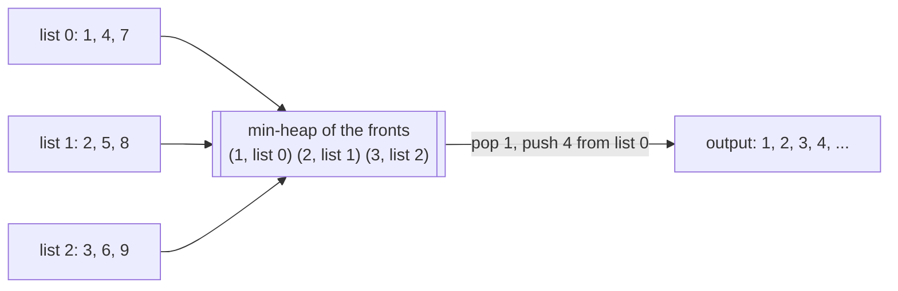

```python
import heapq


def merge_k_sorted(lists):
    heap = [(lst[0], i, 0) for i, lst in enumerate(lists) if lst]  # (value, list, position)
    heapq.heapify(heap)
    out = []
    while heap:
        value, i, j = heapq.heappop(heap)
        out.append(value)
        if j + 1 < len(lists[i]):
            heapq.heappush(heap, (lists[i][j + 1], i, j + 1))
    return out
```

For linked lists, push `(node.val, i, node)`: the list number `i` breaks ties between equal values,
so Python never has to compare two nodes.

### Regret greedy

Course Schedule III: each course has a duration and a last day; take as many as possible, one at a
time. Go through the courses by deadline and take every one. When the total time runs past the
current deadline, drop the **longest** course taken so far, using a max-heap. Dropping the longest
frees the most time for the same cost, one course.

| Next course (duration, last day) | Total if taken | Action | Taken |
|---|---|---|---|
| (5, 5) | 5 | fits | 5 |
| (4, 6) | 9, over 6 | drop the longest, the 5 | 4 |
| (2, 6) | 6 | fits | 4, 2 |

Skipping a course that doesn't fit would take only one course here; giving up the 5 makes room for
two.

```python
import heapq


def schedule_course(courses):
    taken, total = [], 0  # durations, negated for a max-heap
    for duration, last_day in sorted(courses, key=lambda c: c[1]):
        heapq.heappush(taken, -duration)
        total += duration
        if total > last_day:  # too late: give up the longest course
            total += heapq.heappop(taken)  # pops -longest, so this subtracts it
    return len(taken)
```

The clue for this "regret" pattern is a choice you can cheaply take back: accept everything, and
when a budget or deadline breaks, undo the worst choice so far.

### heapq mechanics

- **Max-heap:** push `-x`, and negate again when you pop.
- **Tuples** compare field by field, so put the priority first: `(priority, tie_breaker, item)`.
- **Ties:** Python compares numbers and strings, but not arbitrary objects. Two `ListNode`s with
  equal values make `heapq` compare the nodes themselves, which raises `TypeError`. Put a counter
  or index before the object, or give the class a `__lt__` method.
- **No decrease-key:** push the updated entry and skip stale ones when they're popped ("lazy
  deletion"), as [Dijkstra](#/algo/learn/patterns/weighted-edges-dijkstra) does.
- `queue.PriorityQueue` is the same heap wrapped in locks for threads: slower, and it can't peek.
  Use `heapq`.

**Cost:** O(log k) per push or pop on a heap of size k; O(n log k) for a stream of n items.

> **Pitfall.** Keeping the k largest with a max-heap of everything costs O(n) memory and
> O(n log n) time. The size-k min-heap is the point: its top is the k-th largest so far.

**Practice:** [Top K Frequent Elements](#/algo/problem/a14_top_k_frequent_elements), [Merge k Sorted Lists](#/algo/problem/a42_merge_k_sorted_lists), [Values in K Sorted Streams](#/algo/problem/a36_k_common_in_sorted_streams), [Course Schedule III](#/algo/problem/a13_course_schedule_iii)

## Graph traversal

**Signals:** "connected", "reachable", "a path between", islands, regions, provinces, networks,
cloning, dependencies; a grid where you move between neighbouring cells; any input where you can say
"these two things are neighbours". A tree is a graph without cycles.

Most graph problems are about **reachability**: which nodes can you get to, from where.
Depth-first search (DFS) answers it: follow an edge as far as you can, back up, try the next edge,
and mark nodes as seen so nothing is visited twice. It touches every node and edge once:
O(V + E) for V nodes and E edges.

### Building the graph

Graphs rarely arrive as graphs. Decide what the nodes and edges are, which way the edges point and
where the search starts: that is often the crux of the problem.

| Input | Nodes | Neighbours |
|---|---|---|
| An edge list `[[a, b], ...]` | the labels | build an adjacency list (below) |
| A grid | the cells `(r, c)` | the 4 cells around it, or 8 with diagonals |
| Words, states, board positions | each word or state | the ones a single move away |
| Prerequisites `[course, pre]` | the courses | an edge `pre → course` (or the reverse: pick one and say which) |

```python
from collections import defaultdict


def build_graph(edges, directed=False):
    graph = defaultdict(list)  # node -> list of neighbours
    for a, b in edges:
        graph[a].append(b)  # a -> b
        if not directed:
            graph[b].append(a)  # and b -> a
    return graph
```

```grid
_ _ _ _ _
_ D N D _
_ N C N _
_ D N D _
_ _ _ _ _
highlight: 1,2 2,1 2,3 3,2
dim: 1,1 1,3 3,1 3,3
caption: a grid is a graph: cell C's neighbours are the 4 N cells, plus the D cells with diagonals
```

```python
DIRS4 = [(1, 0), (-1, 0), (0, 1), (0, -1)]
DIRS8 = DIRS4 + [(1, 1), (1, -1), (-1, 1), (-1, -1)]


def neighbours(grid, r, c, dirs=DIRS4):
    for dr, dc in dirs:
        nr, nc = r + dr, c + dc
        if 0 <= nr < len(grid) and 0 <= nc < len(grid[0]):
            yield nr, nc
```

### Depth-first search

```python
def count_components(n, edges):
    graph = build_graph(edges)
    seen = set()

    def dfs(node):
        seen.add(node)  # mark before exploring, so cycles stop here
        for nxt in graph[node]:
            if nxt not in seen:
                dfs(nxt)

    components = 0
    for node in range(n):  # every node: some aren't reachable from 0
        if node not in seen:
            components += 1  # a new component starts here
            dfs(node)
    return components
```

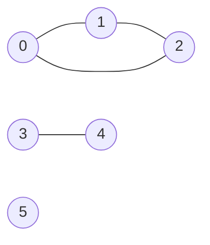

Each colour is one component of the undirected graph in
`count_components(6, [[0, 1], [1, 2], [0, 2], [3, 4]])`. The outer loop is what finds all three: a
single DFS from node 0 never sees 3, 4 or 5.

Clone Graph is the same walk with a map from each original node to its copy, which doubles as the
seen set. Create the copy **before** recursing into the neighbours, so that a cycle leading back
finds the copy instead of looping forever.

```python
class Node:
    def __init__(self, val=0, neighbors=None):
        self.val = val
        self.neighbors = neighbors if neighbors is not None else []


def clone_graph(node):
    copies = {}  # original -> copy; also the seen set

    def dfs(n):
        if n in copies:
            return copies[n]
        copy = Node(n.val)
        copies[n] = copy  # register first: cycles will find it
        copy.neighbors = [dfs(m) for m in n.neighbors]
        return copy

    return dfs(node) if node else None
```

Python allows about 1,000 nested calls by default. A DFS over a 300 × 300 grid can go 90,000 deep,
so use an explicit stack for big inputs (with `neighbours` from above):

```python
def flood_fill(grid, r, c):
    """The cells reachable from (r, c) through cells that hold 1."""
    seen = {(r, c)}
    stack = [(r, c)]
    while stack:
        r, c = stack.pop()
        for nr, nc in neighbours(grid, r, c):
            if grid[nr][nc] == 1 and (nr, nc) not in seen:
                seen.add((nr, nc))
                stack.append((nr, nc))
    return seen
```

### Trees are graphs too

A tree has no cycles, so it needs no seen set, and most tree problems are a DFS that **returns** a
value: solve both subtrees, then combine their answers.

```tree
values: 3 9 20 null null 15 7
highlight: 3 20 15
caption: depth(3) = 1 + max(depth(9), depth(20)) = 1 + max(1, 2) = 3
```

```python
def max_depth(root):
    if root is None:
        return 0  # an empty tree has depth 0
    return 1 + max(max_depth(root.left), max_depth(root.right))
```

When you handle a node relative to its children decides the order. On a binary search tree,
in-order visits the values in sorted order:

```tree
values: 4 2 6 1 3 5 7
caption: a binary search tree
```

| Order | Visit | Here | Use it to |
|---|---|---|---|
| Pre-order | node, left, right | 4 2 1 3 6 5 7 | copy or serialize a tree; pass information down |
| In-order | left, node, right | 1 2 3 4 5 6 7 | read a binary search tree in sorted order |
| Post-order | left, right, node | 1 3 2 5 7 6 4 | combine the children's answers: depth, size, deleting the tree |

Same Tree recurses on two trees at once (both empty: equal; one empty or different values: not
equal; otherwise compare both pairs of subtrees), and Invert Binary Tree swaps the two children at
every node. More in [tree traversals](#/algo/learn/data-structures/tree-traversals).

### Searching backwards from the goal

When there are many possible starts and only a few goals, start from the goals. Pacific Atlantic
Water Flow asks which cells of a height map can drain into both oceans, water flowing to neighbours
of equal or lower height. A search from every cell costs O((mn)²). Instead, climb **up** from each
ocean's edges, to neighbours of equal or greater height: one search per ocean, O(mn), and the answer
is the overlap.

```grid
1 2 2 3 5
3 2 3 4 4
2 4 5 3 1
6 7 1 4 5
5 1 1 2 4
highlight: 0,0 0,1 0,2 0,3 0,4 1,0 1,1 1,2 1,3 1,4 2,0 2,1 2,2 3,0 3,1 4,0
caption: reached climbing from the Pacific (the top and left edges)
---
1 2 2 3 5
3 2 3 4 4
2 4 5 3 1
6 7 1 4 5
5 1 1 2 4
highlight: 0,4 1,3 1,4 2,2 2,3 2,4 3,0 3,1 3,2 3,3 3,4 4,0 4,1 4,2 4,3 4,4
caption: reached climbing from the Atlantic (the bottom and right edges)
---
1 2 2 3 5
3 2 3 4 4
2 4 5 3 1
6 7 1 4 5
5 1 1 2 4
highlight: 0,4 1,3 1,4 2,2 3,0 3,1 4,0
caption: in both sets: these cells drain into both oceans
```

Putting every edge cell on the stack at the start makes it a **multi-source** search: one walk
instead of one per edge cell.

```python
def pacific_atlantic(heights):
    rows, cols = len(heights), len(heights[0])

    def climb(starts):
        seen, stack = set(starts), list(starts)
        while stack:
            r, c = stack.pop()
            for nr, nc in ((r + 1, c), (r - 1, c), (r, c + 1), (r, c - 1)):
                if (
                    0 <= nr < rows
                    and 0 <= nc < cols
                    and (nr, nc) not in seen
                    and heights[nr][nc] >= heights[r][c]
                ):
                    seen.add((nr, nc))
                    stack.append((nr, nc))
        return seen

    pacific = climb([(0, c) for c in range(cols)] + [(r, 0) for r in range(rows)])
    atlantic = climb([(rows - 1, c) for c in range(cols)] + [(r, cols - 1) for r in range(rows)])
    return [[r, c] for r, c in sorted(pacific & atlantic)]
```

### Union-find for connectivity

When edges arrive one at a time, between questions like "are a and b connected yet?", rerunning a
DFS costs O(V + E) per question. [Union-find](#/algo/learn/data-structures/union-find) keeps one
parent pointer per node: each group is a tree whose root represents it.

```python
class UnionFind:
    def __init__(self, n):
        self.parent = list(range(n))  # every node starts as its own group

    def find(self, x):
        while self.parent[x] != x:
            self.parent[x] = self.parent[self.parent[x]]  # path halving: shortcut as we climb
            x = self.parent[x]
        return x

    def union(self, a, b):
        ra, rb = self.find(a), self.find(b)
        if ra == rb:
            return False  # already connected: this edge closes a cycle
        self.parent[ra] = rb
        return True
```

With union by size as well (hang the smaller tree under the larger root), each operation is
effectively O(1). Union-find can't remove edges or report paths, and it only models undirected
connectivity.

| You need | Use |
|---|---|
| Can I reach it? All the components? A flood fill | DFS (or BFS) |
| The fewest steps in an unweighted graph; levels | [BFS](#/algo/learn/patterns/bfs-by-levels-and-shortest-paths) |
| The cheapest path when edges have costs | [Dijkstra](#/algo/learn/patterns/weighted-edges-dijkstra), BFS with a heap |
| An order that respects dependencies; a directed cycle | [Topological sort](#/algo/learn/patterns/topological-sort-and-cycles) |
| Connectivity while edges keep arriving | Union-find |

**Cost:** O(V + E) time, and O(V) for the seen set and the stack. A grid has V = rows × cols and
at most 4V edges.

> **Pitfall.** No seen set (an infinite loop on the first cycle); marking a node only after
> exploring it (it gets visited many times); edges pointing the wrong way; and no outer loop over
> all nodes when the graph can be disconnected.

**Practice:** [Clone Graph](#/algo/problem/a10_clone_graph), [Pacific Atlantic Water Flow](#/algo/problem/a21_pacific_atlantic_water_flow), [Maximum Depth of Binary Tree](#/algo/problem/a22_maximum_depth_of_binary_tree), [Same Tree](#/algo/problem/a23_same_tree), [Invert Binary Tree](#/algo/problem/a24_invert_binary_tree), [Course Schedule](#/algo/problem/a12_course_schedule)

## BFS by levels and shortest paths

**Signals:** "the minimum number of steps, moves or jumps"; the shortest path in an unweighted
graph or grid; the nearest something; "level by level", depth, "the minimum depth"; something that
spreads one step per minute (rotting fruit, fire).

Breadth-first search (BFS) explores in rings: everything 1 step from the start, then everything 2
steps away, and so on. So the first time it reaches a node, it got there with the fewest possible
edges. DFS can't promise that: it might reach a node down a long path first.

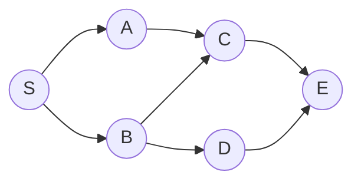

The colours are the rings: S (blue) is level 0, A and B (green) level 1, C and D (amber) level 2,
and E (purple) level 3. C is reached from both A and B, but it must join the queue only once.

### Level by level

Keep the current level in a list, build the next level from its neighbours, then swap. The number of
swaps is the depth.

```python
def bfs_levels(start, neighbours):
    seen = {start}
    level, levels = [start], []
    while level:
        levels.append(level)  # every node here is len(levels) - 1 steps away
        next_level = []
        for node in level:
            for nxt in neighbours(node):
                if nxt not in seen:
                    seen.add(nxt)  # mark when queued, not when processed
                    next_level.append(nxt)
        level = next_level
    return levels
```

Binary Tree Level Order Traversal is this loop with the children as neighbours. A tree needs no seen
set.

```tree
values: 3 9 20 null null 15 7
highlight: 3
caption: level 0: [3]
---
values: 3 9 20 null null 15 7
highlight: 9 20
caption: level 1: [9, 20]
---
values: 3 9 20 null null 15 7
highlight: 15 7
caption: level 2: [15, 7]
```

```python
def level_order(root):
    out, level = [], [root] if root else []
    while level:
        out.append([node.val for node in level])
        level = [child for node in level for child in (node.left, node.right) if child]
    return out
```

The maximum depth is the number of levels, and the minimum depth can stop at the first level that
contains a leaf, which a DFS can't do.

### Shortest paths in grids

With a queue and a map of distances, BFS gives the shortest distance to every reachable cell. Use
`collections.deque`: `list.pop(0)` is O(n). Shortest Path in Binary Matrix moves in 8 directions
through cells that hold 0, and counts the cells on the path:

```grid
0 0 0 1 0
1 1 0 1 0
0 0 1 0 0
0 1 0 1 1
0 0 0 0 0
dim: 0,3 1,0 1,1 1,3 2,2 3,1 3,3 3,4
caption: 0 is open, 1 is a wall (dimmed)
---
1 2 3 # 6
# # 3 # 5
5 4 # 4 5
5 # 5 # #
6 6 6 6 7
path: 0,0 0,1 1,2 2,1 3,2 4,3 4,4
caption: the BFS distance of every open cell, and one shortest path: 7 cells
```

```python
from collections import deque


def shortest_path_binary_matrix(grid):
    n = len(grid)
    if grid[0][0] or grid[n - 1][n - 1]:
        return -1
    dist = {(0, 0): 1}  # cells on the path so far, the start included
    queue = deque([(0, 0)])
    while queue:
        r, c = queue.popleft()
        if (r, c) == (n - 1, n - 1):
            return dist[(r, c)]
        for dr in (-1, 0, 1):
            for dc in (-1, 0, 1):
                nr, nc = r + dr, c + dc
                if 0 <= nr < n and 0 <= nc < n and grid[nr][nc] == 0 and (nr, nc) not in dist:
                    dist[(nr, nc)] = dist[(r, c)] + 1  # the first visit is the shortest
                    queue.append((nr, nc))
    return -1
```

To return the path itself, store `parent[(nr, nc)] = (r, c)` when a cell is queued, and walk the
parents back from the goal. To start from many places at once (every rotten fruit, every exit), put
them all in the first level: a **multi-source** BFS.

### Weighted edges: Dijkstra

BFS counts edges. When edges have different non-negative costs, replace the queue with a min-heap
ordered by the distance so far: Dijkstra's algorithm. The first time a node is popped, its distance
is final.

```python
import heapq


def dijkstra(graph, start):  # graph[u] = [(v, cost), ...]; costs >= 0
    dist = {start: 0}
    heap = [(0, start)]
    while heap:
        d, u = heapq.heappop(heap)
        if d > dist[u]:
            continue  # a stale entry: u was settled more cheaply
        for v, cost in graph[u]:
            if d + cost < dist.get(v, float("inf")):
                dist[v] = d + cost
                heapq.heappush(heap, (d + cost, v))
    return dist
```

| | BFS | DFS |
|---|---|---|
| Visits | by distance from the start | as deep as possible, then backs up |
| Shortest path, unweighted | yes: the first arrival | no |
| Memory | the widest level | the deepest path |
| Natural for | levels, the nearest, the fewest moves | reachability, components, cycles, recursion on trees |

**Cost:** O(V + E) for BFS, O(rows × cols) on a grid; O((V + E) log V) for Dijkstra.

> **Pitfall.** Mark a node seen when you **queue** it, not when you take it out. Otherwise a node on
> the next level is queued once by every neighbour on the current level (C above, twice), and on a
> grid the queue can blow up.

**Practice:** [Binary Tree Level Order Traversal](#/algo/problem/a25_binary_tree_level_order_traversal), [Shortest Path in Binary Matrix](#/algo/problem/a35_shortest_path_in_binary_matrix), [Maximum Depth of Binary Tree](#/algo/problem/a22_maximum_depth_of_binary_tree)

## Topological sort and cycles

**Signals:** prerequisites; dependencies; "in what order can we build, install or take...";
"is it possible to finish everything"; detecting a cycle in a **directed** graph.

A topological order lists every node before the nodes that depend on it. One exists exactly when the
directed graph has no cycle: in a cycle, each node waits for another, forever.

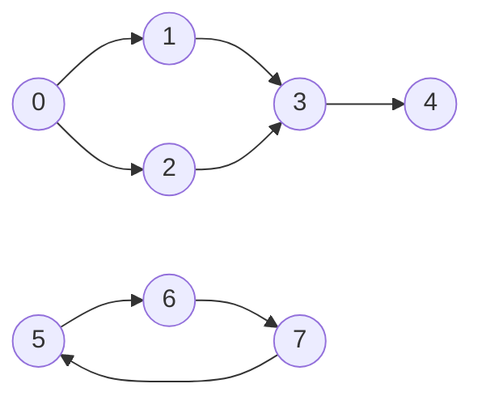

An edge 0 → 1 means "take 0 before 1". Courses 0 to 4 can be ordered (0 1 2 3 4, or 0 2 1 3 4);
courses 5, 6 and 7 wait for each other, so no order exists for them.

### Kahn's algorithm

Count each node's incoming edges, its **in-degree**: the prerequisites it is still waiting for.
Queue every node with none. Repeatedly take one, output it, and decrement the in-degree of every
node that depends on it; a node whose count reaches 0 is ready. Nodes that are never output sit on
a cycle.

```array
label: in-degree
values: 0 1 1 2 1
highlight: 0
caption: courses 0 to 4 above: only course 0 has no prerequisites, so it's ready
---
label: in-degree
values: 0 0 0 2 1
dim: 0
highlight: 1 2
caption: take 0: courses 1 and 2 lose their only prerequisite and become ready
---
label: in-degree
values: 0 0 0 0 1
dim: 0..2
highlight: 3
caption: take 1, then 2: course 3 drops to 0
---
label: in-degree
values: 0 0 0 0 0
dim: 0..3
highlight: 4
caption: take 3, then 4. Order: 0 1 2 3 4, with every course placed: no cycle
```

```python
from collections import deque


def find_order(num_courses, prerequisites):
    graph = [[] for _ in range(num_courses)]
    indegree = [0] * num_courses
    for course, pre in prerequisites:  # [course, pre]: pre comes first
        graph[pre].append(course)
        indegree[course] += 1
    ready = deque(c for c in range(num_courses) if indegree[c] == 0)
    order = []
    while ready:
        c = ready.popleft()
        order.append(c)
        for nxt in graph[c]:
            indegree[nxt] -= 1  # one prerequisite of nxt is done
            if indegree[nxt] == 0:
                ready.append(nxt)
    return order if len(order) == num_courses else []  # leftovers sit on a cycle


def can_finish(num_courses, prerequisites):
    return len(find_order(num_courses, prerequisites)) == num_courses
```

### DFS with three states

DFS finds cycles too, but in a directed graph "I've seen this node before" doesn't mean a cycle: in
the diamond below, D is reached twice and there's no cycle. What matters is whether the node is on
the **current path**. So each node has three states: unvisited, **visiting** (on the current path)
and **done** (fully explored). An edge into a visiting node closes a cycle.

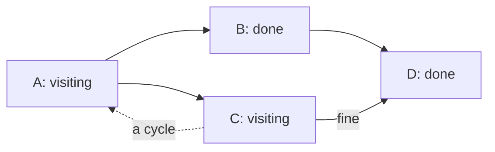

The DFS went A → B → D, finished D and B, and is now on the path A → C. The edge C → D reaches a
finished node, which is fine; an edge C → A (dotted) would reach a node still on the path, which is
a cycle.

```python
def has_directed_cycle(n, graph):  # graph[u]: the v with an edge u -> v
    UNVISITED, VISITING, DONE = 0, 1, 2
    state = [UNVISITED] * n

    def dfs(u):
        state[u] = VISITING  # on the current path
        for v in graph[u]:
            if state[v] == VISITING:
                return True  # back into the current path: a cycle
            if state[v] == UNVISITED and dfs(v):
                return True
        state[u] = DONE  # finished: safe to reach again
        return False

    return any(state[u] == UNVISITED and dfs(u) for u in range(n))
```

Appending each node to a list as it becomes done (post-order) gives a topological order, backwards:
reverse the list when edges point from prerequisite to course, or use it as it is when they point
from course to prerequisite.

### Cycles in undirected graphs

In an undirected graph every edge leads straight back to where you came from, so "reached a seen
node" needs one exception: the parent you just came from. A cycle exists when DFS reaches a seen node
that isn't its parent. Or use [union-find](#/algo/learn/patterns/union-find-for-connectivity): an
edge whose two ends already share a root closes a cycle.

**Cost:** O(V + E) time and space for both methods.

> **Pitfall.** A topological order gives *an* order, not who depends on whom: x appearing before y
> doesn't make x a prerequisite of y, since they may be unrelated. To answer "is x a prerequisite
> of y?", search from y along the prerequisite edges, or precompute reachability when there are many
> such questions.

**Practice:** [Course Schedule](#/algo/problem/a12_course_schedule)

## Backtracking

**Signals:** "return all", "generate every", "list all the ways"; combinations, permutations,
subsets, partitions; placing pieces on a board (N-Queens, Sudoku); finding a word in a grid; small
inputs, n up to about 10 to 20, because the output itself is exponential.

Build a candidate one choice at a time. After each choice, recurse to make the next one; when the
recursion returns, **undo** the choice and try the next. It's a DFS over the tree of partial
candidates. Unlike [dynamic programming](#/algo/learn/dynamic-programming) there's no memo and no
value to combine: the goal is every path, not a count or a best.

### Subsets, combinations and permutations

Problems differ in when a path is recorded, and in how the choices at each step are generated:

| Want | Does order matter? | Choices at each step | Record when | How many |
|---|---|---|---|---|
| Subsets | no | the elements after the last one chosen: a `start` index, recurse with `i + 1` | at every call | 2ⁿ |
| Combinations of size k | no | as for subsets | the path has k elements | C(n, k) |
| Combination sum, reuse allowed | no | the last one chosen and those after it: recurse with `i` | the remaining target is 0 | |
| Permutations | yes | every element not used yet | all n are used | n! |
| Filling a board | | the options for the next empty cell | the board is full | |

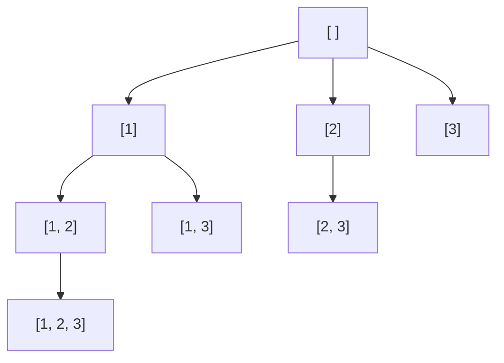

The subsets of [1, 2, 3]: every node of the tree is one subset, 2³ = 8 in all. Because the choices
only move forward from `start`, [2, 1] is never generated as a copy of [1, 2].

```python
def subsets(nums):
    out, path = [], []

    def backtrack(start):
        out.append(path[:])  # every node is a subset: record a copy
        for i in range(start, len(nums)):
            path.append(nums[i])  # choose
            backtrack(i + 1)  # explore: only later elements
            path.pop()  # un-choose

    backtrack(0)
    return out
```

```python
def permutations(nums):
    out, path, used = [], [], [False] * len(nums)

    def backtrack():
        if len(path) == len(nums):
            out.append(path[:])
            return
        for i, x in enumerate(nums):  # order matters: try every unused element
            if not used[i]:
                used[i] = True
                path.append(x)
                backtrack()
                path.pop()
                used[i] = False

    backtrack()
    return out
```

### Pruning

Check validity **before** recursing, so a whole subtree is skipped at once. Combination sum with
candidates [2, 3, 6, 7] and target 7, sorted so that the loop can stop at the first candidate
that's too big:

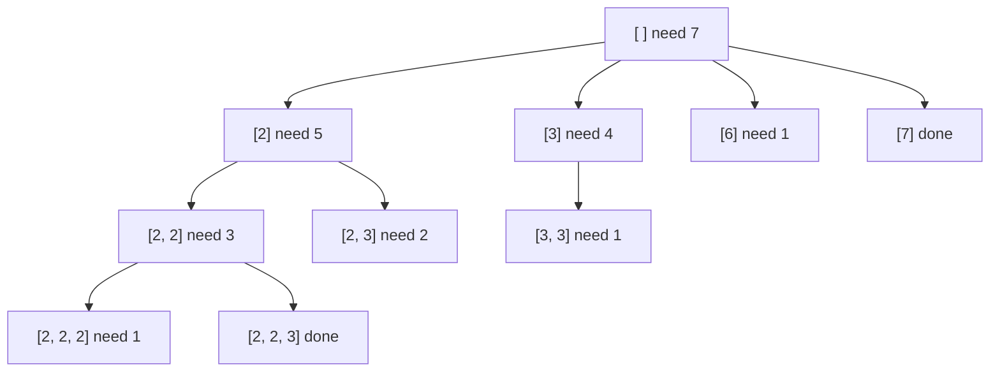

Grey nodes are dead ends: every candidate they may still use is bigger than what's needed, so their
loops stop at once. There's no [3, 2] branch: the choices never go back to smaller candidates, so
each combination appears once.

```python
def combination_sum(candidates, target):
    candidates = sorted(candidates)
    out, path = [], []

    def backtrack(start, remaining):
        if remaining == 0:
            out.append(path[:])
            return
        for i in range(start, len(candidates)):
            c = candidates[i]
            if c > remaining:
                break  # sorted: every later candidate is too big too
            path.append(c)
            backtrack(i, remaining - c)  # i, not i + 1: c may be used again
            path.pop()

    backtrack(0, target)
    return out
```

When the input has duplicates and each element may be used once, sort it and skip
`nums[i] == nums[i - 1]` when `i > start`, so the same value isn't tried twice at one level.

> **Key idea.** If the question changes from "list them all" to "how many" or "which is best", and
> the same remaining subproblem comes up along different paths, add a memo: backtracking becomes
> [dynamic programming](#/algo/learn/dynamic-programming/top-down-helper-plus-memo). Shopping Offers
> searches over which offer to buy next, and only becomes fast once the remaining needs are the memo
> key. Permutation Sum counts the sequences that a backtracking search would list.

**Cost:** (the number of nodes in the tree) × (the work per node): O(n · 2ⁿ) for subsets and
O(n · n!) for permutations, because each recorded path is copied in O(n). The recursion is as deep
as the longest path.

> **Pitfall.** `results.append(path)` instead of `path[:]` stores the same list every time, and it
> ends up empty. Forgetting to undo a choice (`path.pop()`, `used[i] = False`) leaks one branch's
> choices into the next.

**Practice:** [Shopping Offers](#/algo/problem/a44_shopping_offers), and [Permutation Sum](#/algo/problem/a20_permutation_sum) for the step from listing to counting

## Greedy

**Signals:** "the maximum number of non-overlapping...", "the minimum number to remove or add",
scheduling, "can you reach the end"; one number carries forward (the furthest reach, the earliest
end, the lowest price); sorting the input reveals an obvious order to commit to.

A greedy algorithm makes the choice that looks best right now, commits to it and never looks back:
usually O(n), or O(n log n) after a sort, with no table.
[Dynamic programming](#/algo/learn/dynamic-programming) tries every choice and keeps the best, which
is slower but always correct when the recurrence is. Greedy is only right when the local choice
provably never hurts, so the interview work is the argument, not the code.

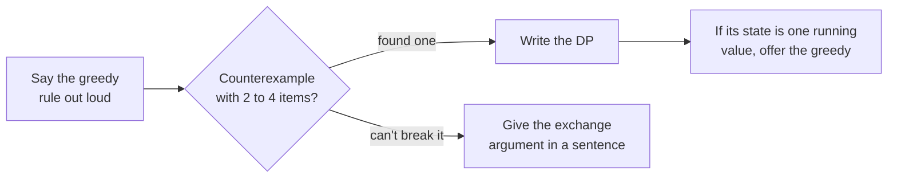

### Proving it: the exchange argument

Take any optimal solution that differs from the greedy one, and look at the first choice where they
differ. Swap the optimal solution's choice for the greedy one, and show that the result is still
valid and no worse. Repeat, and the optimal solution turns into the greedy one without ever getting
worse, so greedy is optimal too.

Interval scheduling keeps the most non-overlapping intervals (Non-overlapping Intervals counts the
rest as removals). Greedy keeps the interval that **ends first**:

```intervals
input: [1,3] [2,5] [6,8] [7,10] [9,12]
an optimal: [2,5] [6,8] [9,12]
greedy: [1,3] [6,8] [9,12]
caption: [1,3] ends before [2,5], so swapping it in can't overlap anything that came after
```

In words: "greedy's first interval ends no later than the optimal's first interval, so everything
after the optimal's first interval still fits after greedy's. The count is the same and it's still
valid." That's the whole proof, and a sentence or two is what an interviewer wants.

### Rules that work, and rules that fail

| Problem | Greedy rule | Why it's safe |
|---|---|---|
| Non-overlapping Intervals | keep the interval that ends first | it leaves the most room (the exchange argument above) |
| Jump Game | track the furthest reachable index | every index up to the reach is reachable, so one number is the whole state |
| Best Time to Buy and Sell Stock | buy at the lowest price so far | for a fixed sell day, the cheapest earlier day is the best buy |
| Course Schedule III | by deadline; when late, drop the longest course | dropping the longest frees the most time for the same loss of one course |
| Merge Intervals | sort by start, extend the last interval | after sorting, an interval can only overlap the last merged one |

| Problem | Tempting rule | Counterexample |
|---|---|---|
| Coin Change | the biggest coin first | coins [1, 3, 4], amount 6: greedy pays 4 + 1 + 1, but 3 + 3 is two coins |
| Jump Game | always jump as far as possible | [3, 0, 5, 0, 0, 0]: the longest first jump lands on a 0 and is stuck; jumping to the 5 works |
| House Robber | rob every other house | [2, 1, 1, 2]: the even or the odd houses give 3, houses 0 and 3 give 4 |
| 0/1 knapsack | the best value per kilo first | capacity 10; items of 6 kg ($30), 5 kg ($20) and 5 kg ($20): the ratio takes $30, the two 5 kg items make $40 |
| Interval scheduling | the earliest start, or the shortest interval | earliest start: [1,10] [2,3] [4,5] keeps one, not two. Shortest: [1,5] [4,7] [6,10] keeps [4,7] alone |

The coin counterexample, and how DP fixes it, is worked through in
[greedy or DP](#/algo/learn/dynamic-programming/greedy-or-dp).

**Cost:** usually O(n log n) for the sort plus an O(n) pass, with O(1) extra space.

> **Interview tip.** Say the rule, then try to break it with two or three items before writing
> code. If you can't break it, give the exchange argument in a sentence. If you wrote DP first,
> check whether its state collapses to one running best value: Jump Game's `reach` is the classic
> case, and offering that upgrade is a strong finish.

**Practice:** [Jump Game](#/algo/problem/a39_jump_game), [Non-overlapping Intervals](#/algo/problem/a17_non_overlapping_intervals), [Course Schedule III](#/algo/problem/a13_course_schedule_iii), [Best Time to Buy and Sell Stock](#/algo/problem/a03_best_time_to_buy_and_sell_stock), [Merge Intervals](#/algo/problem/a16_merge_intervals)
