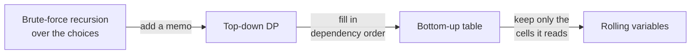
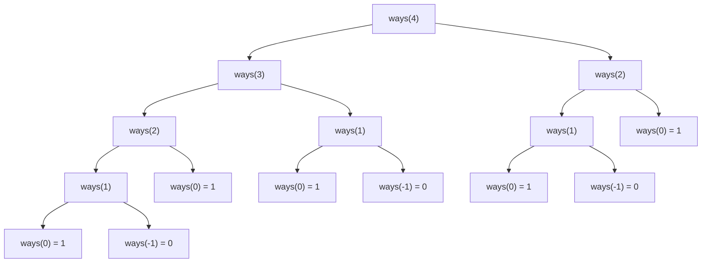
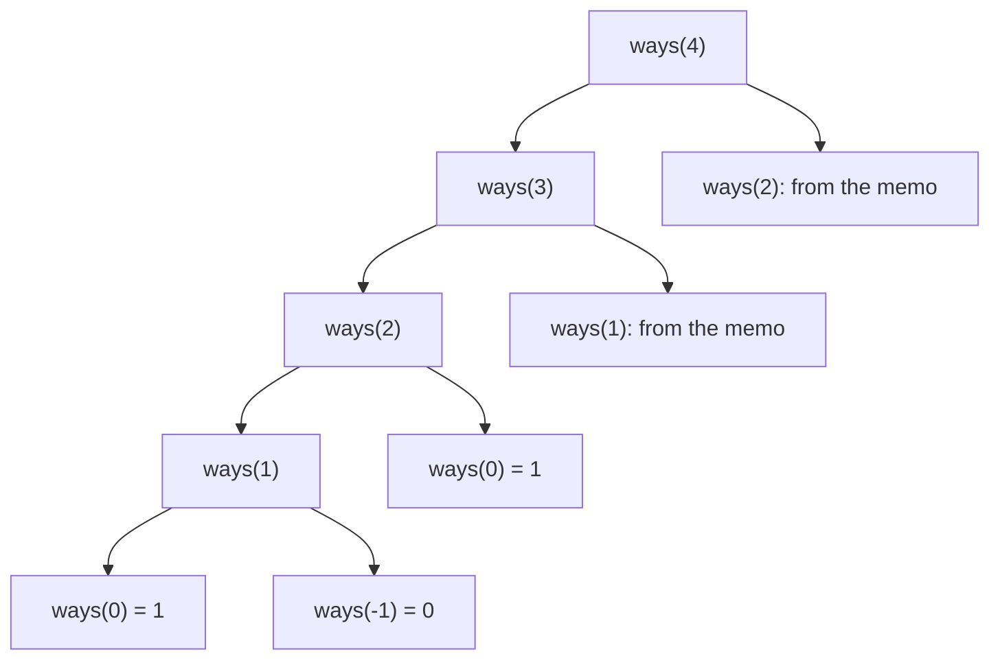
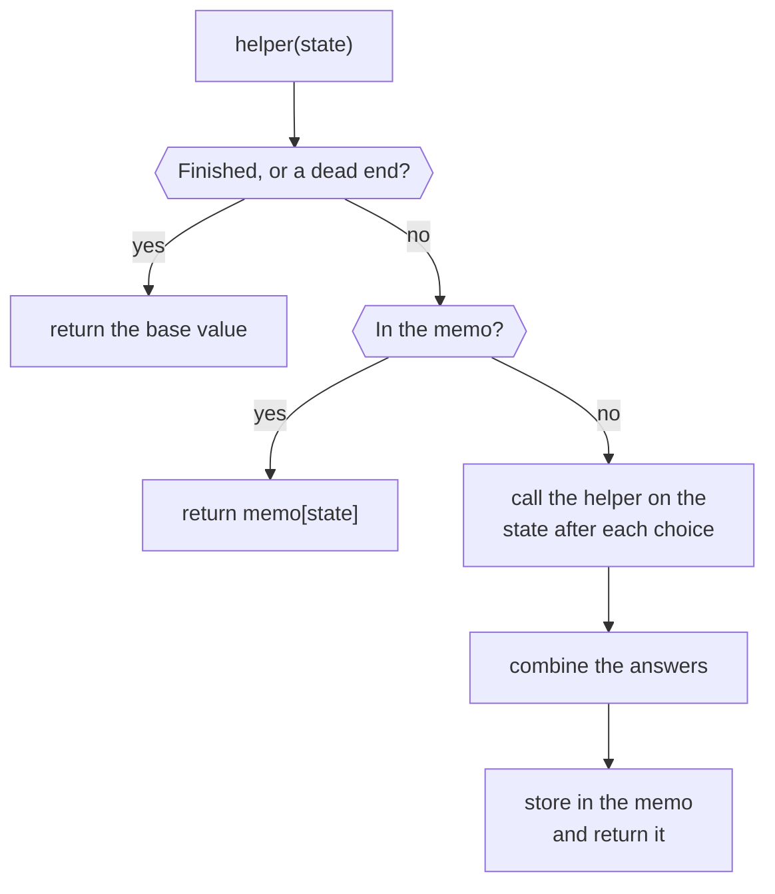
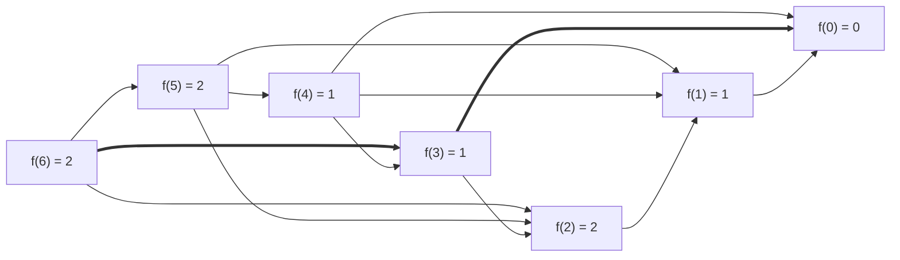
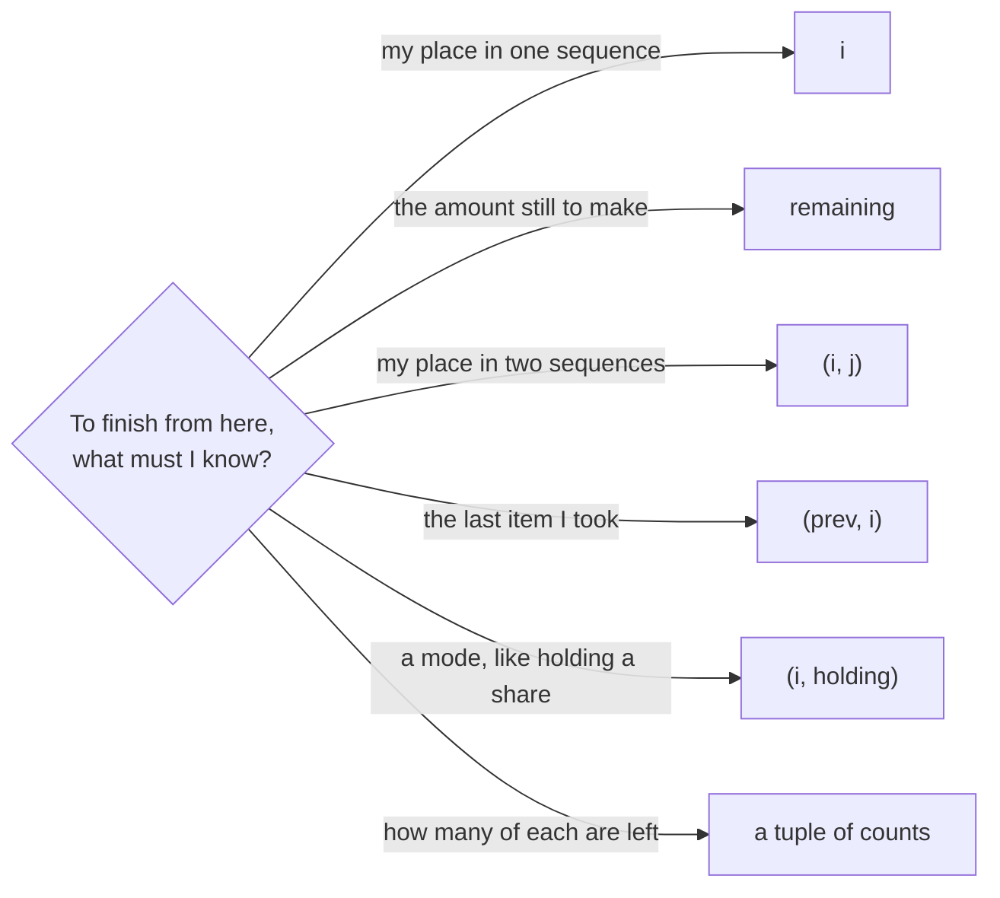
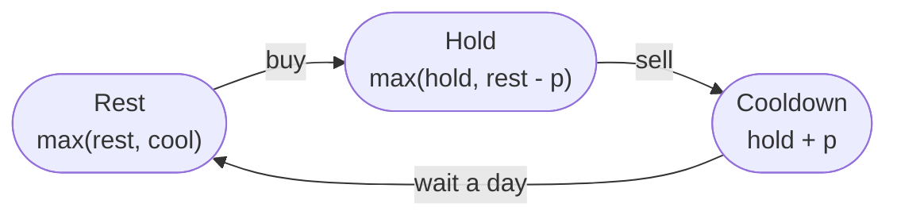
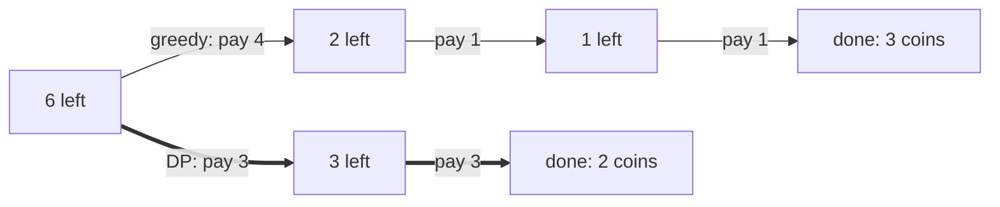

# Dynamic programming

Spot overlapping subproblems, memoize the recursion, then turn it into a table. One template covers the classic shapes.

Every solution on this page is built the same way. Write the recursion that tries every choice,
notice that it solves the same subproblems again and again, and store each answer the first time.
A table and rolling variables are optional optimizations of that same recursion.



## When to use DP

**Signals:** the question asks for a **count** ("how many ways"), an **optimum** ("the fewest
coins", "the most money", "the longest subsequence") or **feasibility** ("can it be split", "can
you reach the end"); each step offers a choice, and earlier choices change what later ones can do,
so no simple rule decides; the obvious recursion is exponential and keeps meeting the same
subproblem.

Two properties make dynamic programming (DP) work:

- **Optimal substructure:** the answer is built from answers to smaller problems of the same kind.
  The fewest coins for 6 is one coin plus the fewest coins for what's left.
- **Overlapping subproblems:** the same smaller problem comes up again and again, along different
  paths. Without overlap a memo saves nothing, and plain recursion is already the answer.

| The recursion | Subproblems repeat? | Technique |
|---|---|---|
| lists every solution | maybe, but the output is exponential anyway | [backtracking](#/algo/learn/patterns/backtracking) |
| splits into independent halves and combines them | no | divide and conquer, like merge sort |
| combines the answers of overlapping subproblems | yes | dynamic programming |
| makes one choice per step and never reconsiders | | [greedy](#/algo/learn/patterns/greedy) |

### Recursion and the call tree

Climbing Stairs: climbing 1 or 2 steps at a time, how many ways are there to climb n steps? The
last move is either 1 step or 2 steps, so `ways(n) = ways(n - 1) + ways(n - 2)`, with two base
cases: `ways(0) = 1` (one way to climb nothing: stop) and `ways(-1) = 0` (an overshoot). The call
tree for n = 4:



The amber subtrees repeat work that was already done on the left: `ways(2)` is solved twice and
`ways(1)` three times. Each call makes two more, so the tree grows like the Fibonacci numbers,
about 1.6ⁿ calls: for n = 50, some 66 billion calls to answer only 51 different questions,
`ways(0)` to `ways(50)`. How to count the nodes of a call tree is covered in
[recursion](#/algo/learn/complexity/recursion).

### What the memo saves

Store each answer in a dictionary the first time it's computed, keyed by the arguments, and look
it up before computing anything. Every repeated subtree collapses into a single lookup:



Nine calls instead of fifteen, and the gap grows fast: with the memo, `ways(n)` makes 2n + 1
calls, O(n) instead of O(1.6ⁿ).

> **Key idea.** Dynamic programming is recursion that never solves the same subproblem twice.
> Write the brute-force recursion over the choices, check that its subproblems repeat, and add a
> memo. Everything else on this page is that idea in different shapes.

## Top-down: helper plus memo

Top-down DP is the brute-force recursion with a memo added. Nest the recursive **helper** inside
the main function: it can see the input and the memo, so its arguments are only the **state**,
what is left to decide. Six steps, in the same order every time:

1. **State:** the helper's arguments. For Climbing Stairs, the number of steps still to climb.
2. **Base cases:** where the recursion stops, either finished (no steps left: 1 way) or a dead end
   (an overshoot: 0 ways).
3. **Memo check:** if this state was solved before, return the stored answer.
4. **Choices:** what can be done from here. Climb 1 step, or 2.
5. **Combine:** turn the choices' answers into this state's answer. Counting ways: add them.
6. **Store:** save the answer in the memo, then return it.

### The template

```python
def climb_stairs(n):
    memo = {}

    def ways(left):  # state: the steps still to climb
        if left == 0:  # base case: finished, one way
            return 1
        if left < 0:  # base case: overshot, no ways
            return 0
        if left in memo:  # memo check
            return memo[left]
        result = ways(left - 1) + ways(left - 2)  # choices: 1 or 2 steps; combine: add
        memo[left] = result  # store, then return
        return result

    return ways(n)
```



Checking the base cases before the memo keeps the memo small: it only ever holds real states,
never an overshoot like -1.

The standard library can keep the memo for you. `@functools.cache` (or `@lru_cache(maxsize=None)`
before Python 3.9) remembers every call's result, keyed by the arguments:

```python
from functools import cache


def climb_stairs(n):
    @cache
    def ways(left):
        if left < 0:
            return 0
        if left == 0:
            return 1
        return ways(left - 1) + ways(left - 2)

    return ways(n)
```

The arguments must be hashable, so pass tuples, not lists. In an interview, write the explicit
dictionary at least once so the memo is visible, then mention the decorator.

### Count, optimize, or decide

DP questions come in three kinds, and the kind decides how the choices combine and what the base
cases return:

| Question | Combine the choices with | Finished | Dead end | Examples |
|---|---|---|---|---|
| How many ways? | `+` | 1 | 0 | Climbing Stairs, Decode Ways, Permutation Sum |
| The fewest, most, cheapest, longest? | `min` or `max`, adding the cost of the choice | 0 | `inf` for a min, `-inf` for a max | Coin Change, House Robber, Longest Common Subsequence, Shopping Offers |
| Is it possible? | `or`, written with `any` | `True` | `False` | Word Break, Jump Game |

Coin Change asks for the fewest coins that add up to `amount`, or -1 if no combination does:

```python
def coin_change(coins, amount):
    memo = {}

    def fewest(remaining):  # coins needed to pay `remaining`
        if remaining == 0:
            return 0  # finished: no more coins
        if remaining < 0:
            return float("inf")  # overpaid: a dead end
        if remaining in memo:
            return memo[remaining]
        best = float("inf")
        for c in coins:  # choice: which coin to pay next
            best = min(best, 1 + fewest(remaining - c))
        memo[remaining] = best
        return best

    answer = fewest(amount)
    return -1 if answer == float("inf") else answer
```

Infinity means "impossible" inside the recursion: `min` ignores it for free, and `1 + inf` is
still infinity. Only the outer function translates it into the -1 that the problem wants. Using
-1 inside the recursion would need a special case at every `min`.

Word Break asks whether a string can be split into words from a dictionary:

```python
def word_break(s, word_dict):
    words = set(word_dict)
    memo = {}

    def can(i):  # can s[i:] be split into words?
        if i == len(s):
            return True  # nothing left: done
        if i in memo:
            return memo[i]
        memo[i] = any(s[i:j] in words and can(j) for j in range(i + 1, len(s) + 1))
        return memo[i]

    return can(0)
```

Key the memo by the index `i`, not by the remaining string `s[i:]`: the index is the same state,
but it's O(1) to hash instead of O(n).

### Cost: states times work

A memoized recursion costs **(the number of distinct states) × (the work per state)**, where the
work per state counts the loop over the choices but not the recursive calls: after the first time,
each of those is a lookup. Space is the memo plus the depth of the recursion.

| Problem | State | States | Work per state | Time |
|---|---|---|---|---|
| Climbing Stairs | steps left | n | O(1) | O(n) |
| House Robber | the next house | n | O(1) | O(n) |
| Coin Change | the amount left | amount | O(coins) | O(amount × coins) |
| Word Break | the start index | n | O(n) end points, each slice O(n) | O(n³) |
| Longest Common Subsequence | (i, j) | m × n | O(1) | O(mn) |
| Longest Increasing Subsequence | (prev, i) | n² | O(1) | O(n²) |

Drawn as a graph instead of a tree, the subproblems form a DAG: one node per state and one edge per
choice. For Coin Change with coins 1, 3 and 4 and amount 6, the memo computes each of the 7 nodes
once and follows each of the 13 edges once:



`f(a)` is the fewest coins for amount a, and each edge pays one coin. The thick path is the
answer: 3 + 3, two coins.

The recursion depth counts as space too ([space complexity](#/algo/learn/complexity/space-complexity)).
Python stops at about 1,000 nested calls with a `RecursionError`, and `climb_stairs(5000)` recurses
5,000 deep. `sys.setrecursionlimit(10_000)` helps for moderate depths; beyond that, go bottom-up,
which doesn't recurse at all.

> **Interview tip.** Say the recurrence in one line before coding: "fewest(r) is 1 plus the
> minimum of fewest(r - c) over the coins c, and fewest(0) is 0." Then give the cost as states
> times work: "amount states, each trying every coin: O(amount × coins)."

**Practice:** [Climbing Stairs](#/algo/problem/a04_climbing_stairs), [Coin Change (min coins)](#/algo/problem/a05_coin_change), [Word Break](#/algo/problem/a19_word_break), [Permutation Sum](#/algo/problem/a20_permutation_sum), [Shopping Offers](#/algo/problem/a44_shopping_offers)

## Choosing the memo key

The memo key is the state: **the smallest set of values that fully determines the answer to
what's left**. With too little, two different situations share a memo entry and one of them gets
the wrong answer. With too much (the path so far, a copy of the list), no two calls ever share a
key, and the memo never saves anything.



### Common key shapes

| Key | The helper answers | Examples |
|---|---|---|
| `i` | the best for the rest of the sequence, from index i | Climbing Stairs, House Robber, Decode Ways, Word Break |
| `remaining` | the best for the amount still to make | Coin Change, Permutation Sum |
| `(i, remaining)` | the same, using only the items from index i on | Coin Change II, 0/1 knapsack |
| `(i, j)` | the best for two sequences from positions i and j, or for one sequence between i and j | Longest Common Subsequence, edit distance, palindromes |
| `(prev, i)` | the best from index i on, given the last item taken | Longest Increasing Subsequence |
| `(i, holding)` | the best from day i on, in a given mode | stock trading with a cooldown or a fee |
| a tuple of counts | the cheapest way to buy what's still needed | Shopping Offers |
| a bitmask | the best given which of up to 20 items are used | assigning tasks to people, visiting every city |

Leave out anything the future doesn't depend on. Coin Change needs the amount left, not the coins
paid so far: whether you reached "3 left" by paying 3 or by paying 1 + 1 + 1, the fewest coins to
finish is the same. That is exactly why the memo pays off, since many paths reach the same amount.

### When the position isn't enough

Longest Increasing Subsequence asks for the length of the longest strictly increasing subsequence
(not necessarily contiguous). With the key `i` alone, the helper can't tell whether `nums[i]` may
be taken: that depends on the last number taken before it. Two calls at the same position can need
different answers:

```array
label: nums
values: 1 5 2 3
pointers: prev=1 i=3
highlight: 0 1
dim: 2
caption: took 1 and 5, skipped 2: 3 can't follow 5, so best(prev=1, i=3) = 0
---
label: nums
values: 1 5 2 3
pointers: prev=2 i=3
highlight: 0 2
dim: 1
caption: took 1 and 2, skipped 5: 3 can follow 2, so best(prev=2, i=3) = 1
```

So the key is `(prev, i)`, the index of the last number taken (-1 for none) and the next index to
consider:

```python
def length_of_lis(nums):
    memo = {}

    def best(prev, i):  # longest increasing run in nums[i:] after nums[prev]
        if i == len(nums):
            return 0
        if (prev, i) in memo:
            return memo[(prev, i)]
        result = best(prev, i + 1)  # skip nums[i]
        if prev == -1 or nums[prev] < nums[i]:
            result = max(result, 1 + best(i, i + 1))  # take nums[i]
        memo[(prev, i)] = result
        return result

    return best(-1, 0)
```

About n² states of O(1) work each: O(n²). The
[bottom-up version and an O(n log n) one](#/algo/learn/dynamic-programming/longest-increasing-subsequence)
come later.

Other ways the state needs more than a position:

- **A constraint between the ends.** House Robber II puts the houses in a circle, so the first and
  last are neighbours, and whether house 0 was robbed matters at the very end. Rather than adding
  that to the key, split into two cases: rob among houses 0 to n - 2, or among 1 to n - 1, and take
  the better. Each run needs its own fresh memo.
- **Order that mustn't matter.** Counting the combinations of coins that make an amount, with
  `remaining` alone as the key, counts 1 + 2 and 2 + 1 separately. Adding the index of the coins
  still allowed, `(i, remaining)`, counts each combination once
  ([details](#/algo/learn/dynamic-programming/combinations-or-permutations)).
- **Too much state.** Passing the path so far, a set of used items or a slice `nums[i:]` makes
  every key different (or expensive to hash), and the memo never hits. If the answer to what's
  left doesn't depend on it, leave it out.
- **Hashable keys.** Use an int, a string or a tuple; turn a list into a tuple before using it as
  a key.

### State machines

Sometimes the extra state is a small mode: holding a share or not, in a cooldown or not. Draw the
modes and the moves between them. Each mode becomes one running value, the best profit so far
while in that mode.

Best Time to Buy and Sell Stock with Cooldown: buy and sell as often as you like, holding at most
one share, but after selling you must wait a day before buying again.



```python
def max_profit_with_cooldown(prices):
    hold, cool, rest = float("-inf"), float("-inf"), 0  # best profit in each mode
    for p in prices:
        hold, cool, rest = max(hold, rest - p), hold + p, max(rest, cool)
    return max(cool, rest)
```

Under each mode is its value at the end of a day with price p. You start in Rest with no profit;
the other modes start at minus infinity, meaning "not reachable yet". Each mode takes the best of
the arrows into it, plus staying put where waiting is allowed: Hold keeps holding or buys from
Rest, Cooldown can only come from selling, and Rest keeps resting or finishes a cooldown. The tuple
assignment matters: every right-hand side reads yesterday's values. For prices
`[1, 2, 3, 0, 2]` it returns 3: buy at 1, sell at 2, cool down, buy at 0, sell at 2.

**Practice:** [Longest Increasing Subsequence](#/algo/problem/a06_longest_increasing_subsequence), [House Robber](#/algo/problem/a33_house_robber), [Shopping Offers](#/algo/problem/a44_shopping_offers)

## Bottom-up tables

### From memo to table

Top-down asks for what it needs and lets the recursion discover the order. Bottom-up decides the
order in advance and fills a table from the base cases up, so every value is ready before anything
reads it. The conversion is mechanical:

1. **Table:** one cell per state: `dp[i]` for the key `i`, `dp[i][j]` for `(i, j)`.
2. **Base cases:** fill them first.
3. **Order:** a cell must come after every cell it reads. For `dp[i] = dp[i - 1] + dp[i - 2]`,
   that's increasing i.
4. **Recurrence:** replace each recursive call with a table read.
5. **Answer:** read the cell of the starting state.

```array
label: dp
values: 1 1 _ _ _ _
caption: the base cases: dp[0] = 1 (climb nothing) and dp[1] = 1
---
label: dp
values: 1 1 2 3 _ _
pointers: i=4
highlight: 2 3
caption: dp[4] = dp[3] + dp[2]: both are already filled, because i only increases
---
label: dp
values: 1 1 2 3 5 8
highlight: 5
caption: dp[5] = 8 ways to climb 5 steps
```

```python
def climb_stairs(n):
    dp = [1, 1] + [0] * (n - 1)  # dp[i]: the ways to climb i steps
    for i in range(2, n + 1):
        dp[i] = dp[i - 1] + dp[i - 2]
    return dp[n]
```

### Saving space

Each cell reads only the two before it, so everything older can be forgotten:

```array
label: dp
values: 1 1 2 3 5 _
pointers: prev=3 cur=4
dim: 0..2
highlight: 3 4
caption: dp[5] reads only dp[3] and dp[4]: the dimmed cells are never read again
```

```python
def climb_stairs(n):
    prev, cur = 0, 1  # ways(-1) and ways(0)
    for _ in range(n):
        prev, cur = cur, prev + cur  # slide both one step up
    return cur
```

O(1) space instead of O(n). The same trick works in two dimensions: when row i reads only row
i - 1, keep two rows instead of the whole table, or even one row, filled in the right direction
(the [0/1 knapsack](#/algo/learn/dynamic-programming/01-knapsack) below does exactly that).

### Top-down or bottom-up?

| | Top-down: helper plus memo | Bottom-up: table |
|---|---|---|
| Writing it | straight from the recurrence | needs a fill order |
| Computes | only the states it reaches | every cell in the table |
| Recursion | as deep as the longest chain of states: a `RecursionError` risk | none |
| Space | the memo plus the call stack | the table, often cut to a row or two variables |
| Speed in Python | slower: function calls and hashing | faster: list indexing |

Start top-down: it follows directly from the recurrence and is hard to get wrong. Convert to
bottom-up when the interviewer asks, when the recursion would be too deep, or to save space.

**Practice:** [Climbing Stairs](#/algo/problem/a04_climbing_stairs), [House Robber](#/algo/problem/a33_house_robber), [Longest Common Subsequence](#/algo/problem/a09_longest_common_subsequence)

## One-dimensional DP

One sequence, one index of state. Each problem below differs only in its choices and in how they
combine.

### Climbing Stairs and House Robber

House Robber: houses in a row, each holding some money, and robbing two adjacent houses sets off
the alarm. At house i the choice is to rob it (and so not house i - 1) or to skip it:
`dp[i] = max(dp[i - 1], dp[i - 2] + nums[i])`, the most from the first i + 1 houses. Climbing
Stairs had the same shape with `+` in place of `max`.

```grid
collabels: 0 1 2 3 4
rowlabels: nums dp
2 7 9 3 1
2 7 11 11 12
highlight: 1,2 1,3 0,4 1,4
caption: dp[4] = max(dp[3], dp[2] + nums[4]) = max(11, 11 + 1) = 12
```

```python
def rob(nums):
    two_back, one_back = 0, 0  # the best up to house i - 2, and up to house i - 1
    for x in nums:
        two_back, one_back = one_back, max(one_back, two_back + x)  # skip x, or rob it
    return one_back
```

House Robber II, with the houses in a circle, runs this twice, on `nums[:-1]` and on `nums[1:]`,
and takes the larger (a single house is its own answer).

### Decode Ways

Letters are encoded as the numbers 1 to 26; in how many ways can a string of digits be decoded?
From position i, decode one digit (if it isn't 0) or two digits (if they make 10 to 26). `dp[i]`
counts the ways to decode the suffix `s[i:]`, so the table fills from the right, with
`dp[n] = 1` for the empty suffix.

```grid
collabels: 0 1 2 3 4 5
rowlabels: s dp
1 1 1 0 6 _
2 1 1 0 1 1
highlight: 1,0 1,1 1,2
caption: s = 11106. dp[0] = dp[1] + dp[2] = 1 + 1 = 2, as 1 and 11 are both letters
```

The 0 at index 3 can't start a letter, so `dp[3] = 0`, and the 1 before it must pair with it as
10. The two decodings are 1 1 10 6 and 11 10 6.

```python
def num_decodings(s):
    n = len(s)
    dp = [0] * (n + 1)
    dp[n] = 1  # the empty suffix: one way
    for i in range(n - 1, -1, -1):
        if s[i] != "0":  # no letter starts with 0
            dp[i] = dp[i + 1]  # decode one digit
            if i + 1 < n and int(s[i : i + 2]) <= 26:
                dp[i] += dp[i + 2]  # decode two digits: 10 to 26
    return dp[0]
```

Checking `s[i] != "0"` first rules out both kinds of bad zero: "0" alone isn't a letter, and "06"
isn't 6.

### Word Break

Bottom-up, `dp[i]` says whether the prefix `s[:i]` can be split into words. It's true when some
earlier split point j is true and `s[j:i]` is a word.

```grid
collabels: 0 1 2 3 4 5 6 7 8
rowlabels: s dp
_ i c e c r e a m
T F F T F F F F T
highlight: 1,0 1,3 1,8
caption: words ice and cream: dp[3] thanks to ice, dp[8] thanks to dp[3] and cream
```

```python
def word_break(s, word_dict):
    words = set(word_dict)
    dp = [True] + [False] * len(s)  # dp[i]: can s[:i] be split? The empty prefix can
    for i in range(1, len(s) + 1):
        dp[i] = any(dp[j] and s[j:i] in words for j in range(i))
    return dp[len(s)]
```

There are O(n²) pairs (j, i), and each one slices and hashes up to n characters: O(n³). Trying
only the j within the longest word's length L of i makes it O(n · L²).

### Longest increasing subsequence

Some recurrences read every earlier cell, not just the last one or two. `dp[i]` is the length of
the longest increasing subsequence that **ends** at `nums[i]`: it extends the best earlier one
whose last number is smaller. The answer is the largest cell, since the subsequence can end
anywhere.

```grid
collabels: 0 1 2 3 4 5 6 7
rowlabels: nums dp
10 9 2 5 3 7 101 18
1 1 1 2 2 3 4 4
highlight: 0,2 0,3 0,5 0,6
caption: dp[6] = 4, from 2, 5, 7, 101 (or 2, 3, 7, 101). The answer is the largest cell
```

```python
def length_of_lis(nums):
    dp = [1] * len(nums)  # dp[i]: the longest run that ends at nums[i]
    for i in range(len(nums)):
        for j in range(i):
            if nums[j] < nums[i]:
                dp[i] = max(dp[i], dp[j] + 1)  # extend the run that ends at nums[j]
    return max(dp, default=0)
```

That's O(n²). A cleverer state makes it O(n log n): `tails[k]` is the smallest number that ends
an increasing run of length k + 1 so far. The tails only increase, so a
[binary search](#/algo/learn/patterns/binary-search) finds where each new number goes: it either
extends the longest run or lowers one tail.

```array
label: tails
values: 2 5
caption: nums = 10 9 2 5 3 7 101 18. After 10, 9, 2, 5: runs of length 1 and 2 end in 2 and 5
---
label: tails
values: 2 3
highlight: 1
caption: 3 replaces 5: a run of length 2 can now end in 3, which is easier to extend
---
label: tails
values: 2 3 7 18
highlight: 3
caption: 7 and 101 extend it, then 18 replaces 101. Four tails: the answer is 4
```

```python
from bisect import bisect_left


def length_of_lis_fast(nums):
    tails = []
    for x in nums:
        k = bisect_left(tails, x)  # the first tail >= x
        if k == len(tails):
            tails.append(x)  # x extends the longest run
        else:
            tails[k] = x  # x is a smaller tail for runs of length k + 1
    return len(tails)
```

`tails` holds the right length, but it isn't necessarily a subsequence of `nums` itself.

When a recurrence only needs the best of the earlier cells, keep that best in a variable and the
table disappears: the DP becomes [running state](#/algo/learn/patterns/running-state-in-one-pass).
Maximum Subarray's `cur = max(x, cur + x)` (Kadane's algorithm) is the DP "the best sum ending
here", and Jump Game's furthest reach is a DP over "can I get here?" that
[collapses to greedy](#/algo/learn/dynamic-programming/when-dp-collapses-to-greedy).

**Practice:** [Climbing Stairs](#/algo/problem/a04_climbing_stairs), [House Robber](#/algo/problem/a33_house_robber), [Decode Ways](#/algo/problem/a34_decode_ways), [Word Break](#/algo/problem/a19_word_break), [Longest Increasing Subsequence](#/algo/problem/a06_longest_increasing_subsequence), [Jump Game](#/algo/problem/a39_jump_game)

## Two sequences and grids

Two strings, or two positions in one string, or a row and a column: the state is a pair `(i, j)`
and the table is two-dimensional. Top-down, the helper `best(i, j)` usually works on the suffixes
`a[i:]` and `b[j:]`. Bottom-up tables usually use prefixes instead, `a[:i]` and `b[:j]`, with an
extra row and column of zeros for the empty prefix.

### Longest common subsequence

Given two strings, how long is the longest sequence of characters that appears in both, in order?
(A subsequence deletes zero or more characters without reordering the rest.) Compare the last
characters of the two prefixes. If they match, the match ends the common subsequence: take it, and
step back in both strings. If not, one of them is not in the answer: drop the last character of
one string or of the other, and keep the better.

```grid
collabels: _ a c e
rowlabels: _ a b c d e
0 0 0 0
0 1 1 1
0 1 1 1
0 1 2 _
0 _ _ _
0 _ _ _
highlight: 3,2 2,1
caption: c = c: dp[3][2] = dp[2][1] + 1 = 2, the diagonal plus one
---
rowlabels: _ a b c d e
collabels: _ a c e
0 0 0 0
0 1 1 1
0 1 1 1
0 1 2 2
0 1 2 2
0 1 2 3
highlight: 1,1 3,2 5,3
path: 0,0 1,1 2,1 3,2 4,2 5,3
caption: the full table. The diagonal steps through the matches spell a, c, e: length 3
```

```python
def longest_common_subsequence(a, b):
    m, n = len(a), len(b)
    dp = [[0] * (n + 1) for _ in range(m + 1)]  # dp[i][j]: the LCS of a[:i] and b[:j]
    for i in range(1, m + 1):
        for j in range(1, n + 1):
            if a[i - 1] == b[j - 1]:
                dp[i][j] = dp[i - 1][j - 1] + 1  # take the match
            else:
                dp[i][j] = max(dp[i - 1][j], dp[i][j - 1])  # drop a character
    return dp[m][n]
```

- **Cost:** without a memo, every mismatch branches twice: up to O(2^(m+n)) calls. With it,
  (m + 1)(n + 1) states of O(1) work: O(mn) time and space.
- **Indices, not slices:** recursing on `a[1:]` copies the string at every call, and the slices
  make slow memo keys.
- **Two rows:** row i reads only row i - 1, so two rows are enough; make `b` the shorter string
  for O(min(m, n)) space.
- **The subsequence itself:** walk back from `dp[m][n]`. On a match, record the character and step
  diagonally; otherwise step towards the larger neighbour.

> **Pitfall.** `[[0] * (n + 1)] * (m + 1)` builds m + 1 references to the **same** row, so writing
> one cell writes a whole column. Build the rows with a comprehension, as above.

### Other two-sequence problems

| Problem | `dp[i][j]` means | Recurrence |
|---|---|---|
| Edit distance | the fewest edits turning `a[:i]` into `b[:j]` | on a match `dp[i-1][j-1]`; otherwise 1 + the min of insert `dp[i][j-1]`, delete `dp[i-1][j]` and replace `dp[i-1][j-1]` |
| Longest common substring | the longest common **suffix** of `a[:i]` and `b[:j]` | on a match `dp[i-1][j-1] + 1`, otherwise 0; the answer is the largest cell |
| Longest palindromic subsequence | the longest palindrome inside `s[i..j]` | if the ends match `dp[i+1][j-1] + 2`, otherwise `max(dp[i+1][j], dp[i][j-1])` |
| Longest palindromic substring | is `s[i..j]` a palindrome? | the ends match and `dp[i+1][j-1]`; fill by increasing length |

For Longest Palindromic Substring the table costs O(n²) space. [Expanding around each
center](#/algo/learn/patterns/pointers-from-both-ends) takes the same O(n²) time with O(1) space,
and is simpler to write.

### Grid paths

When moves only go right or down, each cell is reached from the cell above it or the cell to its
left, so its answer combines those two. Minimum Path Sum asks for the cheapest path from the
top-left corner to the bottom-right one:

```grid
1 3 1
1 5 1
4 2 1
path: 0,0 0,1 0,2 1,2 2,2
caption: the costs, and the cheapest path: 1 + 3 + 1 + 1 + 1 = 7
---
1 4 5
2 7 6
6 8 7
highlight: 1,2 2,1 2,2
caption: dp, the cheapest cost to reach each cell. dp[2][2] = 1 + min(6, 8) = 7
```

```python
def min_path_sum(grid):
    rows, cols = len(grid), len(grid[0])
    dp = [[0] * cols for _ in range(rows)]
    for r in range(rows):
        for c in range(cols):
            if r == 0 and c == 0:
                dp[r][c] = grid[r][c]
            elif r == 0:
                dp[r][c] = dp[r][c - 1] + grid[r][c]  # the first row: only from the left
            elif c == 0:
                dp[r][c] = dp[r - 1][c] + grid[r][c]  # the first column: only from above
            else:
                dp[r][c] = min(dp[r - 1][c], dp[r][c - 1]) + grid[r][c]
    return dp[-1][-1]
```

Unique Paths, which counts the paths, is the same table with `+` instead of `min`, and 1 in every
cell of the first row and column. When moves may go in all four directions, the cells no longer
have a fill order: that's a shortest path problem for
[BFS or Dijkstra](#/algo/learn/patterns/bfs-by-levels-and-shortest-paths).

**Practice:** [Longest Common Subsequence](#/algo/problem/a09_longest_common_subsequence), [Longest Palindromic Substring](#/algo/problem/a26_longest_palindromic_substring)

## Knapsack and coin problems

A set of items, each with a size (a coin's value, an item's weight), and a total to make or a
capacity to fill. Four variants cover most problems, and the main difference between them is the
order of two loops:

| Variant | Each item | Does order matter? | Loops | Examples |
|---|---|---|---|---|
| The fewest items to make an amount | any number of times | no | either way round | Coin Change |
| Count the combinations | any number of times | no: 1 + 2 is 2 + 1 | items outside, amounts inside | Coin Change II |
| Count the sequences | any number of times | yes: 1 + 2 and 2 + 1 differ | amounts outside, items inside | Permutation Sum, Climbing Stairs |
| The best value within a capacity | at most once | no | items outside, capacity **downwards** inside | 0/1 knapsack, Partition Equal Subset Sum |

Climbing Stairs is Permutation Sum with the numbers 1 and 2: the sequences of steps that add up to
n.

### Fewest coins

`dp[a]` is the fewest coins that make the amount a. Whichever coin c is paid last, the rest is the
best way to make `a - c`, so `dp[a] = 1 + min(dp[a - c])` over the coins that fit.

```array
label: dp
values: 0 1 2 1 1 _ _
pointers: a=4
highlight: 0 1 3
caption: coins 1, 3, 4. dp[4] = 1 + min(dp[3], dp[1], dp[0]) = 1 + 0 = 1
---
label: dp
values: 0 1 2 1 1 2 2
pointers: a=6
highlight: 2 3 5
caption: dp[6] = 1 + min(dp[5], dp[3], dp[2]) = 1 + 1 = 2: two coins of 3
```

```python
def coin_change(coins, amount):
    INF = float("inf")
    dp = [0] + [INF] * amount  # dp[a]: the fewest coins for a
    for a in range(1, amount + 1):
        for c in coins:
            if c <= a:
                dp[a] = min(dp[a], dp[a - c] + 1)  # pay c last
    return dp[amount] if dp[amount] != INF else -1
```

O(amount × coins) time and O(amount) space. Paying the biggest coin first would make 6 as
4 + 1 + 1, three coins: see [the counterexample](#/algo/learn/dynamic-programming/the-coin-change-counterexample).

### Combinations or permutations

With the numbers 1, 2 and 3, how many ways make 4? It depends on whether order matters:

| Count | The ways | How many |
|---|---|---|
| Combinations, where 1 + 3 and 3 + 1 are the same | 1+1+1+1, 1+1+2, 1+3, 2+2 | 4 |
| Sequences, where 1 + 3 and 3 + 1 differ | 1+1+1+1, 1+1+2, 1+2+1, 2+1+1, 1+3, 3+1, 2+2 | 7 |

**Sequences** (Permutation Sum): `dp[a]` counts the sequences that add up to a. Any number x can
come last, so `dp[a]` is the sum of `dp[a - x]`.

```array
label: dp
values: 1 1 2 4 7
pointers: a=4
highlight: 1..3
caption: numbers 1, 2, 3: dp[4] = dp[3] + dp[2] + dp[1] = 4 + 2 + 1 = 7 sequences
```

```python
def count_permutations(nums, target):  # Permutation Sum
    dp = [1] + [0] * target  # dp[0] = 1: the empty sequence
    for a in range(1, target + 1):  # amounts outside...
        for x in nums:  # ...numbers inside: any of them can come last
            if x <= a:
                dp[a] += dp[a - x]
    return dp[target]
```

**Combinations** (Coin Change II): to count each combination once, build it in a fixed order:
first decide how many 1s, then how many 2s, then how many 3s. Putting the coins in the outer loop
does exactly that. While coin 2 is being added, the table only holds ways made of 1s, so a 2 always
comes after the 1s, and 3 + 1 is never counted apart from 1 + 3.

```grid
collabels: 0 1 2 3 4
rowlabels: "no coins" "1" "1, 2" "1, 2, 3"
1 0 0 0 0
1 1 1 1 1
1 1 2 2 3
1 1 2 3 4
highlight: 3,4 2,4 3,1
caption: amount 4 with coins 1, 2, 3: the 3 ways without a 3, plus the 1 way to make 4 - 3
```

```python
def count_combinations(coins, amount):  # Coin Change II
    dp = [1] + [0] * amount
    for c in coins:  # coins outside...
        for a in range(c, amount + 1):  # ...amounts inside, upwards: c can repeat
            dp[a] += dp[a - c]
    return dp[amount]
```

Top-down, the order shows up in the key. `ways(i, remaining)` may only use the coins from index i
on, so a coin that has been passed over is never used again, and every combination is built in one
order only:

```python
from functools import cache


def count_combinations_top_down(coins, amount):
    @cache
    def ways(i, remaining):  # use only coins[i:]
        if remaining == 0:
            return 1
        if remaining < 0 or i == len(coins):
            return 0
        return ways(i, remaining - coins[i]) + ways(i + 1, remaining)  # coin i again, or move on

    return ways(0, amount)
```

### 0/1 knapsack

Each item can be taken at most once. `dp[c]` is the best value within capacity c, using the items
seen so far. Take the items one at a time, and loop over the capacity **downwards**: then
`dp[c - weight]` still holds the value from before this item, so the item is counted at most once.

```grid
collabels: 0 1 2 3 4 5 6 7
rowlabels: none "1 kg $1" "3 kg $4" "4 kg $5"
0 0 0 0 0 0 0 0
0 1 1 1 1 1 1 1
0 1 1 4 5 5 5 5
0 1 1 4 5 6 6 9
highlight: 3,7 2,3
caption: capacity 7: the 4 kg item ($5) on top of the best for 3 kg so far ($4) makes $9
```

Each row adds one item. The code keeps only one row and overwrites it from right to left.

```python
def knapsack(items, capacity):  # items: [(weight, value), ...]
    dp = [0] * (capacity + 1)  # dp[c]: the best value within capacity c
    for weight, value in items:  # items outside...
        for c in range(capacity, weight - 1, -1):  # ...capacity downwards: each item once
            dp[c] = max(dp[c], dp[c - weight] + value)
    return dp[capacity]
```

Partition Equal Subset Sum (split the numbers into two groups with equal sums) is a 0/1 knapsack of
booleans: can some subset reach exactly half the total?

Shopping Offers is a knapsack whose capacity is a vector: how many of each item are still needed.
The choices are each special offer that doesn't exceed any of those counts, and buying everything
left at the single-item prices. The memo key is the tuple of remaining needs. With up to 6 kinds of
item and up to 10 of each, that's at most 11⁶ keys, and far fewer are reachable in practice.

> **Pitfall.** The loop order is the algorithm. With coins 1, 2 and 3 and amount 4,
> coins-outside counts 4 combinations and amounts-outside counts 7 sequences. And looping the 0/1
> capacity upwards lets an item be added twice, which silently solves the unlimited version instead.

**Practice:** [Coin Change (min coins)](#/algo/problem/a05_coin_change), [Permutation Sum](#/algo/problem/a20_permutation_sum), [Climbing Stairs](#/algo/problem/a04_climbing_stairs), [Shopping Offers](#/algo/problem/a44_shopping_offers)

## Greedy or DP?

Greedy commits to one choice per step; DP tries every choice and keeps the best. When a greedy rule
is right it's simpler and faster, but it needs an argument. When it's wrong, it usually fails on a
small input you can find by hand. How to argue a greedy rule is covered in
[greedy](#/algo/learn/patterns/greedy); this section looks at the boundary from the DP side.

### The coin change counterexample

"Pay with the biggest coin first" works for coins like 1, 5, 10 and 25, but not for every set of
coins. With coins 1, 3 and 4, and amount 6:



Greedy takes the 4 because it's the biggest, and is then left paying in 1s. DP compares all three
first coins, `1 + dp[5]`, `1 + dp[3]` and `1 + dp[2]`, and finds the 3. It can be worse than
suboptimal: with coins 2 and 5 and amount 6, greedy pays 5 and then can't pay the remaining 1 at
all, although 2 + 2 + 2 works.

| Points to greedy | Points to DP |
|---|---|
| a natural order: by end time, by deadline, by price | choices whose effects interact later on |
| an exchange argument you can say in a sentence | a small counterexample to every simple rule |
| the answer needs one running value | "how many ways": a greedy rule can't count |
| large input (10⁵ or more), so O(n log n) is expected | small enough limits for a table, such as amount × coins up to about 10⁷ |

### When DP collapses to greedy

Sometimes the DP is correct, but its table turns out to carry a single useful number. Jump Game:
from index i you can jump up to `nums[i]` steps; can you reach the last index? As a DP, `can[i]`
says whether the end is reachable from i, which is true if any index within one jump is:

```python
def can_jump_dp(nums):
    n = len(nums)
    can = [False] * n
    can[n - 1] = True  # the end reaches itself
    for i in range(n - 2, -1, -1):
        can[i] = any(can[j] for j in range(i + 1, min(n, i + nums[i] + 1)))
    return can[0]
```

```grid
collabels: 0 1 2 3 4
rowlabels: nums can
2 0 2 0 1
T F T F T
highlight: 1,0 1,2 1,4
caption: index 0 reaches index 2, the leftmost T to its right, so it's T as well
```

That's O(n²) in the worst case. But look at what each cell really needs: `can[i]` is true exactly
when i can jump as far as the **leftmost** true index to its right. Any true index further right is
beyond that one, and harder to reach. So keep only that index:

```python
def can_jump(nums):
    leftmost_good = len(nums) - 1  # the leftmost index known to reach the end
    for i in range(len(nums) - 2, -1, -1):
        if i + nums[i] >= leftmost_good:
            leftmost_good = i  # i can jump to it, so i reaches the end too
    return leftmost_good == 0
```

O(n) time and O(1) space. The forward version, carrying the furthest reachable index, is the
[running state](#/algo/learn/patterns/running-state-in-one-pass) solution: the same insight from
the other end.

> **Interview tip.** If you see a greedy rule but can't argue for it, say so and write the DP,
> which is correct by construction. Then look at what the table actually reads. "Every cell only
> needs the leftmost good index" is the sentence that turns an O(n²) DP into an O(n) greedy, and
> offering that upgrade is a strong finish.

**Practice:** [Coin Change (min coins)](#/algo/problem/a05_coin_change), [Jump Game](#/algo/problem/a39_jump_game), [House Robber](#/algo/problem/a33_house_robber), [Non-overlapping Intervals](#/algo/problem/a17_non_overlapping_intervals)
