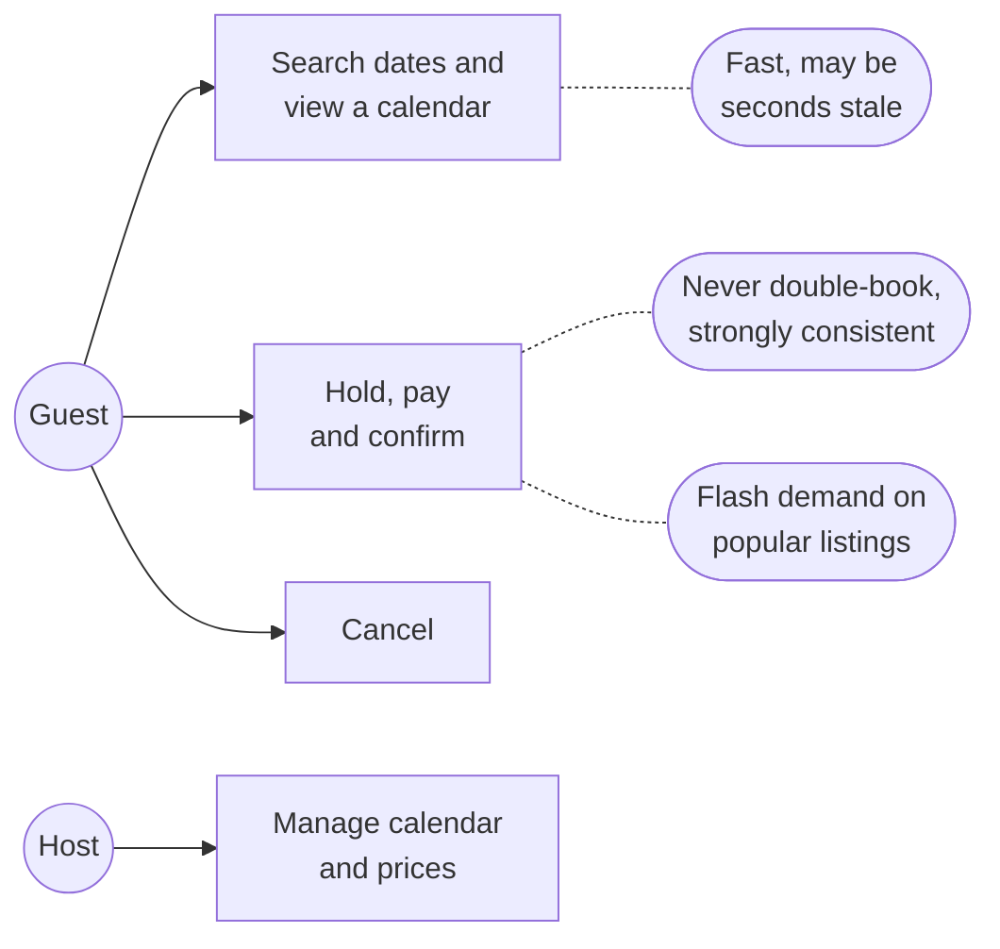
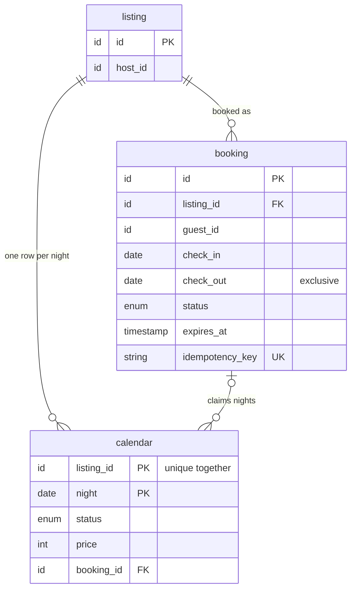
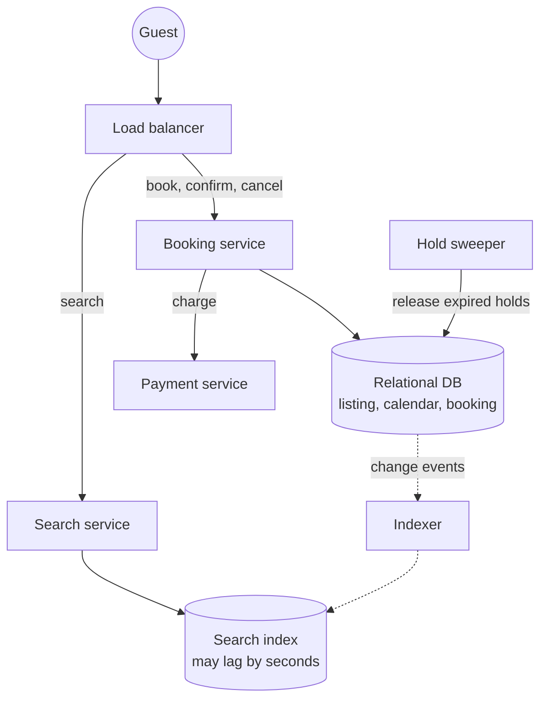
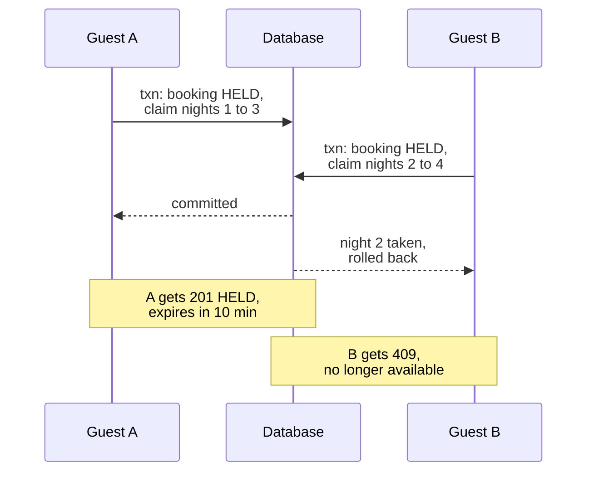
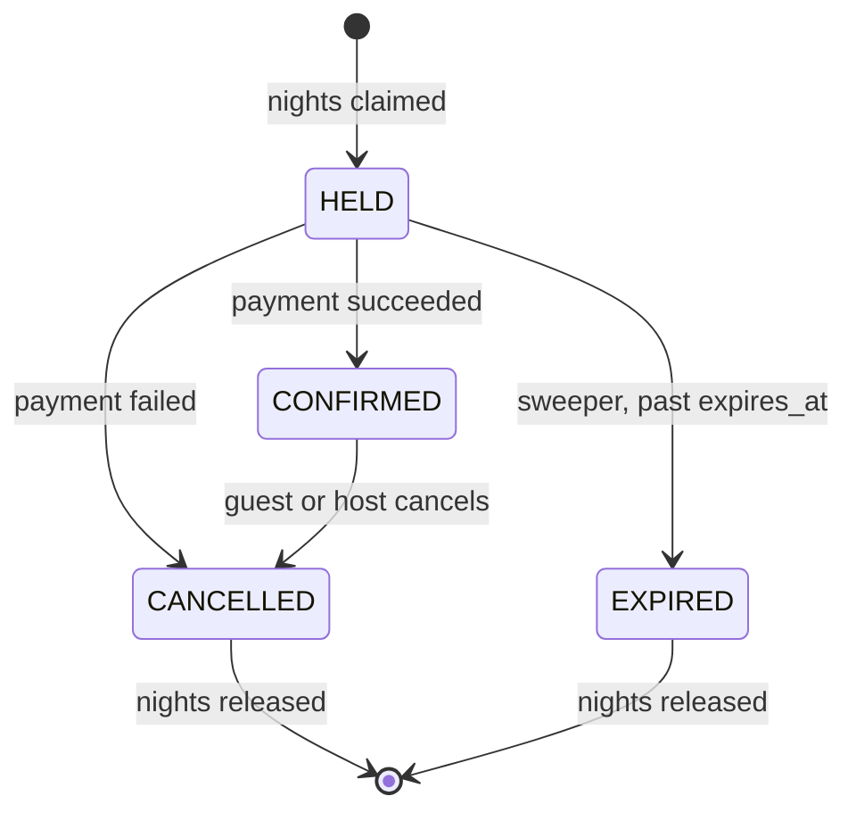
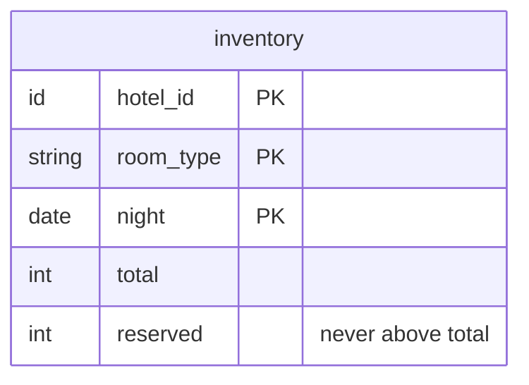
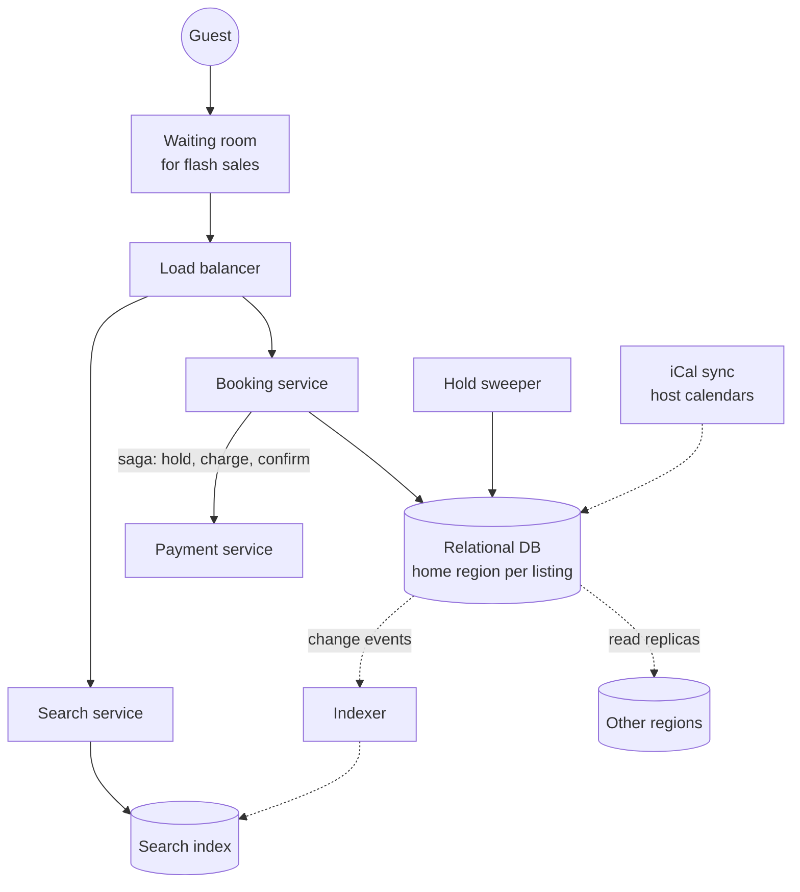

This is the classic reservation question ("design a reservation system"), with event ticketing as a common variant. The heart of it is correctness under concurrency; the rest is ordinary scale.

**Requirements.** Functional: search availability for dates; view a property with a calendar; reserve (hold) while paying; confirm; cancel; hosts manage calendars and prices. Non-functional: **[never double-book](#/design/learn/reliability/concurrency-control-and-double-booking)**; search is fast and may be slightly stale; [booking is strongly consistent](#/design/learn/data/picking-a-guarantee-per-operation); handles flash demand for popular listings or events. Clarify: unique listings (a vacation home, one seat) or fungible inventory ("any of 40 standard rooms")? Both are covered below.

Amber marks the non-functional requirements, each beside the operation it constrains.



**Estimates.** 10M listings, 500K bookings/day ≈ 6/s average, 50/s peak: tiny next to [the few thousand writes/s one relational primary takes](#/design/learn/building-blocks/estimation-and-benchmarks). Searches: 100M/day ≈ 1,200/s average, 5,000+/s peak, so the read/search side is the scale problem, while booking is a correctness problem. Calendar storage: 10M listings × 365 nights × ~20 bytes = 73 GB, which fits on one relational primary (a few TB is comfortable), so neither size nor writes force sharding.

**API.** REST for the guest and host apps, authenticated with the user's token. Every booking call [checks the caller](#/design/learn/networking/authentication-vs-authorization), not just the token: a guest sees only their own bookings, and a host changes only their own listings.

```text
GET   /v1/search?location=&check_in=&check_out=
          &guests=
  -> 200 {results, next_cursor}   (search system)
GET   /v1/listings/{id}/calendar?from=&to=
  -> 200 {nights: [{date, available, price}]}
POST  /v1/bookings   Idempotency-Key: 5c1e...
      {listing_id, check_in, check_out, guests}
  -> 201 Booking (HELD, expires_at)
POST  /v1/bookings/{id}/confirm  {payment_method}
  -> 200 Booking (CONFIRMED)
POST  /v1/bookings/{id}/cancel
  -> 200 Booking (CANCELLED, refund)
PATCH /v1/listings/{id}/calendar   (host only)
      {from, to, available?, price?}
  -> 200 {nights}
```

Search is served by the search system (see the proximity search question). A held booking, as `POST /v1/bookings` returns it:

```json
{
  "id": "bk_7Hq2",
  "listing_id": "ls_381",
  "check_in": "2027-03-10",
  "check_out": "2027-03-13",
  "guests": 2,
  "status": "HELD",
  "expires_at": "2027-01-04T18:40:00Z",
  "price": {"nights": 3, "total": 54000,
            "currency": "EUR"}
}
```

- **Dates are the listing's local calendar dates,** with no time or time zone, and `check_out` is exclusive: the booking above is the nights of the 10th, 11th and 12th. Say this out loud; off-by-one nights are a classic bug.
- **The price is locked into the hold,** in minor units (54000 is €540.00), so a host changing prices mid-checkout doesn't change what this guest pays.
- **Creating a hold is [idempotent](#/design/learn/networking/idempotency-keys).** A double-tapped "Reserve" or a timeout retry returns the same booking instead of making a second hold that blocks the same nights. Confirm is safe to repeat too: the charge uses the booking ID as its idempotency key, and confirming a booking that is already `CONFIRMED` returns it unchanged.
- **Cancel is a `POST` action, not a `DELETE`.** The booking isn't removed: it changes status, may trigger a refund, and must stay on record for the guest, the host and accounting ([resources and verbs](#/design/learn/networking/resources-and-verbs)).

The error cases are where this API earns its keep:

| Case | Response |
| --- | --- |
| `check_out` not after `check_in`, dates in the past, or a stay outside the listing's minimum and maximum | `400 invalid_dates` |
| A night in the range is already held or booked (the race below) | `409 dates_unavailable` |
| Confirming after the hold expired | `409 hold_expired`; the guest starts again |
| Card declined at confirm | `402 payment_declined`; the hold stays until it expires, so the guest can try another card |
| Someone else's booking | `404`, so booking IDs can't be probed |
| The same `Idempotency-Key` with a different body | `422` |

**Data model.** Relational, because [this needs transactions](#/design/learn/data/transactions).

- `listing(id, host_id, ...)`
- `calendar(listing_id, night, status, price, booking_id)` with a **primary key / [unique key](#/design/learn/data/unique-constraints) on `(listing_id, night)`**: one row per listing-night.
- `booking(id, listing_id, guest_id, check_in, check_out, status, expires_at, idempotency_key UNIQUE)`

Status values: `HELD`, `CONFIRMED`, `CANCELLED`, `EXPIRED`.



**Diagram.** Search and booking need different things, so they take different paths. Search reads an index kept up to date from the database's change events and may lag by seconds. Booking writes to the relational database, the single source of truth, in one transaction.



**Booking flow without double-booking.**

1. In a single transaction: insert a `booking` row (`HELD`, `expires_at = now + 10 min`) and claim every night in the range, either by inserting rows into a `booking_nights(listing_id, night)` table with a unique key `(listing_id, night)`, or with `UPDATE calendar SET status='HELD', booking_id=? WHERE listing_id=? AND night BETWEEN ? AND ? AND status='AVAILABLE'` and checking that [the affected row count](#/design/learn/reliability/atomic-conditional-updates) equals the number of nights.
2. If any night is already taken the constraint/row count fails, the transaction rolls back, and the user sees "no longer available". No application-level locks needed: [the database arbitrates](#/design/learn/data/check-then-act-races).
3. Payment proceeds with the booking's idempotency key (see the payments question). On success, mark `CONFIRMED`; on failure or timeout, release the nights.
4. [A sweeper job](#/design/learn/data/holds-that-expire) releases nights for `HELD` bookings past `expires_at` (and the confirm step re-checks that the hold is still valid).

Two guests asking for overlapping nights at the same moment, each through the booking service:



The booking's status through the flow:



**Fungible inventory (hotel room types).** Keep `inventory(hotel_id, room_type, night, total, reserved)` and book with `UPDATE ... SET reserved = reserved + 1 WHERE reserved < total` for every night in one transaction. Contention concentrates on popular nights, so keep transactions short and ordered consistently by night to [avoid deadlocks](#/design/learn/data/pessimistic-locking-and-deadlocks).



**Deep dives.**

1. **Search vs booking consistency.** Search reads from a search index (Elasticsearch) [fed by change events](#/design/learn/reliability/read-models-and-search-indexes) from the calendar, so it can be seconds stale; showing a listing that was just taken is acceptable because the booking transaction is the final authority. Show "available" optimistically, confirm at booking time, and handle the miss gracefully.
2. **[Hot listings and flash sales](#/design/learn/reliability/hot-rows-and-flash-sales) (ticketing).** Thousands of users want the same seats. Use a virtual waiting room that admits users at a controlled rate, hold seats for a limited time, and serialize writes per event/section through a queue or a single-writer partition. Pre-sharding inventory (sections as separate rows) spreads lock contention.
3. **Holds.** The 10-minute hold is a lease; display the countdown, extend only once, and release on payment failure. The expiry must be enforced server-side, not by the client timer.
4. **Payments and sagas.** Booking spans our database and the payment provider: [model as a saga](#/design/learn/reliability/sagas-and-compensation) (hold, charge, confirm; compensate by releasing the hold and refunding), driven from the booking status. See the payments question.
5. **Host calendar sync.** Hosts also have external calendars (iCal feeds). Sync can be late, so treat them as eventual and accept occasional conflicts that need host cancellation policy; reconcile regularly.
6. **Multi-region.** Keep each listing's calendar in one home region ([single leader](#/design/learn/data/single-leader-replication)) so booking is strongly consistent; replicate reads globally. Cross-region writes for one listing would need consensus and add latency.

**The design after the deep dives.** Green marks what they added or changed.



**Done.** Metrics: booking success rate, hold-expiry rate, search-to-book conversion, calendar/search index lag, conflicts at booking time. [Reconciliation](#/design/learn/reliability/reconciliation): nightly job verifying every `CONFIRMED` booking has exactly the right calendar rows and a matching payment.
