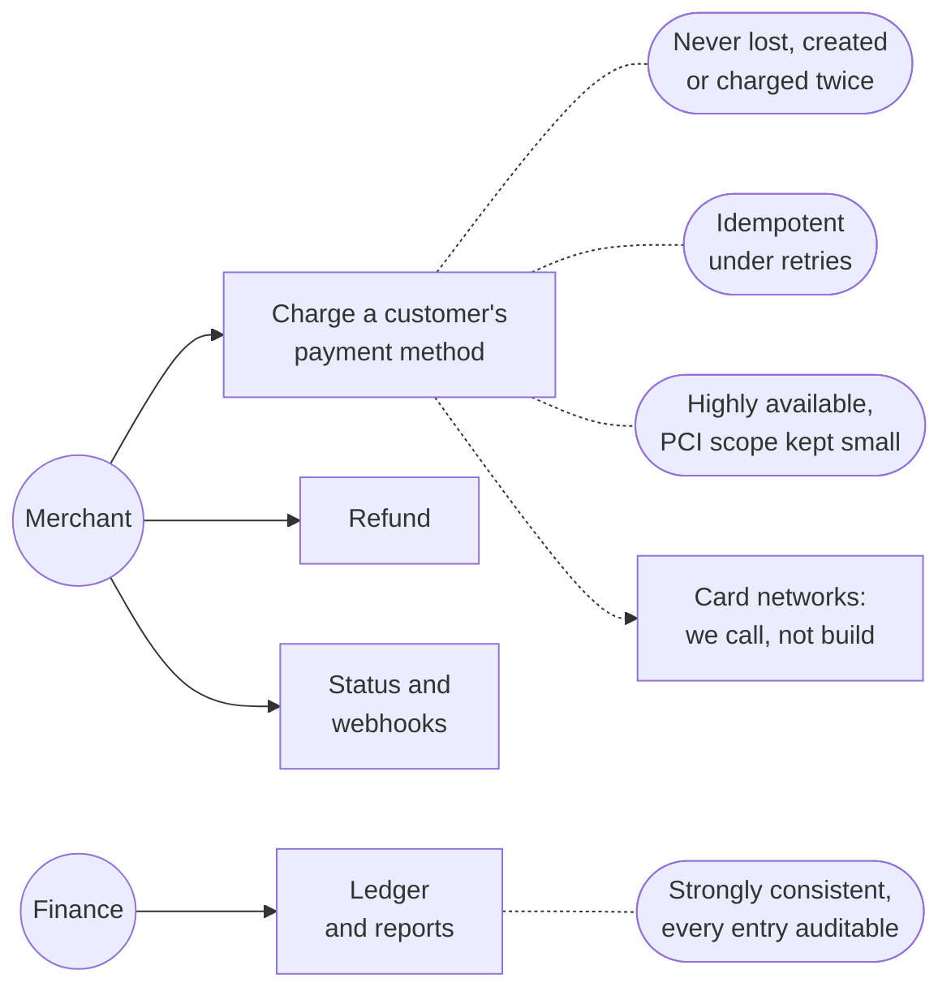
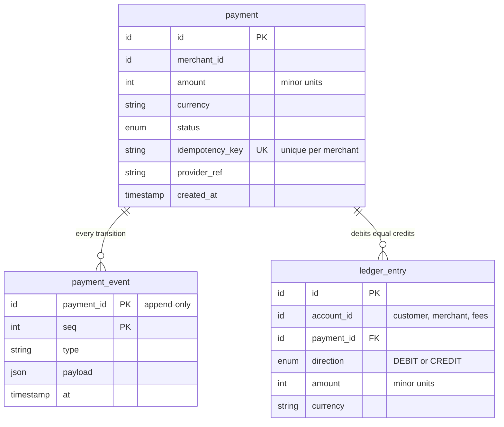
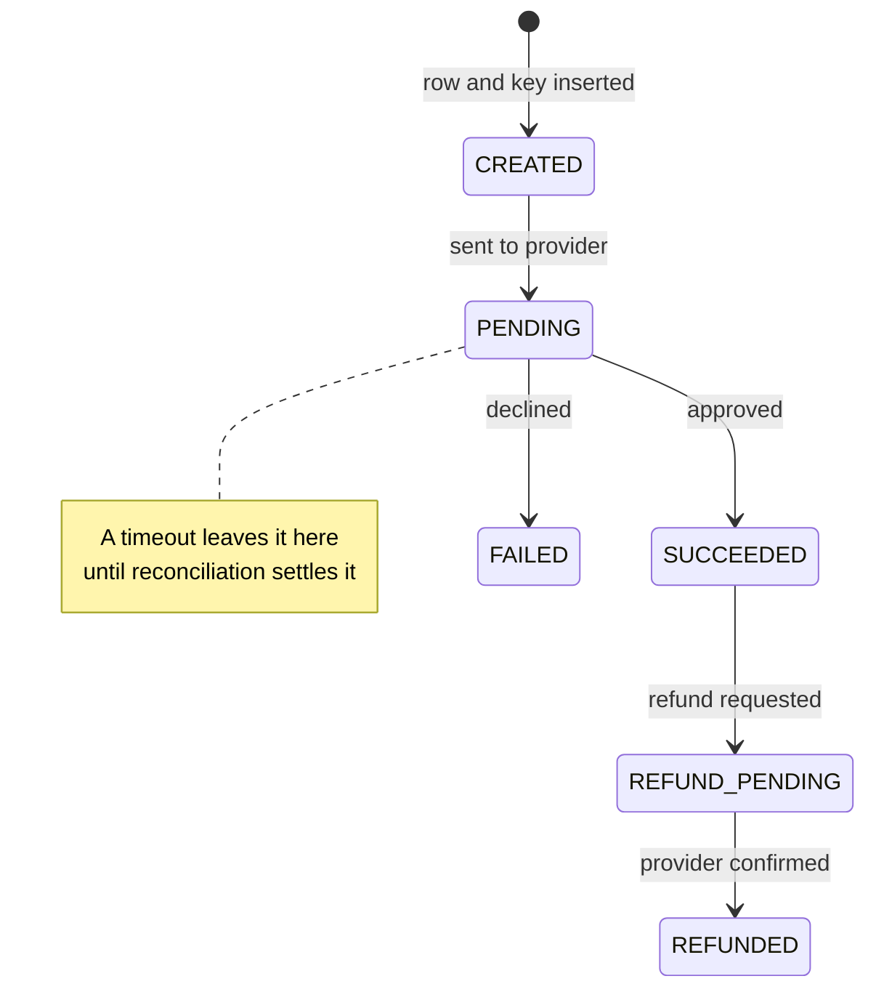
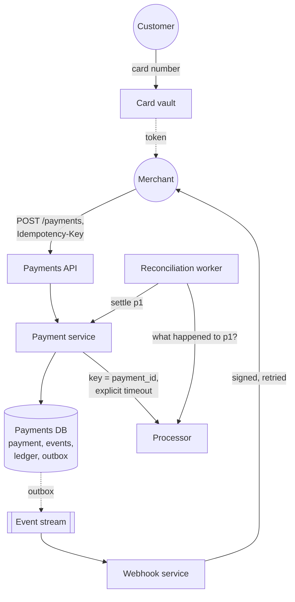
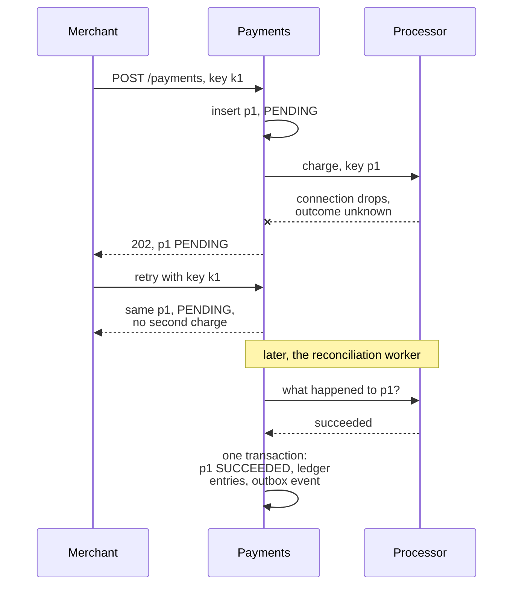
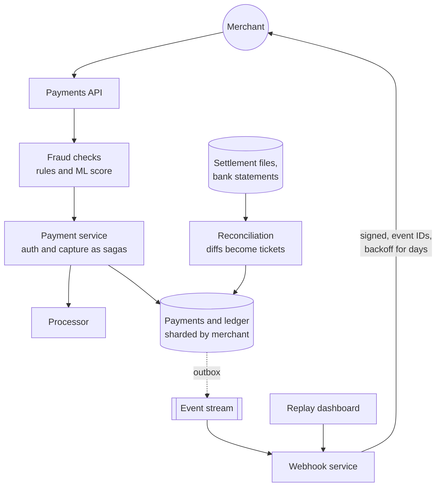

**Requirements.** Functional: a merchant or app charges a customer's payment method; refunds; payment status; [webhooks to merchants](#/design/learn/networking/webhooks); a ledger and reporting. We integrate with external processors/card networks rather than building them. Non-functional: money is never lost, created or double-charged; every operation is auditable; idempotent under retries; secure (PCI scope kept minimal); high availability for charging, strong consistency for balances.

Amber marks the non-functional requirements, each beside the operation it constrains. Grey is out of scope.



**Estimates.** 10M payments/day ≈ 120/s average, 1,000/s peak. This is low volume with extreme correctness requirements, so the design optimizes for correctness and auditability, not raw throughput. Each payment produces several ledger entries and state transitions (maybe 10 rows), so 100M rows/day, about 10,000 row writes/s at peak: still modest for a relational database [sharded a few ways, at a few thousand writes/s per primary](#/design/learn/building-blocks/estimation-and-benchmarks).

**API.** A REST API for merchants' servers, never their browsers. Each merchant authenticates with a secret [API key](#/design/learn/networking/oauth-api-keys-and-mtls); the merchant is taken from the key, never from the request body, so one merchant can't charge as another.

```text
POST /v1/payments   Idempotency-Key (required)
     {amount, currency, payment_method,
      merchant_reference, description?}
  -> 201 Payment (SUCCEEDED or FAILED)
  -> 202 Payment (PENDING: outcome not known yet)
GET  /v1/payments/{id}
  -> 200 Payment
GET  /v1/payments?status=&created_after=&cursor=
  -> 200 {items: [Payment], next_cursor}
POST /v1/payments/{id}/refunds   Idempotency-Key
     {amount?, reason}
  -> 202 Refund (PENDING)
```

A payment, as every endpoint returns it:

```json
{
  "id": "pay_3fK9",
  "status": "SUCCEEDED",
  "amount": 2599,
  "currency": "USD",
  "merchant_reference": "order_1182",
  "payment_method": {"type": "card",
                     "brand": "visa", "last4": "4242"},
  "failure_code": null,
  "created_at": "2026-11-18T10:02:11Z"
}
```

- **Amounts are integers in the currency's minor unit** (2599 is $25.99) with an ISO currency code. Currencies differ (yen has no minor unit), so validate per currency, and never accept floats.
- **`payment_method` is a token** from the card vault (below), never a card number.
- **The [`Idempotency-Key`](#/design/learn/networking/idempotency-keys) is required,** not optional: a create without one gets `400`. Keys are unique per merchant and kept for at least 24 hours. The same key returns the stored result; the same key with a different body gets `422`; a key whose first request is still running gets `409`, and the merchant retries shortly.
- **A decline is a result, not an error.** The request did create a payment, one whose `status` is `FAILED` with a `failure_code` such as `card_declined` or `insufficient_funds`, so the answer is `201`. (Some APIs answer `402` instead.) Either way, trying another card needs a new key, because the old key returns the stored decline. Error codes are for bad requests: `400 invalid_amount`, `401` for a bad key, `429` over the rate limit.
- **`202` means "we don't know yet",** the unknown-outcome case in the flow below. The merchant must not retry with a new key; it waits for the webhook or polls `GET /v1/payments/{id}`.
- **Refunds** default to the full amount; a partial refund can't exceed what's left, or it gets `409 refund_exceeds_payment`.
- **Listing** for the merchant's own reconciliation uses [cursor pagination](#/design/learn/networking/pagination-offset-vs-cursor) over `(created_at, id)`.

**Webhooks to the merchant.** Each event is a signed `POST` to the URL the merchant registered, [retried with backoff](#/design/learn/reliability/retries-with-backoff-and-jitter) for up to three days until it gets a `2xx`. Event types are `payment.succeeded`, `payment.failed` and `payment.refunded`.

```http
POST /hooks/payments HTTP/1.1
Host: merchant.example
Content-Type: application/json
Webhook-Id: evt_81aa
Webhook-Timestamp: 1763460131
Webhook-Signature: v1,K5oZfzN95Z9UVu1EsfQmfVNQhn

{"id": "evt_81aa",
 "type": "payment.succeeded",
 "created_at": "2026-11-18T10:02:12Z",
 "data": {"payment": {"id": "pay_3fK9", ...}}}
```

- The signature is an HMAC-SHA256 of the event ID, timestamp and body, keyed with a secret only we and the merchant hold. The merchant rejects a bad signature, and a timestamp more than five minutes old, which stops replays.
- Delivery is at-least-once and unordered, so the merchant dedupes on the event `id`, answers `2xx` quickly and does the work afterwards. When order matters, it re-reads `GET /v1/payments/{id}` for the current state.

Card data is tokenized by a secure vault (or the processor's hosted fields) so our servers never touch raw card numbers, which keeps PCI scope small.

**Data model.** Relational and strongly consistent.

- `payment(id, merchant_id, amount, currency, status, idempotency_key UNIQUE per merchant, provider_ref, created_at)`
- `payment_event(payment_id, seq, type, payload, at)`: append-only history of every transition.
- **[Double-entry ledger](#/design/learn/reliability/double-entry-ledgers):** `ledger_entry(id, account_id, payment_id, direction DEBIT/CREDIT, amount, currency)`; every transaction posts equal debits and credits across accounts (customer, merchant, fees), so the books always balance and any imbalance reveals a bug. Money amounts are integers in minor units (cents) with an explicit currency, never floats.



**Payment state machine.** `CREATED → PENDING (sent to provider) → SUCCEEDED | FAILED`, then `REFUND_PENDING → REFUNDED`. Allow only legal transitions, enforce them with [conditional updates](#/design/learn/reliability/atomic-conditional-updates) (`WHERE status = 'PENDING'`), and never delete.



**Diagram.** The payment service owns one relational database holding payments, their events, the ledger and an outbox. Card numbers go from the customer's browser to a vault and never reach our servers. Events leave through the outbox to the webhook service and other consumers.



**Flow.**

1. API receives the request; inserts the `payment` row with the idempotency key in one transaction (a duplicate returns the stored result).
2. The payment service calls the provider with our `payment_id` as the provider-side idempotency key. This call has [an explicit timeout](#/design/learn/reliability/timeouts-and-deadlines).
3. On a definite response, update status and post ledger entries in **one transaction**, plus [an outbox event](#/design/learn/reliability/the-outbox-pattern).
4. The outbox publishes `payment.succeeded`; the webhook service notifies the merchant; downstream systems (receipts, analytics) consume the event.
5. On a **timeout or unknown outcome**, status stays `PENDING`; do not assume failure. [A reconciliation worker](#/design/learn/reliability/reconciliation) queries the provider for the real outcome (by `payment_id`) and settles it.

Step 5, the unknown outcome, with the merchant retrying meanwhile:



**Deep dives.**

1. **[Exactly-once effect](#/design/learn/reliability/charging-a-card-exactly-once).** Retries are inevitable (client retries, queue redelivery, our own timeouts). Idempotency keys at our API, a unique constraint inside the transaction, and the provider-side key together make the effect happen once. State plainly: [delivery is at-least-once](#/design/learn/reliability/delivery-guarantees), effects are exactly-once through idempotency.
2. **The unknown-outcome problem.** The classic failure is "we called the provider and the connection died." Never retry blindly with a new key; retry with the same key, or query status. Poll or receive the provider's webhook, and reconcile.
3. **Reconciliation.** Daily (and continuous where possible) compare our ledger with processor settlement files and bank statements. Differences become tickets, never silent fixes. This is the safety net under everything else and a mark of production maturity.
4. **[Multi-step flows (sagas)](#/design/learn/reliability/sagas-and-compensation).** Authorize, then capture (when the goods ship); marketplace payouts; booking holds. Model each as a state machine with compensations (void, refund).
5. **Consistency and sharding.** Shard the payment and ledger tables [by merchant or account ID](#/design/learn/data/choosing-a-partition-key); keep an account's entries on one shard so balance checks are local transactions. [Cross-account transfers](#/design/learn/data/transactions-across-partitions-and-services) use a saga or a two-phase ledger posting (pending, then posted), not distributed locks.
6. **Security and compliance.** Tokenization, encryption at rest and in transit, least-privilege access, audit logs, fraud checks (rule engine and ML score before authorization, with a synchronous decision budget of tens of milliseconds), and strong authentication (3-D Secure) where required.
7. **Webhooks.** At-least-once delivery with signatures and event IDs [so merchants can dedupe](#/design/learn/reliability/deduplicating-consumers); exponential backoff for up to a few days; a dashboard to replay.

**The design after the deep dives.** Green marks what they added or changed.



**Done.** Metrics: success rate by provider/issuer, pending-aged count, reconciliation diffs, p99 latency, webhook lag. Multi-provider routing with fallback (if one processor is down, route to another) improves availability but needs care so one payment isn't charged twice across providers.
