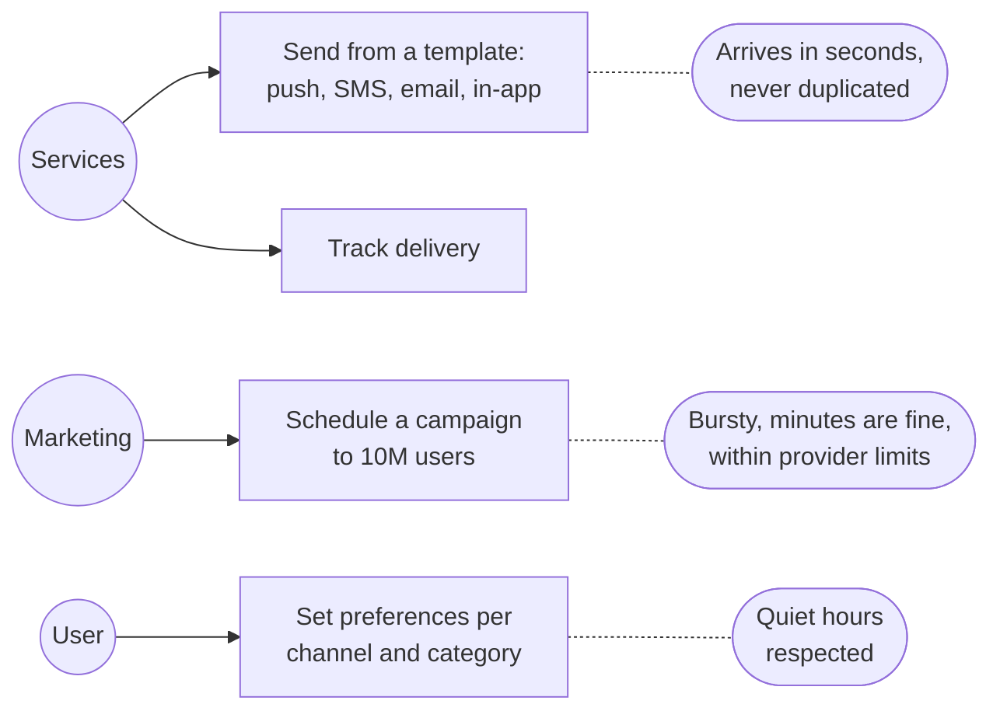
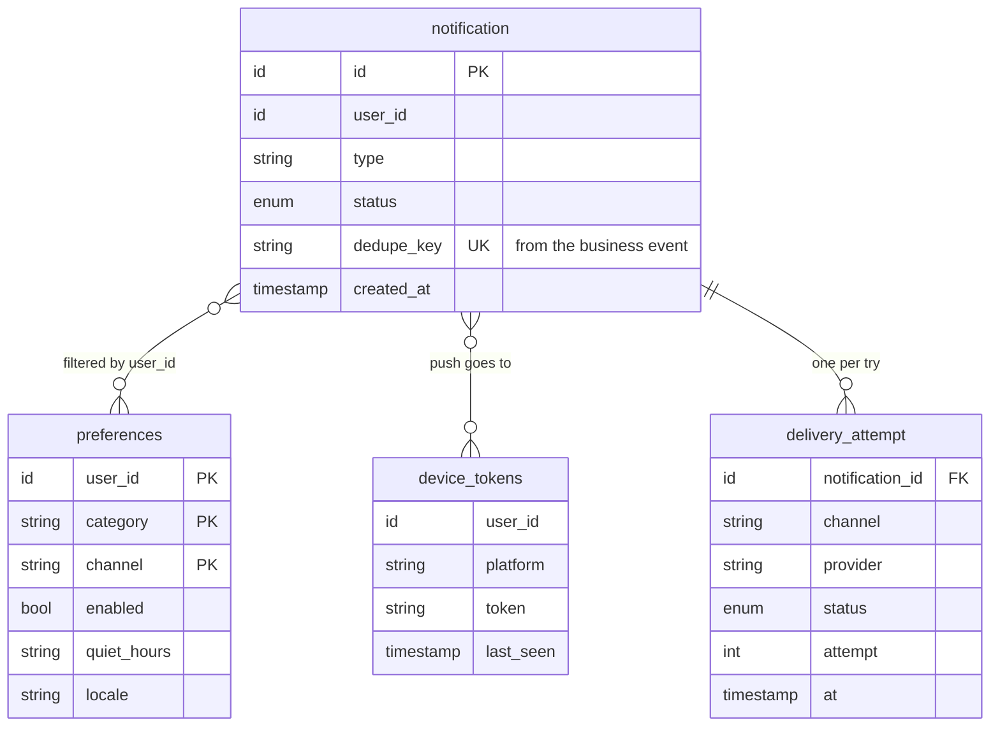
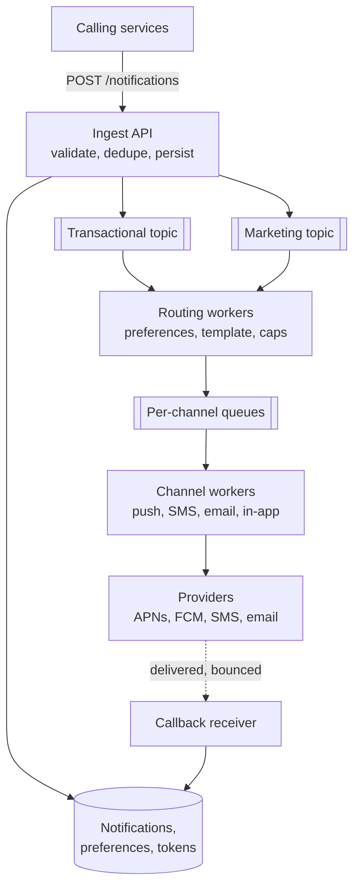
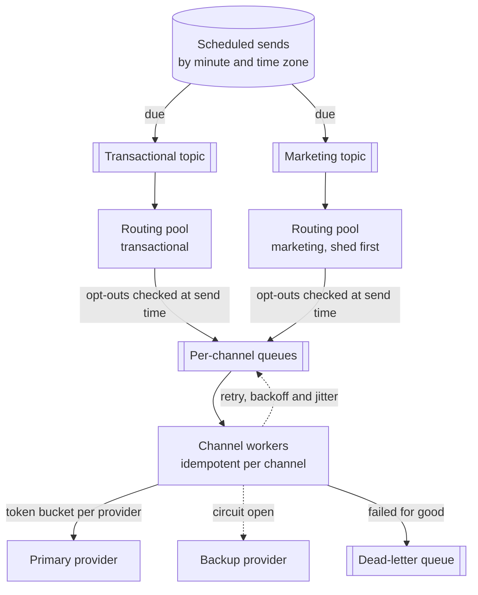

**Requirements.** Functional: other services send notifications (push, SMS, email, in-app) to users; users set preferences per channel and category; templates and localization; scheduled and bulk sends (a campaign to 10M users); delivery tracking. Non-functional: reliable (a password reset or payment alert must arrive); no duplicates; low latency for transactional messages (seconds), higher tolerance for marketing; scales to bursts; respects provider limits and user quiet hours.

Amber marks the non-functional requirements, each beside the operation it constrains.



**Estimates.** 1B notifications/day ≈ 12,000/s average, but bursty: a campaign or breaking-news alert can send 10M in a few minutes (≈ 50,000+/s). A queue absorbs that burst easily ([a few dozen partitions at thousands of messages/s each](#/design/learn/building-blocks/estimation-and-benchmarks)); the real limits are provider send rates and cost. Channels differ: push and in-app are cheap; SMS costs money per message; email has deliverability and reputation constraints.

**API.** Two groups of callers. Internal services send notifications, authenticated as services ([mTLS or service tokens](#/design/learn/networking/oauth-api-keys-and-mtls)), each allowed only certain notification types and a quota:

```text
POST   /v1/notifications
       {to: {user_id} | {audience_id}, type,
        template_id, params, priority,
        channels?, send_at?, ttl_s?, dedupe_key}
  -> 202 {notification_id, status: ACCEPTED}
GET    /v1/notifications/{id}
  -> 200 {status, deliveries: [{channel,
                                status, at}]}
DELETE /v1/notifications/{id}   (not sent yet)
  -> 204
```

Users, their devices and the delivery providers use the rest:

```text
GET   /v1/me/preferences
  -> 200 {categories: [{category, channels}]}
PATCH /v1/me/preferences
      {category, channel, enabled}   -> 200
PUT   /v1/me/devices/{device_id}
      {platform, push_token}         -> 204
POST  /v1/unsubscribe?token=<signed> -> 200
POST  /v1/callbacks/{provider}       -> 200
```

- **`202 Accepted`** ([async request-reply](#/design/learn/networking/async-request-reply)): ingest validates, stores and queues the notification, then answers in milliseconds. Delivery happens later, and `GET /v1/notifications/{id}` reports each channel's progress: `QUEUED`, `SENT`, `DELIVERED`, `FAILED`, or `SUPPRESSED` when preferences or quiet hours blocked it.
- **`dedupe_key` comes from the business event,** such as `order_1182:shipped`, so a retried request, or two services reacting to the same event, makes one notification: a repeated key returns the original `notification_id`. It works like an [idempotency key](#/design/learn/networking/idempotency-keys) that spans callers.
- **Callers send `template_id` and `params`, never finished text.** Templates are versioned and translated in one place, and the routing workers render each copy in the recipient's language. An unknown template or a missing param fails at ingest with `400`, so the caller finds out now, not when a blank email goes out.
- **Bulk sends name an `audience_id`** (a saved segment, such as users in one city who opted into offers) instead of listing users. The routing workers expand it in chunks; nobody posts 10M user IDs.
- **`ttl_s` drops what can't arrive in time.** A login code is useless after 10 minutes, and a breaking-news push after an hour.
- **`priority` is checked against the caller.** Only approved services may send `transactional`, so a marketing job can't jump the queue (`403 priority_not_allowed`). A caller over its quota gets `429` with `Retry-After`.
- **Push tokens are registered with `PUT`, keyed by device,** so an app calling it on every launch is harmless and a refreshed token replaces the old one.
- **Unsubscribing takes one click and no login.** The link carries a signed token, and emails also carry `List-Unsubscribe` headers so mail apps can show their own button.
- **Provider callbacks** are [webhooks](#/design/learn/networking/webhooks) from the providers (delivered, bounced, opened). Verify each provider's signature, and treat them as idempotent on the provider's message ID, since providers retry too.

**Data model.** `preferences(user_id, category, channel, enabled, quiet_hours, locale)`; `device_tokens(user_id, platform, token, last_seen)`; `notification(id, user_id, type, status, dedupe_key, created_at)`; `delivery_attempt(notification_id, channel, provider, status, attempt, at)`. Templates in a versioned store.



**Diagram.** A pipeline of queues.

1. **Ingest API** validates, [dedupes on `dedupe_key`](#/design/learn/networking/idempotency-keys), persists, and publishes to a **[priority-partitioned queue](#/design/learn/building-blocks/message-queues-and-streams)** (separate topics for transactional vs marketing [so a campaign can't starve a password reset](#/design/learn/reliability/bulkheads)).
2. **Orchestrator / routing workers** consume: look up the user's preferences and quiet hours, pick channels (fallback order, for example push, then SMS for critical), render the template in the user's locale, apply per-user frequency caps, and enqueue per-channel jobs. Large audiences are expanded here, in chunks, from a query or segment, not by the caller.
3. **Channel workers** (push, SMS, email, in-app) send through providers (APNs, FCM, SMS and email providers) with [per-provider rate limiting](#/design/learn/building-blocks/rate-limiting) and connection pooling.
4. **Provider callbacks** update delivery state (delivered, bounced, unsubscribed, invalid token), which feeds back into the user's records (remove dead device tokens, suppress bounced addresses).



**Deep dives.**

1. **Reliability and retries.** At-least-once with retries ([exponential backoff and jitter](#/design/learn/reliability/retries-with-backoff-and-jitter), capped), [a dead-letter queue](#/design/learn/reliability/dead-letter-queues) for permanent failures, and provider failover (a second SMS or email provider when the first degrades, with a [circuit breaker](#/design/learn/reliability/circuit-breakers)). Persist state before sending so a crash resumes instead of losing work.
2. **Deduplication.** Duplicate notifications annoy users (and cost money). Use `dedupe_key` plus a short-lived dedupe store; [make workers idempotent](#/design/learn/reliability/deduplicating-consumers) per (notification, channel); and remember that provider calls may succeed without us seeing the response, so the occasional duplicate is possible: for critical messages prefer a possible duplicate over a lost message, and say so.
3. **Throttling and fairness.** Per-user caps (no more than N marketing pushes per day), per-provider rate limits (APNs/FCM and SMS carriers throttle), per-tenant quotas if multi-tenant, and a smooth ramp for big campaigns (spread 10M sends over minutes rather than a single spike). [Token bucket per provider](#/design/learn/building-blocks/token-bucket) (see the rate limiter question).
4. **Prioritization.** Separate queues and worker pools by priority, so transactional traffic keeps flowing during a marketing blast; [shed or delay low priority first](#/design/learn/reliability/load-shedding) under overload.
5. **Scheduling.** Scheduled sends live in a time-indexed store (a delayed queue, or a table sharded by minute that a scheduler scans); user-local-time sends are bucketed by time zone.
6. **Preferences and compliance.** Honor opt-outs instantly (check at send time, not just at enqueue time), keep a global suppression list, respect quiet hours and regional regulations (consent, unsubscribe links), and keep audit logs.
7. **Observability.** Metrics per channel and provider: send latency, delivery rate, bounce rate, [queue depth/lag](#/design/learn/building-blocks/backpressure-and-consumer-lag), retry rate, dead-letter volume. [Alert on delivery rate drops](#/design/learn/reliability/alerting-on-symptoms), which signal provider or credential problems.

**The design after the deep dives.** Green marks what they added or changed. The ingest API and callbacks are as before.



**Done.** Extensions: in-app notification feed (stored per user, read/unread state, real-time push over the chat-style WebSocket), A/B testing of content, digest batching (combine ten notifications into one summary), and analytics on opens and conversions.
