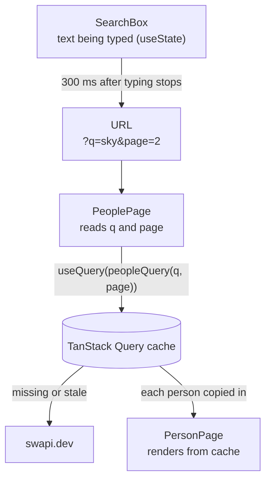
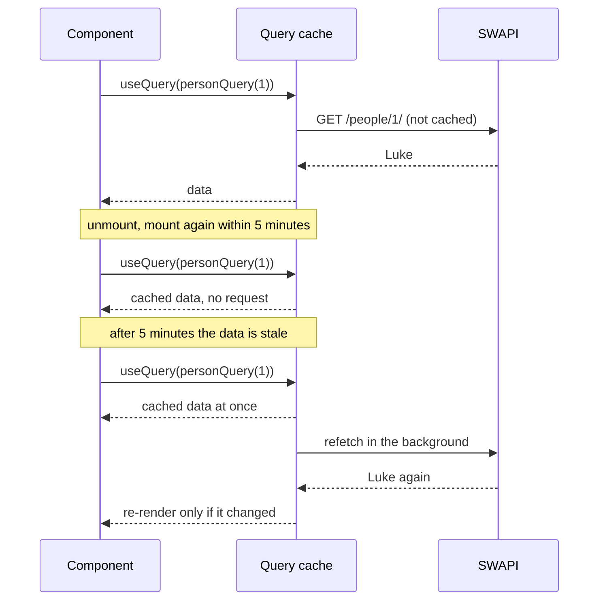
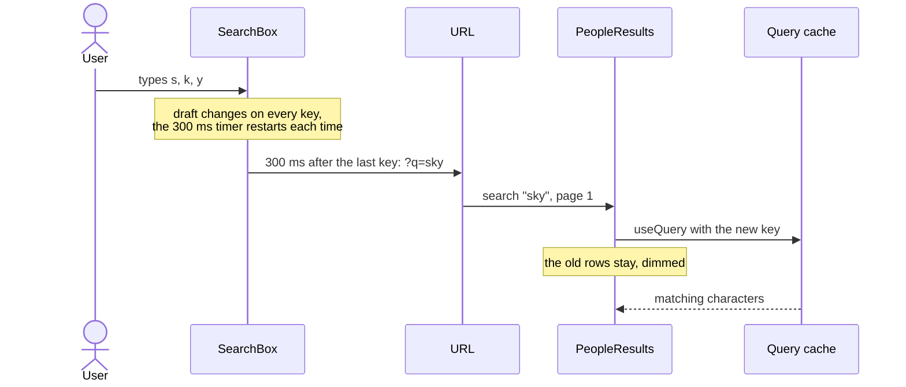
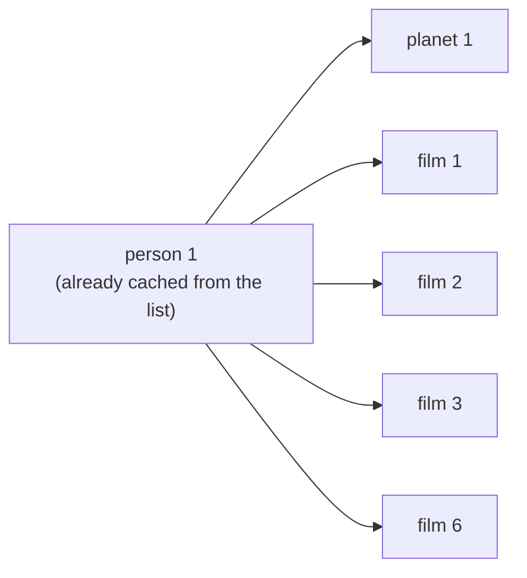
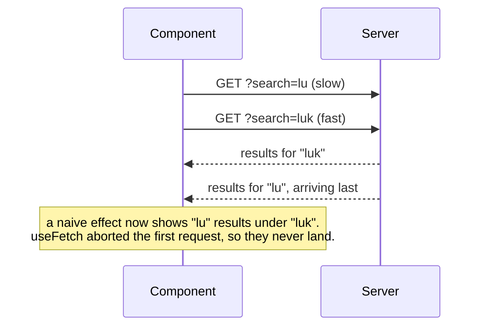

# React: fetching data the modern way

A small React app that searches and pages through Star Wars characters from SWAPI, built with current best practices: React 19 and the React Compiler, strict TypeScript, TanStack Query for server data, the URL for search and page, Zod checking every response, and tests against a fake network. Every file is shown with its comments, along with why it's written that way, what it replaces, and what an interviewer would ask.

## What it does

The project lives in `tech/react-swapi/`. It has two pages:

- **Characters** (`/`): a table of characters, ten per page. A search box filters by name as you type, and Previous and Next links move between pages. Search and page are in the URL (`/?q=sky&page=2`), so reloading, sharing a link or pressing Back restores the same view.
- **Character** (`/people/1`): one character's details, their homeworld and the films they appear in, in episode order.

It behaves well in the cases a quick version gets wrong. It sends one request when typing pauses, not one per key. A late response never overwrites a newer one. The rows already shown stay on screen while the next page loads. Opening a character from the list doesn't fetch them again. Errors explain themselves and offer to retry. The data is cached, so going back is instant, and nothing breaks if SWAPI sends a field the app doesn't expect.



## Run it

You need Node 22.22 or newer (React Router 8's minimum). From the repo root:

```
cd tech/react-swapi
npm install
npm run dev          # http://localhost:5173
npm test             # Vitest, against a fake SWAPI: no network needed
npm run lint         # ESLint, including the React Compiler's checks
npm run format       # Prettier
npm run build        # type-check, then bundle into dist/
```

`npm run dev` talks to the real `https://swapi.dev`, which allows requests from any site, so there's no proxy or API key. The tests never touch it.

```
src/
  main.tsx                  entry point: providers, StrictMode
  App.tsx                   layout, routes, error boundary
  api/
    swapi.ts                the only code that knows SWAPI's URLs and JSON
    queries.ts              every query: its cache key and fetch function
    queryClient.ts          cache settings and retry policy
  pages/
    PeoplePage.tsx          search, results, pagination
    PersonPage.tsx          one character, homeworld, films
    NotFoundPage.tsx
  components/               SearchBox, Pagination, PeopleTable, QueryError, ErrorBoundary
  hooks/useDebouncedCallback.ts
  no-library/useFetch.ts    the same job with only useEffect, for comparison
  test/                     fake SWAPI (MSW), test setup, render helper
  *.test.ts(x)              next to the code they test
```

The [file browser](#/tech/react-swapi/files) has every file of the finished project, including the config files this page doesn't show, such as `tsconfig.json` and `index.html`. Each code block below is captioned with its file name; click it to open that file in the browser.

## The stack, and why

| Job | Choice | Why | Instead of |
|---|---|---|---|
| Dev server and bundler | Vite 8 | Starts instantly, hot-reloads a saved file without losing state | Create React App, deprecated in 2025 |
| UI | React 19 with the React Compiler | The compiler memoizes components and values at build time | Hand-written `useMemo`, `useCallback`, `React.memo` |
| Types | TypeScript 6, strict | Catches `undefined` and typos before the browser does | Plain JavaScript |
| Data from the server | TanStack Query 5 | Caching, deduplication, cancelling, retries, background refresh | `useEffect` + `useState` per component, or Redux for server data |
| Routing and URL state | React Router 8 | The URL holds search and page; links work like links | `useState` for filters, lost on reload |
| Checking responses | Zod 4 | Parses JSON into typed objects at the edge of the app | `as Person` casts that lie at runtime |
| Tests | Vitest, Testing Library, MSW | Tests what the user sees, against a fake network | Jest, Enzyme, mocking `fetch` or whole modules |
| Linting | ESLint with `eslint-plugin-react-hooks` 7 and the TanStack Query plugin | Rules of Hooks, effect dependencies, compiler checks, query keys | Finding these in code review |
| Formatting | Prettier | One style, applied by a tool, so reviews are about the code | Style debates in code review |

The React docs now recommend starting new apps in a framework (Next.js, or React Router's framework mode) that adds server rendering and data loading per route. This project is a plain client-side app on purpose: it keeps the focus on React itself, and it's the shape of most take-home and live-coding exercises. [Interview questions](#/tech/react-swapi/interview-questions) covers what a framework would change.

## Four kinds of state

The most useful idea in this app is that "state" isn't one thing. Each kind has a natural owner, and most bugs in React data code come from putting a kind in the wrong place, usually server data copied into `useState`.

| Kind | Examples here | Lives in | Why there |
|---|---|---|---|
| Server state | the characters, planets, films | TanStack Query's cache | It belongs to the server: it arrives late, can fail, can go out of date, and several components may want the same piece |
| URL state | the search, the page, the character id | the address bar, via React Router | It should survive a reload and be shareable |
| Local UI state | the text being typed, before the debounce | `useState` in `SearchBox` | Nothing else needs it, and it changes on every keystroke |
| Derived values | total pages, the status line, films sorted by episode | computed during render | Storing them would mean keeping two copies in sync |

The last row is the one people miss: if a value can be computed from props or state, compute it. A `useEffect` that sets state from other state renders twice and can show the stale value in between. React's guide [You Might Not Need an Effect](https://react.dev/learn/you-might-not-need-an-effect) is worth reading in full.

## The API boundary

`swapi.ts` is the only file that knows SWAPI exists. Components import `Person`, `Planet` and `Film`, small objects shaped for the app, and never see the raw JSON.

```include
react-swapi/src/api/swapi.ts
```

The points worth being able to explain:

- **Parse, don't cast.** `const data: Person = await res.json()` compiles, but it's a promise TypeScript can't check, because types vanish at runtime. Zod checks the data while converting it, and `z.infer` derives the type from the schema, so the type and the check can't disagree. When the API changes, the error shows up in one place with the field's name, not as `undefined` in a component three files away.
- **Reshape at the edge.** The transforms turn `birth_year` into `birthYear`, `"unknown"` into `null` and URLs into ids. The rest of the app is written against the shape it wants. If the app moved to another Star Wars API, only this file would change.
- **`fetch` doesn't reject on HTTP errors.** A 404 or 500 resolves normally; only a network failure rejects. Checking `response.ok` is easy to forget, and without it an error page gets parsed as data.
- **Keep the status.** `HttpError` remembers it, so the retry policy can skip 4xx errors and the character page can say "no such character" for a 404.
- **Pass the `AbortSignal` through.** It's what lets TanStack Query cancel a request nobody is waiting for any more.
- **Build URLs with `URL` and `URLSearchParams`**, which encode `&`, spaces and the rest. String concatenation breaks on the first search for "R2-D2 & co".

## Queries and the cache

TanStack Query is a cache for server data, with the cache key as the central idea: everything a request depends on goes into its key, and a component asks for a key rather than starting a request. If the data for that key is cached and fresh, it renders at once; if not, the library fetches it, once, however many components ask.

```include
react-swapi/src/api/queries.ts
```

```include
react-swapi/src/api/queryClient.ts
```

What happens over a query's life, with `staleTime` set to five minutes:



That last step is **stale-while-revalidate**: show what you have, refresh it behind the scenes. It's the same trade-off as a server-side cache with a TTL; see [where caches live](#/design/learn/building-blocks/where-caches-live) and [cache invalidation](#/design/learn/building-blocks/cache-invalidation) in the system design foundations.

The two timers are easy to mix up:

| Setting | Default | Means | Here |
|---|---|---|---|
| `staleTime` | 0 | How long data counts as fresh. Fresh data is served without a request. | 5 minutes: SWAPI never changes |
| `gcTime` | 5 minutes | How long data nobody is using stays in memory before it's dropped | default |

Other details in these two files:

- **`queryOptions` factories.** The key and the fetch function are defined together once, so rendering, prefetching and reading the cache can't drift apart. The ESLint plugin checks that every variable the function uses is in the key.
- **Seeding the cache.** A list page already has every field the character page shows, so `peopleQuery` writes each person into their own entry. Clicking a name renders at once, with no request; one of the tests checks exactly that.
- **`skipToken`** holds the homeworld query until its id is known. It replaces `enabled: false` and keeps the types honest.
- **Retries** go to network failures and 5xx responses only, with growing delays (TanStack Query's default backoff). The reasoning is the same as on the server: see [retries with backoff and jitter](#/design/learn/reliability/retries-with-backoff-and-jitter).
- **v5 names.** If you learned an older version: `isLoading` became `isPending` for "no data yet", `cacheTime` became `gcTime`, and the `keepPreviousData: true` option became `placeholderData: keepPreviousData`.

## Entry point and layout

```include
react-swapi/src/main.tsx
```

```include
react-swapi/src/App.tsx
```

- **Create the `QueryClient` once, outside any component.** Created inside one, every re-render would start a new, empty cache.
- **Providers** put an object in React context so any component below can reach it with a hook. The order matters only when one provider needs another.
- **`StrictMode`** renders components twice and runs effects as setup, cleanup, setup, in development only. Code that breaks under it (an effect without cleanup, a render that changes something outside itself) was already broken, just rarely.
- **`key={pathname}` on the error boundary** remounts it on navigation, which clears a caught error. Changing a `key` is the standard way to reset a component's state from outside.

## The list page

```include
react-swapi/src/pages/PeoplePage.tsx
```

### The URL as the source of truth

`PeoplePage` keeps no state of its own. It reads `q` and `page` from the URL, and changes them by navigating. That gives reload, sharing and Back for free, and it removes a whole class of bug: there's one copy of the search, so nothing can get out of sync with it.

Two details: a new search uses `replace`, so Back leaves the list instead of stepping through every search typed, while changing page adds a history entry, so Back returns to the previous page. And the values are untrusted text: `?page=abc` becomes page 1 rather than a request for page `NaN`. SWAPI's paging is page-number (offset) pagination; [offset vs cursor](#/design/learn/networking/pagination-offset-vs-cursor) covers why large APIs move to cursors.

### Debounced search

```include
react-swapi/src/components/SearchBox.tsx
```

```include
react-swapi/src/hooks/useDebouncedCallback.ts
```

The search box keeps its own `draft` state, because the input must update on every keystroke while the URL, and so the request, should change only when typing stops. Typing "sky":



Three tools sound alike and do different jobs:

| Tool | What it does | Use it for |
|---|---|---|
| Debounce | Waits until calls stop for a while, then runs once | Search requests: one per pause, not per key |
| Throttle | Runs at most once per interval while calls continue | Scroll and resize handlers |
| `useDeferredValue` | Renders the urgent update first and the expensive one when React has time; it doesn't delay or reduce anything | Keeping typing smooth while a large list re-renders from local data |

`useDeferredValue` alone wouldn't help here: every keystroke would still send a request. The other technique in `SearchBox` is **adjusting state during render**: when `query` changes from outside (Back, or the site title link), the box shows the new value in the same render. An effect would paint the old text first, then fix it.

### Keeping the old page while the next loads

`placeholderData: keepPreviousData` keeps the current rows on screen, dimmed, while the next page or search loads, instead of swapping the table for a skeleton and back. While that's happening `isPlaceholderData` is true, and the Next link is disabled, because the placeholder's `hasNext` describes the previous page. The effect then **prefetches** the following page, so most clicks on Next render instantly. Prefetching is a good use of an effect: it keeps something outside React (the cache) in step with what's on screen.

### Pagination, the table and keys

```include
react-swapi/src/components/Pagination.tsx
```

```include
react-swapi/src/components/PeopleTable.tsx
```

- **Links for navigation, buttons for actions.** Page changes are navigation, so they're links: they can be opened in a new tab, and the browser shows where they go.
- **Keys come from the data.** `key={person.id}` tells React which row is which across renders. Index keys break when the list changes: React reuses row 0's DOM, and any state in it, for whoever is now first.
- **A real `<table>`** with `scope` on its headings lets screen readers move by row and column. The skeleton reserves the table's space so nothing jumps when the rows arrive.
- **Navigation state.** The link to a character carries the list's search in `state`. It's invisible in the URL and only there when you came from the list, which is why `PersonPage` checks its shape before using it.

## The character page

```include
react-swapi/src/pages/PersonPage.tsx
```

```include
react-swapi/src/pages/NotFoundPage.tsx
```

The page needs data that depends on other data: the homeworld's id is inside the person. That's a **request waterfall**, two rounds of requests one after the other:



- **Dependent query:** `useQuery(planetQuery(person.data?.homeworldId))` waits, through `skipToken`, until the id exists.
- **Parallel queries:** `useQueries` starts all the film requests at once, and its list can change length between renders, which a `useQuery` call in a loop can't (hooks must be called the same way on every render). `combine` turns the results into the one value the page renders.
- **Shared cache entries:** films are cached by id, so the next character's page reuses them.
- **Fewer round trips.** Seeding from the list removes the first round. Removing the second needs the server's help: an endpoint that returns a person with their planet and films, GraphQL, or a framework that loads route data on the server.
- **`<title>`** rendered in a component is moved into `<head>` by React 19, replacing `document.title` effects and helmet libraries. Its child must be a single string, and only one should be rendered at a time, which is why `index.html` has none.

## Loading, errors and empty results

```include
react-swapi/src/components/QueryError.tsx
```

```include
react-swapi/src/components/ErrorBoundary.tsx
```

Every request can be loading, failed or done, and done can be empty. Each case has a deliberate place:

| Situation | Handled by | What the user sees |
|---|---|---|
| First load | `isPending` | Skeleton rows; the status line says "Loading characters…" |
| Next page or search loading | `isPlaceholderData` | The previous rows, dimmed |
| Request failed | `isError` | A message they can act on, and Try again (`refetch`) |
| No such character | `HttpError` with status 404 | Not found, with a link to the list |
| No matches | `total === 0` | No characters match "…" |
| A bug while rendering | `ErrorBoundary` | Something went wrong, Try again |

Failed requests aren't thrown to the error boundary: they're expected, and the page that made the request knows best what to say. The boundary is the safety net for bugs. The status line is a `role="status"` live region that stays mounted, so screen readers announce each change without moving focus.

## Styling and accessibility

```include
react-swapi/src/index.css
```

Plain CSS is enough for two pages. The modern parts: `light-dark()` with `color-scheme` follows the system's dark mode with no JavaScript; `:focus-visible` shows a focus ring to keyboard users only; animations stop under `prefers-reduced-motion`; and `.visually-hidden` hides the table caption on screen but not from screen readers. Most of the accessibility comes from the markup in the components rather than from ARIA: a labelled search landmark, a real table, links for navigation, a heading for each page. ARIA fills the few gaps HTML can't: the live status line, `aria-busy` while results update, and `aria-hidden` on the skeleton.

## Without a library: useEffect done right

Some interviews say "no libraries". This is the version to write then, and the comparison shows what TanStack Query takes off your hands.

```include
react-swapi/src/no-library/useFetch.ts
```

The bug most hand-written fetch effects have is a race:



- **Clean up every effect.** The cleanup aborts the request, which fixes the race, the update after unmount, and StrictMode's double run in one move.
- **One status field.** `FetchState` is a union, so "loading with an error" or "data and error at once" can't be represented, and TypeScript makes callers handle each case.
- **`useEffectEvent`** (stable since React 19.2) reads the latest `parse` without making it a dependency. Before it, people either left it out and silenced the lint rule, or added it and refetched on every render.
- **What's still missing:** a cache (Back refetches everything), sharing a request between components, retries, background refresh, prefetching, and keeping the previous page visible. Each is a few dozen lines, with its own edge cases, which is the argument for the library.

## Tests

The tests render the real app, click and type like a user, and check what's on screen. Only the network is fake: MSW intercepts `fetch` and answers from a small copy of SWAPI, so the code under test, `fetch` included, is the code that ships.

```include
react-swapi/src/test/server.ts
```

```include
react-swapi/src/test/setup.ts
```

```include
react-swapi/src/test/render.tsx
```

```include
react-swapi/src/pages/PeoplePage.test.tsx
```

```include
react-swapi/src/pages/PersonPage.test.tsx
```

```include
react-swapi/src/api/swapi.test.ts
```

```include
react-swapi/src/no-library/useFetch.test.ts
```

- **Query by role and text**, the way the user and assistive technology find things. A test that finds "the link named Luke Skywalker" survives a refactor; one that finds `.row:first-child a` doesn't, and it says nothing about accessibility.
- **Pick the right query.** `getBy` fails at once if the element is missing, `queryBy` returns `null` (for asserting absence), and `findBy` waits for it to appear (for anything that loads).
- **`userEvent` over `fireEvent`.** `userEvent.type` focuses the input and sends every key with its events, as a browser does; `fireEvent` dispatches one synthetic event.
- **A fresh `QueryClient` per test**, with retries off, so cached data can't leak between tests and failures show at once.
- **Fail on unhandled requests**, so a test can't quietly call the real API.
- **Test the tests.** Break the code on purpose and check that a test fails. Each of these breaks exactly one test: remove `controller.abort()` from `useFetch`, remove the `setQueryData` loop from `peopleQuery`, or call `onSearch` straight from the input's `onChange`.

## Tooling

```include
react-swapi/package.json
```

```include
react-swapi/vite.config.ts
```

```include
react-swapi/tsconfig.app.json
```

```include
react-swapi/eslint.config.js
```

- **The React Compiler** analyses each component and memoizes what it can at build time, so this code has no `useMemo`, `useCallback` or `React.memo`. It only compiles code that follows the Rules of React (pure renders, no refs read during render, no mutating props), and `eslint-plugin-react-hooks` reports code it has to skip. You'd still reach for manual memoization for an effect that must not re-run, or in a codebase without the compiler.
- **TypeScript strictness.** `strict` (on by default since TypeScript 6) and `noUncheckedIndexedAccess`, which makes `array[i]` possibly `undefined`, catch most runtime errors at compile time. `erasableSyntaxOnly` bans syntax that isn't plain type annotations (enums, parameter properties), so tools can strip types without compiling them.
- **TypeScript only checks; Vite strips.** `noEmit` is on: Vite removes the types when it bundles, without type-checking, which is why it's fast and why `npm run build` runs `tsc -b` first.
- **The lint rules** catch the mistakes the type checker can't: a hook called conditionally, state set synchronously in an effect, an effect missing a dependency, a query key missing a variable its function uses. Try writing each one in a component and run `npm run lint`.
- **Versions.** `create-vite`'s `react-compiler-ts` template (with `--eslint`) was the starting point. A lockfile is committed so installs are reproducible.

## Best practices checklist

- Server data goes in a query cache, not in `useState`. URL-worthy state goes in the URL. Derived values are computed, not stored.
- Every request has a key that includes everything it depends on.
- Responses are parsed at the edge, and their types come from the schema.
- Check `response.ok`; pass an `AbortSignal`; build URLs with `URLSearchParams`.
- Effects are for synchronizing with things outside React, and every effect that starts something cleans it up.
- Keys come from the data's ids. Hooks are called unconditionally, at the top level.
- Every request has a loading, an error and an empty state, and errors can be retried.
- Navigation uses links; actions use buttons. Use real elements (`table`, `label`, `form`) before reaching for ARIA.
- Test behaviour through roles and text, against a mocked network.
- Let the React Compiler memoize; don't reach for `useMemo` by habit.

## Common mistakes

| Mistake | What goes wrong | What this code does instead |
|---|---|---|
| `fetch` in `useEffect` with no cleanup | Out-of-order responses show the wrong results | TanStack Query; `useFetch` aborts in its cleanup |
| Copying fetched data into `useState` | Two copies drift; refreshes are missed | Read straight from the query |
| An effect that sets state derived from other state | An extra render, a flash of the stale value | Compute during render, or adjust state during render |
| `res.json() as Person` | Wrong data reaches components unnoticed | Zod parses it |
| Not checking `response.ok` | An error page is treated as data | `getJson` throws `HttpError` |
| `key={index}` on a list that changes | State sticks to the wrong row | `key={person.id}` |
| `new QueryClient()` inside a component | The cache is thrown away on every render | Created once in `main.tsx` |
| `onClick={refetch}` | `refetch` receives the click event as its options | `onClick={() => onRetry()}` |
| A request on every keystroke | Wasted requests, and the API may rate-limit you | Debounced by 300 ms |
| Filters kept in `useState` | Lost on reload; links can't be shared | In the URL |
| A spinner replacing the list on every page change | The page flickers and jumps | `keepPreviousData`, plus prefetching |
| `useEffect(..., [])` to set `document.title` | Boilerplate, easy to leave stale | `<title>` in the component |

## Interview questions

**Why not fetch in `useEffect`?** You can, if you handle races, cleanup, loading and error states yourself (see `useFetch`). But you then have no cache, no sharing between components, no retries and no background refresh, and every component re-implements it. The React docs recommend a framework's data loading or a library like TanStack Query.

**How does TanStack Query decide when to refetch?** Data older than `staleTime` is stale. Stale data is refetched in the background when a component using it mounts, when the window regains focus, when the network reconnects, or when you call `invalidateQueries`. Fresh data is never refetched automatically.

**`staleTime` or `gcTime`?** `staleTime` decides when to refetch; `gcTime` decides when unused data is deleted from memory.

**How would you add a mutation, like marking a favourite?** `useMutation`, then `queryClient.invalidateQueries` on the keys it changes, or `setQueryData` for an optimistic update that's rolled back in `onError`.

**How would you do infinite scroll instead of pages?** `useInfiniteQuery`, with `getNextPageParam` reading `hasNext`, and an `IntersectionObserver` on a sentinel element below the list to call `fetchNextPage`.

**How would you make it render on the server?** Use a framework: React Router's framework mode or Next.js. Route loaders (or Server Components) fetch on the server, the HTML arrives with the data in it, and TanStack Query can be pre-filled from that data with `dehydrate` and `HydrationBoundary`. Fetching per route on navigation also removes the character page's waterfall.

**What would Suspense change?** With `useSuspenseQuery`, a component suspends until its data is there and a `<Suspense>` boundary above it shows the fallback, so the component only renders the success case and errors go to an error boundary. Pagination then needs `useTransition`, or the fallback replaces the list on every page change.

**What does the React Compiler change?** Components and hooks are memoized automatically, so `useMemo`, `useCallback` and `React.memo` are mostly unnecessary. It relies on the Rules of React, so code that mutates during render or reads refs during render gets skipped, and the lint rules point it out.

**Controlled or uncontrolled input?** The search box is controlled (`value` plus `onChange`) because the component needs the text on every keystroke and must reset it on Back. A form read only on submit can stay uncontrolled and use `FormData`.

**When is an effect the right tool?** To synchronize with something outside React: a subscription, a timer, the DOM, a non-React widget, the query cache. Not to compute values, and not to respond to an event (do that in the handler).

**How do you test a component that fetches?** Render it with its providers, fake the network with MSW, and assert on what the user sees, with `findBy` for anything that loads.

## Exercises

- Show the character's species and starships: more dependent and parallel queries.
- Replace Previous and Next with infinite scroll using `useInfiniteQuery`.
- Add favourites saved in `localStorage`, read through `useSyncExternalStore` so every component sees changes at once.
- Move the fetching into route loaders (React Router's data mode, `createBrowserRouter`) that call `queryClient.ensureQueryData`, and compare the network tab with the current version.
- Switch the character page to `useSuspenseQuery` with `<Suspense>` and an error boundary, then the list page, and make pagination keep the old rows with `useTransition`.
- Rebuild the list page with `useFetch` instead of TanStack Query, and list each behaviour you lose.
- Break the code in each of the three ways under [Tests](#/tech/react-swapi/tests) and watch which test fails.
