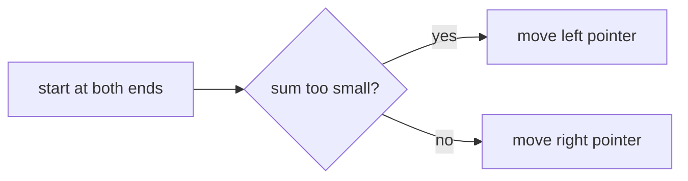

# Basics

A tiny foundations page for the tests: two sections, a subsection and one diagram.

## Hashing

A dictionary answers "have I seen this value?" in O(1) on average.

### Sets and maps

Use a set for membership and a dict when you also need a value, such as an index.

## Two pointers

Two indices that move towards each other, or a slow and a fast pointer.

