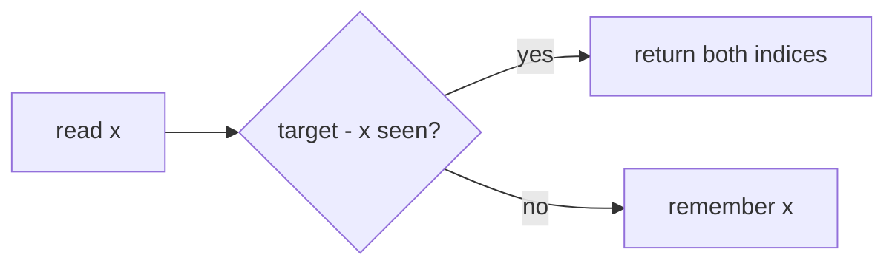

## The idea

Keep each value's index in a [dictionary](#/algo/learn/basics/hashing) while scanning; the
answer appears when the partner of the current number is already there.

```array
values: 2 7 11 15
pointers: i=1
highlight: 0 1
caption: 9 - 7 = 2 was seen at index 0
```



The fixture's reference is the explanation the review shows.
